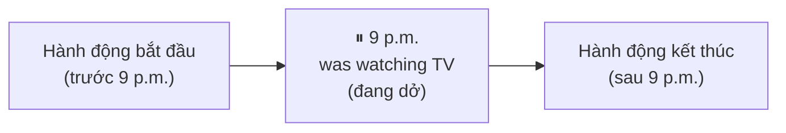

# A2-G001 · Past Continuous — Thì quá khứ tiếp diễn

## Mục lục

- [A. Lesson Information](#a-lesson-information)
- [B. Warm-up](#b-warm-up-tình-huống-thực-tế)
- [C. WHAT](#c-what-quá-khứ-tiếp-diễn-là-gì)
- [D. WHY](#d-why-video-tua-lại-quá-khứ)
- [E. FORM](#e-form-công-thức)
- [F. HOW](#f-how-các-cách-dùng)
- [G. VISUAL](#g-visual-explanation)
- [H. COMPARISON](#h-comparison)
- [I. COMMON MISTAKES](#i-common-mistakes)
- [J. MEMORY TRICKS](#j-memory-tricks)
- [K. REAL-LIFE APPLICATION](#k-real-life-application)
- [L. PRACTICE EXERCISES](#l-practice-exercises)
- [M. KNOWLEDGE CHECK](#m-knowledge-check)
- [N. ANSWER KEY](#n-answer-key)

---

## A. Lesson Information

| Mục | Nội dung |
|---|---|
| **Lesson ID** | A2-G001 |
| **Topic** | Past Continuous |
| **Tên tiếng Việt** | Thì quá khứ tiếp diễn |
| **CEFR Level** | A2 |
| **Prerequisites** | [A1-G004 — Present Continuous](../../02-A1-BEGINNER/grammar/A1-G004-present-continuous.md), [A1-G016 — was/were](../../02-A1-BEGINNER/grammar/A1-G016-past-simple-be.md), [A1-G018](../../02-A1-BEGINNER/grammar/A1-G018-past-simple-negatives-questions.md) |
| **Estimated Time** | 90 phút |

**Learning Objectives:**

1. Tạo câu với **was/were + V-ing** ở thể khẳng định, phủ định, nghi vấn.
2. Dùng quá khứ tiếp diễn cho hành động **đang diễn ra tại một thời điểm cụ thể** trong quá khứ.
3. Dùng quá khứ tiếp diễn để **tả bối cảnh** (background) khi kể chuyện.
4. Diễn tả **hai hành động diễn ra song song** trong quá khứ với *while*.
5. Tránh dùng tiếp diễn với nghĩa trạng thái thông thường; nhận ra một động từ có thể đổi nghĩa theo ngữ cảnh.

---

## B. Warm-up: Tình huống thực tế

Cảnh sát hỏi bạn về một vụ trộm xảy ra lúc 9 giờ tối qua:

> **Police:** *What were you doing at 9 p.m. last night?*

Bạn muốn trả lời: "Lúc 9 giờ tối qua, tôi **đang xem** TV với vợ tôi. Con gái tôi **đang làm** bài tập trong phòng."

🤔 **Hãy suy nghĩ:** Bạn không nói "tôi xem TV" (một hành động đã xong), mà "tôi **đang** xem" — tức là lúc 9 giờ, việc xem TV **đã bắt đầu nhưng chưa kết thúc**. Bạn đã biết *am/is/are + V-ing* diễn tả "đang" ở hiện tại. Bạn đoán quá khứ sẽ thay đổi phần nào?

---

## C. WHAT: Quá khứ tiếp diễn là gì?

**Thì quá khứ tiếp diễn (Past Continuous)** diễn tả một hành động **đang diễn ra (chưa kết thúc) tại một thời điểm** hoặc **trong một khoảng thời gian** trong quá khứ.

| Cách dùng | Ví dụ |
|---|---|
| Đang diễn ra tại một thời điểm cụ thể trong quá khứ | *At 9 p.m. yesterday, I **was watching** TV.* |
| Tả bối cảnh trong câu chuyện | *It **was raining** and people **were hurrying** home.* |
| Hai hành động song song | ***While** I **was cooking**, my husband **was cleaning**.* |
| Hành động bị cắt ngang bởi một hành động khác | *I **was having** dinner when the phone **rang**.* → học kỹ ở [A2-G002](A2-G002-past-simple-vs-past-continuous.md) |

**Khi nào KHÔNG dùng?**
- Kể sự việc như một tổng thể trong quá khứ, không nhấn đang diễn ra → thường dùng quá khứ đơn: *I **watched** a film last night.*
- Nghĩa trạng thái thông thường (*know, like, want, believe...*) thường dùng quá khứ đơn: *I **knew** the answer* (không phải ~~I was knowing~~).

---

## D. WHY: "Video tua lại quá khứ"

Ở A1, bạn học hiện tại tiếp diễn = **video quay trực tiếp** lúc này. Quá khứ tiếp diễn = **tua video về quá khứ và nhấn "pause" ở một khoảnh khắc** — trong khung hình đó, hành động **đang chạy dở**.



Mỗi phần của công thức có ý nghĩa:
- **was/were** → thời gian **quá khứ**.
- **V-ing** → **đang diễn ra, chưa xong**.

---

## E. FORM: Công thức

**Ký hiệu:** **S** = chủ ngữ · **V-ing** = động từ thêm *-ing* (quy tắc chính tả: [A1-G004](../../02-A1-BEGINNER/grammar/A1-G004-present-continuous.md#e2-chính-tả-v-ing-mở-rộng-từ-a0-g019)).

| | I / he / she / it | you / we / they |
|---|---|---|
| ➕ | S + **was** + V-ing | S + **were** + V-ing |
| ➖ | S + **wasn't** + V-ing | S + **weren't** + V-ing |
| ❓ | **Was** + S + V-ing? | **Were** + S + V-ing? |
| 💬 | Yes, S was. / No, S wasn't. | Yes, S were. / No, S weren't. |
| Wh- | *What **was** she **doing**?* | *Where **were** they **going**?* |

Thì này dùng **was/were** để hỏi/phủ định — không thêm *did* vào mẫu *was/were + V-ing*. Một câu có thời gian cụ thể không tự bắt buộc tiếp diễn: hãy xác định người nói đang tả việc dở tại mốc đó hay kể sự việc xảy ra. Tiếp diễn cũng không khẳng định hành động còn tiếp tục đến hiện tại.

### Cụm thời gian thường gặp

| Mẫu | Ví dụ |
|---|---|
| *at* + giờ + thời gian quá khứ | *at 8 o'clock last night, at this time yesterday* |
| *all* + khoảng thời gian | *all morning, all day yesterday* |
| *while* + quá khứ tiếp diễn | *while I was waiting* |
| *when* + quá khứ đơn (hành động cắt ngang) | *when the phone rang* |

---

## F. HOW: Các cách dùng

| # | English | Tiếng Việt | Phân tích |
|---|---|---|---|
| 1 | At 7 a.m. yesterday, I **was driving** to work. | 7 giờ sáng qua, tôi đang lái xe đi làm. | I + was + driving; việc lái xe được nhìn ở giữa quá trình lúc 7 giờ, không phải vì thấy giờ là tự chọn tiếp diễn. |
| 2 | What **were you doing** at midnight? — I **was sleeping**. | Nửa đêm bạn đang làm gì? — Tôi đang ngủ. | Were đảo trước you để hỏi; khi trả lời đổi chủ ngữ I nên dùng was. |
| 3 | This time last year, we **were living** in Japan. | Giờ này năm ngoái chúng tôi đang sống ở Nhật. | We + were + living; nhấn hoàn cảnh tạm thời tại giai đoạn đó, không cho biết hiện giờ còn ở Nhật hay không. |
| 4 | It **was** a cold evening. Snow **was falling** and the wind **was blowing**. | Đó là tối lạnh; tuyết đang rơi và gió đang thổi. | Was ở câu đầu là be + tính từ; was falling/was blowing là tiếp diễn mô tả hai quá trình làm nền. |
| 5 | The sun **was shining** and children **were playing** in the park. | Mặt trời đang chiếu sáng, bọn trẻ đang chơi. | Sun số ít dùng was; children số nhiều dùng were; hai hoạt động cùng tạo bối cảnh. |
| 6 | While I **was cooking**, my husband **was setting** the table. | Trong khi tôi đang nấu, chồng đang bày bàn. | Hai quá trình được nhìn đang diễn ra đồng thời; set → setting; while nối khoảng thời gian chồng lấn. |
| 7 | She **was listening** to music while she **was studying**. | Cô ấy vừa nghe nhạc vừa học. | Hai cụm was + V-ing dùng cùng she; không cần suy ra chúng bắt đầu/kết thúc đúng cùng giây. |
| 8 | I **was having** a shower when the doorbell **rang**. | Tôi đang tắm thì chuông cửa reo. | Was having là nền đang diễn ra; rang là sự kiện trong nền đó. Câu không khẳng định người nói đã dừng tắm. |
| 9 | Sorry, I **wasn't listening**. Can you repeat that? | Xin lỗi, lúc đó tôi không nghe. Bạn nhắc lại được không? | Not đặt sau was; listening vẫn V-ing; lời xin nhắc lại xuất phát từ việc không theo dõi trước đó. |
| 10 | **Were you sleeping** when I called? — Yes, I **was**. | Bạn đang ngủ lúc tôi gọi à? — Có. | Hỏi bằng were theo you; trả lời was theo I, có thể lược sleeping vì đã rõ. |
| 11 | Why **was she crying**? | Vì sao lúc đó cô ấy đang khóc? | Why + was + she + crying; hỏi lý do của hành động đang diễn ra, không thêm did. |
| 12 | They **weren't working**; they **were chatting**. | Họ không đang làm việc; họ đang tán gẫu. | Weren't phủ định hoạt động thứ nhất, were khẳng định hoạt động thực sự; hai động từ đều -ing. |

---

## G. VISUAL EXPLANATION

### G1. Timeline

```text
Quá khứ ─────[~~~~~~~ was watching TV ~~~~~~~]──────────── NOW ──►
                          ↑
                       9 p.m.
             (hành động đang diễn ra tại thời điểm này)
```

### G2. Song song với *while*

```text
I      ──[~~~~~~ was cooking ~~~~~~]──
Husband──[~~~ was setting the table ~~]──
          (cùng lúc, cùng kéo dài)
```

### G3. Bảng biến đổi

| Present Continuous | Past Continuous |
|---|---|
| I **am** work**ing**. | I **was** work**ing**. |
| She **is** sleep**ing**. | She **was** sleep**ing**. |
| They **are** play**ing**. | They **were** play**ing**. |
| **Are** you listen**ing**? | **Were** you listen**ing**? |

---

## H. COMPARISON

### Quá khứ đơn và quá khứ tiếp diễn (giới thiệu — so sánh đầy đủ ở [A2-G002](A2-G002-past-simple-vs-past-continuous.md))

| Past Simple | Past Continuous |
|---|---|
| Hành động **hoàn tất** | Hành động **đang diễn ra** |
| *I **read** a book last night.* (kể việc đọc; câu này không luôn đảm bảo đọc hết cuốn) | *At 10 p.m., I **was reading** a book.* (lúc 10h đang đọc dở) |
| *It **rained** yesterday.* (sự việc) | *It **was raining** when I left.* (bối cảnh) |

### Động từ trạng thái

Các sửa dưới đây chọn nghĩa trạng thái thông thường. Một số từ có nghĩa hành động có thể dùng tiếp diễn, như *have dinner*. *Was wanting* cũng gặp trong một số văn phong/ngữ cảnh; bài này luyện mẫu trung tính *wanted*, không tuyên bố mọi cách dùng đó đều sai.

| ❌ | ✅ |
|---|---|
| *I **was knowing** her.* | *I **knew** her.* |
| *She **was wanting** a drink.* | *She **wanted** a drink.* |
| *We **were having** a car.* (sở hữu) | *We **had** a car.* |
| | *We **were having** dinner.* ✅ (*have* = ăn — hành động) |

---

## I. COMMON MISTAKES

| # | ❌ Sai | ✅ Đúng | Nguyên nhân | Cách tránh |
|---|---|---|---|---|
| 1 | At 9 p.m. I **watching** TV. | At 9 p.m. I **was watching** TV. | Quên *was/were* | Hai thành phần: *was/were* + V-ing |
| 2 | They **was** playing. | They **were** playing. | Chia sai *be* | *they* → *were* |
| 3 | **Did** you **sleeping**? | **Were** you sleeping? | Trộn *did* | Gia đình *be* |
| 4 | I **was knowing** the answer. | I **knew** the answer. | Know ở nghĩa biết là trạng thái | Dùng knew cho nghĩa này |
| 5 | They **was going** to the gym at six. | They **were going** to the gym at six. | Sai hòa hợp | They dùng were. Với thói quen thường dùng went; was going vẫn có thể diễn tả thói quen tạm thời, không tự sai. |
| 6 | Yesterday I **was writing** three emails. (ý: đã viết xong 3 email) | Yesterday I **wrote** three emails. | Có số lượng hoàn tất | Kết quả cụ thể → quá khứ đơn |
| 7 | While I **was cook**, he was cleaning. | While I **was cooking**, he was cleaning. | Thiếu -ing | Was + V-ing. While I cooked có thể đúng; while không tự bắt buộc tiếp diễn. |

---

## J. MEMORY TRICKS

1. **"Tua – Dừng – Nhìn"**: Tua về quá khứ, dừng ở một thời điểm, nhìn xem ai **đang** làm gì → quá khứ tiếp diễn.
2. **"Was/were + ing = đang (hồi đó)"**: Tiếng Việt "lúc đó đang..." ⇄ tiếng Anh *was/were + V-ing*.
3. **"Bối cảnh tiếp diễn, sự kiện đơn"**: Trong truyện, phần **tả cảnh** thường là tiếp diễn, phần **hành động chính** là quá khứ đơn. (Mẹo kể chuyện — sẽ hoàn thiện ở [B1-G004 Narrative Tenses](../../04-B1-INTERMEDIATE/grammar/B1-G004-narrative-tenses.md).)

---

## K. REAL-LIFE APPLICATION

### Bài đọc: The power cut

> *Last Friday evening, there was a power cut in my building. At that moment, everyone **was doing** something different. I **was cooking** dinner in the kitchen. My husband **was watching** a football match on TV — and Vietnam **was winning**! Our son **said he was doing** his homework on the computer, and our daughter **was talking** to her friend on the phone. Suddenly, everything went dark. For a few seconds, nobody said anything. Then my husband shouted, "No! The match!" Luckily, my son **wasn't using** the computer for anything important — he **was playing** a game, not doing homework!*

**Vietnamese explanation:** Tối thứ Sáu, tòa nhà mất điện. Lúc đó mỗi người đang làm một việc: "tôi" đang nấu ăn, chồng đang xem bóng đá (Việt Nam đang thắng), con trai nói mình đang "làm bài tập" trên máy tính, con gái đang nói chuyện điện thoại. Bỗng tất cả tối om. Chồng hét lên "Không! Trận đấu!" May mà con trai không dùng máy tính cho việc gì quan trọng — cậu ấy đang chơi game chứ không làm bài tập!

**Grammar highlights:** quá khứ tiếp diễn tả những gì **đang diễn ra** lúc mất điện (*was cooking, was watching, was winning, was doing, was talking, wasn't using, was playing*); quá khứ đơn cho **sự kiện chính** (*there was a power cut, went dark, said, shouted*).

*Said he was doing* = nói rằng mình đang làm; đây là cụm để hiểu câu chuyện, chưa yêu cầu biến đổi lời tường thuật.

**Useful expressions:** *a power cut* (mất điện) · *at that moment* (vào lúc đó) · *Suddenly,...* (Bỗng nhiên) · *Luckily,...* (May mắn thay)

---

## L. PRACTICE EXERCISES

> ✍️ Đáp án: [A2-G001-ANSWERS](../../12-ANSWERS-AND-EXPLANATIONS/A2/A2-G001-ANSWERS.md)

### Level 1 — Recognition

**L1.1.** Chọn quá khứ tiếp diễn đúng: At 8 o'clock last night, we ___ dinner.  A. had  B. were having  C. are having  D. was having
**L1.2.** "What ___ you doing when I called?"  A. did  B. was  C. were  D. are
**L1.3.** Chọn dạng nhấn mạnh đang tắm tại thời điểm chuông reo: While she ___ a shower, her phone rang three times.  A. took  B. was taking  C. is taking  D. takes
**L1.4.** Yesterday, I ___ the answer to the last question.  A. was knowing  B. knew  C. were knowing  D. know
**L1.5.** Câu nào tả **bối cảnh** của một câu chuyện?  A. The thief opened the window.  B. It was raining heavily and the streets were empty.  C. I called the police.
**L1.6.** "Were they working?" — "No, they ___. They were having a break."  A. didn't  B. wasn't  C. weren't  D. aren't

### Level 2 — Controlled Practice

Chia động từ ở quá khứ tiếp diễn.

**L2.1.** At midnight, my neighbours (play) ___ loud music.
**L2.2.** I (not / sleep) ___ when you called. I (read) ___.
**L2.3.** What (you / do) ___ at 3 p.m. yesterday?
**L2.4.** This time last week, we (lie) ___ on a beach in Phu Quoc.
**L2.5.** While my mother (cook) ___, my father (wash) ___ the car.
**L2.6.** (it / rain) ___ when you left the office?

Dựa vào lịch của Minh hôm qua, viết câu trả lời: *What was Minh doing at...?*

| 7:00 – 8:00 | 9:00 – 11:30 | 12:00 – 13:00 | 14:00 – 17:00 |
|---|---|---|---|
| have breakfast | attend a meeting | eat lunch with colleagues | write a report |

**L2.7.** at 7:30 → ______
**L2.8.** at 10:00 → ______
**L2.9.** at 12:30 → ______
**L2.10.** at 15:00 → ______

### Level 3 — Error Correction

**L3.1.** At 10 p.m. I studying for my exam.
**L3.2.** Did you watching the match when the power went off?
**L3.3.** We was walking home when it started to rain.
**L3.4.** She was know the answer.
**L3.5.** At three yesterday, they was visiting their grandparents.
**L3.6.** While I was cook dinner, my son was playing games.

### Level 4 — Production

Dịch sang tiếng Anh:

**L4.1.** 9 giờ sáng hôm qua, tôi đang họp với khách hàng.
**L4.2.** Lúc bạn gọi, tôi không ngủ — tôi đang xem phim.
**L4.3.** Trong khi chúng tôi đang ăn tối, con mèo ngủ trên ghế sofa.
**L4.4.** Giờ này năm ngoái, bạn đang làm gì?

**L4.5.** **Explain:** Bạn muốn nói hôm qua đã đọc xong ba cuốn sách. Vì sao *Yesterday I was reading three books* chưa thể hiện rõ kết quả đó? Viết lại bằng *finished reading* và giải thích. Câu gốc có thể đúng nếu nói đang đọc xen kẽ ba cuốn chưa xong không?

### Level 5 — Real Communication

**L5.1.** Viết đoạn văn 80–100 từ: *What was everyone doing?* Hãy tưởng tượng (hoặc nhớ lại) một khoảnh khắc đặc biệt (mất điện, có tin vui, động đất nhẹ, pháo hoa giao thừa...). Mô tả những gì mọi người đang làm lúc đó, rồi kết bằng sự việc xảy ra.
**L5.2.** **Speaking — Alibi game:** Một vụ "mất trộm bánh" xảy ra trong văn phòng lúc 3 giờ chiều hôm qua. Hãy nói 1 phút chứng minh bạn vô tội: *At 3 p.m. yesterday, I was... My colleague was... We were...*

---

## M. KNOWLEDGE CHECK

### 5 câu hỏi tự kiểm tra

1. Công thức quá khứ tiếp diễn? Mỗi phần mang nghĩa gì?
2. Kể 3 cách dùng chính.
3. Vì sao không nói *I was knowing*?
4. *While* có bắt buộc luôn đi với tiếp diễn không? Cho một ví dụ đang diễn ra.
5. Viết câu hỏi: "Lúc 8 giờ tối qua họ đang làm gì?"

### Checklist

- [ ] Tôi tạo đúng *was/were + V-ing* ở 3 thể.
- [ ] Tôi mô tả được bối cảnh của một câu chuyện.
- [ ] Tôi phân biệt việc đang diễn ra với kết quả hoàn tất; không suy từ thời lượng, while hoặc số lượng thành quy tắc tuyệt đối.

### 3 lỗi quan trọng cần nhớ

1. ~~I watching~~ → I **was** watching.
2. ~~Did you sleeping~~ → **Were** you sleeping.
3. ~~was knowing~~ → **knew**.

### Lịch ôn tập

| Ngày | Việc cần làm |
|---|---|
| Ngày 1 | Làm lại L2 |
| Ngày 3 | Viết 6 câu: hôm qua lúc 7h, 10h, 12h, 15h, 18h, 21h bạn đang làm gì |
| Ngày 7 | Làm lại L5.1 với một khoảnh khắc khác |

### Liên kết

- ➡️ Bài tiếp theo: [A2-G002 — Past Simple vs Past Continuous](A2-G002-past-simple-vs-past-continuous.md)
- 🔁 Tra cứu: [ALL-TENSES-COMPARISON](../../06-GRAMMAR-REFERENCE/ALL-TENSES-COMPARISON.md)

---

Nguồn đối chiếu: [British Council — Past continuous](https://learnenglish.britishcouncil.org/free-resources/grammar/english-grammar-reference/past-continuous).

## N. ANSWER KEY

👉 [A2-G001-ANSWERS.md](../../12-ANSWERS-AND-EXPLANATIONS/A2/A2-G001-ANSWERS.md)
