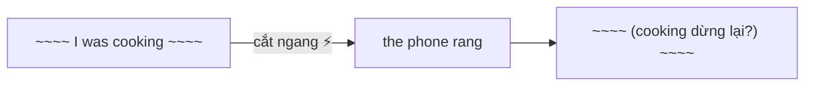
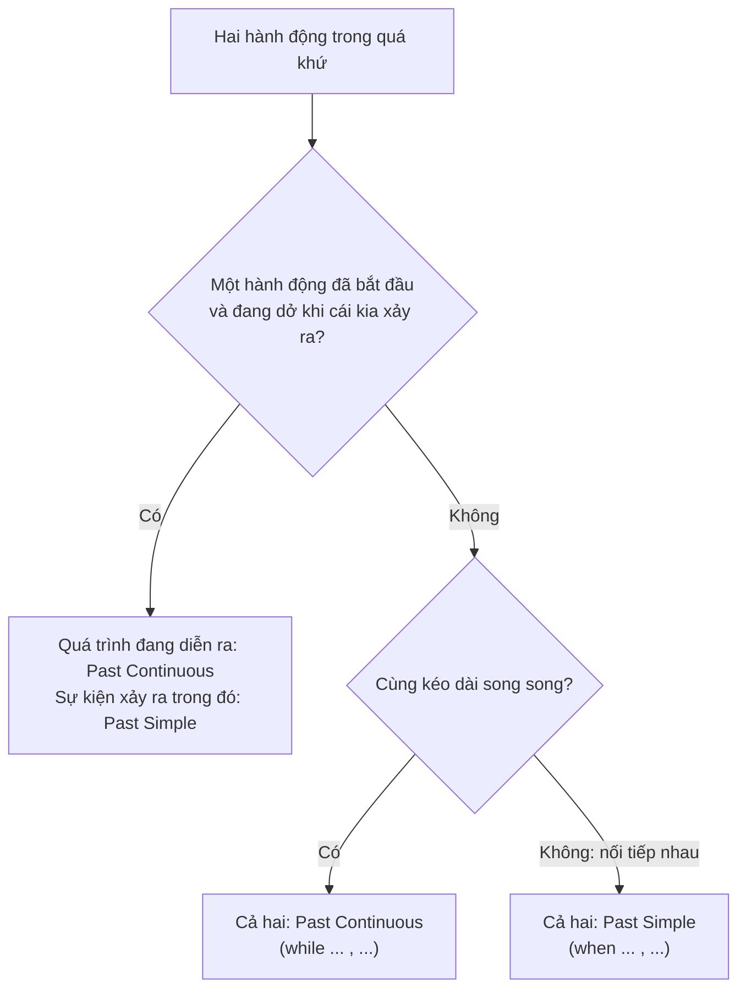

# A2-G002 · Past Simple vs Past Continuous (when / while) — Quá khứ đơn và quá khứ tiếp diễn

## Mục lục

- [A. Lesson Information](#a-lesson-information)
- [B. Warm-up](#b-warm-up-tình-huống-thực-tế)
- [C. WHAT](#c-what-hai-thì-quá-khứ-phối-hợp)
- [D. WHY](#d-why-hành-động-dài-và-hành-động-ngắn)
- [E. FORM](#e-form-năm-mẫu-kết-hợp)
- [F. HOW](#f-how-ví-dụ-phân-tích)
- [G. VISUAL](#g-visual-explanation)
- [H. COMPARISON](#h-comparison-when-và-while)
- [I. COMMON MISTAKES](#i-common-mistakes)
- [J. MEMORY TRICKS](#j-memory-tricks)
- [K. REAL-LIFE APPLICATION](#k-real-life-application)
- [L. PRACTICE EXERCISES](#l-practice-exercises)
- [M. KNOWLEDGE CHECK](#m-knowledge-check)
- [N. ANSWER KEY](#n-answer-key)

---

## A. Lesson Information

| Mục | Nội dung |
|---|---|
| **Lesson ID** | A2-G002 |
| **Topic** | Past Simple vs Past Continuous; *when* and *while* |
| **Tên tiếng Việt** | Phối hợp quá khứ đơn và quá khứ tiếp diễn |
| **CEFR Level** | A2 |
| **Prerequisites** | [A2-G001 — Past Continuous](A2-G001-past-continuous.md), [A1-G017](../../02-A1-BEGINNER/grammar/A1-G017-past-simple-affirmative.md) |
| **Estimated Time** | 90 phút |

**Learning Objectives:**

1. Phân biệt cách nhìn **đang diễn ra tại mốc quá khứ** với cách kể **sự việc như một tổng thể**; không chọn thì chỉ theo dài/ngắn.
2. Dùng mẫu **hành động bị cắt ngang**: *I was cooking when the phone rang.*
3. Dùng mẫu **chuỗi hành động nối tiếp**: *When the phone rang, I answered it.*
4. Phân biệt *when* và *while*, đặt dấu phẩy đúng.
5. Chọn thì chính xác trong một đoạn kể chuyện có nhiều sự việc.

---

## B. Warm-up: Tình huống thực tế

So sánh hai câu:

> 1. *When the teacher **came** in, the students **were talking**.*
> 2. *When the teacher **came** in, the students **stopped** talking.*

🤔 **Hãy suy nghĩ:** Trong câu 1, học sinh bắt đầu nói chuyện **trước hay sau** khi cô giáo vào? Còn câu 2 thì sao? Chỉ khác một chút về thì, nhưng thứ tự sự việc thay đổi hoàn toàn!

---

## C. WHAT: Hai thì quá khứ phối hợp

| | Past Continuous | Past Simple |
|---|---|---|
| Vai trò thường gặp | Quá trình đang diễn ra, thường làm nền | Sự việc được kể như một tổng thể, thường đẩy chuyện tiến lên |
| Câu hỏi tự đặt | "Lúc đó đang làm gì?" | "Sau đó chuyện gì xảy ra?" |
| Ví dụ | *I **was walking** home...* | *...when I **saw** an accident.* |

Khi kể chuyện, hai thì này **thường phối hợp**, nhưng không bắt buộc luôn có cả hai. Một đoạn chỉ kể chuỗi sự việc có thể dùng toàn quá khứ đơn. Một hành động dài vẫn dùng đơn: *We lived there for ten years*. Một hành động ngắn vẫn có thể được nhìn đang diễn ra: *The train was stopping*.

---

## D. WHY: Hành động dài và hành động ngắn

Hãy tưởng tượng bạn đang xem một bộ phim:

- **Quá khứ tiếp diễn** = **cảnh nền đang chạy** (mưa đang rơi, nhân vật đang đi bộ).
- **Quá khứ đơn** thường kể sự việc theo tiến trình câu chuyện; không nhất thiết đột ngột hoặc ngắn.

“Cắt ngang” trong bài chỉ việc một sự kiện xảy ra giữa lúc một quá trình đang diễn ra; nó không tự chứng minh quá trình đó bị dừng. Người nói có thể vẫn tiếp tục nấu sau tiếng chuông.



Điều quan trọng là **thứ tự thời gian**:

| Câu | Thứ tự |
|---|---|
| *When she arrived, we **were having** dinner.* | Ăn tối **đã bắt đầu trước**, cô ấy đến **giữa chừng**. |
| *When she arrived, we **had** dinner.* | Cô ấy đến **trước**, **sau đó** mọi người mới ăn tối. |

---

## E. FORM: Năm mẫu kết hợp

| # | Mẫu | Ý nghĩa | Ví dụ |
|---|---|---|---|
| 1 | **Past Continuous + when + Past Simple** | Hành động dài bị cắt ngang | *I **was sleeping** when the alarm **went off**.* |
| 2 | **When + Past Simple, Past Continuous** | (cùng nghĩa với mẫu 1, đảo vế) | *When the alarm **went off**, I **was sleeping**.* |
| 3 | **While + Past Continuous, Past Simple** | Trong lúc đang..., thì... | ***While** I **was sleeping**, the alarm **went off**.* |
| 4 | **While + Past Continuous, Past Continuous** | Hai hành động song song | ***While** I **was sleeping**, my roommate **was studying**.* |
| 5 | **When + Past Simple, Past Simple** | Chuỗi nối tiếp thường gặp trong ngữ cảnh này | ***When** the alarm **went off**, I **got** up.* |

**Dấu phẩy:** Khi mệnh đề *when/while* đứng **đầu câu** → có dấu phẩy. Khi đứng **giữa câu** → thường không cần.

- ***When** the phone rang**,** I was cooking.*
- *I was cooking **when** the phone rang.*

**Công thức mỗi thì:** quá khứ tiếp diễn S + was/were + V-ing; phủ định was/were not; hỏi Was/Were + S + V-ing? Quá khứ đơn với động từ thường S + V2; phủ định S + did not + V; hỏi Did + S + V? Ví dụ: *Were you cooking when I called? — Yes, I was.* Với be quá khứ dùng was/were trực tiếp, không thêm did.

**Ký hiệu:** **Mệnh đề** (clause) = nhóm từ có chủ ngữ + động từ. *When/while* mở đầu **mệnh đề phụ** chỉ thời gian.

---

## F. HOW: Ví dụ phân tích

| # | English | Tiếng Việt | Phân tích |
|---|---|---|---|
| 1 | *I **was walking** to work when I **met** an old friend.* | Tôi đang đi bộ đi làm thì gặp một người bạn cũ. | Was walking nhìn hành động ở giữa quá trình; met nêu cuộc gặp xảy ra trong lúc đó. Không suy rằng người nói dừng đi bộ. |
| 2 | *While she **was shopping**, someone **stole** her bag.* | Trong lúc cô ấy đang mua sắm, ai đó đã lấy cắp túi của cô. | While mở khoảng đang mua sắm; was shopping là nền, stole là sự kiện mất túi; stole là quá khứ steal. |
| 3 | *We **were watching** TV when the lights **went** out.* | Chúng tôi đang xem TV thì mất điện. | We dùng were watching; went out là cụm mất/tắt điện ở quá khứ. Việc mất điện xảy ra giữa lúc xem TV. |
| 4 | *When the lights **went** out, we **lit** some candles.* | Khi mất điện, chúng tôi thắp nến. | Went out rồi lit: hai sự kiện được kể nối tiếp; lit là quá khứ light nghĩa thắp. |
| 5 | *While I **was cooking**, my husband **was helping** the kids with homework.* | Trong khi tôi nấu ăn, chồng tôi giúp con làm bài. | I was cooking và my husband was helping cùng được nhìn đang diễn ra; không biết chúng có cùng lúc kết thúc hay không. |
| 6 | *He **broke** his leg while he **was skiing**.* | Anh ấy gãy chân khi đang trượt tuyết. | Broke nêu sự cố; was skiing là hoạt động đang diễn ra. Đặt while cuối câu thường không có dấu phẩy. |
| 7 | *When I **got** to the station, the train **was leaving**.* | Khi tôi đến ga, tàu đang rời đi. | Got nêu mốc đến ga; was leaving nhìn tàu đang trong quá trình rời ga, không chỉ dự định tương lai. |
| 8 | *When I **got** to the station, the train **left**.* | Khi tôi đến ga, tàu rời đi (ngay sau đó). | Got và left kể hai sự kiện gần nhau; trong ngữ cảnh này thường hiểu người kể đến rồi tàu rời ga. |
| 9 | *What **were** you **doing** when the earthquake **happened**?* | Bạn đang làm gì khi động đất xảy ra? | What + were + you + doing hỏi bối cảnh; happened là sự kiện quá khứ. Không thêm did vào were doing. |
| 10 | *I **wasn't paying** attention when the teacher **explained** the homework.* | Tôi không chú ý khi cô giáo giải thích bài tập. | Was not paying attention phủ định việc chú ý; explained trình bày phần giải thích như một sự việc, dù việc giải thích có thể kéo dài. |
| 11 | *It **was snowing** when we **arrived** in Sapa.* | Khi chúng tôi đến Sa Pa, tuyết đang rơi. | Was snowing là bối cảnh đang diễn ra khi arrived; đây là tình huống kể giả định, không khẳng định thời tiết Sa Pa luôn có tuyết. |
| 12 | *She **was smiling** when she **opened** the letter, but she **started** to cry when she **read** it.* | Cô ấy đang mỉm cười khi mở thư, nhưng bắt đầu khóc khi đọc nó. | Was smiling là trạng thái hành động lúc mở thư; opened, started, read kể các sự việc tiếp theo; liên kết thời gian rõ từ ngữ cảnh. |

---

## G. VISUAL EXPLANATION

### G1. Timeline — bị cắt ngang

```text
           ┌─────── was cooking ───────┐
──────────[~~~~~~~~~~~~~~~~~~~~~~~~~~~~~]───────────── NOW ──►
                     ✕
                the phone rang
```

### G2. Timeline — chuỗi nối tiếp

```text
──────────── ✕ ────── ✕ ────── ✕ ──────────────── NOW ──►
         phone rang  answered  talked
     "When the phone rang, I answered it and talked to my mum."
```

### G3. Sơ đồ quyết định



---

## H. COMPARISON: *when* và *while*

| | *when* | *while* |
|---|---|---|
| Vai trò trong các mẫu đang luyện | Định vị thời điểm/sự kiện; có thể đi với thì đơn hoặc tiếp diễn | Nêu khoảng thời gian chồng lấn; thường có quá trình đang diễn ra |
| Nghĩa | khi (vào lúc) | trong khi, trong lúc |
| Ví dụ | *I was reading **when** she **called**.* | ***While** I **was reading**, she called.* |

> Không dùng when/while như máy chọn thì. *While I lived in Hanoi, I walked to work* có quá khứ đơn hợp lệ; *When I was walking home, I saw Mai* dùng when với tiếp diễn hợp lệ. Chọn theo ý nghĩa và ngữ cảnh; hai liên từ đôi khi đều dùng được.

### *When I was a child* và *while I was a child*

*When I was a child* (hồi nhỏ) là cách nói tự nhiên, phổ biến. *While I was a child* ít dùng hơn nhiều.

---

## I. COMMON MISTAKES

| Câu cần sửa | Câu đúng | Nguyên nhân và cách tránh |
|---|---|---|
| I was cook when the phone rang. | I was cooking when the phone rang. | Was + V-ing, không nguyên mẫu. |
| While we were walking, we seed an accident. | While we were walking, we saw an accident. | See có quá khứ saw, không thêm -ed. |
| When I arrived, the film was started. (ý: phim bắt đầu, không nói ai chiếu phim) | When I arrived, the film started. | Kể sự kiện bắt đầu dùng started; was started chuyển thành bị động, khác ý. |
| Did you watching when it happened? | Were you watching when it happened? | Câu hỏi tiếp diễn đảo were, không dùng did + V-ing. |
| She was meeting her husband for the first time yesterday. (đề muốn kể cuộc gặp lần đầu đã xảy ra như một sự kiện trọn vẹn) | She met her husband for the first time yesterday. | Sửa cho đúng ý đề, không tuyên bố was meeting luôn sai: nó có thể tả cuộc gặp đang diễn ra hoặc lịch hẹn. |
| When the phone rang I was cooking. | When the phone rang, I was cooking. | Mệnh đề thời gian đầu câu thường có dấu phẩy để rõ ranh giới. |

*While the phone rang* có thể nói khoảng chuông reo kéo dài; không được gắn nhãn sai chỉ vì ring bị coi là “động từ ngắn”. *While the phone was ringing* nhấn quá trình; *when the phone rang* thường định vị sự kiện tiếng chuông. Chọn theo ý đang kể.

---

## J. MEMORY TRICKS

1. **Khung cảnh và sự kiện:** hỏi “ở mốc đó đang làm gì?” trước khi chia thì; không đo độ dài bằng số phút.
2. **Đọc hết ngữ cảnh:** when và while báo quan hệ thời gian, không tự bắt buộc một thì duy nhất.
3. **Kiểm kết quả muốn kể:** “đã xảy ra rồi sau đó...” thường dùng đơn; “đang dở khi...” thường dùng tiếp diễn cho quá trình nền. Hai quá trình song song có thể được nhấn bằng hai tiếp diễn.

---

## K. REAL-LIFE APPLICATION

### Bài đọc: An embarrassing moment

> *Last month, I **was giving** a presentation to my company's directors. Everything **was going** well. I **was explaining** our sales figures when my phone suddenly **started** to ring — loudly! My ringtone was a funny cartoon song. Everyone **looked** at me. While I **was trying** to turn it off, I **dropped** my notes on the floor. When I **picked** them up, they **were** all in the wrong order. Some directors **were laughing**, and my boss **was shaking** his head. I **took** a deep breath, **smiled** and **said**, "Well, now you know my favourite cartoon!" After that, everyone **relaxed**, and the rest of the presentation **went** very well.*

**Vietnamese explanation:** Tháng trước, "tôi" đang thuyết trình trước ban giám đốc. Mọi thứ đang suôn sẻ thì điện thoại reo — nhạc chuông là bài hát hoạt hình! Trong lúc cố tắt, tôi làm rơi giấy ghi chú; nhặt lên thì lộn xộn hết. Vài giám đốc đang cười, sếp đang lắc đầu. Tôi hít sâu, mỉm cười, nói đùa — sau đó mọi người thoải mái và phần còn lại diễn ra tốt.

**Grammar highlights:**

| Bối cảnh / hành động dài (Past Continuous) | Sự kiện / hành động ngắn (Past Simple) |
|---|---|
| was giving, was going, was explaining, was trying, were laughing, was shaking | started, looked, dropped, picked, took, smiled, said, relaxed, went |

**Useful expressions:** *Everything was going well* · *suddenly* · *took a deep breath* (hít một hơi sâu) · *the rest of...* (phần còn lại của...)

---

## L. PRACTICE EXERCISES

> ✍️ Đáp án: [A2-G002-ANSWERS](../../12-ANSWERS-AND-EXPLANATIONS/A2/A2-G002-ANSWERS.md)

### Level 1 — Recognition

**L1.1.** Chọn mẫu nhấn việc tắm đang dở và tiếng chuông như một sự kiện: I ___ a bath when the doorbell ___.  A. had / was ringing  B. was having / rang  C. was having / was ringing  D. had / rang
**L1.2.** Chọn TẤT CẢ cách mở đầu giữ nghĩa cuộc gặp xảy ra trong lúc đang chờ: ___ I was waiting for the bus, I met my old teacher. A. When B. While C. During D. After
**L1.3.** Khán giả đợi phim kết thúc rồi mới vỗ tay; chọn câu kể chuỗi sự kiện: When the film ended, everyone ___.  A. was clapping  B. clapped  C. clap  D. were clapping
**L1.4.** "When she arrived, we were having dinner." — Chúng tôi bắt đầu ăn tối khi nào?  A. trước khi cô ấy đến  B. sau khi cô ấy đến  C. đúng lúc cô ấy đến
**L1.5.** Chọn dạng nhấn cả hai quá trình đang diễn ra song song: While my mum ___ the house, my dad ___ in the garden.  A. cleaned / was working  B. was cleaning / was working  C. was cleaning / worked  D. is cleaning / is working
**L1.6.** Chọn dạng kể mất ví như một sự kiện trong nền đang chạy bộ: He ___ his wallet while he ___ in the park.  A. lost / was jogging  B. was losing / jogged  C. lost / jogged  D. was losing / was jogging

### Level 2 — Controlled Practice

Chia theo cách nhìn gợi ý; nếu có biến thể đúng, giải thích nghĩa. Không dùng when/while như tín hiệu tuyệt đối.

**L2.1.** (Đang lái thì thấy) I (drive) ___ to work when I (see) ___ the accident.
**L2.2.** (Khi đến, mọi người đã đang nhảy) When we (arrive) ___ at the party, everyone (dance) ___.
**L2.3.** (Chuông reo rồi tôi nhảy khỏi giường) When the alarm (go off) ___, I (jump) ___ out of bed.
**L2.4.** (Đang làm thì mưa bắt đầu) While I (work) ___ in the garden, it (start) ___ to rain.
**L2.5.** (Đang chơi thì một em ngã, bị đau) The children (play) ___ football when one of them (fall) ___ and (hurt) ___ his knee.
**L2.6.** (Hỏi lúc đó đang làm gì) What (you / do) ___ when I (call) ___ you last night?
**L2.7.** While my sister (sleep) ___, I (read) ___ a book. (song song)
**L2.8.** (Lúc hướng dẫn, cô ấy không đang nghe) She (not / listen) ___ when the teacher (give) ___ the instructions.

Nối hai câu bằng *when* hoặc *while* (giữ nghĩa):

**L2.9.** I was crossing the road. A motorbike almost hit me.
**L2.10.** The guests arrived. We were still cleaning the house.

### Level 3 — Error Correction

**L3.1.** I was cook dinner when my friend called me.
**L3.2.** While the phone was ringing, I were taking a shower.
**L3.3.** When I openned the door, I saw a stranger.
**L3.4.** She meeted her husband when she was studying in Australia. (lần đầu gặp nhau)
**L3.5.** While we was walking in the park, it started to rain.
**L3.6.** When the teacher came in the students were talking loudly. (dấu câu)

### Level 4 — Production

Dịch sang tiếng Anh:

**L4.1.** Tôi đang ngủ thì điện thoại reo.
**L4.2.** Khi điện thoại reo, tôi trả lời ngay. (*immediately*)
**L4.3.** Trong lúc chúng tôi đang chờ xe buýt, trời bắt đầu mưa.
**L4.4.** Bạn đang làm gì khi mất điện? (*the power went off*)

**L4.5.** **Explain:** Giải thích sự khác nhau về nghĩa giữa hai câu sau (2–3 câu tiếng Việt):
*(a) When I got home, my wife was cooking dinner.*
*(b) When I got home, my wife cooked dinner.*

### Level 5 — Real Communication

**L5.1.** Viết câu chuyện 100–120 từ: *An unexpected moment*. Bắt đầu bằng bối cảnh (thời tiết, mọi người đang làm gì), sau đó kể sự việc bất ngờ và những gì xảy ra tiếp theo. Dùng ít nhất 2 câu với *when* và 2 câu với *while*.
**L5.2.** **Speaking — Where were you when...?** Nói 1–2 phút về một sự kiện bạn nhớ rõ (một trận bóng quan trọng, một tin vui/tin buồn, đêm giao thừa...): *I was... when I heard the news. While I was..., ...*

---

## M. KNOWLEDGE CHECK

### 5 câu hỏi tự kiểm tra

1. Hành động nào dùng tiếp diễn, hành động nào dùng quá khứ đơn khi một việc cắt ngang việc khác?
2. *When she arrived, we were eating* và *When she arrived, we ate* khác nhau thế nào?
3. *while* thường đi với thì nào? Vì sao?
4. Khi nào cần dấu phẩy với *when/while*?
5. Viết một câu có hai hành động song song.

### Checklist

- [ ] Tôi phân biệt quá trình đang diễn ra và sự việc nhìn như một tổng thể.
- [ ] Tôi dùng *when/while* đúng.
- [ ] Tôi kể được một câu chuyện ngắn có bối cảnh và sự việc.

### 3 lỗi quan trọng cần nhớ

1. Không chọn thì chỉ theo dài/ngắn; nhìn vai trò và ý định kể.
2. Không coi when/while là tín hiệu bắt buộc cho một thì.
3. Khi kể chuỗi sự kiện như mẫu bài, dùng quá khứ đơn; với tiếp diễn luôn kiểm was/were + V-ing.

### Lịch ôn tập

| Ngày | Việc cần làm |
|---|---|
| Ngày 1 | Làm lại L2 |
| Ngày 3 | Viết 5 cặp câu đối chiếu như ví dụ 7–8 |
| Ngày 7 | Viết lại L5.1 với một câu chuyện khác |

### Liên kết

- ➡️ Bài tiếp theo: [A2-G003 — Present Perfect: Introduction](A2-G003-present-perfect-form.md)
- 🔜 [B1-G004 — Narrative Tenses](../../04-B1-INTERMEDIATE/grammar/B1-G004-narrative-tenses.md)
- 🎯 **Mini Challenge khối A2-1:** kể một sự cố bất ngờ — xem [A2 README](../README.md#5-mini-challenges)

---

Nguồn đối chiếu: [Cambridge — Past continuous or past simple?](https://dictionary.cambridge.org/grammar/british-grammar/past-simple-or-past-continuous).

## N. ANSWER KEY

👉 [A2-G002-ANSWERS.md](../../12-ANSWERS-AND-EXPLANATIONS/A2/A2-G002-ANSWERS.md)
