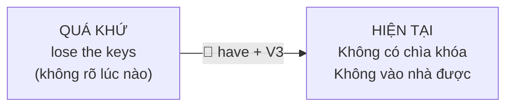

# A2-G003 · Present Perfect: Introduction & Form — Hiện tại hoàn thành: khái niệm và công thức

## Mục lục

- [A. Lesson Information](#a-lesson-information)
- [B. Warm-up](#b-warm-up-tình-huống-thực-tế)
- [C. WHAT](#c-what-hiện-tại-hoàn-thành-là-gì)
- [D. WHY](#d-why-cây-cầu-nối-quá-khứ-với-hiện-tại)
- [E. FORM](#e-form-have--has--v3)
- [F. HOW](#f-how-ví-dụ-phân-tích)
- [G. VISUAL](#g-visual-explanation)
- [H. COMPARISON](#h-comparison)
- [I. COMMON MISTAKES](#i-common-mistakes)
- [J. MEMORY TRICKS](#j-memory-tricks)
- [K. REAL-LIFE APPLICATION](#k-real-life-application)
- [L. PRACTICE EXERCISES](#l-practice-exercises)
- [M. KNOWLEDGE CHECK](#m-knowledge-check)
- [N. ANSWER KEY](#n-answer-key)

---

## A. Lesson Information

| Mục | Nội dung |
|---|---|
| **Lesson ID** | A2-G003 |
| **Topic** | Present Perfect — Introduction, Form and Past Participles |
| **Tên tiếng Việt** | Hiện tại hoàn thành — khái niệm, công thức và quá khứ phân từ (V3) |
| **CEFR Level** | A2 |
| **Prerequisites** | [A1-G017 — Past Simple](../../02-A1-BEGINNER/grammar/A1-G017-past-simple-affirmative.md), [A1-G018](../../02-A1-BEGINNER/grammar/A1-G018-past-simple-negatives-questions.md) |
| **Estimated Time** | 90 phút |

**Learning Objectives:**

1. Hiểu bản chất: hiện tại hoàn thành nói về **quá khứ có liên quan đến hiện tại**, không nhấn mạnh **khi nào**.
2. Tạo câu với **have/has + V3** ở thể khẳng định, phủ định, nghi vấn, trả lời ngắn.
3. Nhận biết **V3** (past participle — quá khứ phân từ) của động từ có quy tắc và 54 động từ bất quy tắc thông dụng.
4. Dùng hiện tại hoàn thành cho **kết quả ở hiện tại** (*I've lost my keys*).
5. Biết bức tranh tổng quan 3 cách dùng sẽ học trong các bài A2-G004 → G007.

---

## B. Warm-up: Tình huống thực tế

Bạn đứng trước cửa nhà, lục túi và nói với người hàng xóm:

> "Ôi không, tôi **làm mất** chìa khóa rồi! Tôi không vào nhà được."

Một người học dịch: *Oh no, I **lost** my keys!* — Câu này không sai. Nhưng người bản ngữ thường nói:

> *Oh no, I'**ve lost** my keys!*

🤔 **Hãy suy nghĩ:** Việc làm mất chìa khóa đã xảy ra **trong quá khứ**. Nhưng điều bạn thật sự muốn nói là gì — **lúc nào** bạn làm mất, hay **tình trạng hiện tại** (không có chìa khóa, không vào nhà được)?

---

## C. WHAT: Hiện tại hoàn thành là gì?

**Thì hiện tại hoàn thành (Present Perfect)** nói về **hành động hoặc trạng thái trong quá khứ nhưng có liên hệ với hiện tại**. Người nói quan tâm đến **ảnh hưởng/kết quả/trải nghiệm ở hiện tại**, không quan tâm (hoặc không nói) **thời điểm chính xác** sự việc xảy ra.

Tiếng Việt dùng "đã", "rồi", "chưa", "từng" nhưng không có một hình thức khớp hoàn toàn với have/has + V3. Các từ ấy cũng có thể dịch bằng quá khứ đơn; hãy nhìn mốc thời gian và ý nghĩa, không dịch từng từ máy móc.

### Ba cách dùng chính (sẽ học lần lượt)

| Cách dùng | Ví dụ | Bài học |
|---|---|---|
| **1. Kết quả ở hiện tại / tin mới** | *I've lost my keys.* (giờ không có chìa) | Bài này + [A2-G005](A2-G005-present-perfect-just-already-yet.md) |
| **2. Trải nghiệm trong đời** (đến nay) | *I've been to Japan twice.* | [A2-G004](A2-G004-present-perfect-experience.md) |
| **3. Kéo dài từ quá khứ đến hiện tại** | *I've lived here for ten years.* (vẫn đang sống) | [A2-G006](A2-G006-present-perfect-since-for.md) |

Và so sánh với quá khứ đơn: [A2-G007](A2-G007-present-perfect-vs-past-simple.md).

---

## D. WHY: Cây cầu nối quá khứ với hiện tại

**Present** cho biết điểm nhìn hiện tại; **Perfect** liên kết một việc/trạng thái trước đó với điểm nhìn này. Tên dịch "hoàn thành" không có nghĩa mọi tình huống đều đã kết thúc: *I have known Lan for years* nói quan hệ biết nhau vẫn kéo dài. Bài này ưu tiên cách dùng kết quả hiện tại trước khi học trải nghiệm và thời gian kéo dài.

- Trợ động từ ***have/has*** ở hiện tại xác lập điểm nhìn đến hiện tại.
- **V3** là hình thức động từ cần trong cấu trúc; nó không tự khẳng định hành động đã kết thúc trong mọi câu.



So sánh:

| Câu | Người nói quan tâm |
|---|---|
| *I **lost** my keys yesterday.* (quá khứ đơn) | **Câu chuyện** ở quá khứ: hôm qua đã mất chìa. Hiện tại? Có thể đã tìm lại. |
| *I'**ve lost** my keys.* (hiện tại hoàn thành) | **Tình trạng bây giờ**: tôi đang không có chìa khóa. |

---

## E. FORM: *have / has + V3*

### E1. Công thức

**Ký hiệu:** **S** = chủ ngữ · **V3** = past participle (quá khứ phân từ) — cột thứ 3 trong bảng động từ.

| | I / you / we / they | he / she / it |
|---|---|---|
| ➕ | S + **have** + V3 → *I've* | S + **has** + V3 → *She's* |
| ➖ | S + **haven't** + V3 | S + **hasn't** + V3 |
| ❓ | **Have** + S + V3? | **Has** + S + V3? |
| 💬 | Yes, S **have**. / No, S **haven't**. | Yes, S **has**. / No, S **hasn't**. |
| Wh- | *Where **have** you **been**?* | *What **has** she **done**?* |

> *She's* có thể là *she is* hoặc *she has*. Trong *She's **finished her work***, nó là has; trong *She's **finishing her work***, nó là is. Không chỉ nhìn một từ V3 để kết luận: *The door is closed* có thể là bị động hoặc trạng thái. Đọc cả cấu trúc và nghĩa; bị động học ở G019.

**Have** ở đây là **trợ động từ** (gia đình 1 — tự đảo, tự gắn *not*), **không** có nghĩa "có". Không dùng *do/does*.

### E2. V3 của động từ có quy tắc

V3 = V2 = **V + -ed** (cùng quy tắc chính tả ở [A1-G017](../../02-A1-BEGINNER/grammar/A1-G017-past-simple-affirmative.md)): *work → worked → worked*, *study → studied → studied*, *stop → stopped → stopped*.

### E3. V3 của 54 động từ bất quy tắc thông dụng

**Nhóm 1 — Ba dạng giống cách viết (read đổi cách phát âm):**

| V1 | V2 | V3 | | V1 | V2 | V3 |
|---|---|---|---|---|---|---|
| cut | cut | cut | | put | put | put |
| cost | cost | cost | | read /riːd/ | read /red/ | read /red/ |
| hit | hit | hit | | let | let | let |

**Nhóm 2 — V2 = V3:**

| V1 | V2 = V3 | | V1 | V2 = V3 | | V1 | V2 = V3 |
|---|---|---|---|---|---|---|---|
| buy | bought | | have | had | | pay | paid |
| bring | brought | | hear | heard | | say | said |
| build | built | | keep | kept | | sell | sold |
| catch | caught | | leave | left | | send | sent |
| feel | felt | | lose | lost | | sleep | slept |
| find | found | | make | made | | spend | spent |
| get | got (V2); V3 got/gotten, xem chú thích | | meet | met | | teach | taught |
| | | | | | | tell | told |
| | | | | | | think | thought |
| | | | | | | understand | understood |

**Get là trường hợp riêng:** V2 luôn là got; V3 thường got trong Anh Anh, gotten trong nhiều nghĩa Anh Mỹ. Các cụm sở hữu/nhu cầu như have got/have got to vẫn dùng got, không thay mọi got bằng gotten. Từ get được giữ ở bảng để tiện tra nhưng không luôn thuộc nhóm V2 = V3 trong mọi biến thể.

**Nhóm 3 — V2 khác V3 (come/become có V1 = V3):**

| V1 | V2 | V3 | | V1 | V2 | V3 |
|---|---|---|---|---|---|---|
| be | was/were | **been** | | go | went | **gone** |
| begin | began | **begun** | | know | knew | **known** |
| break | broke | **broken** | | ride | rode | **ridden** |
| choose | chose | **chosen** | | see | saw | **seen** |
| come | came | **come** | | sing | sang | **sung** |
| do | did | **done** | | speak | spoke | **spoken** |
| drink | drank | **drunk** | | swim | swam | **swum** |
| drive | drove | **driven** | | take | took | **taken** |
| eat | ate | **eaten** | | wear | wore | **worn** |
| fall | fell | **fallen** | | write | wrote | **written** |
| forget | forgot | **forgotten** | | give | gave | **given** |
| fly | flew | **flown** | | become | became | **become** |

Danh sách đầy đủ: [GRAMMAR-CHEAT-SHEET](../../06-GRAMMAR-REFERENCE/GRAMMAR-CHEAT-SHEET.md).

---

## F. HOW: Ví dụ phân tích

| # | English | Tiếng Việt | Phân tích |
|---|---|---|---|
| 1 | *I'**ve lost** my keys.* | Tôi làm mất chìa khóa rồi. | I + have + lost (V3 của lose); trong cảnh tìm chìa, câu nhấn kết quả chưa có chìa bây giờ. |
| 2 | *She'**s broken** her arm.* | Cô ấy bị gãy tay rồi. | She + has + broken (break–broke–broken); tin về chấn thương liên quan hiện tại, không tự chứng minh tay đang bó bột nếu câu không nói. |
| 3 | *They'**ve bought** a new car.* | Họ đã mua xe mới. | They + have + bought; bought vừa V2 vừa V3 nhưng have xác định đây là hiện tại hoàn thành; thông báo việc mua xe có liên hệ hiện tại. |
| 4 | *Prices **have gone** up.* | Giá cả đã tăng. | Prices số nhiều dùng have; go up = tăng, gone là V3; người nói so mức giá hiện tại với trước. |
| 5 | *We **haven't finished** the project.* | Chúng tôi chưa làm xong dự án. | We + have not + finished; phủ định cho biết dự án chưa hoàn thành đến lúc nói, không thêm do. |
| 6 | ***Have** you **seen** my phone? — No, I **haven't**.* | Bạn có thấy điện thoại của tôi không? — Không. | Have đảo trước you; seen là V3 của see. No, I haven't giữ trợ động từ, lược seen vì đã rõ; hỏi để tìm điện thoại hiện tại. |
| 7 | ***Has** the post **arrived**? — Yes, it **has**.* | Thư đến chưa? — Đến rồi. | Has đảo trước the post; post ở nghĩa thư tín không đếm được nên số ít; arrived có quy tắc, trả lời it has. |
| 8 | *I'**ve been** to Hanoi three times.* | Tôi đã đến Hà Nội ba lần. | Have been to nói trải nghiệm đến và quay về; three times đếm số lần đến nay, không nêu một thời điểm đã kết thúc. |
| 9 | *He'**s worked** here since 2018.* | Anh ấy làm ở đây từ năm 2018. | He + has + worked; since 2018 nêu mốc bắt đầu của khoảng kéo dài đến nay. Có mốc quá khứ trong since không làm câu sai. |
| 10 | *Look! Someone **has written** on the wall.* | Nhìn kìa! Ai đó đã viết lên tường. | Someone hòa hợp số ít nên has; write–wrote–written; dấu viết trên tường là bằng chứng hiện tại trong tình huống. |
| 11 | *What **have** you **done** to your hair? It looks great!* | Bạn đã làm gì với tóc vậy? Trông đẹp quá! | What + have + you + done; do–did–done. Câu hỏi nối thay đổi trước đó với vẻ ngoài đang thấy, không dùng did have. |
| 12 | *The rain **has stopped**. Let's go out.* | Mưa tạnh rồi. Đi chơi thôi. | The rain số ít dùng has; stopped gấp đôi p theo chính tả stop; kết quả tạnh cho phép kế hoạch đi ra ngoài. |

---

## G. VISUAL EXPLANATION

### G1. Timeline

```text
QUÁ KHỨ ─────── ✕ ? ─────────────────────── NOW ──────►
           (không rõ / không quan trọng       ↑
              lúc nào)  ──────────────────► KẾT QUẢ
                                         "I've lost my keys."
```

### G2. Breakdown

`The children | have | eaten | all the cake!`

| Phần | Vai trò |
|---|---|
| The children | S (số nhiều) → *have* |
| have | Trợ động từ hiện tại → câu nói về **bây giờ** |
| eaten | V3 của *eat* → sự việc đã hoàn tất |
| all the cake | O — kết quả: bánh đã hết! |

---

## H. COMPARISON

### Hiện tại hoàn thành và quá khứ đơn (giới thiệu — đầy đủ ở [A2-G007](A2-G007-present-perfect-vs-past-simple.md))

| Present Perfect | Past Simple |
|---|---|
| Không đặt sự kiện ở một thời gian quá khứ đã kết thúc trong mẫu cơ bản | Có thể nêu hoặc ngầm hiểu khoảng quá khứ đã kết thúc |
| Nhấn mạnh **hiện tại** | Nhấn mạnh **quá khứ** |
| *I'**ve lost** my keys.* | *I **lost** my keys **yesterday**.* |
| ❌ *I've lost my keys yesterday.* | |

> Trong mẫu cơ bản, không dùng hiện tại hoàn thành để định vị sự kiện tại *yesterday, last week, in 2019, two days ago*. Nhưng **since yesterday**, **since 2019** hoặc **today** còn đang tiếp diễn có thể đi với thì này vì khoảng thời gian kéo đến hiện tại. Quá khứ đơn cũng có thể kể việc còn hậu quả hiện tại; không phải cứ có hậu quả bây giờ là bắt buộc dùng hiện tại hoàn thành.

### *have* (có) và *have* (trợ động từ)

| *have* = có (động từ chính) | *have* = trợ động từ |
|---|---|
| *I **have** a car.* | *I **have bought** a car.* |
| *Do you have a car?* | ***Have** you **bought** a car?* |
| *I don't have a car.* | *I **haven't bought** a car.* |

---

## I. COMMON MISTAKES

| # | ❌ Sai | ✅ Đúng | Nguyên nhân | Cách tránh |
|---|---|---|---|---|
| 1 | I **have saw** that film. | I have **seen** that film. | Dùng V2 thay V3 | *have + V3*: *see – saw – **seen*** |
| 2 | She **have** finished. | She **has** finished. | Sai hòa hợp | He/she/it dùng has |
| 3 | **Did** you **have** finished? / **Do** you have finished? | **Have** you finished? | Trộn *do/did* | *have* tự đảo |
| 4 | She has **went** to the shop. | She has **gone** to the shop. | Dùng V2 thay V3 | Go có V3 gone; been to nói đã đi và quay về, không thay tùy ý |
| 5 | I **have lost** my keys **yesterday**. | I **lost** my keys yesterday. | Có thời gian quá khứ | Thời gian đã kết thúc định vị sự kiện → quá khứ đơn |
| 6 | I **have finish** my work. | I have **finished** my work. | Quên *-ed* | V3 |
| 7 | I **don't have finished**. | I **haven't finished**. | Phủ định sai | *have + not* |
| 8 | He's **writed** a book. | He's **written** a book. | Áp *-ed* cho bất quy tắc | Học bảng E3 |

---

## J. MEMORY TRICKS

1. **"Cây cầu 🌉"**: Quá khứ ở một đầu, hiện tại ở đầu kia. Hiện tại hoàn thành là cây cầu — luôn chạm vào **bây giờ**.
2. **"Have + cột 3"**: Khi học động từ bất quy tắc, luôn đọc cả ba cột: *go – went – gone*, *eat – ate – eaten*. V3 dùng sau have/has trong thì này; nó còn dùng trong bị động ở bài sau.
3. **Nhóm *-en***: *eaten, taken, written, spoken, broken, chosen, forgotten, given, driven, ridden, fallen* — nhiều V3 bất quy tắc kết thúc bằng *-en/-n*.
4. **Đọc cả cụm thời gian**: *yesterday* định vị sự kiện đã qua; *since yesterday* nối từ hôm qua đến nay. Không chọn thì chỉ vì thấy một từ.

---

## K. REAL-LIFE APPLICATION

### Hội thoại: Trước chuyến công tác

> **Manager:** Are you ready for the trip to Singapore, Hoa?
> **Hoa:** Almost. I'**ve booked** the hotel and I'**ve printed** the tickets.
> **Manager:** Great. **Have** you **prepared** the presentation?
> **Hoa:** Yes, I **have**. I'**ve sent** it to you by email.
> **Manager:** Hmm, I **haven't received** it. Let me check... Oh, here it is. Sorry!
> **Hoa:** No problem. But I **haven't packed** my suitcase yet!
> **Manager:** And **has** the client **confirmed** the meeting time?
> **Hoa:** Not yet. I **have called** them twice, but nobody **has answered**.
> **Manager:** OK, I'll try later. Oh — and the weather forecast **has changed**. Take an umbrella!

**Vietnamese explanation:** Trước chuyến công tác Singapore, Hoa đã đặt khách sạn, in vé, chuẩn bị bài thuyết trình và gửi email (quản lý lúc đầu chưa thấy). Hoa chưa xếp vali. Khách hàng chưa xác nhận giờ họp — Hoa đã gọi hai lần nhưng không ai nghe. Dự báo thời tiết đã thay đổi — nên mang ô.

**Grammar highlights:** Mọi câu hiện tại hoàn thành đều nói về **tình trạng hiện tại** trước chuyến đi (đã sẵn sàng chưa?), không nói **khi nào** từng việc được làm.

**Useful expressions:** *Almost.* (Gần xong rồi.) · *Let me check.* · *Here it is.* · *Not yet.* (Chưa.)

---

## L. PRACTICE EXERCISES

> ✍️ Đáp án: [A2-G003-ANSWERS](../../12-ANSWERS-AND-EXPLANATIONS/A2/A2-G003-ANSWERS.md)

### Level 1 — Recognition

**L1.1.** V3 của *write*:  A. wrote  B. written  C. writed  D. writen
**L1.2.** V3 của *go*:  A. went  B. goed  C. gone  D. going
**L1.3.** She ___ her passport. She can't travel.  A. has lost  B. have lost  C. lost yesterday  D. is lost
**L1.4.** ___ you finished your homework?  A. Did  B. Do  C. Have  D. Are
**L1.5.** In "He's taken my umbrella", *'s* = ___.  A. is  B. has  C. was  D. does
**L1.6.** Which sentence is **wrong**?  A. I've seen this film.  B. I've seen this film last week.  C. I saw this film last week.  D. Have you seen this film?

### Level 2 — Controlled Practice

Viết V2 và V3:

**L2.1.** eat / take / speak / break
**L2.2.** buy / think / find / leave
**L2.3.** be / do / see / come

Hoàn thành câu với *have/has* + V3 của động từ trong ngoặc.

**L2.4.** Oh no! I (forget) ___ my wallet.
**L2.5.** The price of petrol (go) ___ up again.
**L2.6.** (you / hear) ___ the news? Tuan and Mai are getting married!
**L2.7.** My son (not / eat) ___ anything today. I'm worried.
**L2.8.** Someone (take) ___ my seat!
**L2.9.** (the film / start) ___? — No, it ___.
**L2.10.** We (not / decide) ___ where to go on holiday.

### Level 3 — Error Correction

**L3.1.** I have saw this film before.
**L3.2.** She have finished her report.
**L3.3.** Did you have eaten breakfast?
**L3.4.** I've lost my phone two days ago.
**L3.5.** He has wrote three books.
**L3.6.** We don't have finished the project yet.

### Level 4 — Production

Dịch sang tiếng Anh (dùng hiện tại hoàn thành):

**L4.1.** Tôi đã quên mật khẩu rồi. (*forget, password*)
**L4.2.** Bạn đã gặp quản lý mới chưa? (*the new manager*)
**L4.3.** Mưa tạnh rồi.
**L4.4.** Họ chưa trả tiền. (*pay*)

**L4.5.** **Explain:** Bạn của bạn nói *"I've broken my phone yesterday."* Hãy sửa câu và giải thích bằng tiếng Việt (2–3 câu) vì sao câu gốc sai.

### Level 5 — Real Communication

**L5.1.** Bạn chuẩn bị chuyển đến một căn hộ mới. Viết danh sách việc (*to-do list*) gồm 8 việc, sau đó viết đoạn 60–80 từ: những gì bạn **đã làm** và những gì bạn **chưa làm** (*I've..., I haven't... yet*).
**L5.2.** **Speaking — What has changed?** Nhìn quanh nhà/khu phố của bạn hoặc nghĩ về thành phố của bạn so với 5 năm trước. Nói 1 phút về những thay đổi (*They've built a new bridge. Prices have gone up. My neighbour has bought a dog...*).

---

## M. KNOWLEDGE CHECK

### 5 câu hỏi tự kiểm tra

1. Hiện tại hoàn thành nhấn mạnh quá khứ hay hiện tại? Vì sao gọi là "hiện tại"?
2. Công thức? *have* trong thì này là động từ chính hay trợ động từ?
3. Viết V3 của: *go, see, eat, write, be*.
4. Vì sao *I've lost my keys yesterday* sai?
5. *She's finished her work* và *She's finishing her work* — *'s* là gì trong mỗi câu?

### Checklist

- [ ] Tôi viết được V3 của 54 động từ bất quy tắc thông dụng.
- [ ] Tôi tạo đúng câu hiện tại hoàn thành ở 3 thể.
- [ ] Tôi phân biệt mốc định vị sự kiện đã kết thúc với since + mốc bắt đầu kéo đến nay.

### 3 lỗi quan trọng cần nhớ

1. ~~have saw / have went~~ → have **seen** / have **gone**.
2. ~~Did you have finished~~ → **Have** you finished.
3. ~~I've lost my keys yesterday~~ → I **lost** my keys yesterday.

### Lịch ôn tập

| Ngày | Việc cần làm |
|---|---|
| Ngày 1 | Đọc to bảng E3 (cả 3 cột) hai lần |
| Ngày 3 | Che cột V2, V3 và tự viết lại |
| Ngày 7 | Làm lại L2.4–L2.10 và L3 |

### Liên kết

- ➡️ Bài tiếp theo: [A2-G004 — Present Perfect for Experience](A2-G004-present-perfect-experience.md)
- 🔁 Tra cứu: [ALL-TENSES-COMPARISON](../../06-GRAMMAR-REFERENCE/ALL-TENSES-COMPARISON.md) · [GRAMMAR-CHEAT-SHEET](../../06-GRAMMAR-REFERENCE/GRAMMAR-CHEAT-SHEET.md)

---

## N. ANSWER KEY

👉 [A2-G003-ANSWERS.md](../../12-ANSWERS-AND-EXPLANATIONS/A2/A2-G003-ANSWERS.md)
