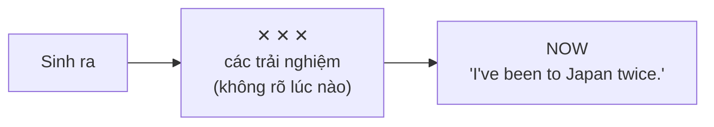
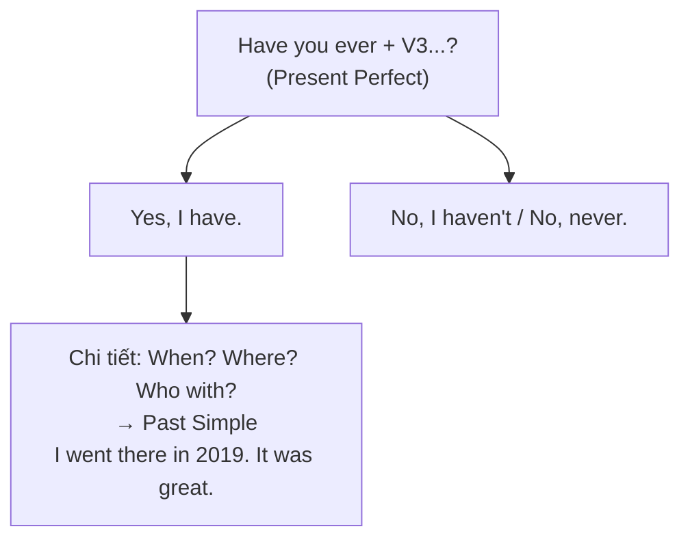

# A2-G004 · Present Perfect for Experience — Nói về trải nghiệm: ever, never, been / gone

## Mục lục

- [A. Lesson Information](#a-lesson-information)
- [B. Warm-up](#b-warm-up-tình-huống-thực-tế)
- [C. WHAT](#c-what-trải-nghiệm-trong-đời)
- [D. WHY](#d-why-cuộc-đời-tính-đến-bây-giờ)
- [E. FORM](#e-form-ever-never-before-số-lần)
- [F. HOW](#f-how-ví-dụ-phân-tích)
- [G. VISUAL](#g-visual-explanation)
- [H. COMPARISON](#h-comparison-been-và-gone)
- [I. COMMON MISTAKES](#i-common-mistakes)
- [J. MEMORY TRICKS](#j-memory-tricks)
- [K. REAL-LIFE APPLICATION](#k-real-life-application)
- [L. PRACTICE EXERCISES](#l-practice-exercises)
- [M. KNOWLEDGE CHECK](#m-knowledge-check)
- [N. ANSWER KEY](#n-answer-key)

---

## A. Lesson Information

| Mục | Nội dung |
|---|---|
| **Lesson ID** | A2-G004 |
| **Topic** | Present Perfect for Life Experience (ever, never, before, been/gone) |
| **Tên tiếng Việt** | Hiện tại hoàn thành nói về trải nghiệm |
| **CEFR Level** | A2 |
| **Prerequisites** | [A2-G003](A2-G003-present-perfect-form.md) |
| **Estimated Time** | 75 phút |

**Learning Objectives:**

1. Dùng hiện tại hoàn thành để nói về **trải nghiệm trong đời** (từ khi sinh ra đến nay).
2. Hỏi với ***Have you ever + V3...?*** và trả lời tự nhiên.
3. Dùng ***never***, ***before***, ***once/twice/... times***.
4. Phân biệt ***been*** và ***gone***.
5. Chuyển từ câu hỏi trải nghiệm (hiện tại hoàn thành) sang **chi tiết** (quá khứ đơn): *Yes, I have. I went there in 2019.*

---

## B. Warm-up: Tình huống thực tế

Trong buổi phỏng vấn, nhà tuyển dụng hỏi:

> *"**Have you ever worked** in a team with people from other countries?"*

Bạn muốn nói: "Có, tôi **từng** làm việc với người Nhật và người Hàn. Năm ngoái tôi làm một dự án với một công ty Hàn Quốc."

🤔 **Hãy suy nghĩ:** Câu hỏi không hỏi **khi nào** bạn làm việc đó — chỉ hỏi bạn **có kinh nghiệm hay không**. Nhưng khi bạn kể **chi tiết** ("năm ngoái...") thì thời gian xuất hiện. Liệu thì của động từ có thay đổi giữa hai phần câu trả lời không?

---

## C. WHAT: Trải nghiệm trong đời

Một trong những cách dùng phổ biến nhất của hiện tại hoàn thành: nói về những gì một người **đã từng / chưa từng** làm **trong cuộc đời họ tính đến thời điểm hiện tại**.

| Câu | Nghĩa |
|---|---|
| *I've **been** to Japan.* | Tôi **từng** đến Nhật (ít nhất một lần trong đời). |
| *She's **never eaten** durian.* | Cô ấy **chưa bao giờ** ăn sầu riêng. |
| ***Have** you **ever ridden** a horse?* | Bạn **đã bao giờ** cưỡi ngựa chưa? |

Thời gian cụ thể **không quan trọng** — điều quan trọng là **có hay không** trong "kho trải nghiệm" của người đó.

---

## D. WHY: "Cuộc đời tính đến bây giờ"

Khoảng thời gian được nói đến là **toàn bộ cuộc đời của người đó, từ quá khứ cho đến hiện tại** — một khoảng thời gian **chưa kết thúc** (người đó vẫn đang sống, vẫn có thể có thêm trải nghiệm). Vì khoảng thời gian chạm tới **bây giờ**, ta dùng hiện tại hoàn thành.



Khi chuyển sang kể một lần cụ thể trong khoảng quá khứ đã kết thúc, thường dùng quá khứ đơn. Tuy nhiên, chi tiết nơi/người không tự bắt buộc đổi thì: *I have worked with Mai several times* vẫn là trải nghiệm đến nay. Mấu chốt là điểm nhìn thời gian, không chỉ có thêm chi tiết.

---

## E. FORM: *ever, never, before*, số lần

**Ký hiệu:** **S** = chủ ngữ · **V3** = quá khứ phân từ.

| Mẫu | Công thức | Ví dụ |
|---|---|---|
| Hỏi trải nghiệm | **Have/Has + S + ever + V3...?** | *Have you **ever** been to Hue?* |
| Chưa bao giờ | **S + have/has + never + V3** | *I've **never** been to Hue.* |
| Phủ định thông thường | **S + haven't/hasn't + V3 (+ before)** | *I **haven't** tried it **before**.* |
| Số lần | **S + have/has + V3 + once / twice / three times** | *She's been to Korea **twice**.* |
| Lần đầu tiên | **It's the first time + S + have/has + V3** | *It's **the first time** I've **eaten** sushi.* |
| Hỏi số lần | **How many times + have/has + S + V3?** | ***How many times** have you **seen** this film?* |

**Vị trí trong mẫu cơ bản:** ever/never thường ở giữa have/has và V3. Never đã có nghĩa phủ định nên không thêm not trong mẫu chuẩn. Ever còn xuất hiện sau so sánh nhất (*the best...ever...*) và trong một số cấu trúc khác; mẹo “ever hỏi, never đáp” không phải quy tắc cho mọi câu.

### Trả lời câu hỏi *Have you ever...?*

| Trả lời | Ví dụ |
|---|---|
| Ngắn | *Yes, I have. / No, I haven't. / No, never.* |
| Có + chi tiết (quá khứ đơn) | *Yes, I have. I **went** there **last summer**. It **was** amazing.* |
| Không + thêm thông tin | *No, I haven't, but I'd love to.* / *No, never. I'm afraid of horses!* |

---

## F. HOW: Ví dụ phân tích

| # | English | Tiếng Việt | Phân tích |
|---|---|---|---|
| 1 | *I've **been** to Singapore three times.* | Tôi đã đến Singapore ba lần. | I + have + been to nói đã đến và trở về; three times đếm số lần đến nay. Số lần tự nó không bắt buộc thì này: I went there twice last year vẫn đúng. |
| 2 | *My grandmother has **never flown** in a plane.* | Bà tôi chưa bao giờ đi máy bay. | Grandmother số ít dùng has; never phủ định trải nghiệm đến nay; fly–flew–flown. Không thêm not trước never. |
| 3 | ***Have** you **ever met** a famous person?* | Bạn đã bao giờ gặp người nổi tiếng chưa? | Have đảo trước you; ever hỏi bất kỳ lần nào đến hiện tại; met là V3 của meet. |
| 4 | *"Have you ever tried bánh xèo?" — "Yes, I **have**. I **had** it in Saigon last year."* | Bạn từng ăn bánh xèo chưa? — Có. Tôi ăn ở Sài Gòn năm ngoái. | Have tried hỏi trải nghiệm; Yes, I have giữ trợ động từ; I had it last year kể lần ăn cụ thể bằng quá khứ đơn. |
| 5 | *She **hasn't seen** snow **before**.* | Cô ấy chưa từng thấy tuyết trước đây. | She dùng has not; see–saw–seen; before ở cuối câu nghĩa trước thời điểm hiện tại trong ngữ cảnh này. |
| 6 | *This is **the first time** I'**ve driven** a car on the left.* | Đây là lần đầu tôi lái xe bên trái. | This is the first time + have driven nêu lần đầu tính đến nay; drive–drove–driven. On the left chỉ bên đường, không phải tay trái. |
| 7 | ***How many times** has he **failed** his driving test?* | Anh ấy đã trượt thi lái xe bao nhiêu lần rồi? | How many times hỏi số lần đến nay; has đảo trước he; failed V3 có quy tắc. |
| 8 | *We'**ve** never **had** a pet.* | Chúng tôi chưa bao giờ nuôi thú cưng. | We + have + never + had; had ở đây là V3 của have, nghĩa đã từng nuôi/có thú cưng, không phải trợ động từ thứ hai. |
| 9 | *It's the best book I'**ve ever read**.* | Đây là cuốn sách hay nhất tôi từng đọc. | Have ever read giới hạn đánh giá “hay nhất” vào kinh nghiệm của người nói; read V3 phát âm /red/. |
| 10 | *"Where's Nam?" — "He'**s gone** to the bank."* | "Nam đâu?" — "Anh ấy đi ngân hàng rồi." | Trong lời hỏi vị trí Nam, has gone to cho biết đã đi và chưa quay về nơi đang nói; có thể đang trên đường hoặc ở ngân hàng. |
| 11 | *"Where have you **been**?" — "I'**ve been** to the gym."* | "Bạn đi đâu về đấy?" — "Tôi đi tập gym về." | Trong cảnh người kia vừa quay về, have been to nói chuyến đi đã xong; không nhầm với have been in + khoảng thời gian còn ở nơi đó. |
| 12 | *Have you **ever been** late for an important meeting?* | Bạn đã bao giờ trễ một cuộc họp quan trọng chưa? | Ever been late: been là V3 của be + tính từ late, không có chuyển động/đi về; phải đọc cấu trúc, không gán mọi been nghĩa đã về. |

---

## G. VISUAL EXPLANATION

### G1. Hỏi trải nghiệm → kể chi tiết



### G2. *Been* và *gone* trên bản đồ

```text
  BEEN:   🏠 ──────► Japan ──────► 🏠     "She's been to Japan."  (đi rồi, đã về)
  GONE:   🏠 ──────► Japan   (chưa về)      "She's gone to Japan."  (đi rồi, chưa về)
```

---

## H. COMPARISON: *Been* và *gone*

| | *have/has been (to)* | *have/has gone (to)* |
|---|---|---|
| Nghĩa | Đã đến và **đã quay về** (trải nghiệm) | Đã đi và **vẫn chưa về** (đang ở đó/đang trên đường) |
| Ví dụ | *I've **been** to Da Lat.* (từng đi Đà Lạt) | *My parents have **gone** to Da Lat.* (đang ở Đà Lạt) |
| Hỏi chuyến thăm nói chung | *Have you ever **been** to Da Lat?* là mẫu ưu tiên ở bài | Gone có thể dùng theo biến thể/ngữ cảnh, nhất là nhấn hành động đi; không coi mọi ever gone là sai |
| Với I/we | Dùng tự nhiên cho trải nghiệm chuyến thăm | Có thể dùng trong tin nhắn *I've gone to the shop; back soon*, hoặc khi nói về hành động đi; không cấm ngôi I/we |

Mẹo been = đã đi và về áp dụng cho **have been to + nơi** khi nói chuyến thăm, không cho mọi been. *She has been in Hanoi for two weeks* thường nghĩa cô ấy đang ở Hà Nội được hai tuần; *she has been ill* là tình trạng ốm.

### Hiện tại hoàn thành và quá khứ đơn trong cùng câu trả lời

| HTHT (trải nghiệm chung) | QKĐ (chi tiết một lần) |
|---|---|
| *I've **climbed** Fansipan.* | *I **climbed** it **in 2021** with my friends.* |
| *She's **worked** abroad.* | *She **worked** in Korea **from 2015 to 2018**.* |

---

## I. COMMON MISTAKES

| Câu cần sửa | Câu đúng | Nguyên nhân và cách tránh |
|---|---|---|
| Did you ever been to Japan? | Have you ever been to Japan? | Been cần have ở mẫu này; nếu dùng did thì động từ về go. Did you ever go cũng có cách dùng hợp lệ theo vùng hoặc khoảng thời gian. |
| Have you ever went to Hanoi? | Have you ever been to Hanoi? | Went là V2; dùng been to cho trải nghiệm chuyến thăm. Gone là V3 của go, có thể hợp ngữ cảnh khác. |
| I haven't never eaten sushi. | I have never eaten sushi. | Never đã phủ định; cũng được I haven't ever eaten sushi. |
| I've ever been to Paris. (ý khẳng định từng đi) | I've been to Paris. | Không cần ever trong lời khẳng định độc lập này; ever có thể có mặt sau so sánh nhất và cấu trúc khác. |
| I have visited Hue in 2020. | I visited Hue in 2020. | Năm đã kết thúc định vị chuyến thăm cụ thể, dùng quá khứ đơn. |
| It's the first time I eat pho. | It's the first time I've eaten pho. | Mẫu lần đầu đến hiện tại dùng have + V3. |
| She has been there two time. | She has been there two times. | Two cần danh từ số nhiều; twice thường gọn hơn. |
| She has went to Paris. | She has gone to Paris. | Go có V3 gone; nếu muốn nói chuyến thăm đã kết thúc thì dùng been to. |

Không đánh dấu *I've been in Japan twice* luôn sai: nó có thể nói đã ở tại Nhật hai lần. *Been to* là cách gọn để nói trải nghiệm đến thăm; *been in* nhấn sự có mặt/lưu trú, tùy ngữ cảnh.

---

## J. MEMORY TRICKS

1. **"Kho trải nghiệm"** 🎒: Hỏi "trong ba lô trải nghiệm của bạn có cái này chưa?" → *Have you ever...?*. Lấy một kỷ niệm ra kể chi tiết → quá khứ đơn.
2. **Been to = chuyến thăm đã xong; gone to = đã đi, chưa về** trong mẫu hỏi vị trí của bài. Không áp cho been late/been ill/been in.
3. **Ever hỏi, never đáp** là mẹo mở đầu; nhớ thêm the best...ever... và không coi đó là giới hạn mọi cách dùng.

---

## K. REAL-LIFE APPLICATION

### Hội thoại: Phỏng vấn tình nguyện viên du lịch

> **Interviewer:** So, Phuong, **have** you **ever worked** as a tour guide?
> **Phuong:** Yes, I **have**. I **worked** as a part-time guide in Hoi An two years ago.
> **Interviewer:** Great. **Have** you **ever been** to the north of Vietnam?
> **Phuong:** Yes, I'**ve been** to Hanoi and Ha Long Bay. I **went** there with my university last spring. But I'**ve never been** to Sapa.
> **Interviewer:** That's OK. **How many** foreign languages **have** you **studied**?
> **Phuong:** I'**ve studied** English for ten years and Korean for one year.
> **Interviewer:** Impressive! **Have** you **ever had** a difficult customer?
> **Phuong:** Yes, once. A tourist **lost** his passport during a tour. I **helped** him go to the police station and call the embassy. It **was** stressful, but we **solved** the problem.
> **Interviewer:** That's the kind of experience we're looking for!

**Vietnamese explanation:** Phương phỏng vấn làm tình nguyện viên du lịch: từng làm hướng dẫn viên bán thời gian ở Hội An hai năm trước; đã đến Hà Nội, Hạ Long nhưng chưa đến Sa Pa; học tiếng Anh 10 năm, tiếng Hàn 1 năm; từng gặp khách khó — một du khách mất hộ chiếu, Phương đã giúp đưa đến đồn cảnh sát và gọi đại sứ quán.

**Grammar highlights:** Câu hỏi trải nghiệm dùng HTHT (*Have you ever worked / been / had...?*); chi tiết có thời gian dùng QKĐ (*worked ... two years ago, went ... last spring, lost, helped, was, solved*). *I've studied English for ten years* — kéo dài đến nay (bài [A2-G006](A2-G006-present-perfect-since-for.md)).

---

## L. PRACTICE EXERCISES

> ✍️ Đáp án: [A2-G004-ANSWERS](../../12-ANSWERS-AND-EXPLANATIONS/A2/A2-G004-ANSWERS.md)

### Level 1 — Recognition

**L1.1.** ___ you ever eaten frog?  A. Did  B. Have  C. Do  D. Are
**L1.2.** I've ___ been to a music festival. A. ever B. never C. doesn't D. yet
**L1.3.** "Where's Linh?" — "She's ___ to the supermarket. She'll be back soon."  A. been  B. gone  C. went  D. go
**L1.4.** I've ___ to Phu Quoc twice. I loved it. A. going B. been C. went D. visited to
**L1.5.** "Have you ever seen a ghost?" — "No, I ___."  A. didn't  B. haven't  C. don't  D. never
**L1.6.** It's the first time I ___ on a plane.  A. am  B. was  C. have been  D. go

### Level 2 — Controlled Practice

Viết câu hỏi *Have you ever...?* với các gợi ý:

**L2.1.** (ride / a horse)
**L2.2.** (lose / your wallet)
**L2.3.** (sing / karaoke in English)

Hoàn thành câu với HTHT hoặc QKĐ.

**L2.4.** I (be) ___ to Thailand three times. The last time, I (go) ___ with my sister in 2022.
**L2.5.** "Have you ever met a celebrity?" — "Yes. I (meet) ___ a famous singer at the airport last year."
**L2.6.** My father (never / use) ___ a smartphone.
**L2.7.** How many times (you / watch) ___ this film?
**L2.8.** She (not / try) ___ Indian food before.

Điền *been* hoặc *gone*:

**L2.9.** "Is Tom at home?" — "No, he's ___ to work."
**L2.10.** "Have you ever ___ to Korea?" — "Yes, I've ___ there twice."

### Level 3 — Error Correction

**L3.1.** Have you ever went to Da Lat?
**L3.2.** I haven't never tried sushi.
**L3.3.** "Have you visited Hue?" — "Yes, I have visited it in 2020."
**L3.4.** It's the first time I see snow.
**L3.5.** I've ever ridden a camel. (ý: tôi từng cưỡi lạc đà; giữ nghĩa khẳng định)
**L3.6.** She has been to Japan two time.

### Level 4 — Production

Dịch sang tiếng Anh:

**L4.1.** Tôi chưa bao giờ đi tàu hỏa. (*travel by train*)
**L4.2.** Bạn đã bao giờ nói chuyện với người nước ngoài chưa?
**L4.3.** Đây là món ăn ngon nhất tôi từng ăn.
**L4.4.** "Mẹ đâu rồi?" — "Mẹ đi chợ rồi." (*gone*)

**L4.5.** **Explain:** Vì sao câu *"Yes, I have been to Hue last year"* sai? Viết lại và giải thích quy tắc chuyển thì (2–3 câu tiếng Việt).

### Level 5 — Real Communication

**L5.1.** Viết đoạn văn 80–100 từ: *Things I have done and things I have never done*. Nêu 3 trải nghiệm bạn đã có (kèm chi tiết bằng QKĐ cho ít nhất 2 trải nghiệm) và 3 điều bạn chưa từng làm nhưng muốn làm.
**L5.2.** **Speaking — Find someone who...:** Đặt và tự trả lời to 8 câu hỏi *Have you ever...?* (nhảy dù, ăn côn trùng, ngủ trong lều, gặp thần tượng, đi lạc ở nước ngoài, nấu cho 10 người, thức trắng đêm, đi xem hòa nhạc). Với mỗi câu "Yes", thêm 1–2 câu chi tiết bằng quá khứ đơn.

---

## M. KNOWLEDGE CHECK

### 5 câu hỏi tự kiểm tra

1. Vì sao trải nghiệm trong đời dùng hiện tại hoàn thành?
2. *ever* và *never* đứng ở đâu trong câu?
3. *been to* và *gone to* khác nhau thế nào?
4. Khi kể chi tiết một trải nghiệm (có thời gian), dùng thì gì?
5. Hoàn thành: *It's the first time I ___ (drive) a car.*

### Checklist

- [ ] Tôi hỏi và trả lời được *Have you ever...?* tự nhiên.
- [ ] Tôi chuyển sang quá khứ đơn khi kể chi tiết.
- [ ] Tôi dùng đúng *been/gone*.

### 3 lỗi quan trọng cần nhớ

1. ~~Have you ever went~~ → Have you ever **been** (hoặc gone nếu phù hợp ngữ cảnh).
2. ~~I have been there last year~~ → I **went** there last year.
3. ~~It's the first time I eat~~ → It's the first time I**'ve eaten**.

### Lịch ôn tập

| Ngày | Việc cần làm |
|---|---|
| Ngày 1 | Làm lại L2 |
| Ngày 3 | Viết 5 câu "I've never... but I'd like to..." |
| Ngày 7 | Làm lại L5.2 với 8 câu hỏi mới |

### Liên kết

- ➡️ Bài tiếp theo: [A2-G005 — Just, Already, Yet](A2-G005-present-perfect-just-already-yet.md)
- 🔁 Ôn: [A2-G003](A2-G003-present-perfect-form.md)

---

Đối chiếu biến thể: [Cambridge — Word choice: go, gone, and been](https://dictionary.cambridge.org/us/grammar/british-grammar/been-and-gone). Mẫu ưu tiên trong bài dùng been to cho chuyến thăm đã hoàn tất.

## N. ANSWER KEY

👉 [A2-G004-ANSWERS.md](../../12-ANSWERS-AND-EXPLANATIONS/A2/A2-G004-ANSWERS.md)
