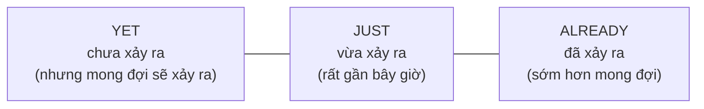

# A2-G005 · Present Perfect with Just, Already, Yet — HTHT với just, already, yet (và still)

## Mục lục

- [A. Lesson Information](#a-lesson-information)
- [B. Warm-up](#b-warm-up-tình-huống-thực-tế)
- [C. WHAT](#c-what-ba-trạng-từ-của-sự-mong-đợi)
- [D. WHY](#d-why-so-sánh-thực-tế-với-mong-đợi)
- [E. FORM](#e-form-vị-trí-trong-câu)
- [F. HOW](#f-how-ví-dụ-phân-tích)
- [G. VISUAL](#g-visual-explanation)
- [H. COMPARISON](#h-comparison)
- [I. COMMON MISTAKES](#i-common-mistakes)
- [J. MEMORY TRICKS](#j-memory-tricks)
- [K. REAL-LIFE APPLICATION](#k-real-life-application)
- [L. PRACTICE EXERCISES](#l-practice-exercises)
- [M. KNOWLEDGE CHECK](#m-knowledge-check)
- [N. ANSWER KEY](#n-answer-key)

---

## A. Lesson Information

| Mục | Nội dung |
|---|---|
| **Lesson ID** | A2-G005 |
| **Topic** | Present Perfect with *just, already, yet* (+ *still*) |
| **Tên tiếng Việt** | Hiện tại hoàn thành với *just, already, yet* |
| **CEFR Level** | A2 |
| **Prerequisites** | [A2-G003](A2-G003-present-perfect-form.md) |
| **Estimated Time** | 75 phút |

**Learning Objectives:**

1. Dùng ***just*** cho việc **vừa mới** xảy ra.
2. Dùng already cho việc đã xảy ra tính đến một mốc, thường sớm hơn mong đợi hoặc không cần làm lại.
3. Dùng ***yet*** trong câu **hỏi** (đã... chưa?) và câu **phủ định** (chưa).
4. Dùng still + phủ định để nhấn "vẫn chưa"; có thể thể hiện sốt ruột tùy ngữ cảnh.
5. Đặt đúng vị trí của bốn trạng từ trong câu.

---

## B. Warm-up: Tình huống thực tế

Bạn và đồng nghiệp chuẩn bị cho một sự kiện lúc 5 giờ chiều. Bây giờ là 3 giờ. Quản lý hỏi:

> *"Have you sent the invitations **yet**?"*

Bạn trả lời:
- "Rồi, tôi gửi **rồi** — sáng nay cơ!" (sớm hơn quản lý nghĩ)
- "Tôi **vừa mới** gọi cho nhà hàng."
- "Nhưng tôi **chưa** in bảng tên."

🤔 **Hãy suy nghĩ:** Ba câu trả lời trên khác nhau ở điểm nào? Tiếng Việt dùng "rồi", "vừa mới", "chưa". Tiếng Anh có ba từ tương ứng — và vị trí của chúng trong câu không giống nhau.

---

## C. WHAT: Ba trạng từ của "sự mong đợi"

| Trạng từ | Nghĩa | Loại câu | Ví dụ |
|---|---|---|---|
| **just** | vừa mới | Khẳng định | *I've **just** called the restaurant.* |
| **already** | đã... rồi (thường sớm hơn mong đợi) | Khẳng định (và câu hỏi ngạc nhiên) | *I've **already** sent the invitations.* |
| **yet** | chưa / ...chưa? | Phủ định, câu hỏi | *I haven't printed the name tags **yet**.* / *Have you sent them **yet**?* |
| **still** (+ phủ định) | vẫn chưa (có thể hàm ý sốt ruột) | Phủ định | *I **still** haven't heard from them.* |

Bốn từ này rất thường đi với hiện tại hoàn thành vì chúng đều nói về **trạng thái hoàn thành tính đến bây giờ**.

---

## D. WHY: So sánh thực tế với mong đợi

Ba trạng từ này đặt sự việc lên một **"thước đo thời gian kỳ vọng"**:



- **yet** — người nói **mong đợi** việc đó sẽ xảy ra, nhưng hiện tại chưa (hoặc đang hỏi xem đã xảy ra chưa).
- **just** — việc vừa xảy ra, **kết quả còn rất "nóng"**.
- **already** — việc đã xảy ra, có thể **sớm hơn người nghe nghĩ** → thường kèm chút ngạc nhiên.

---

## E. FORM: Vị trí trong câu

**Ký hiệu:** **S** = chủ ngữ · **V3** = quá khứ phân từ.

| Trạng từ | Vị trí | Công thức | Ví dụ |
|---|---|---|---|
| **just** | Giữa *have/has* và V3 | S + have/has + **just** + V3 | *She's **just** left.* |
| **already** | Giữa *have/has* và V3 (hoặc cuối câu để nhấn mạnh) | S + have/has + **already** + V3 | *We've **already** eaten.* / *We've eaten **already**!* |
| **yet** | Thường cuối câu; cũng có thể sau have not | S + haven't/hasn't + V3 ... **yet** | *I haven't finished **yet**.* |
| | | Have/Has + S + V3 ... **yet**? | *Has he called **yet**?* |
| **still** | **Trước** *haven't/hasn't* | S + **still** + haven't/hasn't + V3 | *He **still** hasn't called.* |

*I haven't yet finished* và *I haven't finished yet* đều đúng. Vị trí giữa câu có thể trang trọng hơn nhưng không phải lỗi và không bị cấm trong lời nói. Bài luyện dùng vị trí cuối như một mẫu thuận tiện. Already không luôn biểu thị ngạc nhiên; still cũng không luôn là giận hoặc sốt ruột.

### Trả lời ngắn

| Câu hỏi | Trả lời |
|---|---|
| *Have you finished yet?* | *Yes, I have. / Yes, I've just finished. / No, not yet.* |
| *Has she arrived yet?* | *Yes, she's already here. / No, she hasn't arrived yet.* |

> 💡 **Not yet** — "chưa" — là câu trả lời ngắn cực kỳ phổ biến.

---

## F. HOW: Ví dụ phân tích

| # | English | Tiếng Việt | Phân tích |
|---|---|---|---|
| 1 | *I've **just** had lunch, so I'm not hungry.* | Tôi vừa ăn trưa xong nên không đói. | I + have + just + had: had là V3 của have; just đặt sự việc gần hiện tại và giải thích không đói. |
| 2 | *"Where's Hoa?" — "She's **just** gone out."* | "Hoa đâu?" — "Cô ấy vừa ra ngoài." | She + has + just + gone out: just giữa has và V3; gone out cho biết vừa ra ngoài, chưa ở đây. |
| 3 | *The film has **just** started. Sit down quickly!* | Phim vừa bắt đầu. Ngồi xuống nhanh! | The film số ít dùng has; just started nghĩa mới bắt đầu, nên người nói giục ngồi xuống. |
| 4 | *"Can you buy some milk?" — "I've **already** bought some."* | "Bạn mua sữa được không?" — "Tôi mua rồi." | Already trước bought nêu việc đã làm, không cần mua lần nữa; không nhất thiết người đáp ngạc nhiên. |
| 5 | *Wow, you've **already** finished? That was fast!* | Ồ, bạn đã làm xong rồi à? Nhanh thế! | Câu hỏi theo trật tự kể dùng ngữ điệu hỏi trong hội thoại; Wow/That was fast làm rõ sắc thái ngạc nhiên. |
| 6 | ***Have** you **already** booked the tickets?* | Bạn đặt vé rồi à? | Have đảo trước you; already trước booked thường hỏi xác nhận việc đã xảy ra, có thể ngạc nhiên theo ngữ cảnh. |
| 7 | *I haven't decided **yet**.* | Tôi chưa quyết định. | Have not + decided + yet: chưa quyết định đến thời điểm nói; không cần thêm still nếu không nhấn thời gian chờ. |
| 8 | ***Has** the bus come **yet**?* | Xe buýt đến chưa? | Has + the bus + come + yet: hỏi xe đã đến hay chưa; come V3 cùng dạng nguyên mẫu. |
| 9 | *"Have you replied to the email?" — "**Not yet**."* | Bạn trả lời email chưa? — Chưa. | Not yet là câu trả lời rút gọn cho haven't replied yet; không dùng No yet. |
| 10 | *I sent the form two weeks ago, but they **still** haven't replied.* | Tôi gửi đơn hai tuần trước, nhưng họ vẫn chưa trả lời. | Sent...two weeks ago dùng quá khứ đơn cho việc gửi; still haven't replied nêu tình trạng chưa nhận phản hồi đến nay. |
| 11 | *We've **already** paid, but the food **still** hasn't arrived.* | Chúng tôi đã trả tiền rồi mà đồ ăn vẫn chưa đến. | We have already paid: việc trả đã xong; the food số ít nên still hasn't arrived, nhấn chờ đến hiện tại. |
| 12 | *She has **just** started a new job.* | Cô ấy vừa bắt đầu việc mới. | She + has + just + started a new job: tin vừa bắt đầu việc mới; just giữa has và started, không cần cấu trúc bị động chưa học. |

---

## G. VISUAL EXPLANATION

### G1. Vị trí trong câu

```text
She   has   JUST     left.
We    have  ALREADY  eaten.
I     haven't        finished   YET.
Have  you            finished   YET?
He    STILL hasn't   called.
```

### G2. Checklist chuẩn bị sự kiện

| Việc | Trạng thái | Câu |
|---|---|---|
| Send invitations | ✅ (sáng nay) | *I've **already** sent the invitations.* |
| Call the restaurant | ✅ (5 phút trước) | *I've **just** called the restaurant.* |
| Print name tags | ❌ | *I haven't printed the name tags **yet**.* |
| Get a reply from the singer | ❌ (đã hỏi 1 tuần) | *The singer **still** hasn't replied.* |

---

## H. COMPARISON

### *yet* và *still*

| *not ... yet* | *still not* |
|---|---|
| Trung tính: chưa xảy ra | Nhấn mạnh tình trạng chưa xảy ra vẫn tiếp tục; có thể hàm ý chờ lâu/sốt ruột |
| *He hasn't called **yet**.* | *He **still** hasn't called!* |

### *just* + quá khứ đơn (Anh – Mỹ)

Trong tiếng Anh – Mỹ, *just* và *already* thường đi với **quá khứ đơn**: *I **just** ate.* / *I **already** finished.* Cả hai cách đều được chấp nhận. Trong bài luyện này, dùng hiện tại hoàn thành khi đề yêu cầu dạng đó. Không suy từ biến thể Anh Anh/Anh Mỹ thành quy định chấm điểm VSTEP khi chưa có căn cứ từ hướng dẫn thi.

### *already* trong câu hỏi và *yet* trong câu hỏi

| *Have you finished **yet**?* | Hỏi trung tính: bạn đã xong chưa? |
|---|---|
| *Have you **already** finished?* | Ngạc nhiên: bạn xong **rồi** à? (nhanh vậy) |

---

## I. COMMON MISTAKES

| # | ❌ Sai | ✅ Đúng | Nguyên nhân | Cách tránh |
|---|---|---|---|---|
| 1 | I haven't **finish** yet. | I haven't **finished** yet. | Thiếu V3 | Finished sau have; haven't yet finished cũng đúng |
| 2 | I've finished **yet**. | I've **already** finished. | Dùng *yet* trong câu khẳng định | Khẳng định → *already/just* |
| 3 | I've **just** finished **just**. / I **have finished just**. | I've **just** finished. | Sai vị trí | *just* giữa *have* và V3 |
| 4 | He **hasn't still** called. | He **still hasn't** called. | Sai vị trí *still* | *still* trước *hasn't* |
| 5 | I've **just** finished it **an hour ago**. | I finished it an hour ago. / I've just finished it. | Trộn HTHT với *ago* | *ago* → QKĐ |
| 6 | "Have you eaten?" — "**No yet**." | "**Not yet**." | Dịch "chưa" | *Not yet* |
| 7 | Has they finished yet? | Have they finished yet? | Sai hòa hợp | They dùng have; Did you finish yet có thể đúng trong Anh Mỹ, không phải lỗi phổ quát |

---

## J. MEMORY TRICKS

1. **Just/Already thường ở giữa, Yet thường ở cuối, Still trước haven't** là mẫu luyện; already cuối và haven't yet finished cũng đúng.
2. **"Yet chờ đợi"** ⏳: *yet* = "đang chờ". Bạn chờ trong câu hỏi (*...yet?*) hoặc vẫn đang chờ (*haven't...yet*).
3. **"Already = Ủa, rồi à?"** 😮 — *already* thường mang sắc thái "sớm hơn tôi nghĩ".

---

## K. REAL-LIFE APPLICATION

### Tin nhắn: Chuẩn bị đám cưới

> **Lan:** Hi! The wedding is in two weeks! How's everything? 💍
> **Minh:** Busy! I've **just** picked up the wedding suit. It fits perfectly.
> **Lan:** Great! Have you sent the invitations **yet**?
> **Minh:** Yes, we've **already** sent them. We sent them last month.
> **Lan:** Oh, wow, you're organised! What about the music?
> **Minh:** We haven't chosen the songs **yet**. And the band **still** hasn't confirmed the price. 😩
> **Lan:** Don't worry, you've **already** done the most important things. Have you booked the photographer?
> **Minh:** Not **yet**! Do you know anyone good?
> **Lan:** Yes! My cousin has **just** started a photography business. I'll send you her number.

**Vietnamese explanation:** Còn hai tuần nữa là đám cưới. Minh vừa lấy bộ vest; thiệp đã gửi từ tháng trước (sớm hơn Lan nghĩ). Chưa chọn nhạc, ban nhạc vẫn chưa xác nhận giá, chưa đặt thợ ảnh. Lan giới thiệu người em họ vừa mở studio chụp ảnh.

**Grammar highlights:** *just picked up, already sent, haven't chosen yet, still hasn't confirmed, Not yet, has just started*. Lần gửi cụ thể dùng câu quá khứ đơn riêng: *We sent them last month*.

---

## L. PRACTICE EXERCISES

> ✍️ Đáp án: [A2-G005-ANSWERS](../../12-ANSWERS-AND-EXPLANATIONS/A2/A2-G005-ANSWERS.md)

### Level 1 — Recognition

**L1.1.** I'm not hungry. I've ___ had a big lunch.  A. yet  B. just  C. still  D. ever
**L1.2.** Hỏi trung tính xem đã xong chưa: "Have you done your homework ___?" — "No, not yet."  A. already  B. just  C. yet  D. still
**L1.3.** "Can you call Mai?" — "I've ___ called her. She's coming."  A. yet  B. already  C. still  D. ever
**L1.4.** I sent the email three days ago, but they ___ replied.  A. haven't still  B. still haven't  C. haven't yet still  D. yet haven't
**L1.5.** Chọn TẤT CẢ câu đúng:  A. I haven't yet seen the film.  B. I haven't seen the film yet.  C. I've seen yet the film.  D. I've yet seen the film.
**L1.6.** "Wow, have you **already** paid? That was quick!" — Sắc thái nào được ngữ cảnh này hỗ trợ?  A. Ngạc nhiên vì bạn trả nhanh  B. Không quan tâm  C. Tức giận vì bạn chưa trả

### Level 2 — Controlled Practice

Đặt trạng từ trong ngoặc vào đúng vị trí.

**L2.1.** The meeting has started. (just)
**L2.2.** I haven't packed my bag. (yet)
**L2.3.** We have seen this film. (already)
**L2.4.** Has the taxi arrived? (yet)
**L2.5.** My brother hasn't paid me back. (still)

Viết câu với *just, already, yet* dựa trên tình huống:

**L2.6.** Bạn ăn tối xong cách đây 2 phút. → I ______.
**L2.7.** Bạn được hỏi có muốn xem phim *Dune* không, nhưng bạn đã xem rồi. → No thanks, I ______.
**L2.8.** Bạn chưa đọc tin nhắn của sếp. → I ______.
**L2.9.** Hỏi bạn cùng phòng xem anh ấy đã dọn phòng chưa. → ______?
**L2.10.** Bạn đặt hàng online 3 tuần trước và vẫn chưa nhận được (sốt ruột). → My order ______.

### Level 3 — Error Correction

**L3.1.** I have finished yet my report. (ý khẳng định đã xong, giữ nghĩa)
**L3.2.** She hasn't still called me back.
**L3.3.** "Have you eaten?" — "No yet."
**L3.4.** They've already arrived two hours ago.
**L3.5.** I've finished just.
**L3.6.** Has he finished already? (ý: hỏi trung tính, không ngạc nhiên)

### Level 4 — Production

Dịch sang tiếng Anh:

**L4.1.** Tôi vừa nhận được tin nhắn của bạn.
**L4.2.** Bạn đã gọi taxi chưa?
**L4.3.** Họ đã bán hết vé rồi. (*sell all the tickets*)
**L4.4.** Tôi gửi đơn từ tháng trước mà họ vẫn chưa trả lời. (*application*)

**L4.5.** **Explain:** Bạn viết *I haven't yet decided*. Câu có sai không? Viết một cách khác với yet ở cuối và giải thích rằng vị trí thường dùng không phải vị trí duy nhất.

### Level 5 — Real Communication

**L5.1.** Bạn đang chuẩn bị cho một chuyến du lịch/sự kiện. Viết tin nhắn 70–90 từ cập nhật tình hình cho một người bạn: những gì đã làm (*already*), vừa làm (*just*), chưa làm (*yet*), vẫn chưa xong dù đã lâu (*still*).
**L5.2.** **Speaking — Before the deadline:** Đóng vai quản lý hỏi nhân viên về tiến độ dự án (6 câu hỏi với *yet*), và đóng vai nhân viên trả lời bằng *just, already, not yet, still*.

---

## M. KNOWLEDGE CHECK

### 5 câu hỏi tự kiểm tra

1. *just, already, yet, still* — mỗi từ nghĩa là gì?
2. Vị trí của *yet* trong câu? Của *just*?
3. *Have you finished yet?* và *Have you already finished?* khác nhau thế nào?
4. *not yet* và *still not* khác nhau ra sao?
5. Vì sao *I've just finished it an hour ago* sai?

### Checklist

- [ ] Tôi đặt đúng vị trí 4 trạng từ.
- [ ] Tôi trả lời *Not yet* tự nhiên.
- [ ] Tôi báo cáo được tiến độ công việc bằng tiếng Anh.

### 3 lỗi quan trọng cần nhớ

1. ~~haven't finish yet~~ → haven't **finished** yet; haven't yet finished cũng đúng.
2. ~~hasn't still~~ → **still hasn't**.
3. ~~No yet~~ → **Not yet**.

### Lịch ôn tập

| Ngày | Việc cần làm |
|---|---|
| Ngày 1 | Làm lại L2 |
| Ngày 3 | Viết checklist việc nhà tuần này với 8 câu dùng 4 trạng từ |
| Ngày 7 | Làm lại L5.2 |

### Liên kết

- ➡️ Bài tiếp theo: [A2-G006 — Since & For](A2-G006-present-perfect-since-for.md)
- 🔁 Ôn: [A2-G003](A2-G003-present-perfect-form.md), [A2-G004](A2-G004-present-perfect-experience.md)

---

## N. ANSWER KEY

👉 [A2-G005-ANSWERS.md](../../12-ANSWERS-AND-EXPLANATIONS/A2/A2-G005-ANSWERS.md)
