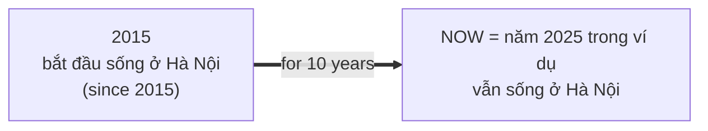
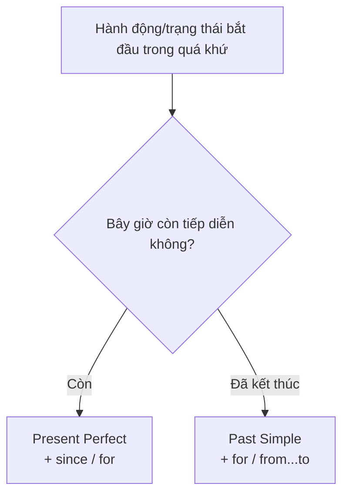

# A2-G006 · Present Perfect with Since & For — Hiện tại hoàn thành với since và for

## Mục lục

- [A. Lesson Information](#a-lesson-information)
- [B. Warm-up](#b-warm-up-tình-huống-thực-tế)
- [C. WHAT](#c-what-hành-động-kéo-dài-đến-hiện-tại)
- [D. WHY](#d-why-vì-sao-không-dùng-hiện-tại-đơn)
- [E. FORM](#e-form-since-for-how-long)
- [F. HOW](#f-how-ví-dụ-phân-tích)
- [G. VISUAL](#g-visual-explanation)
- [H. COMPARISON](#h-comparison)
- [I. COMMON MISTAKES](#i-common-mistakes)
- [J. MEMORY TRICKS](#j-memory-tricks)
- [K. REAL-LIFE APPLICATION](#k-real-life-application)
- [L. PRACTICE EXERCISES](#l-practice-exercises)
- [M. KNOWLEDGE CHECK](#m-knowledge-check)
- [N. ANSWER KEY](#n-answer-key)

---

## A. Lesson Information

| Mục | Nội dung |
|---|---|
| **Lesson ID** | A2-G006 |
| **Topic** | Present Perfect with *since* and *for*; *How long...?* |
| **Tên tiếng Việt** | Hiện tại hoàn thành với *since* và *for* |
| **CEFR Level** | A2 |
| **Prerequisites** | [A2-G003](A2-G003-present-perfect-form.md) |
| **Estimated Time** | 75 phút |

**Learning Objectives:**

1. Dùng hiện tại hoàn thành cho trạng thái/hành động **bắt đầu trong quá khứ và vẫn tiếp tục đến hiện tại**.
2. Phân biệt ***since*** + **mốc** thời gian và ***for*** + **khoảng** thời gian.
3. Hỏi ***How long have you...?*** và trả lời.
4. Không dùng hiện tại đơn cho ý "đã ... được bao lâu" (*I live here for 5 years* ❌).
5. Dùng *since* + mệnh đề quá khứ đơn: *since I was a child*.

---

## B. Warm-up: Tình huống thực tế

**Tình huống giả định diễn ra năm 2025**, sau ngày kỷ niệm chuyển nhà: một người bạn mới hỏi: "Bạn sống ở Hà Nội **bao lâu rồi**?" Bạn trả lời: "Tôi sống ở Hà Nội **được 10 năm rồi** — **từ năm** 2015."

Nhiều người học nói:

> ❌ *I **live** in Hanoi **for** 10 years.*
> ❌ *I **lived** in Hanoi **since** 2015.*

🤔 **Hãy suy nghĩ:** Bạn **vẫn đang** sống ở Hà Nội. Việc sống bắt đầu năm 2015 và **kéo dài đến bây giờ**. Hiện tại đơn không diễn đạt khoảng đã kéo dài đến nay trong mẫu này; quá khứ đơn nhìn việc trong một khoảng quá khứ đã kết thúc. Thì nào có thể "trải dài" từ quá khứ đến hiện tại?

---

## C. WHAT: Hành động kéo dài đến hiện tại

Cách dùng thứ ba của hiện tại hoàn thành: nói về một **trạng thái hoặc hành động bắt đầu trong quá khứ và vẫn còn tiếp diễn ở hiện tại**.

| Câu | Ý nghĩa |
|---|---|
| *I've **lived** in Hanoi **for** ten years.* | Bắt đầu sống ở Hà Nội 10 năm trước → **vẫn đang** sống ở đó. |
| *She's **worked** here **since** 2020.* | Bắt đầu làm năm 2020 → **vẫn đang** làm. |
| *We've **known** each other **since** we were kids.* | Quen nhau từ nhỏ → **vẫn** quen nhau. |

Cách dùng này phổ biến với trạng thái như be, have (sở hữu), know, like, và với các động từ live/work khi nói một tình trạng hoặc hoạt động kéo dài. Không phải mọi động từ trong nhóm này đều là động từ trạng thái trong mọi nghĩa.

> 💡 Với hành động đang diễn ra liên tục (*learn, study, wait, rain*), người bản ngữ thường dùng **hiện tại hoàn thành tiếp diễn**: *I've been learning English for two years* — học kỹ ở [B1-G001](../../04-B1-INTERMEDIATE/grammar/B1-G001-present-perfect-continuous.md). Ở A2, hiện tại hoàn thành đơn với các động từ như *live, work, know, be, have* là đủ và hoàn toàn đúng.

---

## D. WHY: Vì sao không dùng hiện tại đơn?

Tiếng Việt: "Tôi **sống** ở đây 10 năm rồi" — động từ "sống" giữ nguyên, ý "kéo dài" nằm ở "10 năm rồi".

Tiếng Anh tách bạch:
- **Hiện tại đơn** (*I live here*) = chỉ nói về **bây giờ** — không "nhìn lại" quá khứ.
- **Quá khứ đơn** (*I lived here for five years, then moved away*) kể một giai đoạn đã kết thúc. Nếu chỉ nói I lived here, không đủ để chứng minh mọi điều về nơi ở hiện tại; người đó có thể đã quay lại sau này.
- **Hiện tại hoàn thành** (*I've lived here*) = **nối** quá khứ với hiện tại — đúng thứ ta cần.



Vì vậy, khi có câu hỏi **"How long...?"** hoặc **since/for** với một trạng thái chưa kết thúc → hiện tại hoàn thành.

---

## E. FORM: *since*, *for*, *How long*

### E1. *since* và *for*

| | **since** | **for** |
|---|---|---|
| Đi với | **Mốc thời gian** — điểm bắt đầu | **Khoảng thời gian** — độ dài |
| Câu hỏi | "Từ **khi nào**?" | "**Bao lâu**?" |
| Ví dụ | *since 2015, since Monday, since 8 o'clock, since last year, since Christmas, since I was born* | *for 10 years, for three days, for two hours, for a long time, for ages, for a few weeks* |

### E2. Công thức

**Ký hiệu:** **S** = chủ ngữ · **V3** = quá khứ phân từ.

| | Công thức | Ví dụ |
|---|---|---|
| ➕ | S + have/has + V3 + **for** + khoảng / **since** + mốc | *I've had this car **for** five years.* |
| ➖ | S + haven't/hasn't + V3 + for/since | *I **haven't seen** her **since** June.* |
| ❓ | **How long** + have/has + S + V3? | ***How long** have you **known** Lan?* |
| *since* + mệnh đề | S + have/has + V3 + **since** + S + V2 | *I've loved music **since** I **was** a child.* |

> Khi since giới thiệu **sự kiện làm mốc bắt đầu**, dùng quá khứ đơn trong mẫu này: since I moved here, since we met. Không suy rằng mọi mệnh đề sau since luôn quá khứ đơn: nếu nêu trạng thái kéo đến hiện tại, có thể gặp hiện tại hoàn thành. Bài này chỉ yêu cầu tạo mẫu sự kiện mốc.

Câu hỏi có/không cũng dùng have/has đảo: *Have you lived here for long? — Yes, I have / No, I haven't.* How long hỏi độ dài nên thường trả lời một khoảng hoặc mốc, không chỉ Yes/No.

### E3. Phủ định: lâu rồi không làm gì

*I **haven't seen** him **for** ages.* — Lâu lắm rồi tôi không gặp anh ấy.
*She **hasn't eaten** meat **since** 2019.* — Cô ấy không ăn thịt từ năm 2019.

---

## F. HOW: Ví dụ phân tích

| # | English | Tiếng Việt | Phân tích |
|---|---|---|---|
| 1 | *I've **lived** in Da Nang **for** six years.* | Tôi sống ở Đà Nẵng được sáu năm rồi. | I + have + lived; for six years là độ dài. Trong ngữ cảnh cư dân hiện tại, khoảng sống kéo đến nay. |
| 2 | *She's **worked** at this bank **since** 2018.* | Cô ấy làm ở ngân hàng này từ năm 2018. | She + has + worked; since 2018 là mốc bắt đầu, không phải khoảng dài 2018 năm. |
| 3 | ***How long** have you **had** your motorbike?* | Bạn có chiếc xe máy này bao lâu rồi? | How long + have + you + had; have đầu là trợ động từ, had là V3 của have nghĩa sở hữu. Hỏi thời gian đã có xe. |
| 4 | *We've **been** married **for** twelve years.* | Chúng tôi cưới nhau được 12 năm rồi. | We + have + been + married; married mô tả trạng thái kết hôn, been V3 của be; for twelve years đo độ dài trạng thái. |
| 5 | *I've **known** Nam **since** we were at primary school.* | Tôi quen Nam từ hồi tiểu học. | Have known là tình trạng biết nhau đến nay; since we were at primary school dùng mệnh đề nêu mốc quá khứ. |
| 6 | *It **hasn't rained** here **for** three months.* | Ở đây ba tháng nay không mưa. | It + has not + rained; for three months đo khoảng không có mưa đến nay trong tình huống. Không phải mưa đã kéo dài ba tháng. |
| 7 | *I **haven't seen** my grandparents **since** Tet.* | Tôi chưa gặp ông bà từ Tết. | Have not seen nghĩa chưa gặp trong khoảng từ Tet đến nay; since đi với dịp lễ làm mốc. |
| 8 | *He's **been** ill **since** Monday.* | Anh ấy bị ốm từ thứ Hai. | He + has + been + ill; Monday là mốc bắt đầu ốm, been không có nghĩa đã đi và về trong câu này. |
| 9 | *They've **had** the same car **for** ages.* | Họ dùng cùng một chiếc xe lâu lắm rồi. | Have had nêu sở hữu kéo dài; for ages là cách nói không định lượng chính xác nghĩa lâu lắm. |
| 10 | *Prices **have risen** a lot **since** last year.* | Giá đã tăng nhiều từ năm ngoái. | Prices số nhiều dùng have; rise–rose–risen. Since last year nối thay đổi từ mốc đó đến nay, không tự khẳng định tăng đều mỗi ngày. |
| 11 | *I've **wanted** to visit Iceland **since** I saw a documentary about it.* | Tôi muốn đến Iceland từ khi xem một phim tài liệu về nó. | Have wanted là mong muốn kéo đến nay; saw phim là sự kiện mốc sau since; want ở nghĩa này không cần tiếp diễn. |
| 12 | *"How long have you been here?" — "**Since** 9 o'clock. / **For** about an hour."* | Bạn ở đây bao lâu rồi? — Từ 9 giờ / khoảng một giờ. | How long have you been here hỏi thời gian có mặt; since nine cho mốc, for about an hour cho độ dài. Hai câu trả lời tương đương nếu lúc nói khoảng 10 giờ. |

---

## G. VISUAL EXPLANATION

### G1. Timeline

```text
         since 2015
             │◄──────────── for 10 years ────────────►│
─────────────●═══════════════════════════════════════● NOW (2025) ───►
          bắt đầu                                   vẫn tiếp tục
          "I've lived in Hanoi since 2015 / for 10 years."
```

### G2. Phân loại nhanh

| since (mốc) | for (khoảng) |
|---|---|
| 2010 | 15 years |
| last Friday | three days |
| 7 a.m. | two hours |
| my birthday | a long time |
| I was a child | ages |
| the beginning of the year | a few months |

### G3. Sơ đồ chọn thì



---

## H. COMPARISON

### Ba thì với cùng động từ *live*

| Câu | Nghĩa |
|---|---|
| *I **live** in Hue.* | Bây giờ tôi sống ở Huế (không nói từ bao giờ). |
| *I'**ve lived** in Hue **for** 5 years.* | Tôi sống ở Huế 5 năm rồi và **vẫn đang** sống. |
| *I **lived** in Hue **for** 5 years.* | Tôi **từng** sống ở Huế 5 năm (giờ đã chuyển đi). |

### *for* với quá khứ đơn

*For* không chỉ đi với HTHT — nó cho biết **độ dài**, kể cả khi sự việc đã kết thúc: *I **worked** in Japan **for** three years (2015–2018).* Quyết định thì dựa vào việc **còn hay đã kết thúc**, không dựa vào *for*.

### *since* và *ago*

| | |
|---|---|
| *I've worked here **since** 2020.* | *since* + mốc → HTHT |
| *I started working here five years **ago**.* | *ago* → QKĐ |
| *I've worked here since five years ago* có thể xác định mốc “năm năm trước”. | *I've worked here for five years* gọn và thường thuận tiện hơn. Không coi since + ago là tự động sai. |

---

## I. COMMON MISTAKES

| # | ❌ Sai | ✅ Đúng | Nguyên nhân | Cách tránh |
|---|---|---|---|---|
| 1 | I **live** here **for** 10 years. | I'**ve lived** here for 10 years. | Dịch "sống ... 10 năm rồi" | Kéo dài đến nay → HTHT |
| 2 | I'**m** married **for** five years. | I'**ve been** married for five years. | | *be* → *have been* |
| 3 | She has worked here **for** 2018. | ...**since** 2018. | Nhầm mốc/khoảng | Năm là **mốc** → *since* |
| 4 | I haven't seen him **since** three weeks. | ...**for** three weeks. | | Độ dài → *for* |
| 5 | **How long time** have you lived here? | **How long** have you lived here? | Dịch "bao lâu thời gian" | *How long* |
| 6 | I've known her since we **have met**. | ...since we **met**. | HTHT trong mệnh đề *since* | Mốc → QKĐ |
| 7 | **How long** do you know him? | **How long have** you **known** him? | Hiện tại đơn | *How long* + trạng thái đến nay → HTHT |
| 8 | I **know** her **since** 2010. | I'**ve known** her since 2010. | | |

---

## J. MEMORY TRICKS

1. **"Since = Starting point (mốc), For = Full length (độ dài)"** — *S* cho *Start*, *F* cho *Full*.
2. **Hỏi về độ dài đến nay hay một giai đoạn đã kết thúc?** Mẹo này áp dụng cho cách dùng kéo dài, không phủ nhận hiện tại hoàn thành còn nói trải nghiệm/kết quả.
3. **Mẹo tiếng Việt**: "**từ** + mốc" → *since*; "**được** + khoảng ... **rồi**" → *for*.

---

## K. REAL-LIFE APPLICATION

### Hội thoại: Làm quen tại lớp yoga

> **Sarah:** Hi! Are you new here?
> **Thanh:** No, I've **been** a member **since** January. And you?
> **Sarah:** I joined last week. **How long** have you **done** yoga?
> **Thanh:** For about two years. I started because I wanted a new hobby. I've enjoyed the classes.
> **Sarah:** That's great. I've **had** this yoga mat **for** months, but I've never used it!
> **Thanh:** You can ask the teacher how to use it in class. What do you do?
> **Sarah:** I'm a web designer. I've **worked** for the same company **since** I moved to Vietnam.
> **Thanh:** When did you move here?
> **Sarah:** Three years ago. I've **lived** in this neighbourhood **since** then.
> **Thanh:** Cool! We're neighbours, then. I've **lived** in this neighbourhood **for** most of my life!

**Vietnamese explanation:** Thanh là hội viên từ tháng Giêng và tập khoảng hai năm vì muốn có sở thích mới. Sarah mới tham gia; cô đã có tấm thảm yoga nhiều tháng nhưng chưa dùng. Họ hỏi về công việc và thời gian sống trong khu phố. Đây là hội thoại luyện thời gian, không đưa lời khuyên điều trị sức khỏe.

**Grammar highlights:** HTHT + *since/for* cho trạng thái còn tiếp diễn; QKĐ cho mốc bắt đầu (*I joined last week, I started when..., When did you move here? — Three years ago.*). *It's really helped* — HTHT chỉ kết quả.

---

## L. PRACTICE EXERCISES

> ✍️ Đáp án: [A2-G006-ANSWERS](../../12-ANSWERS-AND-EXPLANATIONS/A2/A2-G006-ANSWERS.md)

### Level 1 — Recognition

Chọn *since* hoặc *for*.

**L1.1.** ___ 2010  **L1.2.** ___ six months  **L1.3.** ___ last summer  **L1.4.** ___ ages  **L1.5.** ___ I was ten  **L1.6.** ___ half an hour

Chọn đáp án đúng.

**L1.7.** I ___ at this company for three years and I still work here. I really like it.  A. work  B. worked  C. have worked  D. am working
**L1.8.** My grandfather ___ in the army for ten years, from 1970 to 1980.  A. has been  B. was  C. is  D. has
**L1.9.** How long ___ you known your best friend?  A. do  B. did  C. have  D. are

### Level 2 — Controlled Practice

Hoàn thành câu với HTHT và *since/for*.

**L2.1.** I / know / Mai / 2019
**L2.2.** They / be / married / 25 years
**L2.3.** She / not / eat / meat / she was a teenager
**L2.4.** We / have / this TV / a long time
**L2.5.** He / not / call / me / last Friday

Viết câu hỏi *How long...?* cho các câu trả lời:

**L2.6.** — I've had my car for three years.
**L2.7.** — She's lived in Canada since 2017.
**L2.8.** — We've been friends since primary school.

Chọn HTHT hoặc QKĐ:

**L2.9.** I (live) ___ in Hue for five years, but then I moved to Saigon.
**L2.10.** I (live) ___ in Saigon since I moved here in 2020.

### Level 3 — Error Correction

**L3.1.** I live in this flat for two years. (ý: đã sống đến nay và vẫn sống)
**L3.2.** She has been a teacher for 2015.
**L3.3.** How long do you know Tuan?
**L3.4.** I haven't seen my cousin since three months.
**L3.5.** We are married for ten years. (ý: đã kết hôn đến nay được mười năm)
**L3.6.** He has worked here since he has finished university.

### Level 4 — Production

Dịch sang tiếng Anh:

**L4.1.** Tôi biết anh ấy được 15 năm rồi.
**L4.2.** Cô ấy làm việc ở bệnh viện này từ năm 2016.
**L4.3.** Lâu lắm rồi tôi không xem phim ở rạp. (*for ages*)
**L4.4.** Bạn học tiếng Anh bao lâu rồi? (*How long have you studied...*)

**L4.5.** **Explain:** Giải thích sự khác nhau giữa *"She has taught in Hue for 10 years"* và *"She taught in Hue for 10 years"* (2–3 câu tiếng Việt).

### Level 5 — Real Communication

**L5.1.** Viết đoạn văn 80–100 từ giới thiệu bản thân, tập trung vào "bao lâu": bạn sống ở đâu bao lâu, làm/học ở đâu từ khi nào, quen bạn thân bao lâu, có sở thích/đồ vật gì từ bao giờ. Dùng ≥ 3 câu *since*, ≥ 3 câu *for*, ≥ 1 câu QKĐ cho mốc bắt đầu.
**L5.2.** **Speaking — How long...?** Trả lời to 6 câu hỏi (có thêm 1 câu chi tiết bằng QKĐ): *How long have you lived in your home? How long have you had your phone? How long have you known your best friend? How long have you studied English? How long have you been in your current job/school? What's the oldest thing you own? How long have you had it?*

---

## M. KNOWLEDGE CHECK

### 5 câu hỏi tự kiểm tra

1. *since* và *for* khác nhau thế nào? Cho 3 ví dụ mỗi loại.
2. Vì sao *I live here for 10 years* sai?
3. *I've lived in Hue for 5 years* và *I lived in Hue for 5 years* khác nhau thế nào?
4. Khi since giới thiệu một sự kiện mốc như gặp nhau lần đầu, dùng thì gì?
5. Viết câu hỏi: "Bạn làm việc ở đây bao lâu rồi?"

### Checklist

- [ ] Tôi chọn đúng *since/for* 100%.
- [ ] Tôi dùng HTHT (không phải hiện tại đơn) với *How long...?* cho trạng thái đến nay.
- [ ] Tôi phân biệt được "còn tiếp diễn" và "đã kết thúc".

### 3 lỗi quan trọng cần nhớ

1. ~~I live here for 10 years~~ → I**'ve lived** here for 10 years.
2. ~~for 2018~~ → **since** 2018; ~~since three months~~ → **for** three months.
3. ~~How long do you know...~~ → How long **have** you **known**...

### Lịch ôn tập

| Ngày | Việc cần làm |
|---|---|
| Ngày 1 | Làm lại L1, L2 |
| Ngày 3 | Viết 5 câu về gia đình bạn với *since/for* |
| Ngày 7 | Làm lại L5.2 |

### Liên kết

- ➡️ Bài tiếp theo: [A2-G007 — Present Perfect vs Past Simple](A2-G007-present-perfect-vs-past-simple.md)
- 🔜 [B1-G001 — Present Perfect Continuous](../../04-B1-INTERMEDIATE/grammar/B1-G001-present-perfect-continuous.md)

---

Nguồn về mệnh đề sau since: [Cambridge — Since](https://dictionary.cambridge.org/grammar/british-grammar/since).

## N. ANSWER KEY

👉 [A2-G006-ANSWERS.md](../../12-ANSWERS-AND-EXPLANATIONS/A2/A2-G006-ANSWERS.md)
