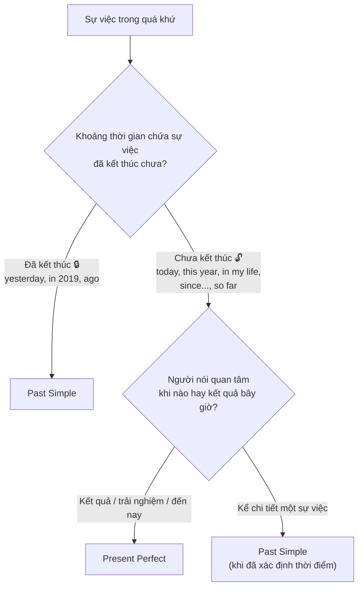

# A2-G007 · Present Perfect vs Past Simple — So sánh hiện tại hoàn thành và quá khứ đơn

## Mục lục

- [A. Lesson Information](#a-lesson-information)
- [B. Warm-up](#b-warm-up-tình-huống-thực-tế)
- [C. WHAT](#c-what-hai-cách-nhìn-về-quá-khứ)
- [D. WHY](#d-why-thời-gian-đã-đóng-hay-còn-mở)
- [E. FORM](#e-form-bảng-đối-chiếu-và-dấu-hiệu)
- [F. HOW](#f-how-các-cặp-đối-chiếu)
- [G. VISUAL](#g-visual-explanation)
- [H. COMPARISON](#h-comparison-những-trường-hợp-khó)
- [I. COMMON MISTAKES](#i-common-mistakes)
- [J. MEMORY TRICKS](#j-memory-tricks)
- [K. REAL-LIFE APPLICATION](#k-real-life-application)
- [L. PRACTICE EXERCISES](#l-practice-exercises)
- [M. KNOWLEDGE CHECK](#m-knowledge-check)
- [N. ANSWER KEY](#n-answer-key)

---

## A. Lesson Information

| Mục | Nội dung |
|---|---|
| **Lesson ID** | A2-G007 |
| **Topic** | Present Perfect vs Past Simple |
| **Tên tiếng Việt** | So sánh hiện tại hoàn thành và quá khứ đơn |
| **CEFR Level** | A2 |
| **Prerequisites** | [A2-G004](A2-G004-present-perfect-experience.md), [A2-G005](A2-G005-present-perfect-just-already-yet.md), [A2-G006](A2-G006-present-perfect-since-for.md) |
| **Estimated Time** | 90 phút |

**Learning Objectives:**

1. Chọn đúng giữa HTHT và QKĐ dựa trên **thời gian đóng/mở** và **mối liên hệ với hiện tại**.
2. Nhận diện dấu hiệu thời gian của mỗi thì — và biết khi nào dấu hiệu **không đủ**.
3. Xử lý các trường hợp khó: *this morning, today, this week*; người đã mất; tin tức.
4. Chuyển tự nhiên từ HTHT (giới thiệu chủ đề) sang QKĐ (kể chi tiết).
5. Làm bài tập trộn không ghi tên thì và giải thích lý do chọn thì.

---

## B. Warm-up: Tình huống thực tế

Hai câu sau đều nói về việc đọc cuốn *Dế Mèn phiêu lưu ký*:

> 1. *I've **read** "De Men" three times.*
> 2. *I **read** "De Men" when I was ten.*

So sánh thêm hai câu về một tác giả giả định đang viết sách:

> *Ms An has written five stories so far.* (đến nay đã viết năm truyện)
> *She wrote her first story in 2010.* (viết truyện đầu năm 2010)

Cùng một người có thể dùng cả hai thì. Hãy xác định đang tổng kết đến nay hay định vị một sự kiện ở thời gian đã kết thúc; không chọn thì chỉ vì người đó còn sống.

---

## C. WHAT: Hai cách nhìn về quá khứ

| | Past Simple | Present Perfect |
|---|---|---|
| Nhìn vào | **Quá khứ** — một câu chuyện đã kết thúc | **Hiện tại** — kết quả, trải nghiệm, trạng thái đến nay |
| Thời gian | **Đã đóng**: xác định, đã kết thúc | **Còn mở**: chưa kết thúc / không xác định |
| Câu hỏi tự đặt | "Chuyện xảy ra **khi nào**?" | "Bây giờ **thế nào**?" / "Đến nay đã...?" |
| Ví dụ | *I **met** her in 2019.* | *I'**ve met** her before.* |

---

## D. WHY: Thời gian "đã đóng" hay "còn mở"

Hãy hình dung mỗi khoảng thời gian là một **chiếc hộp**:

- **Hộp đã đóng** 📦🔒 (*yesterday, last year, in 2015, when I was a child, two days ago*): khoảng thời gian **đã kết thúc hoàn toàn** → **Quá khứ đơn**.
- **Hộp còn mở** 📦🔓 (*today, this week, this year, in my life, so far, since..., for... đến nay*): khoảng thời gian **vẫn đang tiếp diễn**, chạm tới bây giờ → **Hiện tại hoàn thành**.



**Tiểu sử:** khi kể sự nghiệp đã kết thúc, quá khứ đơn thường phù hợp. Nhưng tuổi thọ không phải công tắc chọn thì; người còn sống vẫn có sự kiện quá khứ dùng đơn, và ảnh hưởng/tác phẩm của người đã mất vẫn có thể được bàn từ điểm nhìn hiện tại.

---

## E. FORM: Bảng đối chiếu và dấu hiệu

| | Past Simple | Present Perfect |
|---|---|---|
| ➕ | S + V2 | S + have/has + V3 |
| ➖ | S + didn't + V | S + haven't/hasn't + V3 |
| ❓ | Did + S + V? | Have/Has + S + V3? |
| Dấu hiệu thường gặp | *yesterday, last week/month/year, ... ago, in 2010, on Monday (đã qua), when I was..., What time / When...?* | *ever, never, before, just, already, yet, still, so far, recently, lately, since, for (đến nay), How long...?, How many times...?* |
| Dấu hiệu "nước đôi" | *for* (nếu đã kết thúc), *this morning* (nếu buổi sáng đã qua) | *for* (nếu còn tiếp diễn), *today, this week, this year* (nếu còn đang trong khoảng đó) |

> Khi hỏi thời điểm một sự kiện đã xảy ra như lần đến này, dùng *When did you arrive?*. Không suy rằng mọi when đều quá khứ đơn: *When does the class start?* hỏi lịch; *When will you arrive?* hỏi tương lai. Bảng công thức quá khứ đơn ở đây áp dụng động từ thường; với be dùng was/were trực tiếp.

---

## F. HOW: Các cặp đối chiếu

| # | Cặp ví dụ | Dịch và phân tích |
|---|---|---|
| 1 | I've lost my keys. / I lost my keys yesterday, but I found them later. | Tôi mất chìa rồi / Hôm qua mất nhưng sau đó tìm lại. Have lost gắn tình huống hiện tại; lost/found kể chuỗi sự kiện đã qua. Quá khứ đơn không tự nói kết quả hiện tại nếu không có phần found. |
| 2 | She's been to Paris. / She went to Paris in 2019. | Cô ấy từng đến Paris / Cô ấy đi Paris năm 2019. Has been to tổng kết chuyến thăm đến nay; went đặt chuyến đi ở năm cụ thể đã qua. |
| 3 | I've worked here for five years and still do. / I worked there for five years before moving away. | Tôi làm đây năm năm và còn làm / Tôi từng làm đó năm năm trước khi chuyển đi. For chỉ độ dài; chính ngữ cảnh quyết định khoảng còn tiếp tục hay đã kết thúc. |
| 4 | Have you seen Nam today? / Did you see Nam yesterday? | Hôm nay bạn đã thấy Nam chưa? / Hôm qua bạn có thấy Nam không? Câu đầu hỏi tổng đến nay, câu sau giới hạn hôm qua. Did you see Nam today cũng có thể đúng nếu hỏi lần gặp cụ thể hôm nay. |
| 5 | I've had three coffees this morning. / I had three coffees this morning. | Sáng nay tôi đã uống ba cà phê / Tôi đã uống ba cà phê sáng nay. Câu đầu tổng đến thời điểm đang còn buổi sáng; câu sau có thể kể việc uống đã xong, đặc biệt khi đã sang chiều. Không bắt buộc mọi câu buổi sáng dùng hoàn thành. |
| 6 | Ms An has written five stories so far. / She wrote her first story in 2010. | Đến nay An đã viết năm truyện / Cô viết truyện đầu năm 2010. Cùng tác giả giả định, so far nối đến nay; in 2010 định vị một sự kiện. |
| 7 | Have you ever eaten durian? / When did you eat it? | Bạn từng ăn sầu riêng chưa? / Bạn ăn lúc nào? Have eaten hỏi trải nghiệm; did eat nguyên mẫu hỏi thời điểm một lần đã xác định. |
| 8 | The club has announced a new event. / The organiser announced it at nine yesterday. | Câu lạc bộ vừa thông báo sự kiện mới / Người tổ chức thông báo lúc chín hôm qua. Câu đầu đưa tin mới; câu sau nêu thời gian đã qua. Đây là tình huống giả định. |
| 9 | I've just finished. / I finished ten minutes ago. | Tôi vừa xong / Tôi xong mười phút trước. Have finished nhấn gần hiện tại; finished đi với mốc ago. I just finished cũng có cách dùng chuẩn theo biến thể/ngữ cảnh. |
| 10 | We haven't decided yet. / We didn't decide anything at the meeting. | Đến giờ chúng tôi chưa quyết / Chúng tôi không quyết gì trong buổi họp. Have not tính đến nay; did not giới hạn buổi họp đã kết thúc, sau họp có thể đã quyết. |

### Mô hình hội thoại tự nhiên: HTHT → QKĐ

> **A:** *Have you **heard** the news? Lan **has got** a new job!* (tin mới — HTHT)
> **B:** *Really? When **did** she **get** it?* (hỏi thời điểm — QKĐ)
> **A:** *She **signed** the contract on Monday. She **started** yesterday.* (chi tiết — QKĐ)

---

## G. VISUAL EXPLANATION

### G1. Hai timeline

```text
PAST SIMPLE:       ──── [ last year 🔒 ] ─────────────── NOW
                          ✕ I went to Japan.

PRESENT PERFECT:   ───────────── [ my life 🔓 ─────────── NOW ]
                          ✕         ✕     "I've been to Japan twice."
```

### G2. "Hộp" thời gian

| Thời gian đã đóng, thường Past Simple | Khoảng còn mở, có thể tổng kết bằng Present Perfect |
|---|---|
| yesterday | today |
| last week | this week |
| last year | this year |
| in 2020 | in my life / ever |
| when I was young | since I was young |
| two hours ago | so far / up to now |

---

## H. COMPARISON: Những trường hợp khó

### 1. *Today, this morning, this week*

Phụ thuộc thời điểm nói **và cách người nói nhìn sự việc**:
- Nói lúc 11 giờ sáng: *I'**ve sent** 20 emails **this morning**.* (buổi sáng chưa hết)
- Nói lúc 4 giờ chiều: *I **sent** 20 emails **this morning**.* (buổi sáng đã hết)

Dù vẫn là buổi sáng, *I sent the email at nine this morning* vẫn kể sự kiện đã xong ở mốc chín giờ. Today/this week không ép một thì duy nhất.

### 2. Kể chuyện: mở đầu HTHT, phát triển QKĐ

*I'**ve had** a terrible day! First I **missed** the bus, then I **spilled** coffee on my shirt...*
Câu mở đầu tóm tắt **tình trạng hiện tại**; các chi tiết là **chuỗi sự kiện** → QKĐ.

### 3. Anh – Anh và Anh – Mỹ

Người Mỹ dùng QKĐ trong nhiều tình huống người Anh dùng HTHT: *Did you eat yet?* (Mỹ) / *Have you eaten yet?* (Anh). Trong bài luyện này, chú ý yêu cầu góc nhìn cụ thể; không tự chấm mọi biến thể Anh Mỹ là sai hoặc suy ra một quy định thi quốc tế.

### 4. Người/vật đã không còn

*My grandfather **was** a teacher. He **taught** for 40 years.* (đang kể một giai đoạn đã kết thúc)
*My grandfather **has been** a teacher for 40 years.* (trạng thái nghề nghiệp kéo đến hiện tại trong ngữ cảnh này)

---

## I. COMMON MISTAKES

| # | ❌ Sai | ✅ Đúng | Nguyên nhân | Cách tránh |
|---|---|---|---|---|
| 1 | I **have seen** him **yesterday**. | I **saw** him yesterday. | Dùng HTHT với hộp đã đóng | Có *yesterday/ago/last* → QKĐ |
| 2 | When did you **arrived**? | When did you **arrive**? | Sai dạng sau did | Hỏi sự kiện quá khứ cụ thể: did + V |
| 3 | I **lived** here **since** 2015. (vẫn sống) | I'**ve lived** here since 2015. | | *since* + còn tiếp diễn → HTHT |
| 4 | **Did** you **ever** **be** to Japan? | **Have** you **ever been** to Japan? | | Trải nghiệm → HTHT |
| 5 | Our school **has opened** in 1998. | Our school **opened** in 1998. | Mốc đã kết thúc | Sửa theo thời gian, không theo tuổi thọ chủ thể |
| 6 | "Have you been to Hoi An?" — "Yes, I **have been** there in May." | "Yes, I **have**. I **went** there in May." | Giữ HTHT khi có thời gian | Chi tiết + thời gian → QKĐ |
| 7 | I **haven't finish** my homework yet. | I **haven't finished** my homework yet. | Thiếu V3 | Did not finish...yet có thể đúng theo biến thể; lỗi ở đây là thiếu V3 |
| 8 | I **have been** to the cinema **last night**. | I **went** to the cinema last night. | | |

---

## J. MEMORY TRICKS

1. **"Hộp khóa 🔒 → Past Simple; Hộp mở 🔓 → Present Perfect"**.
2. **Hỏi thời điểm sự kiện đã xảy ra:** dùng When did + V trong mẫu này; hỏi lịch/tương lai dùng thì tương ứng.
3. **"Tin mới — HTHT; Chi tiết — QKĐ"**: Báo chí tiếng Anh thường mở đầu bằng HTHT (*has announced*) rồi kể chi tiết bằng QKĐ (*said, added*). Đọc báo để quan sát mô hình này.
4. **Cùng một người, nhiều góc nhìn:** tổng kết đến nay khác kể một thành tựu năm cụ thể; không dùng sống/mất làm quy tắc tuyệt đối.

---

## K. REAL-LIFE APPLICATION

### Bài đọc: A news report

**Bản tin hư cấu, đặt vào năm 2025.** Tên người/quán/giải thưởng và số liệu chỉ phục vụ bài đọc, không phải tin tức được xác minh. Mốc 2012 → 2025 giải thích khoảng thirteen years.

> **Local café owner wins national award**
>
> *Ms Tran Thi Bich, owner of the Bich Café in Hoi An, **has won** the "Best Small Business" award for 2025.*
>
> *Ms Bich **opened** her café in 2012 with only four tables. Since then, the café **has become** one of the most popular places in the old town. She **has trained** more than fifty young people from poor families, and many of them **have opened** their own businesses.*
>
> *She **received** the award at a ceremony in Hanoi last Friday. "I **didn't expect** it," she **said**. "I'**ve worked** hard for thirteen years, but I **have** never **thought** about prizes. I just love coffee and people."*
>
> *The café **has** already **received** hundreds of congratulatory messages this week.*

**Vietnamese explanation:** Bà Trần Thị Bích, chủ quán cà phê ở Hội An, vừa đạt giải "Doanh nghiệp nhỏ xuất sắc nhất" năm 2025. Quán mở năm 2012 với 4 bàn, từ đó trở thành một trong những nơi nổi tiếng nhất phố cổ; bà đã đào tạo hơn 50 bạn trẻ nghèo. Bà nhận giải tại Hà Nội thứ Sáu tuần trước.

**Grammar highlights:**

| Present Perfect (tin mới, đến nay, kết quả) | Past Simple (thời điểm cụ thể đã qua) |
|---|---|
| has won, has become (since then), has trained, have opened, 've worked (for 13 years), have never thought, has already received (this week) | opened (in 2012), received (last Friday), didn't expect, said |

---

## L. PRACTICE EXERCISES

> ✍️ Đáp án: [A2-G007-ANSWERS](../../12-ANSWERS-AND-EXPLANATIONS/A2/A2-G007-ANSWERS.md)

### Level 1 — Recognition

**L1.1.** I ___ my best friend in 2015.  A. have met  B. met  C. meet  D. have meet
**L1.2.** Chọn hiện tại hoàn thành đúng: ___ you ever ___ to a concert? A. Did / go  B. Have / been  C. Have / went  D. Do / go
**L1.3.** Bạn đã làm công việc này hai năm. Hỏi ngày bắt đầu đã xảy ra: When ___ you ___ your job?  A. have / started  B. did / start  C. do / start  D. has / started
**L1.4.** My grandmother ___ in a factory for thirty years. She retired in 2010.  A. has worked  B. worked  C. works  D. has been working
**L1.5.** (11 a.m., chọn hiện tại hoàn thành để tổng kết đến lúc nói) I'm so tired! I ___ four cups of coffee this morning.  A. had  B. have had  C. was having  D. have
**L1.6.** The writer ___ this story in 1998.  A. has written  B. wrote  C. writes  D. has wrote

### Level 2 — Controlled Practice

Chia theo nghĩa; chấp nhận biến thể đúng nếu giải thích được. Các câu hỏi yet trong nhóm này luyện hiện tại hoàn thành; không coi quá khứ đơn Anh Mỹ tự động sai.

**L2.1.** I (never / eat) ___ snails. Are they good?
**L2.2.** We (go) ___ to Sapa last December. It (be) ___ freezing!
**L2.3.** "Where's your car?" — "I (sell) ___ it. I don't need a car now."
**L2.4.** She (live) ___ in London since 2018. Before that, she (live) ___ in Paris for two years.
**L2.5.** (you / see) ___ the new Marvel film yet? — Yes, I (see) ___ it on Saturday.
**L2.6.** Look! Someone (break) ___ the window.
**L2.7.** When I was a child, I (not / like) ___ vegetables.
**L2.8.** How many countries (you / visit) ___ so far?
**L2.9.** (Báo cáo đến nay của năm đang diễn ra) The company (make) ___ a lot of money last year, but it (not / make) ___ much this year.
**L2.10.** I (know) ___ Phong for ten years. We (meet) ___ at university.

### Level 3 — Error Correction

Mỗi câu có một lỗi về thì hoặc hình thức động từ. Tìm, sửa và **giải thích ngắn** lý do.

**L3.1.** I have finished my homework two hours ago.
**L3.2.** When have you bought that jacket?
**L3.3.** My father worked at this bank since 2005. (ông vẫn đang làm)
**L3.4.** Have you ever try Ethiopian food?
**L3.5.** Our school has opened in 1998.
**L3.6.** I didn't see her since last summer.

### Level 4 — Production

Dịch sang tiếng Anh:

**L4.1.** Tôi đã đến Đà Lạt nhiều lần. Lần cuối là tháng trước.
**L4.2.** Bạn đã bắt đầu làm ở đây khi nào?
**L4.3.** Năm nay giá vàng đã tăng rất nhiều. (*the price of gold, go up*)
**L4.4.** Ông nội tôi là bác sĩ. Ông làm việc ở bệnh viện Chợ Rẫy 35 năm. (ông đã nghỉ hưu)

**L4.5.** Viết lại đoạn văn sau, sửa **tất cả** lỗi thì (có 5 lỗi):
> *I have started learning English in 2020. Since then, I took three courses and I passed two exams. Last year, I have gone to Singapore for a conference. It has been my first time speaking English with foreigners. I was nervous, but it was a great experience.*

### Level 5 — Real Communication

**L5.1.** Viết bài 120–150 từ: *My English learning journey*. Mở đầu bằng HTHT (bạn đã học bao lâu, đã làm được gì), sau đó kể 2–3 kỷ niệm cụ thể bằng QKĐ (có thời gian), kết thúc bằng những gì bạn chưa làm được (*haven't... yet*).
**L5.2.** **Speaking — Interview a classmate (or yourself):** Mỗi chủ đề hỏi một câu HTHT rồi một câu QKĐ để lấy chi tiết. Chủ đề: du lịch, món ăn lạ, thể thao, sự kiện đặc biệt, người nổi tiếng. Ví dụ: *Have you ever played golf? — Yes. When did you play? Who did you play with?*

---

## M. KNOWLEDGE CHECK

### 5 câu hỏi tự kiểm tra

1. Giải thích quy tắc "hộp đóng/hộp mở".
2. Vì sao *When have you arrived?* sai?
3. Nếu vẫn là buổi sáng, có bắt buộc mọi câu với this morning đều dùng HTHT không?
4. Một tác giả còn sống có thể được nói đến bằng QKĐ không? Cho ví dụ.
5. Trong một cuộc hội thoại, khi nào chuyển từ HTHT sang QKĐ?

### Checklist

- [ ] Tôi chọn đúng thì trong bài tập trộn ≥ 80%.
- [ ] Tôi giải thích được lý do chọn thì bằng lời.
- [ ] Tôi kể được một trải nghiệm: giới thiệu (HTHT) → chi tiết (QKĐ).

### 3 lỗi quan trọng cần nhớ

1. HTHT **không** đi với *yesterday, ago, last..., in 2010*.
2. Hỏi thời điểm một sự kiện quá khứ cụ thể: When did + V; không áp cho mọi câu when.
3. *since* + trạng thái còn tiếp diễn → **HTHT**, không phải QKĐ.

### Lịch ôn tập

| Ngày | Việc cần làm |
|---|---|
| Ngày 1 | Làm lại L2 và giải thích từng câu |
| Ngày 3 | Đọc một bản tin tiếng Anh ngắn, gạch chân HTHT và QKĐ |
| Ngày 7 | Làm phần A2 trong [LAB-02 Mixed Grammar](../../10-PRACTICE-LAB/LAB-02-mixed-grammar-exercises.md) |

### Liên kết

- ➡️ Bài tiếp theo: [A2-G008 — Present Continuous for Future](A2-G008-present-continuous-future.md)
- 🔁 Tra cứu: [ALL-TENSES-COMPARISON](../../06-GRAMMAR-REFERENCE/ALL-TENSES-COMPARISON.md)
- 🎯 **Mini Challenge khối A2-2:** *Talk about your last holiday* — xem [A2 README](../README.md#5-mini-challenges)

---

## N. ANSWER KEY

👉 [A2-G007-ANSWERS.md](../../12-ANSWERS-AND-EXPLANATIONS/A2/A2-G007-ANSWERS.md)
