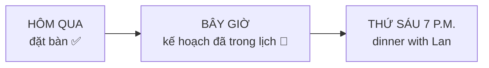
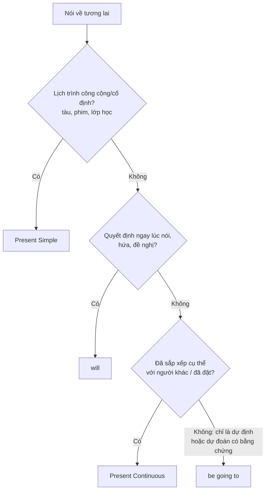

# A2-G008 · Present Continuous for Future Arrangements — Hiện tại tiếp diễn chỉ kế hoạch đã sắp xếp

## Mục lục

- [A. Lesson Information](#a-lesson-information)
- [B. Warm-up](#b-warm-up-tình-huống-thực-tế)
- [C. WHAT](#c-what-kế-hoạch-đã-được-sắp-xếp)
- [D. WHY](#d-why-tương-lai-đã-có-trong-lịch)
- [E. FORM](#e-form-công-thức)
- [F. HOW](#f-how-ví-dụ-phân-tích)
- [G. VISUAL](#g-visual-explanation)
- [H. COMPARISON](#h-comparison-bốn-cách-nói-về-tương-lai)
- [I. COMMON MISTAKES](#i-common-mistakes)
- [J. MEMORY TRICKS](#j-memory-tricks)
- [K. REAL-LIFE APPLICATION](#k-real-life-application)
- [L. PRACTICE EXERCISES](#l-practice-exercises)
- [M. KNOWLEDGE CHECK](#m-knowledge-check)
- [N. ANSWER KEY](#n-answer-key)

---

## A. Lesson Information

| Mục | Nội dung |
|---|---|
| **Lesson ID** | A2-G008 |
| **Topic** | Present Continuous for Future Arrangements; comparing future forms |
| **Tên tiếng Việt** | Hiện tại tiếp diễn chỉ kế hoạch tương lai; so sánh các cách nói tương lai |
| **CEFR Level** | A2 |
| **Prerequisites** | [A1-G004](../../02-A1-BEGINNER/grammar/A1-G004-present-continuous.md), [A1-G019 — Will](../../02-A1-BEGINNER/grammar/A1-G019-future-will.md), [A1-G020 — Going to](../../02-A1-BEGINNER/grammar/A1-G020-be-going-to.md) |
| **Estimated Time** | 75 phút |

**Learning Objectives:**

1. Dùng hiện tại tiếp diễn cho **kế hoạch đã sắp xếp cụ thể** (có người khác tham gia, có giờ, có địa điểm, đã đặt chỗ).
2. Phân biệt bốn cách nói tương lai: **present continuous, be going to, will, present simple (lịch trình)**.
3. Hỏi về kế hoạch: *What are you doing this weekend? Are you doing anything tonight?*
4. Dùng mốc thời gian hoặc ngữ cảnh để người nghe hiểu đang nói kế hoạch tương lai; không bắt buộc lặp mốc trong mọi câu.
5. Lên lịch, sắp xếp cuộc hẹn bằng tiếng Anh.

---

## B. Warm-up: Tình huống thực tế

Đồng nghiệp hỏi bạn về tối thứ Sáu. Bạn mở lịch trên điện thoại:

> 📅 Fri 7 p.m. — Dinner with Lan @ Pizza 4P's (booked)

Bạn trả lời: "Tối thứ Sáu tôi **ăn tối** với Lan ở Pizza 4P's."

🤔 **Hãy suy nghĩ:** Ở A1, bạn học *I'm going to have dinner...* (dự định) và *I'll have dinner...* (quyết định lúc nói). Nhưng người bản ngữ thường nói: *I'**m having** dinner with Lan on Friday.* Vì sao lại dùng thì "đang"? Và câu này có khiến người nghe hiểu nhầm là bạn **đang** ăn tối không?

---

## C. WHAT: Kế hoạch đã được sắp xếp

**Present continuous for future** (hiện tại tiếp diễn chỉ tương lai) dùng cho **kế hoạch cá nhân đã được sắp xếp** (*arrangements*) — thường:

- **Có người khác** tham gia hoặc biết (bạn bè, bác sĩ, khách hàng...).
- **Đã chốt**: có ngày giờ, địa điểm, đã đặt vé/đặt chỗ/hẹn.
- Như thể đã **ghi vào lịch** 📅.

| Câu | Ý nghĩa |
|---|---|
| *I'**m meeting** my boss at 10 tomorrow.* | Đã hẹn với sếp lúc 10 giờ mai. |
| *We'**re flying** to Bangkok on Saturday.* | Lịch bay đã được sắp xếp; câu tự nó không chứng minh đã thanh toán vé. |
| *She'**s seeing** the dentist this afternoon.* | Đã có lịch hẹn nha sĩ chiều nay. |

Cần người nghe hiểu thời gian từ cụm như tomorrow/tonight hoặc ngữ cảnh. *Are you free tomorrow? — No, I'm working* không cần lặp tomorrow. Khi câu đứng riêng dễ mơ hồ, thêm mốc là cách làm rõ, không phải điều kiện ngữ pháp bắt buộc.

---

## D. WHY: Tương lai "đã có trong lịch"

Hiện tại tiếp diễn diễn tả điều **đã bắt đầu/đang trong tiến trình**. Khi nói về kế hoạch đã sắp xếp, người nói coi sự việc tương lai **đã được "khởi động" từ hiện tại**: vé đã mua, lịch đã hẹn, mọi thứ đang "chạy" để dẫn tới sự việc.

So sánh:
- *I'm **going to** have dinner with Lan.* — tôi **dự định** (có thể chưa liên lạc với Lan, chưa đặt bàn).
- *I'm **having** dinner with Lan on Friday.* — trình bày như **đã hẹn/sắp xếp**; không tự chứng minh đã đặt bàn hay trả tiền.

---

## E. FORM: Công thức

Giống hiện tại tiếp diễn ([A1-G004](../../02-A1-BEGINNER/grammar/A1-G004-present-continuous.md)); thời gian tương lai rõ từ câu hoặc ngữ cảnh. S = chủ ngữ; V-ing = động từ thêm -ing. Trả lời ngắn: *Are you coming? — Yes, I am / No, I'm not; Is she coming? — Yes, she is / No, she isn't.*

| | Công thức | Ví dụ |
|---|---|---|
| ➕ | S + am/is/are + V-ing + **thời gian tương lai** | *They're getting married **in June**.* |
| ➖ | S + am/is/are + not + V-ing + ... | *I'm not working **tomorrow**.* |
| ❓ | Am/Is/Are + S + V-ing + ...? | *Are you doing anything **tonight**?* |
| Wh- | Wh- + am/is/are + S + V-ing...? | *What time **are** you **leaving** **tomorrow**?* |

### Câu hỏi hỏi kế hoạch thông dụng

| Câu hỏi | Nghĩa |
|---|---|
| *What are you doing this weekend?* | Cuối tuần này bạn làm gì? |
| *Are you doing anything tonight?* | Tối nay bạn có bận gì không? |
| *When are you leaving?* | Khi nào bạn đi? |
| *Who are you going with?* | Bạn đi với ai? |

---

## F. HOW: Ví dụ phân tích

| # | English | Tiếng Việt | Phân tích |
|---|---|---|---|
| 1 | *I'**m having** lunch with a client **tomorrow**.* | Mai tôi ăn trưa với khách hàng. | I + am + having; tomorrow làm rõ tương lai; người nói trình bày bữa trưa như lịch hẹn, không phải đang ăn lúc nói. |
| 2 | *My parents **are visiting** us **next weekend**.* | Cuối tuần sau bố mẹ tôi đến thăm. | Parents số nhiều dùng are visiting; next weekend xác định lịch thăm đã thống nhất trong tình huống. |
| 3 | *We'**re moving** to a new flat **in March**.* | Tháng Ba chúng tôi chuyển nhà. | We are moving + in March là lịch chuyển dự kiến đã thu xếp; câu không tự chứng minh đã ký hợp đồng thuê. |
| 4 | *"Are you free on Saturday?" — "Sorry, I'**m working**."* | Thứ Bảy bạn rảnh không? — Xin lỗi, tôi phải làm. | I am working không lặp on Saturday vì câu hỏi đã cho mốc; đây là ví dụ ngữ cảnh đủ xác định tương lai. |
| 5 | *What **are** you **doing** **tonight**?* | Tối nay bạn làm gì? | What + are + you + doing + tonight: hỏi kế hoạch, không thêm do; câu trả lời có thể chưa có kế hoạch. |
| 6 | *She'**s starting** her new job **on Monday**.* | Thứ Hai cô ấy bắt đầu công việc mới. | She is starting + on Monday nêu ngày bắt đầu đã xác định; không tự khẳng định hình thức hợp đồng. |
| 7 | *I'**m not coming** to the party — I'm too tired.* | Tôi không đi tiệc đâu — mệt quá. | Am not coming thông báo không tham dự bữa tiệc đã rõ trong ngữ cảnh; not sau am, come → coming. |
| 8 | *We'**re flying** to Da Nang **at 6 a.m.**, so we need to get up early.* | Chúng tôi bay ra Đà Nẵng lúc 6 giờ sáng... | We are flying nêu lịch của nhóm; at six cho giờ. Cần ngữ cảnh chuyến sắp tới; không suy thời gian cố định là bảo đảm không thay đổi. |
| 9 | *The train **leaves** at 6:30.* | Tàu chạy lúc 6:30. | Leaves chia hiện tại đơn cho thời gian biểu trong tình huống. Is leaving cũng có thể nói chuyến cụ thể; không phải chỉ một dạng hợp ngữ pháp. |
| 10 | *Is Nam **coming** to the meeting **this afternoon**?* | Chiều nay Nam có đến họp không? | Is đảo trước Nam; coming giữ V-ing; this afternoon làm rõ mốc kế hoạch tương lai. |

---

## G. VISUAL EXPLANATION

### G1. Từ "đang" đến "sẽ" — phân biệt bằng cụm thời gian

| Câu | Nghĩa |
|---|---|
| *I'm meeting Tom.* | Cần ngữ cảnh: có thể đang gặp hoặc đã hẹn sắp gặp Tom |
| *I'm meeting Tom **tomorrow**.* | **Kế hoạch** gặp Tom ngày mai |

### G2. Trang lịch tuần

| Ngày | Lịch | Câu |
|---|---|---|
| Mon | 9:00 dentist | *I'm seeing the dentist on Monday at 9.* |
| Wed | 18:30 yoga with Mai | *I'm doing yoga with Mai on Wednesday evening.* |
| Fri | 19:00 dinner — Lan (booked) | *I'm having dinner with Lan on Friday.* |
| Sat | flight HAN→SGN 07:15 | *I'm flying to Saigon on Saturday morning.* |

---

## H. COMPARISON: Bốn cách nói về tương lai

| Hình thức | Dùng khi | Ví dụ |
|---|---|---|
| **Present continuous** | Kế hoạch **cá nhân đã sắp xếp** (có lịch, có người khác, đã đặt) 📅 | *I'm meeting Lan at 7.* |
| **be going to** | **Dự định** đã có trong đầu (chưa chắc đã sắp xếp) 🧠; **dự đoán có bằng chứng** 👀 | *I'm going to learn Japanese.* / *It's going to rain.* |
| **will** | **Quyết định tức thời** 💡, lời hứa, đề nghị, **dự đoán theo ý kiến** | *I'll help you.* / *I think it'll rain.* |
| **Present simple** | **Lịch trình, thời gian biểu** công cộng, cố định ⏰ | *The film starts at 8.* / *The shop opens at 9.* |

### Sơ đồ chọn hình thức tương lai

> 💡 Ranh giới giữa *going to* và *present continuous* đôi khi mờ — nhiều câu dùng được cả hai (*I'm going to see / I'm seeing the doctor tomorrow*). Quy tắc trên giúp bạn chọn cách **tự nhiên nhất**, không phải để loại bỏ hoàn toàn cách còn lại.

---

## I. COMMON MISTAKES

| Câu cần sửa | Câu đúng hoặc rõ hơn | Lý do |
|---|---|---|
| I meeting my boss tomorrow. | I'm meeting my boss tomorrow. | Thiếu be trong tiếp diễn. |
| Do you doing anything tonight? | Are you doing anything tonight? | Doing cần are, không do. |
| I'm having dinner. (muốn thông báo lịch tối mai nhưng chưa có ngữ cảnh) | I'm having dinner tomorrow evening. | Câu gốc không sai; thêm mốc để rõ ý tương lai. |
| It raining tomorrow. | It's going to rain tomorrow. | Thiếu động từ hữu hạn; going to diễn tả dự đoán. Thời tiết không phải lịch hẹn cá nhân. |
| I'll to book the room. | I'll book the room. | Sau will dùng nguyên mẫu không to. |
| The museum open at nine every morning. | The museum opens at nine every morning. | Lịch lặp lại, chủ ngữ số ít chia -s. |
| I'm knowing the result tomorrow. | I'll know the result tomorrow. | Know ở nghĩa biết là trạng thái, không dùng tiếp diễn thông thường. |

Hiện tại đơn không chỉ dành cho lịch trình công cộng: *I start work at nine tomorrow* có thể là lịch cá nhân. Present continuous và going to chồng lấn khi kế hoạch đã thu xếp. Không đổi một câu đúng thành “lỗi” chỉ vì muốn luyện dạng khác; nêu rõ dạng yêu cầu.

---

## J. MEMORY TRICKS

1. **"Có trong lịch 📅 → V-ing"**: Nếu bạn có thể ghi nó vào lịch Google với giờ, địa điểm, người tham gia → hiện tại tiếp diễn.
2. **Bốn biểu tượng tương lai**: 📅 present continuous · 🧠👀 going to · 💡 will · ⏰ present simple.
3. **Thời gian nằm trong câu hoặc ngữ cảnh**: không rõ thì thêm mốc; không bắt buộc lặp mốc đã được hỏi.

---

## K. REAL-LIFE APPLICATION

### Hội thoại: Sắp xếp một cuộc họp

> **Anna:** Hi Minh, can we meet this week to discuss the new project?
> **Minh:** Sure. Let me check my calendar. On Monday, I'**m visiting** a client in Bien Hoa all day.
> **Anna:** What about Tuesday?
> **Minh:** I'**m having** a training session in the morning, but I'm free after 2.
> **Anna:** Hmm, I'**m flying** to Hanoi on Tuesday afternoon. My flight **leaves** at 3.
> **Minh:** OK. **Are** you **doing** anything on Wednesday morning?
> **Anna:** No, I'm not. Wednesday at 9?
> **Minh:** Perfect. I'**ll book** a meeting room and send you an invitation.
> **Anna:** Great. Oh, and I think I'**m going to** invite Hoa too — she knows the client well.
> **Minh:** Good idea. See you on Wednesday!

**Vietnamese explanation:** Anna và Minh xếp lịch họp: thứ Hai Minh đi gặp khách hàng cả ngày; thứ Ba sáng Minh có buổi đào tạo, chiều Anna bay ra Hà Nội (chuyến bay 3 giờ); chốt sáng thứ Tư lúc 9 giờ. Minh sẽ đặt phòng họp (quyết định lúc nói → *will*); Anna định mời thêm Hoa (dự định → *going to*).

**Grammar highlights:** 📅 *I'm visiting / I'm having / I'm flying / Are you doing...?* · ⏰ *My flight leaves at 3* · 💡 *I'll book* · 🧠 *I'm going to invite*.

**Useful expressions:** *Let me check my calendar.* · *What about Tuesday?* · *I'm free after 2.* · *I'll send you an invitation.*

---

## L. PRACTICE EXERCISES

> ✍️ Đáp án: [A2-G008-ANSWERS](../../12-ANSWERS-AND-EXPLANATIONS/A2/A2-G008-ANSWERS.md)

### Level 1 — Recognition

**L1.1.** Chọn hiện tại tiếp diễn chỉ sắp xếp: I ___ my grandparents this Sunday. I told them already.  A. visit  B. am visiting  C. will visit  D. visited
**L1.2.** Chọn hiện tại đơn cho thời gian biểu: The concert ___ at 8 p.m. — it's on the ticket.  A. starts  B. is starting  C. will start  D. start
**L1.3.** Chọn will cho lời nhận làm ngay: "The phone's ringing!" — "OK, I ___ it."  A. 'm getting  B. 'll get  C. get  D. 'm going to get
**L1.4.** ___ you doing anything special for your birthday?  A. Do  B. Are  C. Will  D. Have
**L1.5.** Look at the traffic! We ___ late.  A. are being  B. 're going to be  C. 're having  D. be
**L1.6.** Câu nào thể hiện **kế hoạch đã sắp xếp với người khác**?  A. I'll call the doctor.  B. I'm going to call the doctor someday.  C. I'm seeing the doctor at 4 tomorrow.  D. The doctor sees patients from 8 to 5.

### Level 2 — Controlled Practice

Viết câu với present continuous cho kế hoạch tuần tới của Lan:

| Mon | Wed | Fri | Sat |
|---|---|---|---|
| play tennis with Nam | have a job interview at 10 | go to a wedding | fly to Hue at 7 a.m. |

**L2.1.** (Monday) ______
**L2.2.** (Wednesday) ______
**L2.3.** (Friday) ______
**L2.4.** (Saturday) ______

Chọn hình thức tương lai phù hợp nhất (present continuous / going to / will / present simple):

**L2.5.** "I'm cold." — "I (close) ___ the window."
**L2.6.** My sister (get) ___ married in October. The invitations are ready.
**L2.7.** The last bus (leave) ___ at 11:30 p.m.
**L2.8.** I (learn) ___ to swim this summer. I haven't found a class yet.
**L2.9.** I think the new phone (be) ___ very expensive.
**L2.10.** (you / come) ___ to the meeting at 3 tomorrow?

### Level 3 — Error Correction

**L3.1.** I meeting my friends at the cinema tonight. We booked the tickets.
**L3.2.** Do you doing anything this weekend?
**L3.3.** It going to snow next week. (dự đoán trong tình huống giả định)
**L3.4.** "There's someone at the door." — "I'll to open it."
**L3.5.** The museum open at 9 every morning.
**L3.6.** We're having a party. (Câu đúng nhưng chưa có ngữ cảnh; thêm thông tin để người nghe biết lịch thứ Bảy tuần sau.)

### Level 4 — Production

Dịch sang tiếng Anh:

**L4.1.** Tối nay tôi đi xem phim với đồng nghiệp. (đã mua vé)
**L4.2.** Cuối tuần này bạn có làm gì không?
**L4.3.** Thứ Hai tuần sau chúng tôi chuyển văn phòng.
**L4.4.** Chuyến bay của tôi cất cánh lúc 6 giờ 45 sáng.

**L4.5.** **Explain:** Giải thích bằng tiếng Việt (2–3 câu) vì sao cùng nói về tối thứ Sáu nhưng người A nói *"I'm going to see a film"* còn người B nói *"I'm seeing a film with Hoa at CGV"*.

### Level 5 — Real Communication

**L5.1.** Viết email 80–100 từ cho một người bạn sắp đến thăm thành phố của bạn: nêu những kế hoạch **đã sắp xếp** (present continuous), lịch trình cố định (present simple — tàu, bảo tàng...), dự định (going to) và một lời hứa/đề nghị (will).
**L5.2.** **Speaking — Find a time:** Tự đóng vai hai người tìm thời gian gặp nhau trong tuần tới. Mỗi người có lịch bận khác nhau. Dùng *I'm... on Monday / Are you doing anything on...? / What about...? / I'll...*.

---

## M. KNOWLEDGE CHECK

### 5 câu hỏi tự kiểm tra

1. Present continuous chỉ tương lai dùng cho loại kế hoạch nào?
2. Vì sao cần thời gian rõ từ câu hoặc ngữ cảnh? Có bắt buộc luôn ghi tomorrow không?
3. Lịch trình tàu xe dùng thì gì?
4. Phân biệt: *I'm going to visit Hue* và *I'm visiting Hue on Saturday*.
5. Hỏi "Tối nay bạn có bận gì không?" bằng tiếng Anh.

### Checklist

- [ ] Tôi nói được lịch tuần tới của mình bằng present continuous.
- [ ] Tôi chọn đúng giữa 4 hình thức tương lai trong ≥ 80% trường hợp.
- [ ] Tôi sắp xếp được một cuộc hẹn bằng tiếng Anh.

### 3 lỗi quan trọng cần nhớ

1. Tiếp diễn cần be: ~~I meeting~~ → I**'m meeting**.
2. Thời tiết: ~~It's snowing next week~~ → It**'s going to** / It**'ll** snow.
3. Thời gian biểu trung tính: The museum **opens** at nine; đừng quên -s.

### Lịch ôn tập

| Ngày | Việc cần làm |
|---|---|
| Ngày 1 | Viết lịch tuần tới của bạn (5 câu present continuous) |
| Ngày 3 | Làm lại L2.5–L2.10 và giải thích |
| Ngày 7 | Làm lại L5.2 |

### Liên kết

- ➡️ Bài tiếp theo: [A2-G009 — Might / May](A2-G009-might-may-possibility.md)
- 🔁 Tra cứu: [ALL-TENSES-COMPARISON](../../06-GRAMMAR-REFERENCE/ALL-TENSES-COMPARISON.md)

---

## N. ANSWER KEY

👉 [A2-G008-ANSWERS.md](../../12-ANSWERS-AND-EXPLANATIONS/A2/A2-G008-ANSWERS.md)
