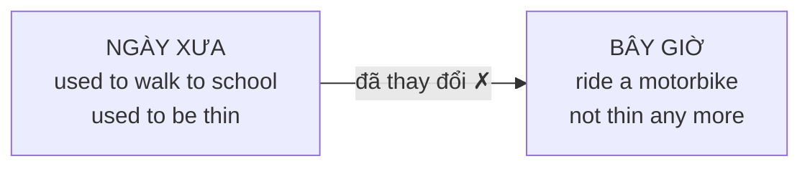

# A2-G010 · Used To — Thói quen và trạng thái trong quá khứ

## Mục lục

- [A. Lesson Information](#a-lesson-information)
- [B. Warm-up](#b-warm-up-tình-huống-thực-tế)
- [C. WHAT](#c-what-used-to-là-gì)
- [D. WHY](#d-why-quá-khứ-khác-với-hiện-tại)
- [E. FORM](#e-form-công-thức)
- [F. HOW](#f-how-ví-dụ-phân-tích)
- [G. VISUAL](#g-visual-explanation)
- [H. COMPARISON](#h-comparison)
- [I. COMMON MISTAKES](#i-common-mistakes)
- [J. MEMORY TRICKS](#j-memory-tricks)
- [K. REAL-LIFE APPLICATION](#k-real-life-application)
- [L. PRACTICE EXERCISES](#l-practice-exercises)
- [M. KNOWLEDGE CHECK](#m-knowledge-check)
- [N. ANSWER KEY](#n-answer-key)

---

## A. Lesson Information

| Mục | Nội dung |
|---|---|
| **Lesson ID** | A2-G010 |
| **Topic** | *Used to* + infinitive (past habits and states) |
| **Tên tiếng Việt** | *Used to* — thói quen, trạng thái trong quá khứ (nay không còn) |
| **CEFR Level** | A2 |
| **Prerequisites** | [A1-G018 — Past Simple: Negatives & Questions](../../02-A1-BEGINNER/grammar/A1-G018-past-simple-negatives-questions.md) |
| **Estimated Time** | 75 phút |

**Learning Objectives:**

1. Dùng ***used to + V*** để nói về **thói quen** và **trạng thái** trong quá khứ **nay không còn nữa**.
2. Tạo phủ định ***didn't use to*** và câu hỏi ***Did ... use to...?*** (chú ý chính tả *use*).
3. Phân biệt *used to* với quá khứ đơn: khi nào **phải** dùng quá khứ đơn.
4. Dùng *never used to*, *any more / any longer*, *now* để so sánh quá khứ – hiện tại.
5. Không nhầm *used to + V* với *be used to + V-ing* (G011, sau khi học G015).

---

## B. Warm-up: Tình huống thực tế

Bạn xem lại ảnh cũ và kể cho bạn bè:

> "Hồi nhỏ tôi **từng** sống ở quê. Tôi **thường** đi bộ đến trường và chơi thả diều mỗi chiều. Tôi **từng** rất gầy! Bây giờ thì tôi sống ở thành phố và đi làm bằng xe máy."

🤔 **Hãy suy nghĩ:** Bạn có thể dùng quá khứ đơn: *I lived in the countryside. I walked to school...* Nhưng quá khứ đơn không nói rõ rằng **bây giờ không còn như vậy**. Tiếng Anh có một cấu trúc chuyên dùng để nhấn mạnh "**ngày xưa thì thế, giờ thì khác**".

---

## C. WHAT: *Used to* là gì?

**Used to + V (nguyên mẫu)** diễn tả:

| Loại | Ví dụ | Ý nghĩa |
|---|---|---|
| **Thói quen** lặp lại trong quá khứ | *I **used to** walk to school.* | Ngày xưa tôi hay đi bộ đến trường (giờ không còn). |
| **Trạng thái** trong quá khứ | *I **used to** be very thin.* | Ngày xưa tôi rất gầy (giờ không gầy nữa). |
| | *There **used to** be a cinema here.* | Ở đây từng có một rạp phim (giờ không còn). |

Hàm ý quan trọng: **điều đó đã thay đổi**, hiện tại **không còn đúng**.

*Used to* **chỉ có ở quá khứ** — không có dạng hiện tại (~~I use to~~ khi nói về thói quen hiện tại; dùng hiện tại đơn + *usually*).

---

## D. WHY: Quá khứ khác với hiện tại

*Used to* là cách tiếng Anh "đóng khung" một giai đoạn trong quá khứ và đặt nó **tương phản** với hiện tại:



Tiếng Việt diễn đạt bằng "ngày xưa", "hồi trước", "từng", "hay"... *Used to* gói tất cả các ý này vào **một cấu trúc**.

---

## E. FORM: Công thức

**Ký hiệu:** **S** = chủ ngữ · **V** = động từ nguyên mẫu.

| | Công thức | Ví dụ |
|---|---|---|
| ➕ | S + **used to** + V | *She **used to** smoke.* |
| ➖ | S + **didn't use to** + V | *I **didn't use to** like coffee.* |
| ➖ (nhấn mạnh) | S + **never used to** + V | *He **never used to** exercise.* |
| ❓ | **Did** + S + **use to** + V? | ***Did** you **use to** play football?* |
| 💬 | Yes, S did. / No, S didn't. | *Yes, I did.* |
| Wh- | Wh- + did + S + use to + V? | *Where **did** you **use to** live?* |

> ⚠️ **Chính tả:** Sau *did/didn't* → **use to** (không có *d*), vì *did* đã mang dấu hiệu quá khứ (giống *didn't go*, không phải *didn't went*). Trong văn nói, *used to* và *use to* phát âm **giống nhau**: /ˈjuːstə/ (không phải /juːzd tuː/).

### Cụm thường đi kèm

| Cụm | Ví dụ |
|---|---|
| *..., but now...* | *I used to live in Hue, but now I live in Hanoi.* |
| *not ... any more / any longer* | *I used to smoke, but I don't smoke **any more**.* |
| *When I was a child/young...* | ***When I was young**, I used to collect stamps.* |

---

## F. HOW: Ví dụ phân tích

| # | English | Tiếng Việt | Phân tích trong ngữ cảnh |
|---|---|---|---|
| 1 | *I **used to walk** to school every day.* | Ngày xưa ngày nào tôi cũng đi bộ đến trường. | I = chủ ngữ; used to + walk = thói quen cũ; every day = tần suất. Người nói đang đối chiếu với cách đi lại hiện nay. |
| 2 | *My father **used to smoke**, but he quit five years ago.* | Bố tôi từng hút thuốc nhưng đã bỏ 5 năm trước. | My father + used to + smoke nêu thói quen; quit nêu một sự kiện đã chấm dứt nó. *Five years ago* bổ nghĩa cho việc bỏ thuốc. |
| 3 | *There **used to be** a big tree in front of my house.* | Trước nhà tôi từng có một cái cây lớn. | There + used to + be + a big tree: sự tồn tại trước đây; in front of my house là vị trí. *Be* giữ nguyên mẫu. |
| 4 | *I **didn't use to like** vegetables, but now I love them.* | Trước đây tôi không thích rau, giờ thì rất thích. | I + didn't + use to + like; didn't mang phủ định/quá khứ nên *use* không có -d. *Now* chỉ sự đối lập hiện tại. |
| 5 | ***Did you use to have** long hair?* | Hồi trước bạn để tóc dài à? | Did + you + use to + have + long hair. Hỏi trạng thái cũ; *have* không đổi thành *had*. |
| 6 | *We **used to be** neighbours.* | Chúng tôi từng là hàng xóm. | We + used to + be + neighbours. Quan hệ trước đây kéo dài, không phải một hành động lặp lại; dùng được *used to*. |
| 7 | *This street **used to be** very quiet.* | Con phố này từng rất yên tĩnh. | This street + used to + be + very quiet. Chủ ngữ số ít vẫn dùng *used to be*, không phải *used to was*. |
| 8 | *She **never used to wear** glasses.* | Trước đây cô ấy không bao giờ đeo kính. | She + never + used to + wear + glasses. *Never* đã tạo nghĩa phủ định; không thêm *didn't*. |
| 9 | *What games **did you use to play** as a child?* | Hồi nhỏ bạn hay chơi trò gì? | What games là thông tin cần hỏi; did + you + use to + play là phần câu hỏi; as a child = hồi nhỏ. |
| 10 | *I **used to know** her phone number by heart.* | Tôi từng thuộc lòng số điện thoại của cô ấy. | I + used to + know + her phone number. *Know* là trạng thái biết; by heart = thuộc lòng. Nay người nói không còn nhớ như trước. |

---

## G. VISUAL EXPLANATION

### G1. Timeline

```text
  ───[ ✕ ✕ ✕ ✕ ✕ ✕ ✕ ✕ ]──────────────── NOW ──►
     I used to walk to school         (I don't any more)
     (lặp lại nhiều lần, giai đoạn đã kết thúc)
```

### G2. Then and now

| Then (used to) | Now |
|---|---|
| *I used to live in a village.* | *I live in a city.* |
| *I used to ride a bicycle.* | *I drive a car.* |
| *There used to be rice fields here.* | *There are tall buildings.* |
| *I didn't use to have a phone.* | *I check my phone 100 times a day!* |

---

## H. COMPARISON

### *Used to* và quá khứ đơn

| Trường hợp | *used to* | Past Simple |
|---|---|---|
| Thói quen/trạng thái **lặp lại hoặc kéo dài** đã kết thúc | ✅ *I used to swim every day.* | ✅ *I swam every day.* (cũng đúng, ít nhấn "giờ không còn") |
| Hành động **một lần** | ❌ *~~I used to go to Paris once in 2019.~~* (ý: một chuyến duy nhất) | ✅ *I went to Paris in 2019.* |
| Kể một giai đoạn như một sự việc đã hoàn tất | Thường không chọn khi trọng tâm là tổng thời gian đã sống ở đó | *I lived there for five years.* |

**Quy tắc:** Kể một sự kiện đơn lẻ đã kết thúc → **quá khứ đơn**. Với một thói quen cũ, có thể dùng *used to*, kể cả khi kèm thông tin thời gian.

Không học quy tắc “hễ có năm, số lần hoặc *for* là cấm *used to*”. Ví dụ: *I used to practise for two hours every evening* — Tôi từng luyện tập hai giờ mỗi tối. *For two hours* là thời lượng **mỗi lần**, còn *every evening* cho biết thói quen lặp lại. *In 2019, I used to walk to work every day* cũng diễn tả một thói quen trong năm đó. Nếu chỉ kể tổng thời gian một lần cư trú đã kết thúc, *I lived in Japan for three years* là lựa chọn tự nhiên, rõ ràng.

Phân biệt sự kiện một lần với thói quen là trọng tâm của [British Council — Past habits](https://learnenglish.britishcouncil.org/free-resources/grammar/b1-b2-grammar/past-habits-used-to-would-past-simple). Các ví dụ bổ sung ở đây giúp tránh chọn cấu trúc chỉ dựa vào từ chỉ thời gian.

### *Used to* và *usually* (hiện tại)

| Quá khứ (đã thay đổi) | Hiện tại |
|---|---|
| *I **used to** get up at 5.* | *I **usually** get up at 7.* |
| ❌ *I use to get up at 7 now.* | |

### Xem trước: *used to* và *be used to*

| *used to + V* | *be used to + V-ing / N* |
|---|---|
| Thói quen quá khứ (nay không còn) | **Quen với** (học ở [A2-G011](A2-G011-be-used-to-get-used-to.md)) |
| *I used to **live** alone.* (ngày xưa tôi sống một mình) | *I'm used to **living** alone.* (tôi quen sống một mình rồi) |

---

## I. COMMON MISTAKES

| # | ❌ Sai | ✅ Đúng | Nguyên nhân | Cách tránh |
|---|---|---|---|---|
| 1 | I **use to** play football when I was young. | I **used to** play football... | Thiếu *d* trong câu khẳng định | Khẳng định → *used to* |
| 2 | I **didn't used to** like fish. | I **didn't use to** like fish. | Thêm *d* sau *didn't* | *did/didn't* + *use to* |
| 3 | **Did** you **used to** live here? | Did you **use to** live here? | Chia quá khứ hai lần | Sau *did*, viết *use* |
| 4 | I **used to playing** tennis. | I used to **play** tennis. | Nhầm với *be used to + V-ing* | *used to* + V nguyên mẫu |
| 5 | I **use to** drink coffee every morning. (hiện tại) | I **usually** drink coffee every morning. | Dùng *use to* cho hiện tại | *used to* chỉ cho quá khứ |
| 6 | I **used to go** to Japan **once in 2018**. (một chuyến duy nhất) | I **went** to Japan once in 2018. | Dùng *used to* cho sự việc một lần | Xem ý của cả câu, không chỉ nhìn năm |
| 7 | She **used to worked** there. | She **used to work** there. | Chia quá khứ động từ sau *to* | *Used to + V* nguyên mẫu |
| 8 | I **was used to** be shy. | I **used to** be shy. | Thêm *was* | *used to* không có *be* phía trước (trừ nghĩa "quen với") |

---

## J. MEMORY TRICKS

1. **"Used to = ngày xưa ... giờ thì không"**: Mỗi khi muốn kể "hồi xưa", "trước đây", nghĩ ngay *used to*.
2. **"Did ăn chữ d"**: Sau *did*, động từ về nguyên mẫu: *went → go*, *worked → work*, *used → use*. *Went* là dạng bất quy tắc, không có đuôi *-ed*.
3. **"Một lần thì không used to"**: *used to* cần sự **lặp lại** hoặc **trạng thái kéo dài**.

---

## K. REAL-LIFE APPLICATION

### Bài đọc: My grandmother's village

> *My grandmother often tells me about her life in the 1960s. She **used to** live in a small village near the Red River. There **didn't use to** be electricity, so people **used to** go to bed very early. She **used to** get up at 4 a.m. to help her parents in the rice fields. In the afternoon, she and her friends **used to** swim in the river. There **used to** be only one radio in the whole village, and everyone **used to** gather at the village leader's house to listen to the news.*
>
> *Life was hard, but she says people **used to** be closer to each other. Today, the village has paved roads, a school and even a supermarket. My grandmother doesn't work in the fields any more, and now she gets up at 6 a.m.!*

**Vietnamese explanation:** Bà kể về cuộc sống ở làng ven sông Hồng những năm 1960: không có điện nên mọi người đi ngủ sớm; bà dậy lúc 4 giờ sáng giúp bố mẹ làm ruộng; chiều tắm sông với bạn; cả làng chỉ có một chiếc radio, mọi người tụ tập ở nhà trưởng làng nghe tin tức. Bà nói ngày xưa người ta gần gũi nhau hơn. Giờ làng có đường nhựa, trường học, cả siêu thị. Bà không làm ruộng nữa và bây giờ bà dậy lúc 6 giờ sáng!

**Grammar highlights:** *used to live / get up / swim / gather / be* (thói quen & trạng thái quá khứ), *didn't use to be*, *there used to be*; tương phản với hiện tại: *Today, the village has... / doesn't work... any more / now she gets up*.

---

## L. PRACTICE EXERCISES

> ✍️ Đáp án: [A2-G010-ANSWERS](../../12-ANSWERS-AND-EXPLANATIONS/A2/A2-G010-ANSWERS.md)

### Level 1 — Recognition

**L1.1.** When I was a child, I ___ climb trees.  A. use to  B. used to  C. am used to  D. using to
**L1.2.** ___ you use to have a pet?  A. Do  B. Did  C. Were  D. Have
**L1.3.** She didn't ___ like spicy food.  A. used to  B. use to  C. uses to  D. using
**L1.4.** There ___ a cinema on this street, but it closed in 2015.  A. used to be  B. use to be  C. used to was  D. was used to
**L1.5.** Which sentence is **wrong**?  A. I used to live in Hue.  B. I used to go to Hue once in 2019. (một chuyến duy nhất)  C. I went to Hue in 2019.  D. I lived in Hue for two years.
**L1.6.** I ___ get up early, but now I do because of my new job.  A. used to  B. didn't use to  C. use to  D. am used to

### Level 2 — Controlled Practice

Hoàn thành với *used to / didn't use to / Did ... use to* và động từ trong ngoặc; dùng câu hỏi ở L2.3 và L2.6.

**L2.1.** My brother (be) ___ very shy, but now he's a TV presenter.
**L2.2.** I (not / drink) ___ coffee, but now I drink three cups a day.
**L2.3.** (your parents / live) ___ in the countryside?
**L2.4.** There (be) ___ a lot of trees here before they built the mall.
**L2.5.** We (play) ___ hide-and-seek after school.
**L2.6.** What (you / want) ___ to be when you were a child?

Viết câu so sánh "then and now" theo gợi ý:

**L2.7.** (Then: have long hair → Now: short hair)
**L2.8.** (Then: not like reading → Now: read every day)
**L2.9.** (Then: there / be / rice fields → Now: houses)
**L2.10.** (Then: travel by bicycle → Now: motorbike)

### Level 3 — Error Correction

**L3.1.** I use to live in Can Tho when I was young.
**L3.2.** Did you used to wear glasses?
**L3.3.** My grandfather used to working on a farm.
**L3.4.** I used to visit Paris once in 2020. (Ý: chỉ có đúng một chuyến đi.)
**L3.5.** I use to drink tea every morning now.
**L3.6.** She didn't used to be so busy.

### Level 4 — Production

Dịch sang tiếng Anh:

**L4.1.** Ngày xưa tôi từng sợ chó.
**L4.2.** Hồi trước ở đây có một ngôi chùa cổ.
**L4.3.** Hồi nhỏ bạn có hay đọc truyện tranh không? (*comics*)
**L4.4.** Trước đây anh ấy không chơi thể thao, nhưng bây giờ anh ấy chạy marathon.

**L4.5.** **Explain:** Bạn muốn kể tổng thời gian một lần sống ở Nhật đã kết thúc. Chọn câu tự nhiên hơn: *I lived in Japan for three years / I used to live in Japan for three years*. Sau đó giải thích vì sao *I used to practise for two hours every evening* vẫn đúng.

### Level 5 — Real Communication

**L5.1.** Viết đoạn văn 90–110 từ: *How my life has changed* — so sánh cuộc sống của bạn 10 năm trước và bây giờ (nơi ở, thói quen, sở thích, ngoại hình, công nghệ). Dùng ít nhất 6 câu *used to / didn't use to*, và các cụm *but now, any more*.
**L5.2.** **Speaking — Interview an older person:** Phỏng vấn (hoặc tưởng tượng phỏng vấn) ông bà/bố mẹ về cuộc sống ngày xưa với 6 câu hỏi *What did you use to...? / Did you use to...?* Sau đó tóm tắt bằng 1 phút nói.

---

## M. KNOWLEDGE CHECK

### 5 câu hỏi tự kiểm tra

1. *Used to* diễn tả điều gì? Hàm ý gì về hiện tại?
2. Khi nào viết *used to*, khi nào viết *use to*?
3. Vì sao không dùng *used to* để kể một chuyến đi duy nhất? Năm cụ thể có tự động loại *used to* không?
4. Thói quen hiện tại nói thế nào (thay cho *use to*)?
5. Viết câu với *there used to be*.

### Checklist

- [ ] Tôi viết đúng *used to / didn't use to / Did ... use to*.
- [ ] Tôi không dùng *used to* cho sự việc một lần và không máy móc loại nó chỉ vì có thời lượng/năm.
- [ ] Tôi so sánh được quá khứ và hiện tại của bản thân.

### 3 lỗi quan trọng cần nhớ

1. ~~didn't used to~~ → **didn't use to**.
2. ~~used to playing~~ → used to **play**.
3. ~~I use to + hiện tại~~ → **usually**.

### Lịch ôn tập

| Ngày | Việc cần làm |
|---|---|
| Ngày 1 | Làm lại L2 |
| Ngày 3 | Viết 6 câu về thành phố của bạn ngày xưa (*there used to be...*) |
| Ngày 7 | Làm lại L5.2 |

### Liên kết

- ➡️ Học [A2-G015 — Gerunds & Infinitives](A2-G015-gerunds-infinitives-basic.md) trước, rồi [A2-G011 — Be Used To / Get Used To](A2-G011-be-used-to-get-used-to.md). G015 là kiến thức tiên quyết về V-ing; giữ nguyên ID để bảo toàn đường dẫn.
- 🎯 **Mini Challenge khối A2-3:** so sánh cuộc sống trước đây và bây giờ — xem [A2 README](../README.md#5-mini-challenges)

---

## N. ANSWER KEY

👉 [A2-G010-ANSWERS.md](../../12-ANSWERS-AND-EXPLANATIONS/A2/A2-G010-ANSWERS.md)
