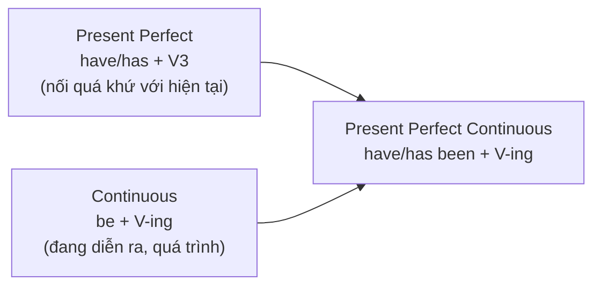
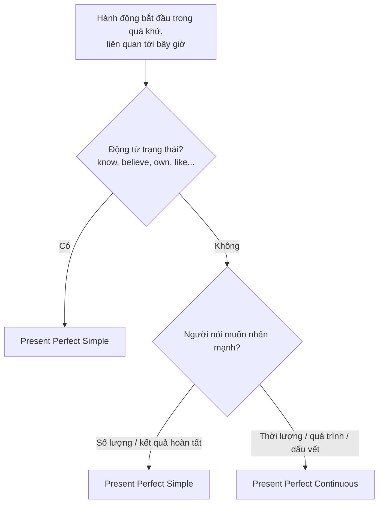

# B1-G001 · Present Perfect Continuous — Hiện tại hoàn thành tiếp diễn

## Mục lục

- [A. Lesson Information](#a-lesson-information)
- [B. Warm-up](#b-warm-up)
- [C. WHAT](#c-what)
- [D. WHY](#d-why)
- [E. FORM](#e-form)
- [F. HOW](#f-how)
- [G. VISUAL](#g-visual)
- [H. COMPARISON](#h-comparison)
- [I. COMMON MISTAKES](#i-common-mistakes)
- [J. MEMORY TRICKS](#j-memory-tricks)
- [K. REAL-LIFE APPLICATION](#k-real-life-application)
- [L. PRACTICE EXERCISES](#l-practice-exercises)
- [M. KNOWLEDGE CHECK](#m-knowledge-check)
- [N. ANSWER KEY](#n-answer-key)

---

## A. Lesson Information

| Mục | Nội dung |
|---|---|
| **Lesson ID** | B1-G001 |
| **Topic** | Present Perfect Continuous (+ comparison with Present Perfect Simple) |
| **Tên tiếng Việt** | Thì hiện tại hoàn thành tiếp diễn |
| **CEFR Level** | B1 |
| **Prerequisites** | [A2-G006 — Since & For](../../03-A2-ELEMENTARY/grammar/A2-G006-present-perfect-since-for.md), [A2-G007 — Present Perfect vs Past Simple](../../03-A2-ELEMENTARY/grammar/A2-G007-present-perfect-vs-past-simple.md), [A1-G004 — Present Continuous](../../02-A1-BEGINNER/grammar/A1-G004-present-continuous.md) |
| **Estimated Time** | 90 phút |

**Learning Objectives — Sau bài này, bạn có thể:**

1. Tạo câu với **have/has been + V-ing** ở thể khẳng định, phủ định, nghi vấn.
2. Nói về một hoạt động **bắt đầu trong quá khứ và vẫn đang tiếp diễn**, nhấn mạnh **quá trình/độ dài**.
3. Giải thích một **tình trạng hiện tại** bằng hoạt động vừa diễn ra (*I'm tired because I've been running*).
4. Chọn giữa **hiện tại hoàn thành đơn** (kết quả, số lượng) và **tiếp diễn** (quá trình, thời lượng).
5. Nhận biết khi nào động từ trạng thái (*know, have* nghĩa sở hữu) thường không dùng dạng tiếp diễn.

---

## B. Warm-up

Bạn đến muộn 40 phút. Bạn của bạn đang đứng dưới mưa, tóc ướt, mặt khó chịu:

> *"Where have you been? I**'ve been waiting** for forty minutes!"*

Một người bạn khác nhìn bàn làm việc của bạn đầy giấy tờ và hỏi: *"What have you done today?"* Bạn trả lời:

> *"I**'ve written** three reports and answered twenty emails."*

🤔 **Hãy suy nghĩ:** Câu đầu nhấn mạnh **việc chờ đã kéo dài bao lâu** (và còn đang chờ). Câu sau nhấn mạnh **đã làm xong bao nhiêu việc**. Vì sao một câu dùng *have been + V-ing*, câu kia dùng *have + V3*?

---

## C. WHAT

**Present Perfect Continuous** (hiện tại hoàn thành tiếp diễn) nói về một **hoạt động kéo dài** (*activity*) có liên hệ tới **bây giờ**. Có hai trường hợp chính:

| Trường hợp | Ví dụ | Ý nghĩa |
|---|---|---|
| **Vẫn đang tiếp diễn** đến hiện tại | *She**'s been studying** English **for** three years.* | Cô ấy học được ba năm và hiện vẫn đang học. |
| **Vừa mới dừng**, để lại dấu vết/kết quả nhìn thấy | *Your eyes are red. Have you **been crying**?* | Hoạt động có thể đã dừng, nhưng "dấu vết" còn ở hiện tại. |

**Khi nào nên dùng:** khi người nói quan tâm đến **quá trình, sự liên tục, độ dài thời gian** của hoạt động, thường kèm *for, since, all day, how long, recently, lately*.

**Khi nào thường không dùng:**

- Khi muốn nói **số lượng/kết quả hoàn tất**: *I've read three books* (không nói ~~I've been reading three books~~ nếu muốn nhấn "đọc xong ba cuốn").
- Với **động từ trạng thái** ở nghĩa trạng thái: *I've known her for years* (không phải ~~I've been knowing~~).

---

## D. WHY

Thì này là sự kết hợp của hai ý nghĩa bạn đã học:



- Phần **perfect** (*have/has been*) → cây cầu từ quá khứ tới **bây giờ**.
- Phần **continuous** (*V-ing*) → nhìn hoạt động như **một quá trình kéo dài**, chưa nhất thiết hoàn tất.

Vì vậy, khi người nói muốn người nghe "cảm nhận" sự kéo dài — mệt mỏi, kiên trì, bực bội vì chờ lâu — họ chọn dạng tiếp diễn. Khi muốn nói "xong rồi, được bao nhiêu" — họ chọn dạng đơn.

---

## E. FORM

**Ký hiệu:** **S** = chủ ngữ · **been** = V3 của *be* · **V-ing** = động từ thêm *-ing* · **V3** = quá khứ phân từ.

| Thể | I / you / we / they | he / she / it |
|---|---|---|
| ➕ Khẳng định | S + **have been** + V-ing | S + **has been** + V-ing |
| ➖ Phủ định | S + **haven't been** + V-ing | S + **hasn't been** + V-ing |
| ❓ Nghi vấn | **Have** + S + **been** + V-ing? | **Has** + S + **been** + V-ing? |
| 💬 Trả lời ngắn | Yes, S have. / No, S haven't. | Yes, S has. / No, S hasn't. |
| Wh- | *How long **have** you **been learning** English?* | *What **has** she **been doing**?* |

Rút gọn: *I've been, you've been, he's been, she's been, it's been, we've been, they've been.*

> ⚠️ Câu luôn có **ba phần**: *have/has* + *been* + *V-ing*. Thiếu *been* là lỗi phổ biến nhất.

### Từ/cụm thường đi kèm

| Cụm | Ví dụ |
|---|---|
| *for* + khoảng thời gian | *for two hours, for ages* |
| *since* + mốc | *since 8 a.m., since last summer* |
| *all day / all morning / all week* | *It's been raining all day.* |
| *How long...?* | *How long have you been waiting?* |
| *recently / lately* | *I've been sleeping badly lately.* |

---

## F. HOW

### Cách dùng 1 — Hoạt động bắt đầu trong quá khứ, vẫn đang tiếp diễn

| # | English | Tiếng Việt | Phân tích |
|---|---|---|---|
| 1 | *I**'ve been learning** English **since** 2022.* | Tôi học tiếng Anh từ năm 2022 (và vẫn đang học). | *since* + mốc; nhấn quá trình học |
| 2 | *It**'s been raining** **all morning**.* | Trời mưa cả buổi sáng (giờ vẫn mưa). | *all morning* = suốt buổi |
| 3 | ***How long have** you **been working** here? — **For** about six months.* | Bạn làm ở đây bao lâu rồi? — Khoảng sáu tháng. | Hỏi thời lượng |
| 4 | *We**'ve been looking** for a flat **for** weeks, but we haven't found one yet.* | Chúng tôi tìm nhà mấy tuần rồi mà chưa thấy. | Quá trình (tiếp diễn) + kết quả chưa có (đơn) |

### Cách dùng 2 — Hoạt động vừa dừng, để lại dấu vết ở hiện tại

| # | English | Tiếng Việt | Phân tích |
|---|---|---|---|
| 5 | *I'm exhausted. I**'ve been cleaning** the house.* | Tôi mệt rã rời. Tôi vừa dọn nhà. | Giải thích tình trạng mệt |
| 6 | *Why are your hands dirty? — I**'ve been fixing** my bike.* | Sao tay bạn bẩn vậy? — Tôi vừa sửa xe đạp. | Dấu vết nhìn thấy |
| 7 | *The ground is wet. It**'s been raining**.* | Mặt đất ướt. Trời vừa mưa. | Mưa có thể đã tạnh |

### Cách dùng 3 — Hoạt động lặp lại gần đây (xu hướng tạm thời)

| # | English | Tiếng Việt | Phân tích |
|---|---|---|---|
| 8 | *She**'s been going** to the gym a lot **recently**.* | Dạo gần đây cô ấy đi tập gym nhiều. | Lặp lại trong giai đoạn gần đây |
| 9 | *I **haven't been sleeping** well **lately**.* | Dạo này tôi ngủ không ngon. | Phủ định |
| 10 | *Have you **been following** the news about the floods?* | Bạn có theo dõi tin về lũ không? | Câu hỏi về hoạt động liên tục gần đây |

---

## G. VISUAL

### Timeline

```text
QUÁ KHỨ ──────●~~~~~~~~~~~~~~~~~~~~~~~~~~~~~~~~~~● NOW ────►
          bắt đầu       "I've been waiting"      (vẫn đang chờ,
          (since 6:20)  ← for 40 minutes →        hoặc vừa dừng)
```

### Sentence breakdown

`My sister | has been | preparing | for her exams | all week.`

| Phần | Vai trò |
|---|---|
| My sister | Chủ ngữ ngôi 3 số ít → *has* |
| has been | Phần "hoàn thành" nối tới hiện tại |
| preparing | V-ing — quá trình chuẩn bị |
| for her exams | Mục đích |
| all week | Khoảng thời gian kéo dài |

---

## H. COMPARISON

### Present Perfect Simple vs Present Perfect Continuous

| | Present Perfect Simple | Present Perfect Continuous |
|---|---|---|
| Trọng tâm | **Kết quả**, sự hoàn tất, **số lượng** | **Quá trình**, sự liên tục, **thời lượng** |
| Câu hỏi đặc trưng | *How many / How much...?* | *How long...?* |
| Ví dụ | *I've painted **two rooms**.* | *I've been painting **all day**.* |
| Hàm ý | Việc sơn hai phòng đã xong. | Việc sơn kéo dài cả ngày; có thể chưa xong. |
| Động từ trạng thái | ✅ *I've known him for years.* | ✗ thường không dùng |

**Cặp đối chiếu:**

| Simple | Continuous |
|---|---|
| *She**'s written** five emails this morning.* (đếm được, xong) | *She**'s been writing** emails all morning.* (quá trình) |
| *I**'ve read** your report. It's great.* (đọc xong) | *I**'ve been reading** your report. I'm on page 20.* (chưa xong) |
| *I**'ve lived** here for ten years.* | *I**'ve been living** here for ten years.* |

> 💡 Với một số động từ như *live, work, teach, study*, khi có *for/since*, **cả hai dạng thường đều đúng** và nghĩa rất gần nhau. Dạng tiếp diễn có thể nghe "tạm thời" hoặc nhấn quá trình hơn một chút — đây là xu hướng, không phải quy tắc tuyệt đối.

### Quy tắc ra quyết định



### Present Perfect Continuous vs Present Continuous

| *I'm learning Japanese.* | *I've been learning Japanese for a year.* |
|---|---|
| Chỉ nói về hiện tại | Nhìn lại cả quá trình từ quá khứ tới nay |
| ❌ *I'm learning Japanese for a year.* | ✅ có *for a year* → cần hoàn thành |

---

## I. COMMON MISTAKES

| # | ❌ Sai | ✅ Đúng | Nguyên nhân | Cách tránh |
|---|---|---|---|---|
| 1 | I **have waiting** for an hour. | I**'ve been waiting** for an hour. | Thiếu *been* | Luôn kiểm tra đủ 3 phần |
| 2 | I **am waiting** here **for** an hour. | I**'ve been waiting** here for an hour. | Dịch "tôi đang đợi một tiếng rồi" | Có *for/since* + đến nay → hoàn thành |
| 3 | I**'ve been knowing** her since school. | I**'ve known** her since school. | Dùng tiếp diễn với *know* | Động từ trạng thái → dạng đơn |
| 4 | I**'ve been reading** three books this month. (ý: đã đọc xong 3 cuốn) | I**'ve read** three books this month. | Có số lượng hoàn tất | Đếm được kết quả → dạng đơn |
| 5 | **How long** have you **waited**? (ý: đang chờ) | How long **have you been waiting**? | Không sai hoàn toàn nhưng kém tự nhiên | *How long* + hoạt động đang diễn ra → tiếp diễn |
| 6 | She **has been worked** here since 2020. | She **has been working** / **has worked** here since 2020. | Trộn V3 với *been* | *been* + V-ing (chủ động) |
| 7 | I've been studying English **since three years**. | ...**for** three years. | Nhầm *since/for* | Khoảng → *for* |

---

## J. MEMORY TRICKS

1. **"Đồng hồ đang chạy ⏱️"**: Nếu bạn có thể hình dung một chiếc đồng hồ đếm thời gian của hoạt động → tiếp diễn. Nếu bạn hình dung một **danh sách đã tick xong ✅** → dạng đơn.
2. **"How long → been V-ing, How many → V3"** — mẹo nhanh cho câu hỏi; vẫn có ngoại lệ với động từ trạng thái (*How long have you known...?*).
3. **"Mồ hôi và dấu vết"** 💦: Mệt, bẩn, ướt, mắt đỏ... → giải thích bằng *I've been + V-ing*.

> ⚠️ Mẹo chỉ hỗ trợ ra quyết định nhanh; khi động từ là *live/work/study* với *for/since*, cả hai dạng đều có thể chấp nhận.

---

## K. REAL-LIFE APPLICATION

### Hội thoại: Gặp lại bạn cũ

> **Linh:** Duc! I haven't seen you for ages! What **have** you **been doing**?
> **Duc:** I**'ve been working** in Singapore. I moved there two years ago.
> **Linh:** Wow! And how's your English?
> **Duc:** Much better. I**'ve been taking** a business English course since January. I**'ve** already **passed** two exams.
> **Linh:** That's great. You look tired, though.
> **Duc:** Yeah, I**'ve been travelling** a lot for work recently. I**'ve visited** five countries this year!
> **Linh:** Five! I**'ve been planning** a trip to Malaysia for months, but I **haven't booked** anything yet.
> **Duc:** Come on, just book it!

**Giải thích tiếng Việt:** Linh gặp lại Đức sau thời gian dài. Đức làm việc ở Singapore, học tiếng Anh thương mại từ tháng Giêng (đã qua hai kỳ thi). Dạo này Đức đi công tác nhiều (đã đến 5 nước). Linh lên kế hoạch đi Malaysia mấy tháng nay nhưng chưa đặt gì.

**Grammar highlights:**

| Continuous — quá trình/thời lượng | Simple — kết quả/số lượng |
|---|---|
| have been doing, 've been working, 've been taking (since January), 've been travelling (recently), 've been planning (for months) | 've passed two exams, 've visited five countries, haven't booked anything yet |

**Useful expressions:** *I haven't seen you for ages!* (Lâu lắm rồi không gặp!) · *You look tired, though.* · *Come on, just...!* (Thôi nào, cứ... đi!)

---

## L. PRACTICE EXERCISES

> ✍️ Làm ra giấy trước. Đáp án: [B1-G001-ANSWERS](../../12-ANSWERS-AND-EXPLANATIONS/B1/B1-G001-ANSWERS.md)

### Level 1 — Recognition

**L1.1.** Sorry I'm late. ___ for a long time?  A. Have you waited  B. Have you been waiting  C. Are you waiting  D. Did you wait
**L1.2.** She ___ three cups of coffee this morning.  A. has been drinking  B. has drunk  C. is drinking  D. has been drunk
**L1.3.** I ___ him since we were at university.  A. have been knowing  B. know  C. have known  D. am knowing
**L1.4.** Why are you out of breath? — I ___.  A. have run  B. have been running  C. run  D. was run
**L1.5.** Câu nào nhấn mạnh **thời lượng/quá trình**?  A. I've painted the kitchen.  B. I've been painting the kitchen all day.  C. I painted the kitchen yesterday.
**L1.6.** How long ___ Vietnamese?  A. has he been learning  B. is he learning  C. does he learn  D. has he learn

### Level 2 — Controlled Practice

Chia động từ ở hiện tại hoàn thành tiếp diễn.

**L2.1.** It (snow) ___ in Sapa since yesterday evening.
**L2.2.** They (not / talk) ___ to each other since the argument.
**L2.3.** How long (you / wait) ___ for the bus?
**L2.4.** My neighbours (build) ___ an extension for six months. The noise is terrible!
**L2.5.** (she / work) ___ too hard lately? She looks exhausted.

Chọn hiện tại hoàn thành **đơn** hoặc **tiếp diễn**.

**L2.6.** I (write) ___ my thesis for three months, and I (finish) ___ four chapters.
**L2.7.** We (know) ___ each other for twenty years.
**L2.8.** "Why is the kitchen so messy?" — "Sorry, I (cook) ___."
**L2.9.** He (lose) ___ his keys. He can't get into the house.
**L2.10.** How many times (you / visit) ___ Da Nang?

### Level 3 — Error Correction

**L3.1.** I have studying English for five years.
**L3.2.** She is working here since 2019.
**L3.3.** I've been owning this car for ten years.
**L3.4.** We've been visiting four museums today.
**L3.5.** He has been worked on this project all week.
**L3.6.** They've been living here since three years.

### Level 4 — Production

Dịch sang tiếng Anh:

**L4.1.** Tôi học guitar được hai năm rồi.
**L4.2.** Dạo này bạn làm gì? Lâu rồi không gặp!
**L4.3.** Trời mưa cả ngày. Tôi không ra ngoài được.
**L4.4.** Cô ấy vừa khóc à? Mắt cô ấy đỏ.

**L4.5.** **Explain:** Giải thích sự khác nhau giữa *"I've read your report"* và *"I've been reading your report"* (2–3 câu tiếng Việt).

### Level 5 — Real Communication

**L5.1.** Viết email 100–130 từ cho một người bạn cũ đã lâu không liên lạc. Kể những gì bạn **đã và đang làm** gần đây (công việc, học tập, sở thích). Dùng ít nhất 4 câu hiện tại hoàn thành tiếp diễn và 3 câu hiện tại hoàn thành đơn cho kết quả/số lượng.
**L5.2.** **Speaking — Explain the evidence:** Với mỗi "dấu vết" sau, nói 2 câu giải thích (1 câu tiếp diễn + 1 câu mở rộng): *your clothes are covered in paint · you have a sunburn · your phone battery is dead · you're out of breath · your eyes are tired*.
**L5.3.** **Speaking — How long...?** Trả lời to 5 câu hỏi (2–3 câu mỗi câu): *How long have you been learning English? How long have you been living in your current home? What have you been doing to improve your English lately? What have you been watching or reading recently? Is there anything you've been planning for a long time?*

---

## M. KNOWLEDGE CHECK

### 5 câu hỏi tự kiểm tra

1. Công thức của thì hiện tại hoàn thành tiếp diễn gồm mấy phần?
2. Nêu hai cách dùng chính.
3. *I've painted two rooms* và *I've been painting all day* khác nhau thế nào?
4. Vì sao thường không nói *I've been knowing her*?
5. Khi có *for/since* với *live/work*, có bắt buộc chọn một dạng không?

### Checklist

- [ ] Tôi tạo được câu đủ 3 phần *have/has + been + V-ing*.
- [ ] Tôi giải thích được một tình trạng hiện tại bằng hoạt động vừa diễn ra.
- [ ] Tôi chọn được dạng đơn hay tiếp diễn theo trọng tâm kết quả/quá trình.
- [ ] Tôi không dùng hiện tại tiếp diễn cho ý "đã ... được bao lâu".

### 3 lỗi quan trọng cần nhớ

1. ~~I have waiting~~ → I**'ve been** waiting.
2. ~~I'm working here for two years~~ → I**'ve been working** here for two years.
3. Có số lượng hoàn tất → dạng **đơn**: *I've read three books*.

### Lịch ôn tập

| Ngày | Việc cần làm |
|---|---|
| Ngày 1 | Làm lại L2; giải thích lý do chọn dạng ở L2.6–L2.10 |
| Ngày 3 | Viết 5 cặp câu đơn/tiếp diễn về tuần của bạn |
| Ngày 7 | Ghi âm lại L5.3, so với lần đầu |

### Liên kết

- ➡️ Bài tiếp theo: [B1-G002 — Past Perfect](B1-G002-past-perfect.md)
- 🔁 Ôn tập: [A2-G006 — Since & For](../../03-A2-ELEMENTARY/grammar/A2-G006-present-perfect-since-for.md) · [ALL-TENSES-COMPARISON](../../06-GRAMMAR-REFERENCE/ALL-TENSES-COMPARISON.md)

---

## N. ANSWER KEY

👉 [B1-G001-ANSWERS.md](../../12-ANSWERS-AND-EXPLANATIONS/B1/B1-G001-ANSWERS.md)
