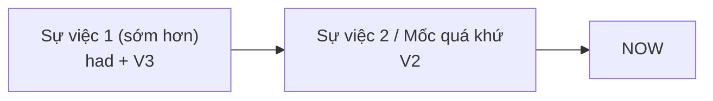

# B1-G002 · Past Perfect — Thì quá khứ hoàn thành

## Mục lục

- [A. Lesson Information](#a-lesson-information)
- [B. Warm-up](#b-warm-up)
- [C. WHAT](#c-what)
- [D. WHY](#d-why)
- [E. FORM](#e-form)
- [F. HOW](#f-how)
- [G. VISUAL](#g-visual)
- [H. COMPARISON](#h-comparison)
- [I. COMMON MISTAKES](#i-common-mistakes)
- [J. MEMORY TRICKS](#j-memory-tricks)
- [K. REAL-LIFE APPLICATION](#k-real-life-application)
- [L. PRACTICE EXERCISES](#l-practice-exercises)
- [M. KNOWLEDGE CHECK](#m-knowledge-check)
- [N. ANSWER KEY](#n-answer-key)

---

## A. Lesson Information

| Mục | Nội dung |
|---|---|
| **Lesson ID** | B1-G002 |
| **Topic** | Past Perfect Simple |
| **Tên tiếng Việt** | Thì quá khứ hoàn thành |
| **CEFR Level** | B1 |
| **Prerequisites** | [A2-G002 — Past Simple vs Past Continuous](../../03-A2-ELEMENTARY/grammar/A2-G002-past-simple-vs-past-continuous.md), [A2-G003 — Present Perfect Form (V3)](../../03-A2-ELEMENTARY/grammar/A2-G003-present-perfect-form.md) |
| **Estimated Time** | 90 phút |

**Learning Objectives:**

1. Tạo câu với **had + V3** cho mọi chủ ngữ.
2. Dùng quá khứ hoàn thành cho hành động xảy ra **trước một thời điểm/hành động khác trong quá khứ**.
3. Dùng các liên từ *when, after, before, by the time, as soon as, because* để sắp thứ tự sự việc.
4. Biết khi nào quá khứ hoàn thành **cần thiết** (để tránh hiểu sai thứ tự) và khi nào **không bắt buộc**.
5. Dùng mẫu *It was the first time I had...*, *had never ... before*.

---

## B. Warm-up

So sánh hai câu:

> 1. *When I arrived at the station, the train **left**.*
> 2. *When I arrived at the station, the train **had left**.*

🤔 **Hãy suy nghĩ:** Trong câu 1, bạn có kịp nhìn thấy đoàn tàu không? Trong câu 2 thì sao? Chỉ khác *had*, nhưng câu chuyện khác hẳn: một người kịp nhìn tàu chạy, một người đến sân ga trống trơn.

---

## C. WHAT

**Past Perfect** (quá khứ hoàn thành) diễn tả một hành động/trạng thái **đã xảy ra (và thường đã hoàn tất) trước** một thời điểm hoặc một sự việc khác **trong quá khứ**. Nó là "quá khứ của quá khứ".

| Thời điểm mốc (quá khứ) | Sự việc xảy ra trước mốc |
|---|---|
| *When I arrived* | *the train **had left*** |
| *By 2015* | *she **had moved** to Hanoi* |
| *Before the meeting* | *I **had read** all the documents* |

**Khi nào dùng:** khi kể chuyện quá khứ và cần cho người nghe biết **sự việc nào xảy ra trước**, đặc biệt khi thứ tự kể **không trùng** với thứ tự thời gian.

**Khi nào thường không cần:** khi thứ tự đã rõ (*after, before* hoặc kể theo trình tự): *After I **finished/had finished** work, I went home* — cả hai đều đúng.

---

## D. WHY

Câu chuyện quá khứ thường được kể bằng quá khứ đơn theo đúng trình tự. Nhưng khi người kể **"lùi lại"** để nói về điều xảy ra **trước đó**, tiếng Anh cần một dấu hiệu để người nghe không nhầm thứ tự. *Had + V3* chính là dấu hiệu "lùi một bước".



So sánh với hiện tại hoàn thành: *have + V3* nối quá khứ với **hiện tại**; *had + V3* nối "quá khứ xa hơn" với **một mốc trong quá khứ**.

---

## E. FORM

**Ký hiệu:** **S** = chủ ngữ · **V3** = quá khứ phân từ (xem bảng ở [A2-G003](../../03-A2-ELEMENTARY/grammar/A2-G003-present-perfect-form.md)).

| Thể | Công thức (mọi chủ ngữ) | Ví dụ |
|---|---|---|
| ➕ | S + **had** + V3 | *She **had finished**.* → *She'd finished.* |
| ➖ | S + **hadn't** (had not) + V3 | *We **hadn't eaten**.* |
| ❓ | **Had** + S + V3? | ***Had** you **met** him before?* |
| 💬 | Yes, S had. / No, S hadn't. | *No, I hadn't.* |
| Wh- | Wh- + had + S + V3? | *Where **had** they **gone**?* |

> ⚠️ *She'd* có thể là *she had* hoặc *she would*. Nhìn từ phía sau: *She'd **gone*** (V3) → *had*; *She'd **go*** (V nguyên mẫu) → *would*.

### Liên từ và cụm thường gặp

| Liên từ/cụm | Ví dụ |
|---|---|
| *when* | *When we got there, the film **had started**.* |
| *before* | *I **had never seen** snow **before** I went to Japan.* |
| *after* | *After she **had locked** the door, she realised the keys were inside.* |
| *by the time* | *By the time the police arrived, the thief **had escaped**.* |
| *as soon as* | *As soon as I **had sent** the email, I saw the mistake.* |
| *because* | *I was hungry because I **hadn't had** breakfast.* |
| *already, just, never... before* | *The guests **had already left**.* |

---

## F. HOW

### Cách dùng 1 — Sự việc xảy ra trước một sự việc khác trong quá khứ

| # | English | Tiếng Việt | Phân tích |
|---|---|---|---|
| 1 | *When I got home, my husband **had cooked** dinner.* | Khi tôi về nhà, chồng tôi đã nấu xong bữa tối. | Nấu (1) → tôi về (2) |
| 2 | *By the time we arrived, the shop **had closed**.* | Lúc chúng tôi đến, cửa hàng đã đóng cửa. | *by the time* = trước lúc |
| 3 | *She was nervous because she **had never spoken** in public before.* | Cô ấy lo lắng vì trước đó chưa từng nói trước đám đông. | Lý do nằm ở quá khứ xa hơn |
| 4 | *I recognised him immediately. We **had met** at a conference.* | Tôi nhận ra anh ấy ngay. Chúng tôi đã gặp nhau ở một hội thảo. | Kể ngược về trước |

### Cách dùng 2 — Trải nghiệm tính đến một mốc quá khứ

| # | English | Tiếng Việt | Phân tích |
|---|---|---|---|
| 5 | *It was the first time I **had flown** in a plane.* | Đó là lần đầu tôi đi máy bay. | Mốc *was* → *had flown* |
| 6 | *Before 2020, I **had** never **worked** from home.* | Trước năm 2020, tôi chưa bao giờ làm việc ở nhà. | |
| 7 | ***Had** you ever **been** abroad before you moved to Australia?* | Trước khi chuyển sang Úc bạn đã từng ra nước ngoài chưa? | Câu hỏi |

### Cách dùng 3 — Trạng thái kéo dài đến một mốc quá khứ

| # | English | Tiếng Việt | Phân tích |
|---|---|---|---|
| 8 | *They **had been** married for 30 years when he died.* | Họ đã kết hôn 30 năm khi ông ấy qua đời. | *for* + mốc quá khứ |
| 9 | *I **had known** her for ten years before we became business partners.* | Tôi quen cô ấy mười năm trước khi chúng tôi thành đối tác. | Động từ trạng thái |

### Cách dùng 4 — Giải thích nguyên nhân

| # | English | Tiếng Việt | Phân tích |
|---|---|---|---|
| 10 | *He failed the test because he **hadn't studied**.* | Anh ấy trượt vì đã không học. | Nguyên nhân trước kết quả |
| 11 | *I couldn't pay because I **had left** my wallet at home.* | Tôi không trả tiền được vì đã để quên ví ở nhà. | |

---

## G. VISUAL

### Timeline

```text
────── ✕ ─────────────── ✕ ───────────────── NOW ──►
   the train         I arrived
   had left          (past simple)
   (past perfect)
"When I arrived, the train had left."
```

### Hai thứ tự kể — cùng một câu chuyện

| Kể theo trình tự (QKĐ là đủ) | Kể đảo ngược (cần QKHT) |
|---|---|
| *I **left** my keys at work. Then I **got** home and **couldn't** open the door.* | *I **got** home and **couldn't** open the door. I **had left** my keys at work.* |

---

## H. COMPARISON

### Past Simple vs Past Perfect

| Câu | Thứ tự sự việc |
|---|---|
| *When she called, I **left**.* | Cô ấy gọi → (sau đó) tôi rời đi. |
| *When she called, I **had left**.* | Tôi đã rời đi → (sau đó) cô ấy gọi. |

### Present Perfect vs Past Perfect

| Present Perfect | Past Perfect |
|---|---|
| Mốc là **bây giờ** | Mốc là **một thời điểm quá khứ** |
| *I've never seen snow.* (đến nay) | *I'd never seen snow before I went to Japan.* (đến lúc đi Nhật) |

### Khi nào **không cần** quá khứ hoàn thành

- Có *before/after* làm rõ thứ tự: *She left **before** I arrived.* (không cần *had left*)
- Chuỗi hành động theo trình tự: *I got up, had a shower and left.*
- Không có mốc quá khứ nào để so sánh: ❌ *I had visited Hue last year.* → ✅ *I visited Hue last year.*

> 💡 Dùng quá khứ hoàn thành **quá nhiều** cũng là lỗi: người học B1 hay viết *had + V3* cho mọi việc trong quá khứ. Chỉ dùng khi cần "lùi một bước".

---

## I. COMMON MISTAKES

| # | ❌ Sai | ✅ Đúng | Nguyên nhân | Cách tránh |
|---|---|---|---|---|
| 1 | Yesterday I **had gone** to the cinema. | Yesterday I **went** to the cinema. | Dùng QKHT không có mốc quá khứ khác | Chỉ dùng khi so với sự việc/mốc quá khứ khác |
| 2 | When I arrived, the party **finished**. (ý: đã kết thúc trước) | ...the party **had finished**. | Không đánh dấu thứ tự | Sự việc sớm hơn → *had + V3* |
| 3 | She **had went** home. | She **had gone** home. | Dùng V2 | *had* + V3 |
| 4 | I **have finished** my work before he came. | I **had finished** my work before he came. | Nhầm hiện tại hoàn thành | Mốc quá khứ → *had* |
| 5 | **Did** you **had** seen it? | **Had** you **seen** it? | Trộn *did* | *Had* tự đảo |
| 6 | By the time I **had arrived**, they **left**. | By the time I **arrived**, they **had left**. | Đặt QKHT sai vế | QKHT cho sự việc **sớm hơn** |
| 7 | It was the first time I **ate** sushi. | It was the first time I **had eaten** sushi. | Bỏ qua cấu trúc *the first time* | *was the first time* → *had + V3* |

---

## J. MEMORY TRICKS

1. **"Lùi một bước 👣"**: Quá khứ đơn là một bước lùi so với hiện tại; quá khứ hoàn thành là **hai bước lùi**.
2. **"Had trước, V2 sau"**: Trong cặp hai sự việc, sự việc có *had* luôn xảy ra **trước**.
3. **"By the time — gần như luôn kéo theo had"** trong vế chính khi kể quá khứ: *By the time X happened, Y **had** happened.* (Mẹo hỗ trợ, không phải mọi câu *by the time* đều bắt buộc.)

---

## K. REAL-LIFE APPLICATION

### Bài đọc: The worst first day

> *My first day at the new job was a disaster. I **had set** two alarms the night before, but my phone **had run out** of battery, so neither of them rang. When I finally woke up, it was already 8:30. I jumped into a taxi, but by the time I arrived at the office, the welcome meeting **had** already **started**. Everyone turned to look at me. Then I realised I **had forgotten** my laptop at home. My manager smiled and said, "Don't worry. Last year a new employee came on the wrong day!" I laughed — it was the first time I **had felt** relaxed all morning.*

**Giải thích:** Ngày đầu đi làm là một thảm họa: đặt hai báo thức nhưng điện thoại hết pin; đến văn phòng thì buổi họp chào mừng đã bắt đầu; nhận ra đã quên laptop ở nhà. Quản lý trấn an: năm ngoái có nhân viên mới đến nhầm ngày. Đó là lần đầu tiên trong buổi sáng "tôi" thấy thoải mái.

**Grammar highlights:** *had set, had run out, had started, had forgotten, had felt* — đều là sự việc xảy ra **trước** các mốc quá khứ chính (*woke up, arrived, realised, laughed*).

**Useful expressions:** *a disaster* (thảm họa) · *run out of battery* (hết pin) · *by the time...* · *Everyone turned to look at me.*

---

## L. PRACTICE EXERCISES

> ✍️ Đáp án: [B1-G002-ANSWERS](../../12-ANSWERS-AND-EXPLANATIONS/B1/B1-G002-ANSWERS.md)

### Level 1 — Recognition

**L1.1.** When we got to the cinema, the film ___.  A. already started  B. had already started  C. has already started  D. was already start
**L1.2.** I ___ Hoi An before 2019, so it was all new to me.  A. hadn't visited  B. haven't visited  C. didn't visited  D. hadn't visit
**L1.3.** "When she called, I left." → Ai hành động trước?  A. Cô ấy gọi trước  B. Tôi rời đi trước  C. Cùng lúc
**L1.4.** It was the first time he ___ a speech in English.  A. gives  B. has given  C. had given  D. had give
**L1.5.** Câu nào **không cần** (và không tự nhiên với) quá khứ hoàn thành?  A. When I arrived, she had left.  B. I had bought a new phone yesterday.  C. He was tired because he hadn't slept.
**L1.6.** By the time the ambulance arrived, the man ___ consciousness.  A. lost  B. had lost  C. has lost  D. loses

### Level 2 — Controlled Practice

Chia động từ ở quá khứ đơn hoặc quá khứ hoàn thành.

**L2.1.** When I (open) ___ the fridge, I saw that someone (eat) ___ my cake.
**L2.2.** She (not / recognise) ___ me because I (cut) ___ my hair.
**L2.3.** By the time we (find) ___ a parking space, the concert (begin) ___.
**L2.4.** (you / ever / try) ___ Indian food before you (go) ___ to Delhi?
**L2.5.** After the guests (leave) ___, we (clean) ___ the house. (cả hai cách)
**L2.6.** I (live) ___ in Hue for ten years when I (decide) ___ to move to Saigon.

Nối hai câu thành một bằng từ trong ngoặc, dùng quá khứ hoàn thành cho sự việc sớm hơn:

**L2.7.** The plane took off. We arrived at the gate. (when)
**L2.8.** I finished my report. My boss asked for it. (by the time)
**L2.9.** He didn't eat anything all day. He felt dizzy. (because)
**L2.10.** She never travelled alone. She went to Thailand in 2023. (before)

### Level 3 — Error Correction

**L3.1.** I had visited my grandparents last weekend.
**L3.2.** When I arrived, the meeting already finished.
**L3.3.** She had went to bed when I called.
**L3.4.** Did you had finished the project before the deadline?
**L3.5.** By the time I had got home, my parents went to bed.
**L3.6.** It was the first time I see such a beautiful beach.

### Level 4 — Production

Dịch sang tiếng Anh:

**L4.1.** Khi tôi đến ga, tàu đã rời đi.
**L4.2.** Trước khi chuyển đến Hà Nội, tôi chưa bao giờ thấy trời lạnh như vậy. (*such cold weather*)
**L4.3.** Cô ấy không thể vào nhà vì đã làm mất chìa khóa.
**L4.4.** Đó là lần đầu tiên tôi được thăng chức. (*be promoted*)

**L4.5.** **Explain:** Vì sao câu *"After I had finished dinner, I watched TV"* và *"After I finished dinner, I watched TV"* đều đúng? (2–3 câu tiếng Việt)

### Level 5 — Real Communication

**L5.1.** Viết câu chuyện 120–150 từ: *A day when everything went wrong* (hoặc *went right*). Kể theo kiểu "bắt đầu từ giữa": mở đầu bằng một khoảnh khắc trong quá khứ, rồi dùng quá khứ hoàn thành để giải thích những gì đã xảy ra trước đó. Dùng ít nhất 5 động từ quá khứ hoàn thành và 2 trong các từ *when, by the time, because, before*.
**L5.2.** **Speaking — First times:** Nói 1 phút về một "lần đầu tiên" đáng nhớ: *It was the first time I had... Before that, I had never...*
**L5.3.** **Speaking — Detective:** Bạn về nhà và thấy cửa mở, đèn bật, tủ lạnh trống, có một cái ô lạ trên sofa. Nói 6 câu suy đoán những gì **đã xảy ra trước đó** (*Someone had..., They had..., Maybe my brother had...*).

---

## M. KNOWLEDGE CHECK

### 5 câu hỏi tự kiểm tra

1. Công thức quá khứ hoàn thành? Có thay đổi theo chủ ngữ không?
2. Trong cặp sự việc, sự việc nào dùng *had + V3*?
3. *When she called, I left* và *When she called, I had left* khác nhau thế nào?
4. Khi nào quá khứ hoàn thành không bắt buộc?
5. Vì sao *I had bought a phone yesterday* (đứng một mình) không tự nhiên?

### Checklist

- [ ] Tôi tạo câu *had + V3* đúng ở 3 thể.
- [ ] Tôi đặt quá khứ hoàn thành vào đúng sự việc xảy ra trước.
- [ ] Tôi không lạm dụng quá khứ hoàn thành khi không có mốc quá khứ khác.

### 3 lỗi quan trọng cần nhớ

1. ~~had went~~ → had **gone**.
2. ~~By the time I had arrived, they left~~ → By the time I **arrived**, they **had left**.
3. Không có mốc quá khứ khác → dùng **quá khứ đơn**.

### Lịch ôn tập

| Ngày | Việc cần làm |
|---|---|
| Ngày 1 | Làm lại L2, vẽ timeline cho 3 câu |
| Ngày 3 | Viết 5 câu "When I arrived at..., ... had already..." |
| Ngày 7 | Viết lại L5.1 với câu chuyện khác |

### Liên kết

- ➡️ Bài tiếp theo: [B1-G003 — Past Perfect Continuous](B1-G003-past-perfect-continuous.md)
- 🔜 Ứng dụng: [B1-G008 — Third Conditional](B1-G008-third-conditional.md), [B1-G010 — Reported Speech](B1-G010-reported-statements.md)

---

## N. ANSWER KEY

👉 [B1-G002-ANSWERS.md](../../12-ANSWERS-AND-EXPLANATIONS/B1/B1-G002-ANSWERS.md)
