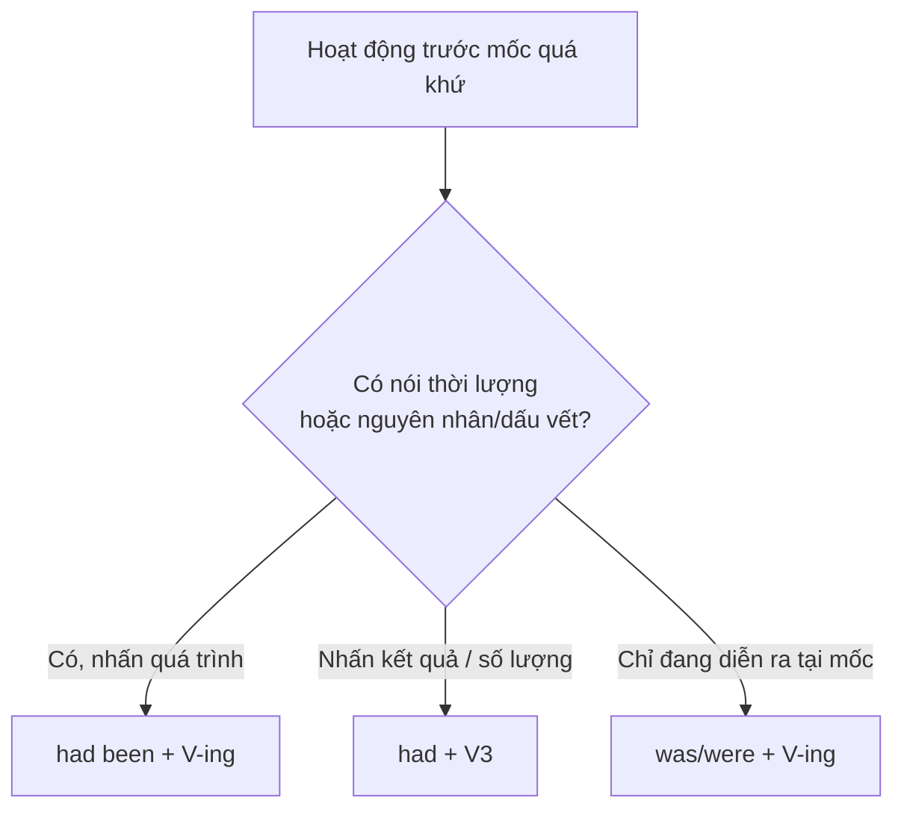

# B1-G003 · Past Perfect Continuous — Thì quá khứ hoàn thành tiếp diễn

## Mục lục

- [A. Lesson Information](#a-lesson-information)
- [B. Warm-up](#b-warm-up)
- [C. WHAT](#c-what)
- [D. WHY](#d-why)
- [E. FORM](#e-form)
- [F. HOW](#f-how)
- [G. VISUAL](#g-visual)
- [H. COMPARISON](#h-comparison)
- [I. COMMON MISTAKES](#i-common-mistakes)
- [J. MEMORY TRICKS](#j-memory-tricks)
- [K. REAL-LIFE APPLICATION](#k-real-life-application)
- [L. PRACTICE EXERCISES](#l-practice-exercises)
- [M. KNOWLEDGE CHECK](#m-knowledge-check)
- [N. ANSWER KEY](#n-answer-key)

---

## A. Lesson Information

| Mục | Nội dung |
|---|---|
| **Lesson ID** | B1-G003 |
| **Topic** | Past Perfect Continuous |
| **Tên tiếng Việt** | Thì quá khứ hoàn thành tiếp diễn |
| **CEFR Level** | B1 |
| **Prerequisites** | [B1-G001 — Present Perfect Continuous](B1-G001-present-perfect-continuous.md), [B1-G002 — Past Perfect](B1-G002-past-perfect.md) |
| **Estimated Time** | 75 phút |

**Learning Objectives:**

1. Tạo câu với **had been + V-ing**.
2. Diễn tả hoạt động **kéo dài đến (hoặc đến ngay trước) một thời điểm trong quá khứ**.
3. Giải thích **nguyên nhân/dấu vết** của một tình trạng trong quá khứ (*She was tired because she had been working*).
4. Chọn giữa *had + V3* (kết quả, số lượng) và *had been + V-ing* (quá trình, thời lượng).
5. Hỏi và trả lời *How long had you been...when...?*

---

## B. Warm-up

Hai cảnh trong một bộ phim:

> - *When the rescue team found him, he **had been walking** in the forest for three days.*
> - *When the rescue team found him, he **had walked** 60 kilometres.*

🤔 **Hãy suy nghĩ:** Câu nào khiến bạn hình dung **sự kiệt sức kéo dài**? Câu nào cho bạn một **con số kết quả**? Bạn đã thấy sự phân biệt này ở bài B1-G001 — giờ hãy "dời" nó về quá khứ.

---

## C. WHAT

**Past Perfect Continuous** (quá khứ hoàn thành tiếp diễn) diễn tả một **hoạt động kéo dài** đã bắt đầu **trước** một thời điểm quá khứ và:

- **vẫn đang tiếp diễn** tại thời điểm đó, hoặc
- **vừa dừng ngay trước** thời điểm đó, để lại dấu vết.

| Ví dụ | Ý nghĩa |
|---|---|
| *We **had been waiting** for an hour when the bus finally came.* | Chờ một tiếng, đến lúc xe tới vẫn đang chờ. |
| *The road was wet. It **had been raining**.* | Mưa vừa tạnh trước lúc đó; đường ướt là dấu vết. |

Thì này thường dùng trong **văn kể chuyện** và **giải thích nguyên nhân**. Trong giao tiếp hằng ngày, nó ít phổ biến hơn quá khứ đơn/quá khứ hoàn thành — nhưng rất hữu ích ở B1–B2 để kể chuyện tự nhiên.

---

## D. WHY

Đây chính là hiện tại hoàn thành tiếp diễn ([B1-G001](B1-G001-present-perfect-continuous.md)) **lùi về quá khứ**: mốc không còn là "bây giờ" mà là "lúc đó".


| | Mốc hiện tại | Mốc quá khứ |
|---|---|---|
| Quá trình | *I **have been** waiting for an hour.* | *I **had been** waiting for an hour.* |
| Kết quả | *I **have** written three emails.* | *I **had** written three emails.* |

---

## E. FORM

**Ký hiệu:** **S** = chủ ngữ · **V-ing** = động từ thêm *-ing*.

| Thể | Công thức (mọi chủ ngữ) | Ví dụ |
|---|---|---|
| ➕ | S + **had been** + V-ing | *They**'d been arguing**.* |
| ➖ | S + **hadn't been** + V-ing | *I **hadn't been sleeping** well.* |
| ❓ | **Had** + S + **been** + V-ing? | ***Had** she **been crying**?* |
| 💬 | Yes, S had. / No, S hadn't. | |
| Wh- | *How long **had** you **been waiting** when...?* | |

Cụm thường gặp: *for / since / all day / how long* + một mốc quá khứ (*when..., by the time..., before...*).

---

## F. HOW

| # | English | Tiếng Việt | Phân tích |
|---|---|---|---|
| 1 | *I**'d been working** there for five years when the company closed.* | Tôi làm ở đó được năm năm thì công ty đóng cửa. | Thời lượng tính đến mốc quá khứ |
| 2 | *She was exhausted because she **had been studying** all night.* | Cô ấy kiệt sức vì đã học suốt đêm. | Nguyên nhân của tình trạng quá khứ |
| 3 | *His eyes were red. He **had been crying**.* | Mắt anh ấy đỏ. Anh ấy vừa khóc. | Dấu vết |
| 4 | *How long **had** you **been living** in Japan when you met your wife?* | Bạn sống ở Nhật bao lâu thì gặp vợ? | Câu hỏi |
| 5 | *The ground was wet because it **had been raining**.* | Mặt đất ướt vì trời vừa mưa. | |
| 6 | *We **had been driving** for hours before we found a petrol station.* | Chúng tôi lái xe hàng giờ trước khi tìm được trạm xăng. | *before* |
| 7 | *By the time the doctor arrived, the patient **had been waiting** for three hours.* | Đến lúc bác sĩ tới, bệnh nhân đã chờ ba tiếng. | *by the time* |
| 8 | *I **hadn't been feeling** well for days, so I finally saw a doctor.* | Mấy ngày liền tôi không khỏe nên cuối cùng đi khám. | Phủ định |
| 9 | *They **had been dating** for two years before they got engaged.* | Họ hẹn hò hai năm trước khi đính hôn. | |
| 10 | *She **had been trying** to call me all morning, but my phone was off.* | Cô ấy cố gọi cho tôi cả buổi sáng nhưng điện thoại tôi tắt. | Lặp lại nhiều lần |

---

## G. VISUAL

### Timeline

```text
──────●~~~~~~~~~~~~~~~~~~~~~~~~~~~● ──────────────── NOW ──►
   bắt đầu chờ     had been waiting   the bus came
   (7:00)          (for an hour)      (8:00 — past simple)
```

### Breakdown

`By the time I finished, | I | had been sitting | at my desk | for ten hours.`

| Phần | Vai trò |
|---|---|
| By the time I finished | Mốc quá khứ |
| had been sitting | Quá trình kéo dài đến mốc |
| for ten hours | Thời lượng |

---

## H. COMPARISON

### Past Perfect Simple vs Past Perfect Continuous

| Simple *had + V3* | Continuous *had been + V-ing* |
|---|---|
| Kết quả, số lượng, hoàn tất | Quá trình, thời lượng, dấu vết |
| *He **had walked** 60 km.* | *He **had been walking** for three days.* |
| *She **had written** three chapters by then.* | *She **had been writing** all morning.* |
| ✅ với động từ trạng thái: *I'd known him for years.* | ✗ ~~I'd been knowing him~~ |

### Past Continuous vs Past Perfect Continuous

| Past Continuous | Past Perfect Continuous |
|---|---|
| Đang diễn ra **tại** mốc (không nói từ khi nào) | Đã diễn ra **một khoảng thời gian trước** mốc |
| *When you called, I **was sleeping**.* | *When you called, I **had been sleeping** for only an hour.* |



---

## I. COMMON MISTAKES

| # | ❌ Sai | ✅ Đúng | Nguyên nhân | Cách tránh |
|---|---|---|---|---|
| 1 | I **had waiting** for an hour. | I **had been waiting**... | Thiếu *been* | Đủ 3 phần |
| 2 | I **was waiting for an hour** when the bus came. (ý: đã chờ được 1 tiếng) | I **had been waiting** for an hour when... | Dùng quá khứ tiếp diễn với thời lượng tính đến mốc | Thời lượng *for* tính đến mốc → hoàn thành tiếp diễn |
| 3 | He **had been knowing** her for years. | He **had known** her for years. | Động từ trạng thái | |
| 4 | She **had been reading** five books by June. | She **had read** five books by June. | Có số lượng | Số lượng → dạng đơn |
| 5 | I **have been working** there for 5 years when it closed. | I **had been working**... | Mốc quá khứ | *had* |
| 6 | **Did** you **had been** waiting long? | **Had** you **been** waiting long? | Trộn *did* | |

---

## J. MEMORY TRICKS

1. **"Đồng hồ dừng ở quá khứ ⏱️⏸"**: Hoạt động chạy, rồi đồng hồ dừng tại một khoảnh khắc trong quá khứ → *had been + V-ing*.
2. **"B1-G001 lùi một bước"**: *have been* → *had been*. Mọi quy tắc quá trình/kết quả giữ nguyên.

---

## K. REAL-LIFE APPLICATION

### Bài đọc: The long wait

> *Last summer, my family flew to Da Nang for a holiday. We **had been planning** the trip for months, so we were very excited. But when we got to the airport, we found out that our flight was delayed. We **had been sitting** in the waiting area for four hours when the announcement came: the flight was cancelled! The children were cranky because they **had been playing** on their tablets all afternoon and the batteries were dead. My husband looked stressed — he **had been trying** to call the airline for an hour. Finally, the airline gave us a hotel room. By midnight, we **had** all **fallen** asleep. The next morning, we flew to Da Nang — and it was worth the wait.*

**Giải thích:** Gia đình lên kế hoạch nhiều tháng; ngồi chờ ở sân bay 4 tiếng thì chuyến bay bị hủy. Bọn trẻ cáu kỉnh vì chơi máy tính bảng cả buổi chiều, hết pin; chồng căng thẳng vì gọi hãng bay suốt một tiếng. Hãng cho ở khách sạn; nửa đêm mọi người đã ngủ; sáng hôm sau bay tới Đà Nẵng.

**Grammar highlights:** *had been planning / sitting / playing / trying* — quá trình kéo dài trước các mốc; *had fallen asleep* — kết quả (dạng đơn).

---

## L. PRACTICE EXERCISES

> ✍️ Đáp án: [B1-G003-ANSWERS](../../12-ANSWERS-AND-EXPLANATIONS/B1/B1-G003-ANSWERS.md)

### Level 1 — Recognition

**L1.1.** When I arrived, they ___ for me for an hour.  A. were waiting  B. had been waiting  C. have been waiting  D. waited
**L1.2.** Her clothes were dirty because she ___ in the garden.  A. had been working  B. has been working  C. works  D. had been worked
**L1.3.** By 2020, he ___ three novels.  A. had been writing  B. had written  C. has written  D. was writing
**L1.4.** I ___ him for ten years when we started the company.  A. had been knowing  B. had known  C. knew been  D. have known
**L1.5.** How long ___ you been learning English when you took the test?  A. did  B. have  C. had  D. were
**L1.6.** Câu nào chỉ nói hành động **đang diễn ra tại mốc**, không nói thời lượng?  A. I was cooking when he came.  B. I had been cooking for an hour when he came.  C. I had cooked dinner when he came.

### Level 2 — Controlled Practice

Chia động từ ở quá khứ hoàn thành tiếp diễn.

**L2.1.** We (drive) ___ for six hours when the car broke down.
**L2.2.** She was out of breath because she (run) ___.
**L2.3.** How long (they / date) ___ before they got married?
**L2.4.** I (not / sleep) ___ well, so I fell asleep in the meeting.
**L2.5.** The children's faces were covered in chocolate. They (eat) ___ cake.

Chọn *had + V3* hoặc *had been + V-ing*.

**L2.6.** By the time I got home, I (walk) ___ for two hours and I (walk) ___ 10 kilometres.
**L2.7.** He was tired because he (play) ___ football all afternoon.
**L2.8.** She (finish) ___ the report when her boss asked for it.
**L2.9.** They (live) ___ in that house since 2010 when the flood happened. (cả hai)
**L2.10.** I (own) ___ that bike for years before someone stole it.

### Level 3 — Error Correction

**L3.1.** I had waiting for an hour when she arrived.
**L3.2.** She was working there for ten years when she retired.
**L3.3.** We had been visiting five temples by noon.
**L3.4.** He had been knowing the answer all along.
**L3.5.** I have been studying all day when you called yesterday.
**L3.6.** Did they had been arguing before you arrived?

### Level 4 — Production

Dịch sang tiếng Anh:

**L4.1.** Chúng tôi đã chờ hai tiếng thì xe buýt đến.
**L4.2.** Anh ấy mệt vì đã làm việc suốt đêm.
**L4.3.** Bạn học tiếng Anh được bao lâu trước khi thi VSTEP?
**L4.4.** Đường ướt vì trời vừa mưa.

**L4.5.** **Explain:** Giải thích khác biệt giữa *"When the police arrived, the thief was running away"* và *"When the police arrived, the thief had been running for ten minutes"* (2–3 câu tiếng Việt).

### Level 5 — Real Communication

**L5.1.** Viết đoạn văn 100–130 từ kể về một lần bạn phải **chờ đợi rất lâu** hoặc **làm việc rất vất vả** (chờ máy bay, ôn thi, xếp hàng...). Dùng ≥ 3 câu *had been + V-ing*, ≥ 2 câu *had + V3*, và các mốc *when / by the time / because*.
**L5.2.** **Speaking — Explain the scene:** Nói 1 phút giải thích một bức ảnh/cảnh tưởng tượng trong quá khứ: *When I came home, my little brother was sitting on the floor. His hands were blue. He had been painting...*

---

## M. KNOWLEDGE CHECK

### 5 câu hỏi tự kiểm tra

1. Công thức quá khứ hoàn thành tiếp diễn?
2. Thì này khác hiện tại hoàn thành tiếp diễn ở điểm nào?
3. *had walked 60 km* và *had been walking for three days* khác nhau thế nào?
4. Vì sao *I was waiting for an hour when the bus came* không chuẩn?
5. Động từ nào thường không dùng với thì này? Cho 2 ví dụ.

### Checklist

- [ ] Tôi tạo câu đủ *had + been + V-ing*.
- [ ] Tôi dùng thì này để giải thích nguyên nhân/dấu vết trong quá khứ.
- [ ] Tôi phân biệt được với *had + V3* và *was/were + V-ing*.

### 3 lỗi quan trọng cần nhớ

1. ~~had waiting~~ → had **been** waiting.
2. Thời lượng tính đến mốc quá khứ → **had been V-ing**, không phải *was V-ing*.
3. Số lượng → **had + V3**.

### Lịch ôn tập

| Ngày | Việc cần làm |
|---|---|
| Ngày 1 | Làm lại L2.6–L2.10 |
| Ngày 3 | Viết 5 câu giải thích "dấu vết" trong quá khứ |
| Ngày 7 | Làm bài tổng hợp ở [B1-G004 Narrative Tenses](B1-G004-narrative-tenses.md) |

### Liên kết

- ➡️ Bài tiếp theo: [B1-G004 — Narrative Tenses](B1-G004-narrative-tenses.md)
- 🔁 Ôn: [B1-G001](B1-G001-present-perfect-continuous.md), [B1-G002](B1-G002-past-perfect.md)

---

## N. ANSWER KEY

👉 [B1-G003-ANSWERS.md](../../12-ANSWERS-AND-EXPLANATIONS/B1/B1-G003-ANSWERS.md)
