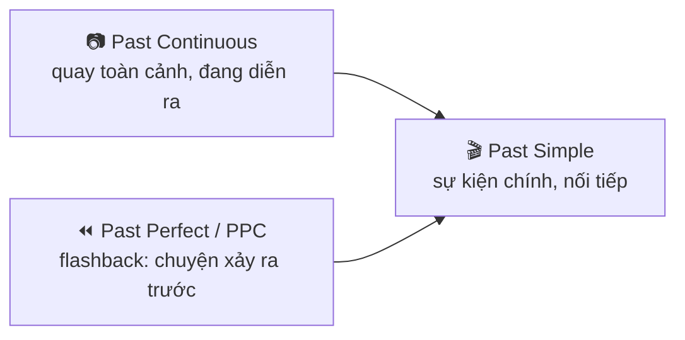
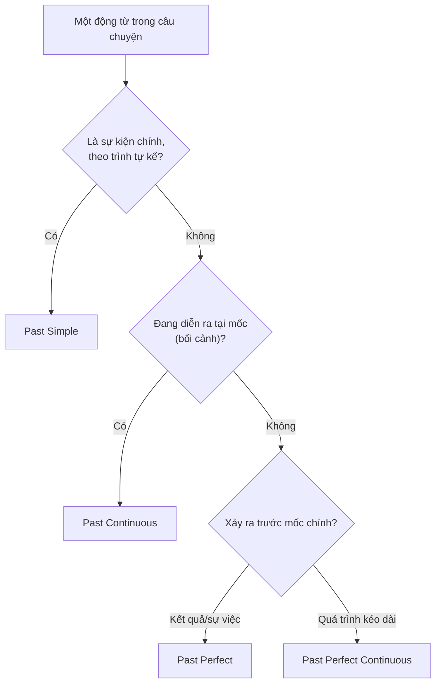

# B1-G004 · Narrative Tenses — Các thì dùng khi kể chuyện

## Mục lục

- [A. Lesson Information](#a-lesson-information)
- [B. Warm-up](#b-warm-up)
- [C. WHAT](#c-what)
- [D. WHY](#d-why)
- [E. FORM](#e-form)
- [F. HOW](#f-how)
- [G. VISUAL](#g-visual)
- [H. COMPARISON](#h-comparison)
- [I. COMMON MISTAKES](#i-common-mistakes)
- [J. MEMORY TRICKS](#j-memory-tricks)
- [K. REAL-LIFE APPLICATION](#k-real-life-application)
- [L. PRACTICE EXERCISES](#l-practice-exercises)
- [M. KNOWLEDGE CHECK](#m-knowledge-check)
- [N. ANSWER KEY](#n-answer-key)

---

## A. Lesson Information

| Mục | Nội dung |
|---|---|
| **Lesson ID** | B1-G004 |
| **Topic** | Narrative Tenses (Past Simple, Past Continuous, Past Perfect, Past Perfect Continuous) |
| **Tên tiếng Việt** | Phối hợp các thì quá khứ khi kể chuyện |
| **CEFR Level** | B1 |
| **Prerequisites** | [A2-G002](../../03-A2-ELEMENTARY/grammar/A2-G002-past-simple-vs-past-continuous.md), [B1-G002](B1-G002-past-perfect.md), [B1-G003](B1-G003-past-perfect-continuous.md) |
| **Estimated Time** | 90 phút |

**Learning Objectives:**

1. Xác định **vai trò** của từng thì quá khứ trong một câu chuyện: sự kiện chính, bối cảnh, sự việc trước đó, quá trình trước đó.
2. Chọn thì phù hợp trong đoạn văn kể chuyện **không ghi sẵn tên thì**.
3. Dùng các từ nối thời gian tự nhiên: *one day, suddenly, meanwhile, as soon as, eventually, in the end*.
4. Viết và kể một câu chuyện 150–180 từ có cấu trúc mở – diễn biến – kết.
5. Tránh lỗi "nhảy thì" và lạm dụng quá khứ hoàn thành.

---

## B. Warm-up

Đọc hai phiên bản của cùng một câu chuyện:

> **A.** *I walk home. It rains. I see a dog. Someone leaves it. I take it home.*
>
> **B.** *I **was walking** home and it **was raining** heavily. Suddenly I **saw** a small dog under a bench. It **was shaking** — it **had** obviously **been sitting** there for hours. Someone **had left** it alone. I **took** it home.*

🤔 **Hãy suy nghĩ:** Bản B cho bạn biết những thông tin gì mà bản A không có? (Điều gì đang diễn ra? Điều gì xảy ra trước? Con chó đã ở đó bao lâu?) Mỗi thì "làm một việc" khác nhau trong câu chuyện.

---

## C. WHAT

**Narrative tenses** là nhóm các thì quá khứ dùng phối hợp khi kể chuyện. Mỗi thì giữ một **vai trò**:

| Thì | Vai trò trong câu chuyện | Ví dụ |
|---|---|---|
| **Past Simple** | **Sự kiện chính**, hành động nối tiếp đẩy câu chuyện đi tới | *I **saw** a dog. I **took** it home.* |
| **Past Continuous** | **Bối cảnh**, hành động đang diễn ra khi sự kiện chính xảy ra | *It **was raining**. I **was walking** home.* |
| **Past Perfect** | Sự việc **xảy ra trước** mốc chính của câu chuyện | *Someone **had left** it alone.* |
| **Past Perfect Continuous** | **Quá trình kéo dài** trước mốc chính | *It **had been sitting** there for hours.* |

Phần lớn câu chuyện được viết bằng **quá khứ đơn**. Ba thì còn lại được dùng **khi cần** — để dựng cảnh hoặc lùi về trước.

---

## D. WHY

Người kể chuyện giỏi không chỉ liệt kê sự kiện, mà giúp người nghe **hình dung không gian và thời gian**. Các thì quá khứ là công cụ "camera":



Khi người kể **"lùi" về quá khứ xa hơn** (flashback), cần quá khứ hoàn thành để người nghe không nhầm thứ tự. Khi quay lại mạch chính, dùng lại quá khứ đơn.

---

## E. FORM

| Thì | Công thức | Ví dụ |
|---|---|---|
| Past Simple | S + V2 / didn't + V | *She **opened** the door.* |
| Past Continuous | S + was/were + V-ing | *The phone **was ringing**.* |
| Past Perfect | S + had + V3 | *Someone **had broken** the window.* |
| Past Perfect Continuous | S + had been + V-ing | *She **had been waiting** for an hour.* |

### Từ nối kể chuyện (narrative linkers)

| Chức năng | Từ/cụm |
|---|---|
| Mở đầu | *One day, Last summer, A few years ago, It was a cold night when...* |
| Sự kiện bất ngờ | *Suddenly, All of a sudden, Just then* |
| Đồng thời | *While, As, Meanwhile* |
| Trình tự | *First, Then, After that, Next, As soon as, Once* |
| Cuối cùng | *Eventually, Finally, In the end, At last* |
| Thời lượng | *for hours, by the time, until* |

---

## F. HOW

| # | English | Tiếng Việt | Phân tích |
|---|---|---|---|
| 1 | *It **was getting** dark and the wind **was blowing**.* | Trời đang tối dần và gió đang thổi. | Bối cảnh — Past Continuous |
| 2 | *Suddenly, the lights **went** out.* | Bỗng nhiên đèn tắt. | Sự kiện chính — Past Simple |
| 3 | *I **had forgotten** to charge my phone, so I **couldn't** use the torch.* | Tôi đã quên sạc điện thoại nên không bật đèn pin được. | Flashback — Past Perfect |
| 4 | *We **had been driving** for six hours when we **saw** the sign.* | Chúng tôi lái xe sáu tiếng thì thấy biển báo. | Quá trình trước mốc — PPC |
| 5 | *As soon as she **opened** the letter, she **started** to cry.* | Vừa mở thư cô ấy đã bắt đầu khóc. | Chuỗi nối tiếp — hai QKĐ |
| 6 | *While I **was paying**, someone **took** my bag.* | Trong lúc tôi đang trả tiền, ai đó lấy túi của tôi. | Bối cảnh + sự kiện cắt ngang |
| 7 | *When I **got** to the party, most people **had left**.* | Khi tôi đến bữa tiệc, phần lớn mọi người đã về. | Đối chiếu thứ tự |
| 8 | *When I **got** to the party, people **were dancing**.* | Khi tôi đến, mọi người đang nhảy. | So với #7: bối cảnh đang diễn ra |
| 9 | *She **hadn't eaten** all day, so she **was** starving.* | Cả ngày cô ấy chưa ăn nên đói lả. | Nguyên nhân trước |
| 10 | *In the end, we **found** the hotel. We **had been looking** for it for two hours!* | Cuối cùng chúng tôi tìm thấy khách sạn. Chúng tôi đã tìm nó suốt hai tiếng! | Kết + quá trình trước |

---

## G. VISUAL

### Timeline của câu chuyện ở Warm-up

```text
   ~~~~ had been sitting (for hours) ~~~~
   ✕ someone had left the dog
──────────────────────────────────────────────────── NOW
             [~~~~ was walking / was raining ~~~~]
                        ✕ saw the dog → ✕ took it home
                        (main events: past simple)
```

### Bảng "camera"

| Câu hỏi người kể tự đặt | Thì |
|---|---|
| Rồi chuyện gì xảy ra? | Past Simple |
| Lúc đó cảnh vật/người khác đang làm gì? | Past Continuous |
| Trước đó đã có chuyện gì? | Past Perfect |
| Trước đó việc gì đã kéo dài bao lâu? | Past Perfect Continuous |

---

## H. COMPARISON

### Cùng một mốc, ba ý nghĩa

| Câu | Ý nghĩa |
|---|---|
| *When I arrived, the meeting **started**.* | Tôi đến → (rồi) cuộc họp bắt đầu. |
| *When I arrived, the meeting **was starting**.* | Lúc tôi đến, cuộc họp đang bắt đầu. |
| *When I arrived, the meeting **had started**.* | Cuộc họp đã bắt đầu trước khi tôi đến. |

### Không lạm dụng quá khứ hoàn thành

Khi các sự kiện được kể **đúng trình tự**, chỉ cần quá khứ đơn:

- ❌ *I had got up, had had a shower and had left the house.*
- ✅ *I got up, had a shower and left the house.*



---

## I. COMMON MISTAKES

| # | ❌ Sai | ✅ Đúng | Nguyên nhân | Cách tránh |
|---|---|---|---|---|
| 1 | Last week I **go** to Hue and I **see** an old friend. | ...I **went**... **saw**... | "Nhảy" về hiện tại khi kể | Giữ mạch quá khứ |
| 2 | I had got up early and had gone to work. | I got up early and went to work. | Lạm dụng QKHT | Trình tự → QKĐ |
| 3 | When I arrived, the film already started. | ...the film **had** already **started**. | Thiếu đánh dấu thứ tự | Việc sớm hơn → QKHT |
| 4 | It **rained** and people **ran** for cover when I **was arriving**. | It **was raining**... when I **arrived**. | Đảo vai bối cảnh/sự kiện | Bối cảnh tiếp diễn, sự kiện QKĐ |
| 5 | We **were walking** for hours when we found it. | We **had been walking** for hours... | Thời lượng đến mốc | PPC |
| 6 | Suddenly, I **was hearing** a noise. | Suddenly, I **heard** a noise. | *Suddenly* + tiếp diễn | Sự kiện đột ngột → QKĐ |

---

## J. MEMORY TRICKS

1. **Bốn câu hỏi camera** (bảng ở mục G).
2. **"Suddenly → Past Simple"**: Sự kiện đột ngột gần như luôn là quá khứ đơn.
3. **"Flashback cần had"**: Mỗi lần kể "lùi" về trước → *had*. Quay lại mạch chính → bỏ *had*.

---

## K. REAL-LIFE APPLICATION

### Câu chuyện: The wallet

> *It **was** a busy Saturday morning, and the market **was** full of people. I **was looking** for fresh mangoes when an old woman **tapped** my shoulder. "Excuse me, is this yours?" she **asked**. She **was holding** my wallet! I **had** no idea that it **had fallen** out of my bag. I **thanked** her and **tried** to give her some money, but she **refused**. She **explained** that she **had been selling** vegetables at that market for forty years and that someone **had** once **returned** her lost purse too. "Kindness comes back," she **said**. Since that day, I have always tried to help strangers.*

**Giải thích:** Sáng thứ Bảy ở chợ đông người; "tôi" đang tìm xoài thì một bà cụ vỗ vai, cầm chiếc ví của "tôi" — "tôi" không biết nó đã rơi khỏi túi. Bà từ chối nhận tiền, kể rằng bà đã bán rau ở chợ 40 năm và từng có người trả lại ví cho bà. "Lòng tốt sẽ quay lại."

**Grammar highlights:** Bối cảnh: *was full, was looking, was holding*. Sự kiện chính: *tapped, asked, thanked, tried, refused, explained, said*. Flashback: *had fallen, had been selling, had returned*. Câu cuối chuyển sang hiện tại hoàn thành vì nối với **bây giờ**.

---

## L. PRACTICE EXERCISES

> ✍️ Đáp án: [B1-G004-ANSWERS](../../12-ANSWERS-AND-EXPLANATIONS/B1/B1-G004-ANSWERS.md)

### Level 1 — Recognition

Xác định vai trò của động từ in đậm: **(E)** sự kiện chính, **(B)** bối cảnh, **(F)** sự việc trước, **(P)** quá trình trước.

**L1.1.** The sun **was setting** when we reached the beach.
**L1.2.** We **reached** the beach at seven.
**L1.3.** We were tired because we **had been travelling** since dawn.
**L1.4.** Someone **had left** a message on the door.
**L1.5.** "When I got home, my parents had gone out." — Ai rời đi trước?  A. Tôi về trước  B. Bố mẹ đi trước  C. Cùng lúc
**L1.6.** Chọn câu tự nhiên nhất:  A. Suddenly, the dog was running away.  B. Suddenly, the dog ran away.  C. Suddenly, the dog had run away.

### Level 2 — Controlled Practice

Chia động từ trong đoạn văn (chọn thì phù hợp).

> **L2.1.** Last winter, I (stay) ___ at a small hotel in Sapa. **L2.2.** One night, while I (read) ___ in my room, I heard a strange noise. **L2.3.** I (open) ___ the door, but nobody was there. **L2.4.** The next morning, the owner told me that a cat (live) ___ in the hotel for years. **L2.5.** It (come) ___ into rooms at night looking for food. **L2.6.** I (not / see) ___ it because it (hide) ___ under my bed! **L2.7.** When I checked, there were biscuit crumbs everywhere — the cat (eat) ___ my snacks. **L2.8.** It (sleep) ___ peacefully when I found it. **L2.9.** It (sit) ___ under there for hours, so it was covered in dust. **L2.10.** In the end, I (take) ___ a photo of it and we (become) ___ friends.

### Level 3 — Error Correction

Mỗi câu có một lỗi về thì.

**L3.1.** Yesterday I am going to the bank when I met my teacher.
**L3.2.** When we arrived at the station, the train left ten minutes before.
**L3.3.** I had woken up, had brushed my teeth and had made coffee.
**L3.4.** While I walked home, it was starting to rain.
**L3.5.** She was tired because she was working for twelve hours.
**L3.6.** Suddenly someone was knocking at the door.

### Level 4 — Production

**L4.1.** Viết lại câu chuyện ở Warm-up (phiên bản A) thành 6–7 câu dùng đủ 4 thì quá khứ.
**L4.2.** Hoàn thành câu: *When I opened the door, ...* theo **ba** cách khác nhau: (a) Past Simple, (b) Past Continuous, (c) Past Perfect. Giải thích nghĩa mỗi câu bằng tiếng Việt.
**L4.3.** Dịch: *"Khi tôi đến sân bay, máy bay đã cất cánh. Tôi đã chờ taxi gần một tiếng và đường rất tắc."*
**L4.4.** Viết 3 câu mở đầu câu chuyện (bối cảnh) dùng Past Continuous.

### Level 5 — Real Communication

**L5.1.** Viết câu chuyện 150–180 từ: *An unexpected meeting* hoặc *A lucky day*. Yêu cầu: có mở đầu bối cảnh, ít nhất một flashback, kết thúc rõ ràng; dùng ≥ 6 từ nối kể chuyện.
**L5.2.** **Speaking — Storytelling:** Kể một câu chuyện có thật (hoặc tưởng tượng) trong 1,5–2 phút. Ghi âm, nghe lại và đánh dấu: các động từ bối cảnh, sự kiện chính, flashback.
**L5.3.** **Speaking — Continue the story:** Tiếp tục câu: *"It was almost midnight, and I was the only passenger on the bus..."* trong 1 phút.

---

## M. KNOWLEDGE CHECK

### 5 câu hỏi tự kiểm tra

1. Bốn thì kể chuyện và vai trò của mỗi thì?
2. Thì nào chiếm phần lớn câu chuyện?
3. Khi nào cần quá khứ hoàn thành trong câu chuyện?
4. *When I arrived, the meeting started / was starting / had started* khác nhau ra sao?
5. Vì sao *Suddenly I was hearing a noise* không tự nhiên?

### Checklist

- [ ] Tôi nhận diện được vai trò của mỗi động từ trong câu chuyện.
- [ ] Tôi không "nhảy" về hiện tại khi kể chuyện quá khứ.
- [ ] Tôi kể được một câu chuyện 1,5 phút có bối cảnh và flashback.

### 3 lỗi quan trọng cần nhớ

1. Kể đúng trình tự → **Past Simple**, không lạm dụng *had*.
2. Bối cảnh → **was/were + V-ing**; sự kiện đột ngột → **V2**.
3. Thời lượng trước mốc → **had been + V-ing**.

### Lịch ôn tập

| Ngày | Việc cần làm |
|---|---|
| Ngày 1 | Làm lại L2 không nhìn đáp án |
| Ngày 3 | Kể lại một bộ phim bạn thích bằng 8–10 câu |
| Ngày 7 | Viết lại L5.1 với chủ đề khác |

### Liên kết

- ➡️ Bài tiếp theo: [B1-G005 — Future Continuous](B1-G005-future-continuous.md)
- 🔁 Kỹ năng: [S05 — Storytelling](../../09-FOUR-SKILLS/Speaking/S05-storytelling.md)
- 🎯 **Mini Challenge khối B1-1** — xem [B1 README](../README.md#5-mini-challenges)

---

## N. ANSWER KEY

👉 [B1-G004-ANSWERS.md](../../12-ANSWERS-AND-EXPLANATIONS/B1/B1-G004-ANSWERS.md)
