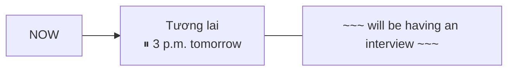

# B1-G005 · Future Continuous — Thì tương lai tiếp diễn

## Mục lục

- [A. Lesson Information](#a-lesson-information)
- [B. Warm-up](#b-warm-up)
- [C. WHAT](#c-what)
- [D. WHY](#d-why)
- [E. FORM](#e-form)
- [F. HOW](#f-how)
- [G. VISUAL](#g-visual)
- [H. COMPARISON](#h-comparison)
- [I. COMMON MISTAKES](#i-common-mistakes)
- [J. MEMORY TRICKS](#j-memory-tricks)
- [K. REAL-LIFE APPLICATION](#k-real-life-application)
- [L. PRACTICE EXERCISES](#l-practice-exercises)
- [M. KNOWLEDGE CHECK](#m-knowledge-check)
- [N. ANSWER KEY](#n-answer-key)

---

## A. Lesson Information

| Mục | Nội dung |
|---|---|
| **Lesson ID** | B1-G005 |
| **Topic** | Future Continuous |
| **Tên tiếng Việt** | Thì tương lai tiếp diễn |
| **CEFR Level** | B1 |
| **Prerequisites** | [A2-G008 — Future forms](../../03-A2-ELEMENTARY/grammar/A2-G008-present-continuous-future.md), [A2-G001 — Past Continuous](../../03-A2-ELEMENTARY/grammar/A2-G001-past-continuous.md) |
| **Estimated Time** | 75 phút |

**Learning Objectives:**

1. Tạo câu với **will be + V-ing**.
2. Nói về hoạt động **đang diễn ra tại một thời điểm trong tương lai**.
3. Nói về việc **sẽ diễn ra như một phần bình thường của lịch/kế hoạch** (*I'll be passing the post office anyway*).
4. Hỏi về kế hoạch của người khác một cách **lịch sự**: *Will you be using the car tonight?*
5. Phân biệt với *will + V*, *be going to*, present continuous.

---

## B. Warm-up

Bạn hẹn gọi video với một người bạn ở Canada. Bạn nói:

> *"Don't call me at 3 p.m. tomorrow — I**'ll be having** a job interview."*

Một đồng nghiệp hỏi bạn: *"**Will** you **be going** past the bank this afternoon? Could you drop off these documents?"*

🤔 **Hãy suy nghĩ:** Câu đầu không nói "tôi sẽ bắt đầu phỏng vấn" — mà nói "vào lúc 3 giờ, tôi **đang** phỏng vấn". Câu thứ hai hỏi về kế hoạch mà không gây áp lực. Bạn đã học quá khứ tiếp diễn (*was doing* tại một mốc quá khứ). Bạn đoán tương lai sẽ dùng cấu trúc gì?

---

## C. WHAT

**Future Continuous** (tương lai tiếp diễn) có ba cách dùng chính:

| Cách dùng | Ví dụ | Ý nghĩa |
|---|---|---|
| 1. **Đang diễn ra tại một thời điểm tương lai** | *This time tomorrow, I**'ll be flying** to Tokyo.* | Giờ này ngày mai tôi đang bay tới Tokyo. |
| 2. **Việc sẽ xảy ra như lẽ thường** (theo lịch, không phải vì quyết định mới) | *I**'ll be seeing** Lan at work tomorrow, so I can give her the book.* | Mai đằng nào tôi cũng gặp Lan ở cơ quan. |
| 3. **Hỏi lịch sự về kế hoạch** | ***Will** you **be using** your laptop this evening?* | (trước khi xin mượn) |

---

## D. WHY

Đây là "quá khứ tiếp diễn" đặt sang tương lai:

| Mốc | Cấu trúc | Ví dụ |
|---|---|---|
| Quá khứ | *was/were + V-ing* | *At 8 last night, I **was watching** TV.* |
| Hiện tại | *am/is/are + V-ing* | *Right now, I'**m watching** TV.* |
| Tương lai | *will be + V-ing* | *At 8 tonight, I'**ll be watching** TV.* |



Vì sao dạng này **lịch sự**? Câu hỏi *Will you be using the car?* chỉ hỏi về **lịch trình bình thường** của bạn, không hỏi về **ý định/quyết định** (*Will you use...?* có thể nghe như yêu cầu hoặc chất vấn). Người nghe dễ trả lời "không" mà không thấy bị ép.

---

## E. FORM

**Ký hiệu:** **S** = chủ ngữ · **V-ing** = động từ thêm *-ing*.

| Thể | Công thức (mọi chủ ngữ) | Ví dụ |
|---|---|---|
| ➕ | S + **will be** + V-ing | *They**'ll be waiting** for you.* |
| ➖ | S + **won't be** + V-ing | *I **won't be working** on Friday.* |
| ❓ | **Will** + S + **be** + V-ing? | ***Will** you **be coming** to the party?* |
| 💬 | Yes, S will. / No, S won't. | |

Cụm thời gian thường gặp: *this time tomorrow / next week, at 10 a.m. tomorrow, (at) this time next year, all day tomorrow, when you arrive*.

---

## F. HOW

| # | English | Tiếng Việt | Phân tích |
|---|---|---|---|
| 1 | ***This time next week**, I**'ll be lying** on a beach in Phu Quoc.* | Giờ này tuần sau tôi đang nằm trên bãi biển Phú Quốc. | Đang diễn ra tại mốc tương lai |
| 2 | *Don't call at 8 — we**'ll be having** dinner.* | Đừng gọi lúc 8 giờ — lúc đó chúng tôi đang ăn tối. | |
| 3 | *When you arrive, I**'ll be waiting** at the gate.* | Khi bạn tới, tôi sẽ đang đợi ở cổng. | *when* + hiện tại đơn |
| 4 | *In ten years, many people **will be working** from home.* | Mười năm nữa, nhiều người sẽ làm việc ở nhà. | Dự đoán xu hướng đang diễn ra |
| 5 | *I**'ll be passing** the supermarket on my way home. Do you need anything?* | Trên đường về tôi sẽ đi qua siêu thị. Bạn cần gì không? | Việc theo lẽ thường |
| 6 | *The CEO **will be visiting** our office next Monday.* | Thứ Hai tới giám đốc điều hành sẽ đến thăm văn phòng. | Lịch trình (thông báo trang trọng) |
| 7 | ***Will** you **be using** the printer this afternoon?* | Chiều nay bạn có dùng máy in không? | Hỏi lịch sự |
| 8 | *I **won't be coming** to class tomorrow. I have a doctor's appointment.* | Mai tôi không đến lớp. Tôi có lịch hẹn bác sĩ. | Phủ định — thông báo |
| 9 | *At midnight, I'll **still be studying**.* | Nửa đêm tôi vẫn còn đang học. | *still* giữa *will* và *be* |
| 10 | *Ladies and gentlemen, we**'ll be landing** in about twenty minutes.* | Thưa quý khách, khoảng 20 phút nữa chúng ta sẽ hạ cánh. | Thông báo của phi hành đoàn |

---

## G. VISUAL

### Timeline

```text
NOW ──────────────────── [~~~~~~~~ will be flying ~~~~~~~~] ───►
                                    ↑
                         this time tomorrow (9 a.m.)
```

### Ba thì tiếp diễn

| Thì | Mốc | Ví dụ |
|---|---|---|
| Past Continuous | Quá khứ | *At 9 yesterday, I was teaching.* |
| Present Continuous | Bây giờ | *I'm teaching now.* |
| Future Continuous | Tương lai | *At 9 tomorrow, I'll be teaching.* |

---

## H. COMPARISON

| Hình thức | Ý nghĩa chính | Ví dụ |
|---|---|---|
| *will + V* | Quyết định/hứa/dự đoán (sự kiện) | *I'll call you at 8.* (hành động gọi) |
| *will be + V-ing* | Đang diễn ra tại mốc; việc theo lẽ thường | *I'll be driving at 8.* (đang lái) |
| *be going to* | Dự định đã có | *I'm going to call the bank.* |
| Present continuous | Kế hoạch đã sắp xếp | *I'm meeting Lan at 8.* |

### *Will you...?* và *Will you be + V-ing...?*

| | Sắc thái |
|---|---|
| *Will you come to my party?* | Lời mời / yêu cầu — người nghe cần quyết định |
| *Will you be coming to the party?* | Hỏi thông tin trung tính về kế hoạch |
| *Will you lend me your car?* | Yêu cầu trực tiếp |
| *Will you be using your car tonight?* | Hỏi dò lịch sự trước khi xin mượn |

---

## I. COMMON MISTAKES

| # | ❌ Sai | ✅ Đúng | Nguyên nhân | Cách tránh |
|---|---|---|---|---|
| 1 | At 9 tomorrow I **will working**. | ...I **will be working**. | Thiếu *be* | *will* + **be** + V-ing |
| 2 | At 9 tomorrow I **will be work**. | ...**will be working**. | Thiếu *-ing* | |
| 3 | I'll be waiting when you **will arrive**. | ...when you **arrive**. | *will* sau *when* | Mệnh đề thời gian → hiện tại đơn |
| 4 | This time tomorrow I'**ll be knowing** the result. | ...I'**ll know** the result. | Động từ trạng thái | |
| 5 | **Do** you be using the car? | **Will** you **be using** the car? | | |
| 6 | I **will still** be... → I **still will be** working. | I **will still be** working. | Sai vị trí *still* | *will still be* |

---

## J. MEMORY TRICKS

1. **"Nhấn pause ở tương lai ⏸"**: Tua tới một thời điểm tương lai, nhấn pause — bạn đang làm gì trong khung hình đó? → *will be + V-ing*.
2. **"Will be — câu hỏi lịch sự"**: Muốn mượn đồ của ai, hỏi trước *Will you be using...?*

---

## K. REAL-LIFE APPLICATION

### Email: Out-of-office

> *Subject: Out of office 12–16 May*
>
> *Dear colleagues,*
>
> *Please note that I **will be attending** a training course in Singapore from 12 to 16 May. During this time, I **won't be checking** my emails regularly. If you need urgent help, please contact Nguyen Lan, who **will be handling** my clients while I am away.*
>
> *I **will be back** in the office on Monday, 19 May.*
>
> *Best regards,*
> *Tran Minh*

**Giải thích:** Thư báo vắng mặt: Minh đi đào tạo ở Singapore từ 12–16/5, sẽ không thường xuyên kiểm tra email; việc khẩn liên hệ Nguyễn Lan, người sẽ phụ trách khách hàng trong thời gian đó. *will be back* là *will + be* (không phải tương lai tiếp diễn).

**Grammar highlights:** Tương lai tiếp diễn rất phổ biến trong **email công việc và thông báo** vì nghe trung tính, chuyên nghiệp.

---

## L. PRACTICE EXERCISES

> ✍️ Đáp án: [B1-G005-ANSWERS](../../12-ANSWERS-AND-EXPLANATIONS/B1/B1-G005-ANSWERS.md)

### Level 1 — Recognition

**L1.1.** This time next month, we ___ in our new house.  A. will live  B. will be living  C. are living  D. will be live
**L1.2.** Don't phone at 7 — I ___ the children to bed.  A. 'll be putting  B. 'll put  C. put  D. 'm put
**L1.3.** ___ you be using the meeting room at 2 p.m.?  A. Are  B. Do  C. Will  D. Would
**L1.4.** When you get here, we ___ for you at the entrance.  A. 'll wait  B. 'll be waiting  C. wait  D. waited
**L1.5.** Câu nào là **lời mời trực tiếp** (không phải hỏi thông tin)?  A. Will you be coming to the party?  B. Will you come to my party?
**L1.6.** This time tomorrow, I ___ the answer.  A. 'll be knowing  B. 'll know  C. 'm knowing  D. know

### Level 2 — Controlled Practice

Chia động từ ở tương lai tiếp diễn.

**L2.1.** At 10 a.m. tomorrow, I (take) ___ my driving test.
**L2.2.** In 2040, people (drive) ___ electric cars.
**L2.3.** I (not / work) ___ next Monday — it's a holiday.
**L2.4.** (you / use) ___ your bike this weekend? Can I borrow it?
**L2.5.** Don't worry, we (think) ___ of you during the operation.

Dựa vào lịch của Hà ngày mai, viết câu *At ..., Ha will be ...*:

| 7:00–8:00 | 9:00–11:00 | 12:30–13:30 | 15:00–17:00 |
|---|---|---|---|
| jog in the park | teach a class | have lunch with her mother | write a report |

**L2.6.** at 7:30 → ______
**L2.7.** at 10:00 → ______
**L2.8.** at 13:00 → ______
**L2.9.** at 16:00 → ______
**L2.10.** Viết 1 câu phủ định về Hà lúc 10:00 (*not / check emails*).

### Level 3 — Error Correction

**L3.1.** At midnight I will studying.
**L3.2.** This time next year she will be live in Paris.
**L3.3.** I'll be waiting when you will come out.
**L3.4.** Do you be working tomorrow?
**L3.5.** Tomorrow at noon I'll be having a new phone.
**L3.6.** We still will be eating when you arrive.

### Level 4 — Production

Dịch sang tiếng Anh:

**L4.1.** Giờ này ngày mai tôi đang ngồi trên máy bay.
**L4.2.** Đừng gọi tôi lúc 9 giờ — tôi đang họp.
**L4.3.** Tối nay bạn có dùng xe máy không? (hỏi lịch sự)
**L4.4.** Mười năm nữa bạn sẽ đang làm gì?

**L4.5.** **Explain:** Giải thích sắc thái khác nhau giữa *"Will you help me tomorrow?"* và *"Will you be working tomorrow?"* (2–3 câu tiếng Việt).

### Level 5 — Real Communication

**L5.1.** Viết email "out of office" (60–80 từ) thông báo bạn sẽ vắng mặt trong một tuần, dùng ≥ 3 câu tương lai tiếp diễn.
**L5.2.** **Speaking — My life in 10 years:** Nói 1 phút: *In ten years, I'll be living..., I'll be working..., I'll probably be...*
**L5.3.** **Speaking — Polite requests:** Viết và đọc to 4 câu hỏi dò lịch sự với *Will you be + V-ing...?* trước khi xin mượn/nhờ (xe, máy tính, phòng họp, giúp đón con).

---

## M. KNOWLEDGE CHECK

### 5 câu hỏi tự kiểm tra

1. Công thức tương lai tiếp diễn?
2. Ba cách dùng chính?
3. *Will you come?* và *Will you be coming?* khác nhau thế nào?
4. Sau *when* nói về tương lai dùng thì gì?
5. Vì sao *I'll be knowing* sai?

### Checklist

- [ ] Tôi tạo được câu *will be + V-ing* đúng.
- [ ] Tôi mô tả được lịch ngày mai theo từng mốc giờ.
- [ ] Tôi hỏi lịch sự về kế hoạch của người khác.

### 3 lỗi quan trọng cần nhớ

1. ~~will working / will be work~~ → **will be working**.
2. ~~when you will arrive~~ → when you **arrive**.
3. Động từ trạng thái → **will + V**.

### Lịch ôn tập

| Ngày | Việc cần làm |
|---|---|
| Ngày 1 | Làm lại L2 |
| Ngày 3 | Viết lịch ngày mai của bạn theo 5 mốc giờ |
| Ngày 7 | Làm lại L5.2 |

### Liên kết

- ➡️ Bài tiếp theo: [B1-G006 — Future Perfect](B1-G006-future-perfect.md)
- 🔁 Tra cứu: [ALL-TENSES-COMPARISON](../../06-GRAMMAR-REFERENCE/ALL-TENSES-COMPARISON.md)

---

## N. ANSWER KEY

👉 [B1-G005-ANSWERS.md](../../12-ANSWERS-AND-EXPLANATIONS/B1/B1-G005-ANSWERS.md)
