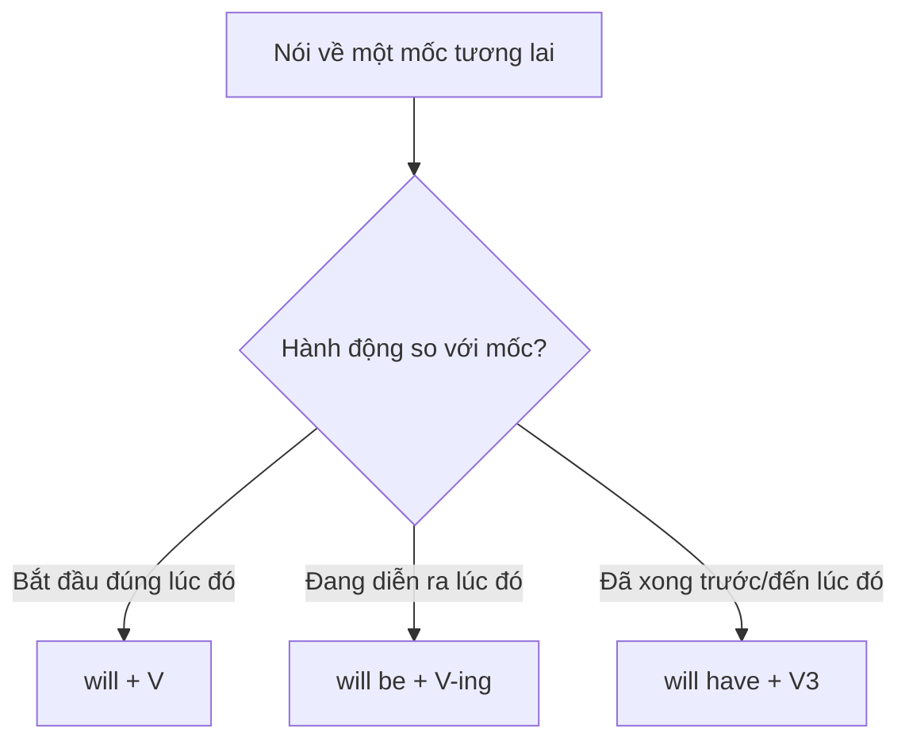

# B1-G006 · Future Perfect — Thì tương lai hoàn thành

## Mục lục

- [A. Lesson Information](#a-lesson-information)
- [B. Warm-up](#b-warm-up)
- [C. WHAT](#c-what)
- [D. WHY](#d-why)
- [E. FORM](#e-form)
- [F. HOW](#f-how)
- [G. VISUAL](#g-visual)
- [H. COMPARISON](#h-comparison)
- [I. COMMON MISTAKES](#i-common-mistakes)
- [J. MEMORY TRICKS](#j-memory-tricks)
- [K. REAL-LIFE APPLICATION](#k-real-life-application)
- [L. PRACTICE EXERCISES](#l-practice-exercises)
- [M. KNOWLEDGE CHECK](#m-knowledge-check)
- [N. ANSWER KEY](#n-answer-key)

---

## A. Lesson Information

| Mục | Nội dung |
|---|---|
| **Lesson ID** | B1-G006 |
| **Topic** | Future Perfect Simple |
| **Tên tiếng Việt** | Thì tương lai hoàn thành |
| **CEFR Level** | B1 |
| **Prerequisites** | [B1-G005 — Future Continuous](B1-G005-future-continuous.md), [A2-G003 — V3](../../03-A2-ELEMENTARY/grammar/A2-G003-present-perfect-form.md) |
| **Estimated Time** | 75 phút |

**Learning Objectives:**

1. Tạo câu với **will have + V3**.
2. Nói về việc **sẽ hoàn tất trước một mốc thời gian trong tương lai**.
3. Dùng ***by + mốc*** và ***by the time + mệnh đề hiện tại đơn***.
4. Nói thời lượng tính đến một mốc tương lai (*By June, I'll have worked here for 10 years*).
5. Phân biệt với tương lai tiếp diễn và *will + V*.

---

## B. Warm-up

Bạn xin nghỉ phép để chuẩn bị đám cưới. Sếp lo lắng về dự án. Bạn trấn an:

> *"Don't worry. By Friday, I**'ll have finished** the report, and I**'ll have sent** it to the client."*

🤔 **Hãy suy nghĩ:** Bạn không nói rằng vào thứ Sáu bạn **bắt đầu** viết báo cáo, cũng không nói bạn **đang** viết. Bạn nói rằng **trước hoặc đến** thứ Sáu, việc viết **đã xong**. Thì nào trong những thì bạn đã học có nghĩa "đã xong tính đến một mốc"? Giờ ta đặt mốc đó vào tương lai.

---

## C. WHAT

**Future Perfect** (tương lai hoàn thành) diễn tả một hành động **sẽ đã hoàn tất trước hoặc tại một thời điểm trong tương lai**. Người nói "đứng" ở mốc tương lai đó và **nhìn lại**.

| Ví dụ | Ý nghĩa |
|---|---|
| *By 2030, I**'ll have paid off** my loan.* | Đến năm 2030, tôi sẽ trả xong khoản vay. |
| *By the time you get home, I**'ll have cooked** dinner.* | Lúc bạn về đến nhà, tôi sẽ nấu xong bữa tối rồi. |
| *Next month, we**'ll have been** married for 20 years.* | Tháng sau là chúng tôi cưới nhau được 20 năm. |

---

## D. WHY

Tương lai hoàn thành là **hiện tại hoàn thành đặt sang tương lai**: thay vì nhìn lại từ "bây giờ", người nói nhìn lại từ "một mốc tương lai".

| Mốc nhìn lại | Cấu trúc | Ví dụ |
|---|---|---|
| Quá khứ | *had + V3* | *By 2020, I had finished university.* |
| Hiện tại | *have/has + V3* | *I have finished university.* |
| Tương lai | *will have + V3* | *By 2030, I will have finished my PhD.* |


---

## E. FORM

**Ký hiệu:** **S** = chủ ngữ · **V3** = quá khứ phân từ.

| Thể | Công thức (mọi chủ ngữ) | Ví dụ |
|---|---|---|
| ➕ | S + **will have** + V3 | *She**'ll have left** by 6.* |
| ➖ | S + **won't have** + V3 | *They **won't have finished** by then.* |
| ❓ | **Will** + S + **have** + V3? | ***Will** you **have finished** by Friday?* |
| 💬 | Yes, S will. / No, S won't. | |

### Cụm thời gian

| Cụm | Ví dụ |
|---|---|
| ***by*** + mốc (= không muộn hơn) | *by Friday, by 2030, by then, by the end of the year* |
| ***by the time*** + S + V (hiện tại đơn) | *by the time you arrive* (không dùng *will arrive*) |
| ***before*** + mốc/mệnh đề | *before the meeting starts* |
| ***in*** + khoảng (= sau khoảng đó) | *In two years, I'll have saved enough.* |

> ⚠️ *by* ≠ *until*: *I'll have finished **by** Friday* (xong trước/ chậm nhất thứ Sáu). *I'll be working **until** Friday* (làm liên tục đến thứ Sáu).

---

## F. HOW

| # | English | Tiếng Việt | Phân tích |
|---|---|---|---|
| 1 | *I**'ll have finished** the report **by** Friday.* | Tôi sẽ làm xong báo cáo trước thứ Sáu. | *by* + mốc |
| 2 | ***By the time** you **wake** up, we**'ll have arrived** in Hue.* | Lúc bạn thức dậy, chúng tôi sẽ đến Huế rồi. | *by the time* + hiện tại đơn |
| 3 | *By 2035, scientists **will have found** a cure for many diseases.* | Đến năm 2035, các nhà khoa học sẽ tìm ra cách chữa nhiều bệnh. | Dự đoán hoàn tất |
| 4 | *Next June, I**'ll have worked** here **for** ten years.* | Tháng Sáu tới là tôi làm ở đây được mười năm. | Thời lượng tính đến mốc tương lai |
| 5 | *She **won't have read** the email by the meeting.* | Cô ấy sẽ chưa đọc email trước buổi họp. | Phủ định |
| 6 | ***Will** you **have saved** enough money by December?* | Đến tháng 12 bạn đã tiết kiệm đủ tiền chưa? | Câu hỏi |
| 7 | *Don't call at 9. The film **will have started**.* | Đừng gọi lúc 9 giờ. Phim sẽ bắt đầu rồi. | Nhìn lại từ 9 giờ |
| 8 | *In two weeks, I**'ll have moved** into my new flat.* | Hai tuần nữa là tôi đã chuyển vào căn hộ mới rồi. | *in* + khoảng |
| 9 | *By the end of this course, you **will have learned** over 500 words.* | Đến cuối khóa, bạn sẽ học được hơn 500 từ. | Số lượng tính đến mốc |
| 10 | *How many countries **will** you **have visited** by the time you're 40?* | Đến lúc 40 tuổi bạn sẽ đến được bao nhiêu nước? | |

---

## G. VISUAL

### Timeline

```text
NOW ─────────── ✕ ─────────────── 📍 Friday ──────►
            (finish report)      "By Friday, I'll have finished."
            ← xảy ra lúc nào đó trước mốc →
```

### So sánh với tương lai tiếp diễn

```text
At 5 p.m. tomorrow:
  I'll be writing the report.       [~~~~ 📍 ~~~~]  đang viết
  I'll have written the report.     ✕ ......... 📍   đã viết xong
```

---

## H. COMPARISON

| Cấu trúc | Câu tại mốc "6 p.m. tomorrow" | Ý nghĩa |
|---|---|---|
| *will + V* | *I'll cook dinner at 6.* | Bắt đầu nấu lúc 6 giờ |
| *will be + V-ing* | *At 6, I'll be cooking.* | Đang nấu lúc 6 giờ |
| *will have + V3* | *By 6, I'll have cooked.* | Đã nấu xong trước 6 giờ |



---

## I. COMMON MISTAKES

| # | ❌ Sai | ✅ Đúng | Nguyên nhân | Cách tránh |
|---|---|---|---|---|
| 1 | By Friday I **will finish** the report. (ý: đã xong trước thứ Sáu) | ...I **will have finished**... | Không thể hiện ý "đã xong" | *by* + mốc tương lai → *will have + V3* |
| 2 | I'll have **finish** it by 6. | I'll have **finished**... | Thiếu V3 | |
| 3 | By the time you **will arrive**, ... | By the time you **arrive**, ... | *will* sau *by the time* | Hiện tại đơn |
| 4 | I'll have finished it **until** Friday. | ...**by** Friday. | Nhầm *by/until* | *by* = hạn chót |
| 5 | I **will had** finished. | I **will have** finished. | Sau *will* dùng V nguyên mẫu | *will have* |
| 6 | **Do** you will have finished? | **Will** you have finished? | | |

---

## J. MEMORY TRICKS

1. **"Đứng ở tương lai, nhìn lại 👀"**: Tưởng tượng bạn đứng ở thứ Sáu và nhìn lại — báo cáo đã xong → *will have finished*.
2. **"By = deadline ⏰"**: Thấy *by + mốc tương lai*, nghĩ đến *will have + V3* (nếu nói về sự hoàn tất).

---

## K. REAL-LIFE APPLICATION

### Hội thoại: Kế hoạch tài chính

> **Advisor:** So, what are your goals?
> **Nam:** I want to buy a flat. I think by the end of 2028, I**'ll have saved** about 500 million dong.
> **Advisor:** Good. And your car loan?
> **Nam:** I**'ll have paid** it **off** by next summer.
> **Advisor:** Excellent. By the time you're 35, you **will have built** a strong financial base. **Will** you **have finished** your master's degree by then?
> **Nam:** Yes, I'll graduate in 2027. And by 2029, I**'ll have worked** in this company for ten years, so I hope I'll get a promotion.

**Giải thích:** Nam bàn với chuyên viên tư vấn tài chính: đến cuối 2028 sẽ tiết kiệm được khoảng 500 triệu; đến hè năm sau sẽ trả xong khoản vay mua xe; trước 35 tuổi sẽ có nền tảng tài chính vững; năm 2029 tròn 10 năm làm ở công ty.

**Useful expressions:** *pay off a loan* (trả hết nợ) · *financial base* (nền tảng tài chính) · *get a promotion* (được thăng chức)

---

## L. PRACTICE EXERCISES

> ✍️ Đáp án: [B1-G006-ANSWERS](../../12-ANSWERS-AND-EXPLANATIONS/B1/B1-G006-ANSWERS.md)

### Level 1 — Recognition

**L1.1.** By 10 p.m., I ___ all my homework.  A. will finish  B. will have finished  C. will be finishing  D. finish
**L1.2.** By the time you ___, I'll have cleaned the house.  A. will arrive  B. arrive  C. arrived  D. will have arrived
**L1.3.** At 10 p.m. I ___ a film. (đang xem)  A. will have watched  B. will be watching  C. watch  D. have watched
**L1.4.** I'll have finished the project ___ Monday.  A. until  B. by  C. since  D. for
**L1.5.** Next year we ___ married for 25 years.  A. will be  B. will have been  C. are  D. have been
**L1.6.** ___ you have finished by 5?  A. Do  B. Are  C. Will  D. Have

### Level 2 — Controlled Practice

Chia động từ ở tương lai hoàn thành.

**L2.1.** By next month, they (build) ___ the new bridge.
**L2.2.** I (not / finish) ___ the book by the weekend — it's too long.
**L2.3.** (you / pack) ___ by the time the taxi comes?
**L2.4.** By 2030, the company (open) ___ fifty new stores.
**L2.5.** In June, my parents (live) ___ in this house for forty years.

Chọn *will + V*, *will be + V-ing* hoặc *will have + V3*.

**L2.6.** At 8 a.m. tomorrow, I (fly) ___ to Seoul.
**L2.7.** By the time I land, my sister (leave) ___ for work.
**L2.8.** "I'm hungry." — "I (make) ___ you a sandwich."
**L2.9.** By the end of this year, I (read) ___ 20 books.
**L2.10.** Don't call at 3 — I (do) ___ my exam.

### Level 3 — Error Correction

**L3.1.** By Friday, I will finish all my tasks. (ý: đã xong trước thứ Sáu)
**L3.2.** By the time you will get here, we'll have eaten.
**L3.3.** She will have leave by then.
**L3.4.** I'll have finished my thesis until June.
**L3.5.** Do you will have saved enough by then?
**L3.6.** We will had lived here for ten years next month.

### Level 4 — Production

Dịch sang tiếng Anh:

**L4.1.** Đến cuối năm nay, tôi sẽ tiết kiệm được 50 triệu đồng.
**L4.2.** Lúc bạn đến, cuộc họp sẽ kết thúc rồi.
**L4.3.** Tháng sau là tôi học tiếng Anh được ba năm.
**L4.4.** Đến năm 2030, bạn nghĩ con người đã làm được gì? (*achieve*)

**L4.5.** **Explain:** Phân biệt *"At 6, I'll be cooking"* và *"By 6, I'll have cooked"* (2 câu tiếng Việt).

### Level 5 — Real Communication

**L5.1.** Viết đoạn văn 90–110 từ: *Where will I be in five years?* Dùng ≥ 4 câu tương lai hoàn thành (*By 20XX, I'll have...*), ≥ 2 câu tương lai tiếp diễn, và *by / by the time*.
**L5.2.** **Speaking — Project update:** Bạn là trưởng nhóm. Báo cáo 1 phút cho sếp về tiến độ: *By Monday we'll have..., By the end of the month we'll have..., We won't have... by then, so...*
**L5.3.** **Speaking — Milestones:** Nói 5 câu về những "cột mốc" sắp tới của bạn: *Next year, I'll have been... for... years.*

---

## M. KNOWLEDGE CHECK

### 5 câu hỏi tự kiểm tra

1. Công thức tương lai hoàn thành?
2. Thì này "nhìn lại" từ đâu?
3. *by* và *until* khác nhau thế nào?
4. Sau *by the time* (nói về tương lai) dùng thì gì?
5. So sánh *will cook / will be cooking / will have cooked*.

### Checklist

- [ ] Tôi tạo được câu *will have + V3*.
- [ ] Tôi dùng đúng *by / by the time*.
- [ ] Tôi chọn đúng giữa 3 dạng tương lai với *will*.

### 3 lỗi quan trọng cần nhớ

1. *by + mốc tương lai* (hoàn tất) → **will have + V3**.
2. ~~by the time you will arrive~~ → by the time you **arrive**.
3. ~~until Friday~~ (hạn chót) → **by** Friday.

### Lịch ôn tập

| Ngày | Việc cần làm |
|---|---|
| Ngày 1 | Làm lại L2.6–L2.10 |
| Ngày 3 | Viết 5 mục tiêu với *By the end of the year, I'll have...* |
| Ngày 7 | Ôn so sánh 3 dạng tương lai trong [ALL-TENSES-COMPARISON](../../06-GRAMMAR-REFERENCE/ALL-TENSES-COMPARISON.md) |

### Liên kết

- ➡️ Bài tiếp theo: [B1-G007 — Second Conditional](B1-G007-second-conditional.md)
- 🔜 [B2-G012 — Future Perfect Continuous](../../05-B2-UPPER-INTERMEDIATE/grammar/B2-G012-future-perfect-continuous.md)

---

## N. ANSWER KEY

👉 [B1-G006-ANSWERS.md](../../12-ANSWERS-AND-EXPLANATIONS/B1/B1-G006-ANSWERS.md)
