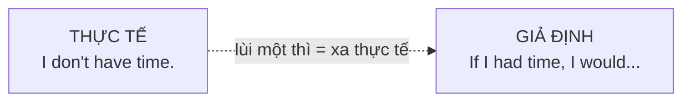
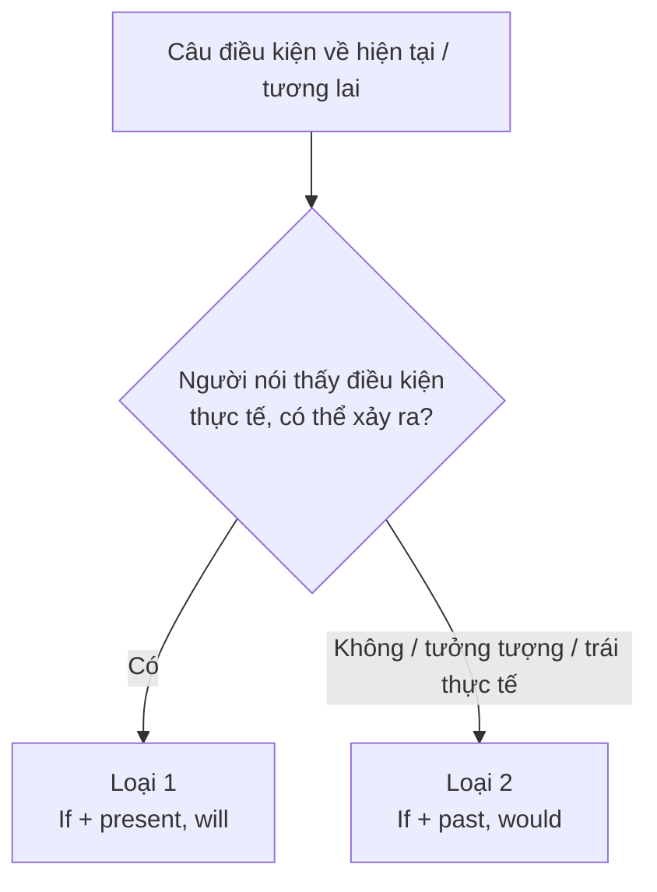

# B1-G007 · Second Conditional — Câu điều kiện loại 2

## Mục lục

- [A. Lesson Information](#a-lesson-information)
- [B. Warm-up](#b-warm-up)
- [C. WHAT](#c-what)
- [D. WHY](#d-why)
- [E. FORM](#e-form)
- [F. HOW](#f-how)
- [G. VISUAL](#g-visual)
- [H. COMPARISON](#h-comparison)
- [I. COMMON MISTAKES](#i-common-mistakes)
- [J. MEMORY TRICKS](#j-memory-tricks)
- [K. REAL-LIFE APPLICATION](#k-real-life-application)
- [L. PRACTICE EXERCISES](#l-practice-exercises)
- [M. KNOWLEDGE CHECK](#m-knowledge-check)
- [N. ANSWER KEY](#n-answer-key)

---

## A. Lesson Information

| Mục | Nội dung |
|---|---|
| **Lesson ID** | B1-G007 |
| **Topic** | Second Conditional (unreal or unlikely present/future) |
| **Tên tiếng Việt** | Câu điều kiện loại 2 |
| **CEFR Level** | B1 |
| **Prerequisites** | [A2-G017 — First Conditional](../../03-A2-ELEMENTARY/grammar/A2-G017-first-conditional.md), [A1-G017 — Past Simple](../../02-A1-BEGINNER/grammar/A1-G017-past-simple-affirmative.md) |
| **Estimated Time** | 90 phút |

**Learning Objectives:**

1. Tạo câu **If + quá khứ đơn, would/could/might + V**.
2. Diễn tả tình huống **không có thật ở hiện tại** hoặc **khó xảy ra trong tương lai**.
3. Dùng ***If I were you, I'd...*** để khuyên.
4. Phân biệt điều kiện loại 1 (có khả năng) và loại 2 (giả định/khó xảy ra).
5. Hỏi và trả lời câu hỏi giả định *What would you do if...?*

---

## B. Warm-up

Hai người bạn nói về xổ số:

> **An:** *If I **win** the lottery this week, I**'ll buy** a car.* (An vừa mua 100 tờ vé số và tin mình có cơ hội!)
> **Bình:** *If I **won** the lottery, I**'d travel** around the world.* (Bình không mua vé — chỉ mơ mộng.)

🤔 **Hãy suy nghĩ:** Cả hai đều nói về tương lai, nhưng Bình dùng **quá khứ** *won*. Vì sao một tình huống tương lai lại dùng thì quá khứ? Điều gì khác nhau trong cách hai người nhìn khả năng trúng số?

---

## C. WHAT

**Second Conditional** (câu điều kiện loại 2) dùng để nói về:

| Loại tình huống | Ví dụ | Ý nghĩa |
|---|---|---|
| **Không có thật ở hiện tại** | *If I **had** more time, I**'d learn** Japanese.* | Thực tế: tôi không có nhiều thời gian. |
| **Khó xảy ra / tưởng tượng** trong tương lai | *If I **won** the lottery, I**'d buy** a house by the sea.* | Khả năng trúng số rất thấp. |
| **Lời khuyên** | *If I **were** you, I**'d talk** to her.* | Tôi không phải là bạn, nhưng đây là lời khuyên. |
| **Yêu cầu/đề nghị lịch sự** | *It **would** be great **if** you **could** help.* | Nhẹ nhàng hơn *Help me.* |

---

## D. WHY

Trong tiếng Anh, **thì quá khứ không chỉ để nói về thời gian quá khứ** — nó còn tạo **"khoảng cách" với thực tế** (*distance from reality*). Khi người nói dùng *If I won...*, thì quá khứ báo hiệu: "đây là tưởng tượng, xa thực tế".

*Would* chính là "quá khứ" của *will* — cũng mang khoảng cách: không phải "sẽ" chắc chắn, mà "sẽ (nếu...)".

| Loại 1 — thực tế, có thể | Loại 2 — giả định, xa thực tế |
|---|---|
| *If it rains, I'll stay home.* | *If I lived by the sea, I'd swim every day.* |
| hiện tại đơn + *will* | **quá khứ đơn** + ***would*** |

---

## E. FORM

**Ký hiệu:** **S** = chủ ngữ · **V2** = quá khứ đơn · **V** = động từ nguyên mẫu.

| Mệnh đề *If* (điều kiện) | Mệnh đề chính (kết quả) |
|---|---|
| **If + S + V2 / were** | **S + would / could / might + V** |
| *If I **had** a car,* | *I **would drive** to work.* |
| *If she **knew** the answer,* | *she **could help** us.* |
| *If they **didn't live** so far away,* | *we **might visit** them more often.* |

- **would** = sẽ (kết quả chắc chắn trong tình huống giả định)
- **could** = có thể (khả năng/năng lực)
- **might** = có lẽ (không chắc)

### *Were* với mọi chủ ngữ

Trong câu điều kiện loại 2, *be* thường dùng ***were*** cho **mọi chủ ngữ**, đặc biệt trong văn viết và cụm cố định *If I were you*. Trong văn nói thân mật, *If I/he/she was...* cũng gặp nhiều.

- *If I **were** rich, ...* / *If she **were** here, ...*
- ***If I were you**, I'd accept the offer.* (cụm cố định)

### Phủ định, câu hỏi, rút gọn

| | Ví dụ |
|---|---|
| Phủ định | *If I **didn't have** to work, I **wouldn't get up** so early.* |
| Câu hỏi | ***What would** you **do** if you **lost** your passport?* |
| Rút gọn | *I'd = I would*, *wouldn't = would not* |
| Đảo vế | *I'd travel more **if** I had money.* (không dấu phẩy khi *if* ở giữa) |

---

## F. HOW

| # | English | Tiếng Việt | Phân tích |
|---|---|---|---|
| 1 | *If I **had** more money, I**'d buy** a bigger flat.* | Nếu tôi có nhiều tiền hơn, tôi sẽ mua căn hộ lớn hơn. | Thực tế: không đủ tiền |
| 2 | *If I **won** the lottery, I**'d give** half to charity.* | Nếu trúng số, tôi sẽ cho từ thiện một nửa. | Khó xảy ra |
| 3 | *If I **were** you, I**'d see** a doctor.* | Nếu tôi là bạn, tôi sẽ đi khám. | Lời khuyên |
| 4 | *If she **spoke** English, she **could get** a better job.* | Nếu cô ấy nói được tiếng Anh, cô ấy có thể có công việc tốt hơn. | *could* = khả năng |
| 5 | *What **would** you **do** if you **saw** a ghost?* | Bạn sẽ làm gì nếu nhìn thấy ma? | Câu hỏi giả định |
| 6 | *I **wouldn't do** that if I **were** you.* | Nếu là bạn, tôi sẽ không làm vậy. | Phủ định + *if* ở cuối |
| 7 | *If we **didn't have** smartphones, we **might talk** to each other more.* | Nếu không có điện thoại thông minh, có lẽ chúng ta nói chuyện với nhau nhiều hơn. | *might* = có lẽ |
| 8 | *If my grandmother **were** still alive, she**'d be** 100 this year.* | Nếu bà tôi còn sống, năm nay bà 100 tuổi. | Không có thật ở hiện tại |
| 9 | *It **would be** great if you **could** come early.* | Sẽ rất tốt nếu bạn có thể đến sớm. | Yêu cầu lịch sự |
| 10 | *If the bus **didn't take** so long, I**'d take** it every day.* | Nếu xe buýt không đi lâu như vậy, ngày nào tôi cũng đi. | Thực tế: xe buýt đi rất lâu |
| 11 | *Would you **move** abroad if your company **offered** you a job there?* | Bạn có ra nước ngoài nếu công ty đề nghị việc ở đó không? | Giả định có thể nhưng không mong đợi |

---

## G. VISUAL

### Từ thực tế đến giả định

| Thực tế (hiện tại) | Câu điều kiện loại 2 |
|---|---|
| *I don't have a car, so I take the bus.* | *If I **had** a car, I **wouldn't take** the bus.* |
| *He isn't tall, so he can't play basketball well.* | *If he **were** taller, he **could play** basketball better.* |
| *I work on Saturdays, so I can't come.* | *If I **didn't work** on Saturdays, I**'d come**.* |

> 🔁 Quy tắc chuyển: **khẳng định ↔ phủ định** và **lùi một thì**.

### Sentence breakdown

`If | I | were | you, | I | would | apologise.`

| Phần | Vai trò |
|---|---|
| If I were you | Điều kiện không có thật (tôi không thể là bạn) |
| I would apologise | Kết quả giả định = lời khuyên |

---

## H. COMPARISON

### Loại 1 vs Loại 2

| | First Conditional | Second Conditional |
|---|---|---|
| Khả năng | Thực tế, **có thể** xảy ra | Giả định, **không có thật** hoặc **khó** xảy ra |
| Công thức | *If + hiện tại đơn, will + V* | *If + quá khứ đơn, would + V* |
| Ví dụ | *If I **find** a job in Hanoi, I'**ll move** there.* (đang tìm việc ở HN) | *If I **found** a job in Paris, I'**d move** there.* (không thực sự đang tìm) |

**Quy tắc ra quyết định:** Hỏi "Người nói nghĩ khả năng này thực tế không?"

> 💡 Cùng một tình huống, hai người có thể dùng hai loại khác nhau tùy **cách nhìn** — như An và Bình ở phần Warm-up.

---

## I. COMMON MISTAKES

| # | ❌ Sai | ✅ Đúng | Nguyên nhân | Cách tránh |
|---|---|---|---|---|
| 1 | If I **would have** money, I'd buy it. | If I **had** money, I'd buy it. | Dùng *would* trong vế *if* | Vế *if* → quá khứ đơn |
| 2 | If I had time, I **will** help you. | ...I **would** help you. | Trộn loại 1 và 2 | Quá khứ ↔ *would* |
| 3 | If I **am** you, I'd go. | If I **were** you, I'd go. | | Cụm cố định *If I were you* |
| 4 | If I had a car, I would **drove** to work. | ...would **drive**... | Chia động từ sau *would* | *would* + V nguyên mẫu |
| 5 | What **will** you do if you **won** the lottery? | What **would** you do... | | |
| 6 | I'd go**,** if I had time. | I'd go if I had time. | Dấu phẩy thừa | *If* ở giữa → không phẩy |
| 7 | If I **were** you**,** I **would to** call her. | ...I would call her. | Thêm *to* | |

---

## J. MEMORY TRICKS

1. **"Lùi thì = lùi khỏi thực tế 🚪"**: Quá khứ trong câu *if* không phải quá khứ thời gian — nó là "cánh cửa sang thế giới tưởng tượng".
2. **"Không bao giờ would trong if"** — ở cấp B1, hãy coi đây là quy tắc an toàn (có trường hợp đặc biệt ở B2 với nghĩa lịch sự *if you would...*).
3. **"If I were you" = "Nếu tôi là bạn"** — học như một khối, dùng để khuyên mỗi ngày.

---

## K. REAL-LIFE APPLICATION

### Hội thoại: Lời khuyên nghề nghiệp

> **Mai:** I've got two job offers — one in Hanoi with a higher salary, and one in Da Nang near my family.
> **Hoang:** What **would** you **choose** if money **weren't** important?
> **Mai:** Da Nang, definitely. If I **lived** near my parents, I **could** help them more.
> **Hoang:** And if you **took** the Hanoi job, **would** you **be** happy?
> **Mai:** Maybe. I**'d earn** more, but I**'d spend** a lot on rent. If the salary **were** much higher, it **might be** worth it.
> **Hoang:** Honestly, if I **were** you, I**'d go** to Da Nang. You **wouldn't feel** so stressed.
> **Mai:** You're right. And if I **didn't like** it, I **could** always move later.

**Giải thích:** Mai có hai lời mời làm việc: Hà Nội lương cao, Đà Nẵng gần gia đình. Hoàng hỏi các câu giả định để giúp Mai suy nghĩ, và khuyên chọn Đà Nẵng.

**Useful expressions:** *What would you choose if...?* · *it might be worth it* (có thể đáng) · *if I were you, I'd...* · *I could always...* (tôi luôn có thể...)

---

## L. PRACTICE EXERCISES

> ✍️ Đáp án: [B1-G007-ANSWERS](../../12-ANSWERS-AND-EXPLANATIONS/B1/B1-G007-ANSWERS.md)

### Level 1 — Recognition

**L1.1.** If I ___ more free time, I would learn to play the piano.  A. have  B. had  C. would have  D. will have
**L1.2.** If she studied harder, she ___ the exam.  A. will pass  B. would pass  C. passes  D. passed
**L1.3.** If I ___ you, I'd accept the job.  A. am  B. was being  C. were  D. would be
**L1.4.** Câu nào thể hiện tình huống **người nói cho là khó xảy ra**?  A. If I see Lan, I'll tell her.  B. If I met the President, I'd ask him a question.
**L1.5.** What ___ you do if you found a wallet in the street?  A. will  B. would  C. do  D. did
**L1.6.** Câu nào **đúng dấu câu**?  A. I'd help you, if I could.  B. I'd help you if I could.  C. If I could I'd help you.

### Level 2 — Controlled Practice

Chia động từ trong ngoặc.

**L2.1.** If I (be) ___ taller, I (play) ___ basketball.
**L2.2.** We (go) ___ to the beach if it (not / be) ___ so cold.
**L2.3.** If you (can) ___ live anywhere, where (you / live) ___?
**L2.4.** She (not / be) ___ so tired if she (go) ___ to bed earlier.
**L2.5.** If people (drive) ___ less, the air (be) ___ cleaner.

Viết lại thành câu điều kiện loại 2.

**L2.6.** I don't have a car, so I can't drive you home.
**L2.7.** He doesn't speak French, so he can't work in Paris.
**L2.8.** I'm not rich, so I don't travel a lot.
**L2.9.** They live far away, so we don't see them often.
**L2.10.** Viết lời khuyên với *If I were you* cho: Bạn tôi bị đau răng ba ngày rồi.

### Level 3 — Error Correction

**L3.1.** If I would have time, I would help you.
**L3.2.** If I had a million dollars, I will buy an island.
**L3.3.** If I am you, I wouldn't say that.
**L3.4.** If she knew his number, she would called him.
**L3.5.** What will you do if you lost your job?
**L3.6.** I would to travel more if I had money.

### Level 4 — Production

Dịch sang tiếng Anh:

**L4.1.** Nếu tôi là bạn, tôi sẽ không mua chiếc xe đó.
**L4.2.** Nếu tôi có thể nói ba thứ tiếng, tôi sẽ làm hướng dẫn viên du lịch.
**L4.3.** Bạn sẽ làm gì nếu bạn không phải đi làm? (*didn't have to*)
**L4.4.** Nếu không có internet, cuộc sống sẽ rất khác.

**L4.5.** **Explain:** Vì sao cùng nói về tương lai, câu *"If I get the job, I'll move"* và *"If I got the job, I'd move"* lại khác nhau? (2–3 câu tiếng Việt)

### Level 5 — Real Communication

**L5.1.** Viết đoạn văn 100–130 từ: *If I could change one thing about my city...* Giải thích điều bạn muốn thay đổi, kết quả sẽ ra sao. Dùng ≥ 5 câu điều kiện loại 2 với *would/could/might*.
**L5.2.** **Speaking — What would you do if...?** Trả lời mỗi câu 30 giây: *What would you do if you won 10 billion dong? if you could speak any language fluently? if you were the leader of your country for a day? if you lost your phone abroad?*
**L5.3.** **Speaking — Advice:** Đưa ra 2 lời khuyên *If I were you...* cho mỗi tình huống: *My friend wants to quit university. · My colleague is always late. · My sister can't sleep.*

---

## M. KNOWLEDGE CHECK

### 5 câu hỏi tự kiểm tra

1. Công thức câu điều kiện loại 2?
2. Vì sao vế *if* dùng quá khứ dù nói về hiện tại/tương lai?
3. Khi nào chọn loại 1, khi nào chọn loại 2?
4. *would, could, might* trong vế kết quả khác nhau thế nào?
5. Vì sao nói *If I were you*?

### Checklist

- [ ] Tôi không dùng *would* trong vế *if*.
- [ ] Tôi chuyển được tình huống thực tế sang câu giả định.
- [ ] Tôi trả lời được câu hỏi *What would you do if...?* trôi chảy.

### 3 lỗi quan trọng cần nhớ

1. ~~If I would have~~ → If I **had**.
2. ~~If I had..., I will~~ → ..., I **would**.
3. ~~If I am you~~ → If I **were** you.

### Lịch ôn tập

| Ngày | Việc cần làm |
|---|---|
| Ngày 1 | Làm lại L2.6–L2.10 |
| Ngày 3 | Viết 5 câu *If I were you* cho các tình huống thực tế |
| Ngày 7 | Làm lại L5.2 |

### Liên kết

- ➡️ Bài tiếp theo: [B1-G008 — Third Conditional](B1-G008-third-conditional.md)
- 🔁 Tra cứu: [ALL-CONDITIONALS](../../06-GRAMMAR-REFERENCE/ALL-CONDITIONALS.md)

---

## N. ANSWER KEY

👉 [B1-G007-ANSWERS.md](../../12-ANSWERS-AND-EXPLANATIONS/B1/B1-G007-ANSWERS.md)
