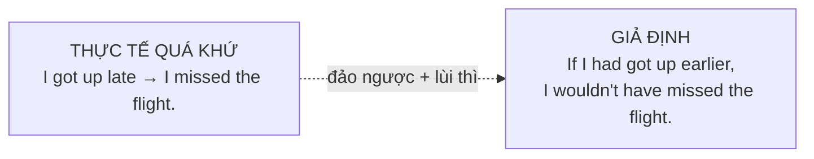
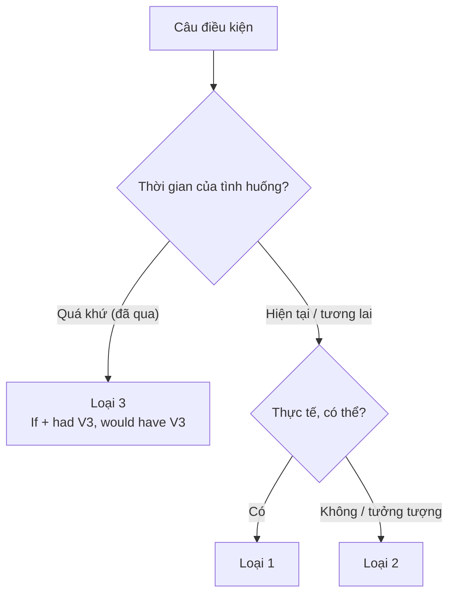

# B1-G008 · Third Conditional — Câu điều kiện loại 3

## Mục lục

- [A. Lesson Information](#a-lesson-information)
- [B. Warm-up](#b-warm-up)
- [C. WHAT](#c-what)
- [D. WHY](#d-why)
- [E. FORM](#e-form)
- [F. HOW](#f-how)
- [G. VISUAL](#g-visual)
- [H. COMPARISON](#h-comparison)
- [I. COMMON MISTAKES](#i-common-mistakes)
- [J. MEMORY TRICKS](#j-memory-tricks)
- [K. REAL-LIFE APPLICATION](#k-real-life-application)
- [L. PRACTICE EXERCISES](#l-practice-exercises)
- [M. KNOWLEDGE CHECK](#m-knowledge-check)
- [N. ANSWER KEY](#n-answer-key)

---

## A. Lesson Information

| Mục | Nội dung |
|---|---|
| **Lesson ID** | B1-G008 |
| **Topic** | Third Conditional (unreal past) |
| **Tên tiếng Việt** | Câu điều kiện loại 3 — giả định trái với quá khứ |
| **CEFR Level** | B1 |
| **Prerequisites** | [B1-G007 — Second Conditional](B1-G007-second-conditional.md), [B1-G002 — Past Perfect](B1-G002-past-perfect.md) |
| **Estimated Time** | 90 phút |

**Learning Objectives:**

1. Tạo câu **If + had + V3, would have + V3**.
2. Nói về điều **không xảy ra trong quá khứ** và kết quả tưởng tượng của nó.
3. Diễn đạt **hối tiếc**, **trách móc**, **may mắn** về quá khứ.
4. Dùng *could have / might have + V3* trong vế kết quả.
5. Phân biệt điều kiện loại 2 và loại 3; phát âm dạng rút gọn *would've*.

---

## B. Warm-up

Bạn đến sân bay muộn và lỡ chuyến bay. Bạn tự trách:

> "Nếu tôi **đã dậy sớm hơn**, tôi **đã không lỡ** chuyến bay."

Nhưng thực tế: bạn **đã dậy muộn**, và bạn **đã lỡ** chuyến bay. Không thể thay đổi được nữa.

🤔 **Hãy suy nghĩ:** Ở bài trước, câu loại 2 lùi **một thì** để nói giả định ở hiện tại. Nếu muốn giả định về **quá khứ** — vốn đã là quá khứ — bạn đoán sẽ phải lùi về thì nào?

---

## C. WHAT

**Third Conditional** (câu điều kiện loại 3) nói về một **điều kiện trái với sự thật trong quá khứ** và **kết quả tưởng tượng** của nó — cũng trong quá khứ. Vì quá khứ không thay đổi được, câu loại 3 thường dùng để:

| Chức năng | Ví dụ |
|---|---|
| **Hối tiếc** | *If I **had studied** harder, I **would have passed** the exam.* |
| **Trách móc** | *If you **had told** me earlier, I **could have helped** you.* |
| **Cảm giác may mắn** | *If we **hadn't left** early, we **would have been** in the accident.* |
| **Phân tích nguyên nhân – kết quả** | *If the company **hadn't invested** in technology, it **would have failed**.* |

---

## D. WHY

Logic "lùi thì để xa thực tế" tiếp tục:

| Thực tế | Giả định | Lùi thì |
|---|---|---|
| Hiện tại: *I don't have time.* | *If I **had** time...* | hiện tại → **quá khứ** |
| Quá khứ: *I didn't have time.* | *If I **had had** time...* | quá khứ → **quá khứ hoàn thành** |

Vế kết quả: *would* + **have + V3** — "*would*" (giả định) + "*have + V3*" (đã xảy ra/hoàn tất trong quá khứ).



---

## E. FORM

**Ký hiệu:** **S** = chủ ngữ · **V3** = quá khứ phân từ.

| Mệnh đề *If* | Mệnh đề chính |
|---|---|
| **If + S + had (not) + V3** | **S + would / could / might + (not) have + V3** |
| *If I **had known**,* | *I **would have come**.* |
| *If she **hadn't missed** the bus,* | *she **wouldn't have been** late.* |
| *If they **had asked** us,* | *we **could have helped**.* |

- **would have V3** = đã (chắc chắn) ... (trong tưởng tượng)
- **could have V3** = đã có thể ...
- **might have V3** = có lẽ đã ...

### Phát âm và rút gọn

| Viết đầy đủ | Rút gọn | Phát âm |
|---|---|---|
| I would have | I'**d have** / I**'d've** (văn nói) | /aɪd əv/ |
| would have | **would've** | /ˈwʊdəv/ |
| If I had known | If I**'d known** | /ɪf aɪd nəʊn/ |

> ⚠️ *would've* nghe giống "would of" — nhưng **không bao giờ viết** *would of*.
> ⚠️ *'d* trong vế *if* = *had*; *'d* trước *have* trong vế chính = *would*: *If I'**d** (had) known, I'**d** (would) have come.*

### Câu hỏi

***What would** you **have done** if you **had lost** your passport?*

---

## F. HOW

| # | English | Tiếng Việt | Phân tích |
|---|---|---|---|
| 1 | *If I **had got up** earlier, I **wouldn't have missed** the flight.* | Nếu tôi dậy sớm hơn thì đã không lỡ chuyến bay. | Thực tế: dậy muộn, lỡ chuyến |
| 2 | *If you **had told** me, I **would have helped** you.* | Nếu bạn nói với tôi thì tôi đã giúp bạn rồi. | Trách nhẹ |
| 3 | *She **would have passed** the exam if she **had studied** more.* | Cô ấy đã đỗ nếu học nhiều hơn. | *If* ở cuối, không phẩy |
| 4 | *If we **hadn't taken** a taxi, we **would have been** late.* | Nếu không đi taxi thì chúng tôi đã muộn. | May mắn |
| 5 | *If it **hadn't rained**, we **could have played** tennis.* | Nếu trời không mưa, chúng tôi đã có thể chơi tennis. | *could have* |
| 6 | *If he **had driven** more carefully, the accident **might not have happened**.* | Nếu anh ấy lái cẩn thận hơn, có lẽ tai nạn đã không xảy ra. | *might not have* |
| 7 | *What **would** you **have done** if you **had been** in my position?* | Bạn sẽ làm gì nếu ở vị trí của tôi lúc đó? | Câu hỏi |
| 8 | *If I**'d known** it was your birthday, I**'d have bought** you a present.* | Nếu biết là sinh nhật bạn, tôi đã mua quà. | Rút gọn |
| 9 | *If the team **hadn't worked** so hard, they **wouldn't have won**.* | Nếu cả đội không làm việc chăm chỉ thì đã không thắng. | Phân tích nguyên nhân |
| 10 | *I **wouldn't have met** my wife if I **hadn't moved** to Hue.* | Nếu không chuyển đến Huế thì tôi đã không gặp vợ tôi. | May mắn |

---

## G. VISUAL

### Từ thực tế đến câu loại 3

| Thực tế (quá khứ) | Câu loại 3 |
|---|---|
| *I didn't know about the party, so I didn't go.* | *If I **had known** about the party, I **would have gone**.* |
| *She forgot her umbrella and got wet.* | *If she **hadn't forgotten** her umbrella, she **wouldn't have got** wet.* |
| *They left early, so they caught the train.* | *If they **hadn't left** early, they **wouldn't have caught** the train.* |

> 🔁 Quy tắc chuyển: **đảo khẳng định ↔ phủ định**; quá khứ đơn → ***had + V3*** (vế *if*) và ***would have + V3*** (vế kết quả).

### Timeline

```text
THỰC TẾ:      ✕ got up late ─► ✕ missed the flight ─────── NOW
GIẢ ĐỊNH:     ✕ (had got up early) ─► ✕ (wouldn't have missed it)
              └──────── thế giới không có thật ─────────┘
```

---

## H. COMPARISON

### Loại 1, 2, 3

| | Loại 1 | Loại 2 | Loại 3 |
|---|---|---|---|
| Thời gian | Hiện tại/tương lai | Hiện tại/tương lai | **Quá khứ** |
| Khả năng | Thực tế | Không có thật / khó xảy ra | **Không thể** (đã qua) |
| Vế *if* | hiện tại đơn | quá khứ đơn | **quá khứ hoàn thành** |
| Vế chính | *will + V* | *would + V* | ***would have + V3*** |
| Ví dụ | *If I see him, I'll tell him.* | *If I saw him, I'd tell him.* | *If I'd seen him, I'd have told him.* |



> 💡 Kết hợp loại 2 và loại 3 (*If I had studied medicine, I would be a doctor now*) gọi là **điều kiện hỗn hợp** — học ở [B2-G001](../../05-B2-UPPER-INTERMEDIATE/grammar/B2-G001-mixed-conditionals.md).

---

## I. COMMON MISTAKES

| # | ❌ Sai | ✅ Đúng | Nguyên nhân | Cách tránh |
|---|---|---|---|---|
| 1 | If I **would have known**, I would have come. | If I **had known**, ... | *would* trong vế *if* | Vế *if* → *had + V3* |
| 2 | If I had known, I **would come**. | ...I **would have come**. | Thiếu *have* ở vế chính | *would have + V3* |
| 3 | If I **knew** yesterday, I would have helped. | If I **had known**... | Dùng QKĐ cho quá khứ không có thật | |
| 4 | I would **of** gone. | I would **have** gone. | Viết theo âm | Không có *would of* |
| 5 | If she had **went**, ... | If she had **gone**, ... | V2 thay V3 | |
| 6 | If I had studied, I would have **pass**. | ...would have **passed**. | Thiếu V3 | |
| 7 | If I didn't miss the bus, I wouldn't be late yesterday. | If I **hadn't missed** the bus, I **wouldn't have been** late yesterday. | Dùng loại 2 cho quá khứ | Quá khứ → loại 3 |

---

## J. MEMORY TRICKS

1. **"3 = 3 bước lùi"**: Loại 1 không lùi, loại 2 lùi 1 thì, loại 3 lùi **2** thì (quá khứ → quá khứ hoàn thành).
2. **"Had ở if, have ở would"**: *If ... **had** V3, ... would **have** V3.*
3. **"Cỗ máy thời gian ⏳"**: Câu loại 3 là "nếu tôi có cỗ máy thời gian quay lại sửa quá khứ thì..."

---

## K. REAL-LIFE APPLICATION

### Bài đọc: A lucky mistake

> *Five years ago, I took the wrong bus to a job interview. I was furious. If I **had checked** the bus number, I **wouldn't have ended up** on the other side of the city. I arrived 40 minutes late, and of course, I didn't get the job.*
>
> *But while I was waiting for a bus back, I started talking to a woman at the bus stop. She was the owner of a small design studio, and she was looking for an assistant. If I **hadn't taken** the wrong bus, I **would never have met** her. She offered me a job the next week. Today, I'm a partner in that studio. If I **had got** that first job, my life **might have been** completely different. Sometimes mistakes are the best things that happen to us.*

**Giải thích:** Năm năm trước, tác giả đi nhầm xe buýt đến buổi phỏng vấn, đến muộn và trượt. Nhưng khi chờ xe về, tác giả nói chuyện với một phụ nữ là chủ studio thiết kế đang tìm trợ lý — và được nhận việc. Giờ tác giả là đối tác của studio. "Đôi khi sai lầm là điều tốt nhất xảy ra với ta."

**Grammar highlights:** Ba câu loại 3 diễn tả lần lượt: hối tiếc (*If I had checked...*), may mắn (*If I hadn't taken...*), suy ngẫm (*If I had got that first job, ... might have been...*).

---

## L. PRACTICE EXERCISES

> ✍️ Đáp án: [B1-G008-ANSWERS](../../12-ANSWERS-AND-EXPLANATIONS/B1/B1-G008-ANSWERS.md)

### Level 1 — Recognition

**L1.1.** If I ___ about the traffic, I would have left earlier.  A. knew  B. had known  C. would have known  D. have known
**L1.2.** If she had asked me, I ___ her.  A. would help  B. will help  C. would have helped  D. had helped
**L1.3.** "If I'd seen him, I'd have told him." — Hai chữ *'d* lần lượt là:  A. would, would  B. had, would  C. had, had  D. would, had
**L1.4.** Câu nào nói về **quá khứ không có thật**?  A. If I had time, I'd help.  B. If I'd had time, I'd have helped.  C. If I have time, I'll help.
**L1.5.** Which is spelled correctly?  A. I would of called.  B. I would have called.  C. I would had called.
**L1.6.** If it ___ so cold, we would have gone swimming.  A. wasn't  B. hadn't been  C. wouldn't be  D. isn't

### Level 2 — Controlled Practice

Chia động từ trong ngoặc (loại 3).

**L2.1.** If you (leave) ___ earlier, you (not / miss) ___ the train.
**L2.2.** We (win) ___ the match if our best player (not / be) ___ injured.
**L2.3.** If I (know) ___ you were in hospital, I (visit) ___ you.
**L2.4.** What (you / do) ___ if the bank (not / give) ___ you the loan?
**L2.5.** She (could / buy) ___ the house if she (save) ___ more money.

Viết lại thành câu điều kiện loại 3.

**L2.6.** I didn't bring my umbrella, so I got wet.
**L2.7.** He didn't check his email, so he didn't see the message.
**L2.8.** They didn't book a table, so they couldn't eat at that restaurant.
**L2.9.** I forgot her birthday, so she was upset.
**L2.10.** We took a map, so we didn't get lost.

### Level 3 — Error Correction

**L3.1.** If I would have seen you, I would have said hello.
**L3.2.** If she had studied, she would pass the exam last year.
**L3.3.** I would of come if you had invited me.
**L3.4.** If they had went to the party, they would have met Tom.
**L3.5.** If I didn't lose my keys yesterday, I wouldn't have been late.
**L3.6.** If we had took a taxi, we would have arrived on time.

### Level 4 — Production

Dịch sang tiếng Anh:

**L4.1.** Nếu tôi biết bạn đến, tôi đã nấu bữa tối rồi.
**L4.2.** Nếu anh ấy không lái xe quá nhanh, tai nạn đã không xảy ra.
**L4.3.** Nếu chúng tôi đặt vé sớm hơn, chúng tôi đã có thể tiết kiệm nhiều tiền.
**L4.4.** Bạn sẽ làm gì nếu bạn bị lỡ chuyến bay đó?

**L4.5.** **Explain:** So sánh *"If I had money, I'd buy it"* và *"If I'd had money, I'd have bought it"* (2–3 câu tiếng Việt).

### Level 5 — Real Communication

**L5.1.** Viết đoạn văn 100–130 từ: *A decision that changed my life* (hoặc *A mistake I learned from*). Kể ngắn sự việc bằng quá khứ đơn, sau đó dùng ≥ 4 câu điều kiện loại 3 để suy ngẫm (có cả *would have, could have, might have*).
**L5.2.** **Speaking — Regrets and luck:** Nói 1 phút: 2 điều bạn hối tiếc (*If I had..., I would have...*) và 2 điều bạn thấy may mắn (*If I hadn't..., I wouldn't have...*).
**L5.3.** **Speaking — Chain story:** Bắt đầu từ *"If I hadn't woken up late, I wouldn't have missed the bus."* Nối tiếp 5 câu theo chuỗi: *If I hadn't missed the bus, I wouldn't have...*

---

## M. KNOWLEDGE CHECK

### 5 câu hỏi tự kiểm tra

1. Công thức câu điều kiện loại 3?
2. Loại 3 nói về thời gian nào? Có thể thay đổi kết quả không?
3. Trong *If I'd known, I'd have come*, hai *'d* là gì?
4. Vì sao không viết *would of*?
5. Phân biệt loại 2 và loại 3 bằng một cặp ví dụ.

### Checklist

- [ ] Tôi tạo được câu loại 3 đúng cả hai vế.
- [ ] Tôi chuyển được tình huống thực tế quá khứ sang câu loại 3.
- [ ] Tôi diễn đạt được hối tiếc và may mắn về quá khứ.

### 3 lỗi quan trọng cần nhớ

1. ~~If I would have known~~ → If I **had** known.
2. ~~I would come~~ (quá khứ) → I **would have come**.
3. ~~would of~~ → **would have** / **would've**.

### Lịch ôn tập

| Ngày | Việc cần làm |
|---|---|
| Ngày 1 | Làm lại L2.6–L2.10 |
| Ngày 3 | Viết 5 câu loại 3 về tuần trước của bạn |
| Ngày 7 | Làm bảng so sánh loại 1–2–3 từ trí nhớ; xem [ALL-CONDITIONALS](../../06-GRAMMAR-REFERENCE/ALL-CONDITIONALS.md) |

### Liên kết

- ➡️ Bài tiếp theo: [B1-G009 — Wish / If Only](B1-G009-wish-if-only.md)
- 🔜 [B2-G001 — Mixed Conditionals](../../05-B2-UPPER-INTERMEDIATE/grammar/B2-G001-mixed-conditionals.md)

---

## N. ANSWER KEY

👉 [B1-G008-ANSWERS.md](../../12-ANSWERS-AND-EXPLANATIONS/B1/B1-G008-ANSWERS.md)
