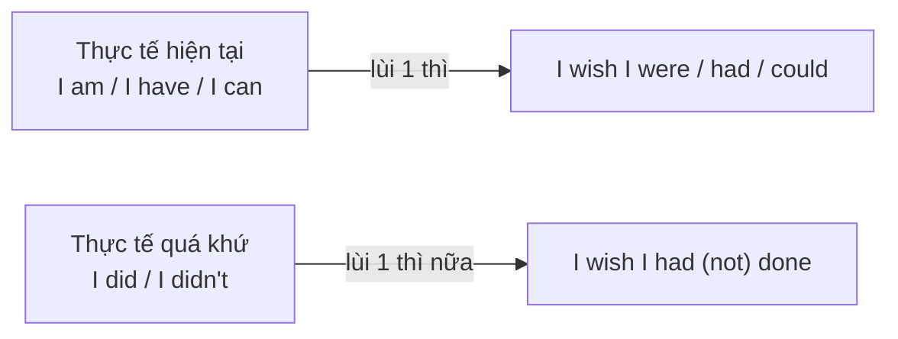
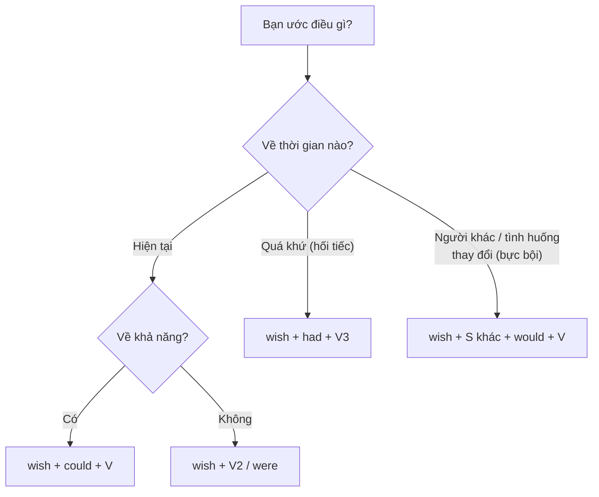

# B1-G009 · Wish / If Only — Câu ước

## Mục lục

- [A. Lesson Information](#a-lesson-information)
- [B. Warm-up](#b-warm-up)
- [C. WHAT](#c-what)
- [D. WHY](#d-why)
- [E. FORM](#e-form)
- [F. HOW](#f-how)
- [G. VISUAL](#g-visual)
- [H. COMPARISON](#h-comparison)
- [I. COMMON MISTAKES](#i-common-mistakes)
- [J. MEMORY TRICKS](#j-memory-tricks)
- [K. REAL-LIFE APPLICATION](#k-real-life-application)
- [L. PRACTICE EXERCISES](#l-practice-exercises)
- [M. KNOWLEDGE CHECK](#m-knowledge-check)
- [N. ANSWER KEY](#n-answer-key)

---

## A. Lesson Information

| Mục | Nội dung |
|---|---|
| **Lesson ID** | B1-G009 |
| **Topic** | Wish / If only (present, past, future/annoyance with *would*) |
| **Tên tiếng Việt** | Câu ước với *wish* và *if only* |
| **CEFR Level** | B1 |
| **Prerequisites** | [B1-G007 — Second Conditional](B1-G007-second-conditional.md), [B1-G008 — Third Conditional](B1-G008-third-conditional.md) |
| **Estimated Time** | 90 phút |

**Learning Objectives:**

1. Ước về **hiện tại**: *wish + quá khứ đơn (were)*.
2. Ước về **quá khứ** (hối tiếc): *wish + quá khứ hoàn thành*.
3. Ước người/vật khác **thay đổi hành vi** (bực bội): *wish + would + V*.
4. Ước về **khả năng**: *wish + could + V*.
5. Dùng *If only* để nhấn mạnh cảm xúc; phân biệt *wish* với *hope*.

---

## B. Warm-up

Một ngày thứ Hai mệt mỏi, bạn nói với đồng nghiệp:

> "Ước gì hôm nay là thứ Sáu. Ước gì tối qua tôi **đã không** thức khuya. Và ước gì hàng xóm **thôi** bật nhạc to!"

🤔 **Hãy suy nghĩ:** Ba điều ước này nói về ba thời điểm/loại khác nhau: hiện tại, quá khứ, và hành vi của người khác. Bạn đã học rằng tiếng Anh "lùi thì" để xa thực tế trong câu điều kiện. *Wish* có dùng cách tương tự không?

---

## C. WHAT

**Wish** (ước) và **If only** (giá mà, ước gì — mạnh hơn) diễn tả mong muốn rằng **thực tế khác đi**. Điều được ước thường **trái với thực tế** hoặc khó xảy ra.

| Loại ước | Thực tế | Câu ước |
|---|---|---|
| Hiện tại | *I don't have a car.* | *I wish I **had** a car.* |
| Quá khứ (hối tiếc) | *I didn't study.* | *I wish I **had studied**.* |
| Khả năng | *I can't swim.* | *I wish I **could** swim.* |
| Hành vi người khác (bực bội) | *He always interrupts me.* | *I wish he **would** stop interrupting me.* |

---

## D. WHY

Giống câu điều kiện, *wish* dùng **"lùi thì" để tạo khoảng cách với thực tế**:

**If only** = *wish* nhưng **cảm xúc mạnh hơn**, thường dùng như một câu cảm thán: *If only I had more time!*

---

## E. FORM

**Ký hiệu:** **S** = chủ ngữ · **V2** = quá khứ đơn · **V3** = quá khứ phân từ · **V** = nguyên mẫu.

| Loại | Công thức | Ví dụ |
|---|---|---|
| Ước hiện tại | S + wish(es) + S + **V2 / were** | *I wish I **were** taller.* |
| Ước quá khứ | S + wish(es) + S + **had (not) + V3** | *I wish I **hadn't eaten** so much.* |
| Ước khả năng | S + wish(es) + S + **could + V** | *She wishes she **could** sing.* |
| Ước người khác thay đổi | S + wish(es) + **người/vật khác** + **would + V** | *I wish it **would** stop raining.* |
| *If only* | **If only** + S + V2 / had V3 / would V | ***If only** I **had listened** to you!* |

> ⚠️ *wish + would* dùng cho **người/vật khác**, không dùng cho chính mình: ❌ *I wish I would...* → ✅ *I wish I could...* hoặc *I wish I + V2*.
> ⚠️ Giống câu điều kiện, *were* thường dùng cho mọi chủ ngữ trong văn trang trọng: *I wish he **were** here.* (*was* phổ biến trong văn nói).

---

## F. HOW

| # | English | Tiếng Việt | Phân tích |
|---|---|---|---|
| 1 | *I wish I **had** more free time.* | Ước gì tôi có nhiều thời gian rảnh hơn. | Hiện tại: thực tế ít thời gian |
| 2 | *I wish I **lived** closer to work.* | Ước gì tôi sống gần chỗ làm hơn. | Hiện tại |
| 3 | *She wishes she **were** on holiday.* | Cô ấy ước mình đang đi nghỉ. | *were* |
| 4 | *I wish I **hadn't said** that to her.* | Ước gì tôi đã không nói điều đó với cô ấy. | Hối tiếc quá khứ |
| 5 | *We wish we **had bought** the tickets earlier.* | Chúng tôi ước đã mua vé sớm hơn. | |
| 6 | *I wish I **could** speak Japanese.* | Ước gì tôi nói được tiếng Nhật. | Khả năng |
| 7 | *I wish my neighbours **would** be quieter.* | Ước gì hàng xóm yên lặng hơn. | Bực bội với người khác |
| 8 | *I wish it **would** stop raining!* | Ước gì trời tạnh mưa! | Mong tình huống thay đổi |
| 9 | ***If only** I **had** a bit more money!* | Giá mà tôi có thêm chút tiền! | Cảm xúc mạnh |
| 10 | ***If only** we **hadn't missed** the last train!* | Giá mà chúng ta không lỡ chuyến tàu cuối! | Hối tiếc mạnh |
| 11 | *Don't you wish you **could** fly?* | Bạn không ước mình biết bay sao? | Câu hỏi |

---

## G. VISUAL

### Bảng chuyển thực tế → điều ước

| Thực tế | Điều ước |
|---|---|
| I **am** not rich. | I wish I **were** rich. |
| I **don't know** the answer. | I wish I **knew** the answer. |
| I **can't** drive. | I wish I **could** drive. |
| I **didn't go** to the party. | I wish I **had gone** to the party. |
| I **ate** too much. | I wish I **hadn't eaten** so much. |
| He **keeps** calling me. (bực) | I wish he **would stop** calling me. |

### Sơ đồ chọn cấu trúc

---

## H. COMPARISON

### *Wish* vs *Hope*

| *wish* | *hope* |
|---|---|
| Điều **trái thực tế** / khó xảy ra | Điều **có thể xảy ra** |
| Lùi thì | Không lùi thì (thường hiện tại/tương lai) |
| *I wish you **were** here.* (bạn không ở đây) | *I hope you **are** OK.* / *I hope you'**ll** come.* |
| *I wish I **had passed**.* (đã trượt) | *I hope I **passed**.* (chưa biết kết quả) |

### *Wish + would* vs *wish + V2*

| | |
|---|---|
| *I wish he **would** call me.* | Mong anh ấy **làm hành động** gọi (bực vì anh ấy không gọi). |
| *I wish he **called** me more often.* | Ước về thói quen/tình trạng chung. |

### *Wish* nghĩa "chúc" và "muốn" (trang trọng)

- *We **wish** you a merry Christmas.* — *wish + người + danh từ* = chúc.
- *I **wish to** speak to the manager.* — *wish to + V* = muốn (rất trang trọng).

---

## I. COMMON MISTAKES

| # | ❌ Sai | ✅ Đúng | Nguyên nhân | Cách tránh |
|---|---|---|---|---|
| 1 | I wish I **have** a car. | I wish I **had** a car. | Không lùi thì | Ước hiện tại → V2 |
| 2 | I wish I **didn't eat** so much last night. | I wish I **hadn't eaten**... | Lùi chưa đủ | Ước quá khứ → *had + V3* |
| 3 | I wish I **would** be taller. | I wish I **were** taller. | *would* với chính mình | *would* chỉ cho người/vật khác |
| 4 | I **wish** you **pass** the exam tomorrow. | I **hope** you pass... | Nhầm *wish/hope* | Có thể xảy ra → *hope* |
| 5 | I wish I **can** swim. | I wish I **could** swim. | | *can → could* |
| 6 | If only I **would have** listened! | If only I **had** listened! | | |
| 7 | She **wish** she were rich. | She **wishes**... | Quên *-es* | Ngôi 3 số ít |

---

## J. MEMORY TRICKS

1. **"Wish = lùi một bước khỏi thực tế"** (giống câu điều kiện loại 2 và 3).
2. **"Would cho người khác"** 👉: Bạn không thể "phàn nàn" về chính mình bằng *would* — dùng nó khi bực với người/vật khác.
3. **"Hope có thể, Wish không thể"** 🙏 vs 🌠.

---

## K. REAL-LIFE APPLICATION

### Hội thoại: Ngày thứ Hai tồi tệ

> **Lan:** Ugh, I wish it **were** Friday already.
> **Tom:** Bad weekend?
> **Lan:** Not bad, just too short. And I wish I **hadn't stayed** up so late watching that series. I've only slept four hours.
> **Tom:** If only we **could** start work at ten!
> **Lan:** Exactly. And I wish the people upstairs **would** stop moving furniture at midnight. It's every night!
> **Tom:** Have you talked to them?
> **Lan:** Not yet. I wish I **were** braver. I hope they'll move out soon!
> **Tom:** Ha ha. Coffee?
> **Lan:** Yes, please. I wish I **had** a bigger cup!

**Giải thích:** Lan ước hôm nay là thứ Sáu; ước đã không thức khuya xem phim; Tom ước được bắt đầu làm lúc 10 giờ; Lan ước hàng xóm tầng trên thôi kéo đồ lúc nửa đêm, ước mình dũng cảm hơn để nói với họ — và *hope* họ sớm chuyển đi (điều có thể xảy ra).

---

## L. PRACTICE EXERCISES

> ✍️ Đáp án: [B1-G009-ANSWERS](../../12-ANSWERS-AND-EXPLANATIONS/B1/B1-G009-ANSWERS.md)

### Level 1 — Recognition

**L1.1.** I wish I ___ more patient. (hiện tại)  A. am  B. were  C. would be  D. had been
**L1.2.** I wish I ___ to my mother's advice last year.  A. listened  B. had listened  C. would listen  D. listen
**L1.3.** I wish my brother ___ borrowing my clothes without asking!  A. stops  B. stopped  C. would stop  D. had stopped
**L1.4.** I ___ you have a great holiday!  A. wish  B. hope  C. wished  D. hoping
**L1.5.** I wish I ___ play the guitar.  A. can  B. could  C. would  D. will
**L1.6.** Câu nào thể hiện **hối tiếc về quá khứ**?  A. I wish I knew her.  B. I wish I had known her.  C. I wish she would know.

### Level 2 — Controlled Practice

Viết câu ước dựa trên thực tế.

**L2.1.** I don't have enough time to exercise.
**L2.2.** I can't remember her name.
**L2.3.** I didn't save my work, and the computer crashed.
**L2.4.** My colleague always talks loudly on the phone. (bực)
**L2.5.** We live in a noisy area.
**L2.6.** I spent all my money on clothes last month.
**L2.7.** It's raining and I want to go out.

Điền *wish* hoặc *hope* (chia đúng).

**L2.8.** I ___ you feel better soon.
**L2.9.** She ___ she had studied medicine.
**L2.10.** We ___ it doesn't rain tomorrow.

### Level 3 — Error Correction

**L3.1.** I wish I have a bigger flat.
**L3.2.** I wish I didn't go to that party last week.
**L3.3.** I wish I would be more confident.
**L3.4.** I wish you get the job.
**L3.5.** He wish he could speak English better.
**L3.6.** If only I would have known earlier!

### Level 4 — Production

Dịch sang tiếng Anh:

**L4.1.** Ước gì tôi biết nói tiếng Hàn.
**L4.2.** Ước gì tối qua tôi đã không uống quá nhiều cà phê.
**L4.3.** Ước gì các bạn cùng phòng của tôi giữ bếp sạch sẽ hơn. (*keep the kitchen cleaner*)
**L4.4.** Giá mà tôi đã mua cổ phiếu đó năm năm trước! (*If only, those shares*)

**L4.5.** **Explain:** Vì sao *"I wish I would be rich"* sai? Viết lại và giải thích quy tắc (2 câu tiếng Việt).

### Level 5 — Real Communication

**L5.1.** Viết đoạn văn 100–120 từ: *Three wishes*. Nêu 1 điều ước về hiện tại, 1 điều hối tiếc về quá khứ, 1 điều bạn mong người khác/xã hội thay đổi; giải thích lý do (có thể kết hợp câu điều kiện loại 2/3).
**L5.2.** **Speaking — Complaints:** Nói 1 phút về những điều làm bạn khó chịu trong cuộc sống hằng ngày, dùng *I wish ... would...* (giao thông, hàng xóm, đồng nghiệp, thời tiết).
**L5.3.** **Speaking — Regrets:** Kể 3 điều bạn hối tiếc ở trường học/công việc với *I wish I had/hadn't...* và giải thích bằng câu loại 3.

---

## M. KNOWLEDGE CHECK

### 5 câu hỏi tự kiểm tra

1. Ước về hiện tại và ước về quá khứ dùng thì gì?
2. Khi nào dùng *wish + would*? Có dùng với *I* không?
3. *wish* và *hope* khác nhau thế nào?
4. *If only* khác *wish* ở điểm nào?
5. Chuyển thành câu ước: *I can't cook.*

### Checklist

- [ ] Tôi chọn đúng thì sau *wish* theo thời gian của điều ước.
- [ ] Tôi không dùng *I wish I would*.
- [ ] Tôi phân biệt được *wish* và *hope*.

### 3 lỗi quan trọng cần nhớ

1. ~~I wish I have~~ → I wish I **had**.
2. Hối tiếc quá khứ → **had + V3**.
3. Có thể xảy ra → **hope**, không phải *wish*.

### Lịch ôn tập

| Ngày | Việc cần làm |
|---|---|
| Ngày 1 | Làm lại L2 |
| Ngày 3 | Viết 6 câu ước (2 mỗi loại) về tuần của bạn |
| Ngày 7 | Ôn chung với điều kiện loại 2–3 trong [ALL-CONDITIONALS](../../06-GRAMMAR-REFERENCE/ALL-CONDITIONALS.md) |

### Liên kết

- ➡️ Bài tiếp theo: [B1-G010 — Reported Speech: Statements](B1-G010-reported-statements.md)
- 🔜 [B2-G016 — Unreal Past: would rather, it's time, as if](../../05-B2-UPPER-INTERMEDIATE/grammar/B2-G016-unreal-past-would-rather.md)
- 🎯 **Mini Challenge khối B1-2** — *What would you do if...?* xem [B1 README](../README.md#5-mini-challenges)

---

## N. ANSWER KEY

👉 [B1-G009-ANSWERS.md](../../12-ANSWERS-AND-EXPLANATIONS/B1/B1-G009-ANSWERS.md)
