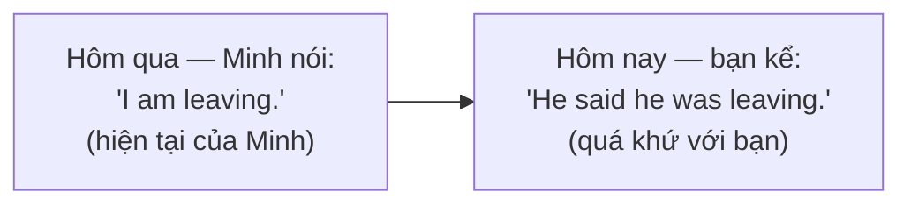
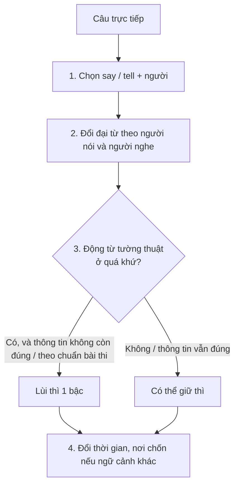

# B1-G010 · Reported Speech: Statements — Câu tường thuật: câu kể

## Mục lục

- [A. Lesson Information](#a-lesson-information)
- [B. Warm-up](#b-warm-up)
- [C. WHAT](#c-what)
- [D. WHY](#d-why)
- [E. FORM](#e-form)
- [F. HOW](#f-how)
- [G. VISUAL](#g-visual)
- [H. COMPARISON](#h-comparison)
- [I. COMMON MISTAKES](#i-common-mistakes)
- [J. MEMORY TRICKS](#j-memory-tricks)
- [K. REAL-LIFE APPLICATION](#k-real-life-application)
- [L. PRACTICE EXERCISES](#l-practice-exercises)
- [M. KNOWLEDGE CHECK](#m-knowledge-check)
- [N. ANSWER KEY](#n-answer-key)

---

## A. Lesson Information

| Mục | Nội dung |
|---|---|
| **Lesson ID** | B1-G010 |
| **Topic** | Reported Speech — Statements (say, tell; backshift; changes of pronouns, time, place) |
| **Tên tiếng Việt** | Câu tường thuật dạng câu kể |
| **CEFR Level** | B1 |
| **Prerequisites** | [B1-G002 — Past Perfect](B1-G002-past-perfect.md), [A1-G007 — Object Pronouns](../../02-A1-BEGINNER/grammar/A1-G007-object-pronouns.md) |
| **Estimated Time** | 90 phút |

**Learning Objectives:**

1. Chuyển câu trực tiếp sang câu tường thuật với ***say*** và ***tell***.
2. Áp dụng **lùi thì** (*backshift*) khi động từ tường thuật ở quá khứ.
3. Đổi **đại từ**, **từ chỉ thời gian**, **nơi chốn** cho phù hợp ngữ cảnh.
4. Biết khi nào **có thể không lùi thì** (sự thật vẫn đúng, tường thuật ngay).
5. Phân biệt *say (that)* và *tell somebody (that)*.

---

## B. Warm-up

Hôm qua, đồng nghiệp tên Minh nói với bạn:

> *"I**'m** leaving the company. I**'ve found** a new job in Singapore."*

Hôm nay, bạn kể lại với sếp:

> *"Minh **told** me he **was** leaving the company. He **said** he **had found** a new job in Singapore."*

🤔 **Hãy suy nghĩ:** Những từ nào đã thay đổi? (*I → he*, *'m → was*, *'ve found → had found*). Tiếng Việt kể lại chỉ cần "Minh nói là anh ấy nghỉ việc..." — động từ không đổi. Vì sao tiếng Anh lại đổi thì?

---

## C. WHAT

**Reported speech** (câu tường thuật, còn gọi *indirect speech* — lời nói gián tiếp) là cách kể lại lời người khác **mà không trích dẫn nguyên văn**.

| | Ví dụ |
|---|---|
| **Direct speech** (trực tiếp) | *Lan said, "I **am** tired."* |
| **Reported speech** (gián tiếp) | *Lan said (that) she **was** tired.* |

Những thay đổi có thể xảy ra:

1. **Đại từ, tính từ sở hữu**: *I → she, my → her*.
2. **Thì** (lùi một bậc) — khi động từ tường thuật ở quá khứ.
3. **Từ chỉ thời gian/nơi chốn** — nếu thời điểm/nơi kể lại khác lúc nói.

Từ *that* sau *say/tell* thường **có thể lược bỏ** trong văn nói.

---

## D. WHY

Khi bạn kể lại, bạn **đứng ở một thời điểm khác** (thường muộn hơn) so với người nói ban đầu. Những gì "hiện tại" với họ đã thành "quá khứ" với bạn. Lùi thì giúp người nghe hiểu lời nói thuộc về **thời điểm đã qua**.

Tương tự, *today* của Minh (hôm qua) giờ là *that day*; *here* (ở Hà Nội) có thể thành *there* (nếu bạn đang ở nơi khác).

> 💡 Lùi thì **không phải luật máy móc**. Nếu điều được kể **vẫn còn đúng** khi bạn kể, có thể giữ nguyên thì: *Minh said he **is** leaving next month.* (anh ấy vẫn sắp nghỉ). Trong bài thi, người ra đề thường kiểm tra lùi thì "chuẩn"; trong giao tiếp, cả hai đều gặp.

---

## E. FORM

### E1. *Say* và *tell*

| Động từ | Cấu trúc | Ví dụ |
|---|---|---|
| **say** | say (that) + mệnh đề | *She **said** (that) she was busy.* |
| | say **to** sb (ít dùng) | *She said to me that...* |
| **tell** | tell **+ người** (that) + mệnh đề | *She **told me** (that) she was busy.* |

> ⚠️ *tell* **phải có người nghe** ngay sau: ❌ *She told that...* · ❌ *She said me that...*

### E2. Bảng lùi thì (khi động từ tường thuật ở quá khứ)

| Direct | Reported |
|---|---|
| present simple: *"I **work** here."* | past simple: *he **worked** there* |
| present continuous: *"I'**m working**."* | past continuous: *he **was working*** |
| present perfect: *"I'**ve finished**."* | past perfect: *he **had finished*** |
| past simple: *"I **finished** yesterday."* | past perfect: *he **had finished** the day before* (hoặc giữ *finished*) |
| *will*: *"I'**ll** call."* | ***would***: *he **would** call* |
| *can*: *"I **can** swim."* | ***could*** |
| *may*: *"I **may** come."* | ***might*** |
| *must*: *"I **must** go."* | ***had to*** (hoặc giữ *must*) |
| *would, could, should, might, ought to* | **không đổi** |
| past perfect | **không đổi** |

### E3. Thay đổi từ chỉ thời gian và nơi chốn (khi ngữ cảnh khác)

| Direct | Reported |
|---|---|
| now | then / at that moment |
| today | that day |
| tonight | that night |
| yesterday | the day before / the previous day |
| tomorrow | the next day / the following day |
| last week | the week before / the previous week |
| next week | the week after / the following week |
| ago | before / earlier |
| here | there |
| this / these | that / those (hoặc *the*) |

### E4. Khi **không** cần lùi thì

- Động từ tường thuật ở **hiện tại**: *She **says** she **is** tired.* (kể ngay lúc đó)
- Điều được kể **vẫn đúng**: *He said Hanoi **is** the capital.*

---

## F. HOW

| # | Direct | Reported | Phân tích |
|---|---|---|---|
| 1 | *Lan: "I'm hungry."* | *Lan said (that) she **was** hungry.* | *I → she*; *am → was* |
| 2 | *Tom: "I work in a bank."* | *Tom told me (that) he **worked** in a bank.* | *tell + me* |
| 3 | *Mai: "I've lost my phone."* | *Mai said she **had lost** her phone.* | HTHT → QKHT; *my → her* |
| 4 | *Nam: "I'll call you tomorrow."* | *Nam said he **would** call me **the next day**.* | *will → would*; *you → me*; *tomorrow → the next day* |
| 5 | *Hoa: "I can't come tonight."* | *Hoa told us she **couldn't** come **that night**.* | *can't → couldn't* |
| 6 | *Boss: "We're launching the product next week."* | *The boss said they **were launching** the product **the following week**.* | |
| 7 | *Dad: "I bought this car two years ago."* | *Dad said he **had bought** that car two years **before**.* | QKĐ → QKHT; *ago → before* |
| 8 | *Teacher: "The sun rises in the east."* | *The teacher said the sun **rises** in the east.* | Sự thật → giữ thì |
| 9 | *Anh (5 phút trước): "I'm going to the shop."* | *Anh **says/said** she **is going** to the shop.* | Vẫn đúng → có thể giữ thì |
| 10 | *Linh: "I must finish this today."* | *Linh said she **had to** finish it **that day**.* | *must → had to* |

---

## G. VISUAL

### Quy trình 4 bước chuyển câu

### Sentence breakdown

`He told me | (that) | he | had finished | the report | the day before.`

| Phần | Vai trò |
|---|---|
| He told me | Động từ tường thuật + người nghe |
| (that) | Liên từ, có thể lược |
| he | *I* → *he* |
| had finished | *finished* → *had finished* |
| the day before | *yesterday* → *the day before* |

---

## H. COMPARISON

### *Say* vs *Tell*

| ✅ | ❌ |
|---|---|
| *She **said** she was tired.* | *She **said me** she was tired.* |
| *She **told me** she was tired.* | *She **told** she was tired.* |
| *She **said to me** that she was tired.* (đúng nhưng ít dùng) | |
| ***Tell** the truth / a lie / a story / a joke* (cụm cố định) | ~~say the truth~~ |
| ***Say** hello / goodbye / sorry / something* | ~~tell hello~~ |

### Trích dẫn trực tiếp vs gián tiếp

| Direct | Reported |
|---|---|
| Có dấu ngoặc kép, giữ nguyên văn | Không ngoặc kép, diễn lại nội dung |
| *He said, "I'm tired."* | *He said he was tired.* |
| Dùng trong truyện, báo chí trích lời | Dùng trong kể chuyện, báo cáo, email |

---

## I. COMMON MISTAKES

| # | ❌ Sai | ✅ Đúng | Nguyên nhân | Cách tránh |
|---|---|---|---|---|
| 1 | She **said me** that she was busy. | She **told me**... / She **said** that... | Nhầm *say/tell* | *tell + người*; *say* không cần người |
| 2 | He **told that** he was ill. | He **told me/us** that... / He **said** that... | *tell* thiếu người nghe | |
| 3 | Lan said **I was** tired. (Lan nói về chính cô ấy) | Lan said **she was** tired. | Không đổi đại từ | Đổi theo người được nói đến |
| 4 | He said he **will** call me. (kể lại chuyện hôm qua, cuộc gọi đã qua) | He said he **would** call me. | Không lùi *will* | *will → would* |
| 5 | She said she **has finished**. (văn kể quá khứ) | She said she **had finished**. | | HTHT → QKHT |
| 6 | He said he would come **tomorrow**. (kể lại sau 1 tuần) | ...**the next day**. | Không đổi thời gian | Đổi khi thời điểm kể khác |
| 7 | She said that **"she was tired"**. | She said that she was tired. | Trộn ngoặc kép | Gián tiếp không dùng ngoặc |

---

## J. MEMORY TRICKS

1. **"Tell cần Tai 👂"**: *tell* luôn cần người nghe (cái tai) đi kèm.
2. **"Lùi một bậc thang 🪜"**: *am → was, have done → had done, will → would, can → could*. Những gì đã ở bậc thấp nhất (*would, could, had done*) không lùi được nữa.
3. **"Kể ngay hoặc vẫn đúng → giữ nguyên"**: Lùi thì là để đánh dấu "lời của quá khứ" — nếu không cần đánh dấu, có thể giữ.

---

## K. REAL-LIFE APPLICATION

### Email: Báo cáo cuộc gọi với khách hàng

> *Hi team,*
>
> *I spoke to Mr Kim from ABC Corp this morning. He **told me** that they **were** very happy with our last delivery. He **said** that their sales **had increased** by 20% since they started using our products. However, he **said** that the next order **would be** smaller because they **were moving** to a new warehouse. He **told me** he **couldn't** confirm the exact date yet, but he **would** email us **the following week**.*
>
> *Best,*
> *Thanh*

**Giải thích:** Thanh tóm tắt cuộc gọi với ông Kim: khách hài lòng; doanh số tăng 20% từ khi dùng sản phẩm; đơn hàng tới sẽ nhỏ hơn vì họ đang chuyển kho; chưa xác nhận được ngày, sẽ email tuần sau.

**Grammar highlights:** *told me / said* + lùi thì đều đặn (*are → were, have increased → had increased, will → would, are moving → were moving, can't → couldn't*).

> 💡 Vì Thanh viết email **ngay trong ngày**, giữ *next week* thay vì *the following week* cũng đúng. Bài mẫu chọn cách lùi đầy đủ để minh họa.

---

## L. PRACTICE EXERCISES

> ✍️ Đáp án: [B1-G010-ANSWERS](../../12-ANSWERS-AND-EXPLANATIONS/B1/B1-G010-ANSWERS.md)

### Level 1 — Recognition

**L1.1.** She ___ me that she was moving to Hue.  A. said  B. told  C. talked  D. spoke
**L1.2.** He ___ that he didn't like the film.  A. told  B. said  C. told to  D. said me
**L1.3.** "I will help you." → He said he ___ help me.  A. will  B. would  C. can  D. had
**L1.4.** "I've finished." → She said she ___.  A. has finished  B. had finished  C. finished  D. was finished
**L1.5.** "I can drive." → He said he ___ drive.  A. can  B. could  C. would  D. may
**L1.6.** "I'll see you tomorrow." (kể lại một tuần sau) → She said she would see me ___.  A. tomorrow  B. the next day  C. yesterday  D. the day before

### Level 2 — Controlled Practice

Chuyển sang câu tường thuật (dùng *said* hoặc *told me*, lùi thì).

**L2.1.** Hung: "I'm tired."
**L2.2.** My mother: "I don't like spicy food."
**L2.3.** Linh: "I've never been to Japan."
**L2.4.** The manager: "We will open a new branch next year."
**L2.5.** Tom: "I can't find my keys."
**L2.6.** Mai: "I'm meeting my sister tonight."
**L2.7.** Dad: "I lost my wallet yesterday."
**L2.8.** The doctor: "You must rest for a week."

Điền *said* hoặc *told*.

**L2.9.** She ___ us a funny story.
**L2.10.** He ___ goodbye and left.

### Level 3 — Error Correction

**L3.1.** She said me that she was busy.
**L3.2.** He told that he would be late.
**L3.3.** Lan said that I was going to Hanoi. (Lan nói về chính cô ấy)
**L3.4.** They said they will arrive the following day.
**L3.5.** He said that he has lived here for ten years. (kể chuyện cũ, giờ anh ấy đã chuyển đi)
**L3.6.** She said "that she was hungry".

### Level 4 — Production

**L4.1.** Dịch: *"Cô ấy nói với tôi rằng cô ấy đã tìm được việc mới."*
**L4.2.** Dịch: *"Anh ấy nói anh ấy sẽ gọi lại cho tôi vào ngày hôm sau."*
**L4.3.** Chuyển lại câu tường thuật thành câu trực tiếp: *She said she had been ill the week before.*
**L4.4.** Viết 3 câu tường thuật về những gì người thân nói với bạn tuần trước.

**L4.5.** **Explain:** Giáo viên nói *"Water boils at 100°C."* Vì sao có thể tường thuật là *The teacher said water **boils** at 100°C* (không lùi thì)? (2 câu tiếng Việt)

### Level 5 — Real Communication

**L5.1.** Viết email 100–120 từ cho đồng nghiệp tường thuật lại nội dung một cuộc họp/cuộc gọi (ít nhất 6 câu tường thuật, dùng cả *said* và *told*).
**L5.2.** **Speaking — Gossip chain:** Đọc 5 câu sau rồi kể lại cho "người thứ ba" bằng câu tường thuật: *Nam: "I'm getting married." · Lan: "I've bought a new car." · Hoa: "I'll travel to Korea next month." · Duc: "I can't stand my new boss." · Mai: "I didn't sleep last night."*

---

## M. KNOWLEDGE CHECK

### 5 câu hỏi tự kiểm tra

1. *say* và *tell* khác nhau về cấu trúc thế nào?
2. *will, can, must, have done* lùi thành gì?
3. *tomorrow, yesterday, here* đổi thành gì khi kể lại ở thời điểm khác?
4. Khi nào có thể không lùi thì?
5. Chuyển: *Hoa: "I'm working from home today."*

### Checklist

- [ ] Tôi dùng đúng *say/tell*.
- [ ] Tôi lùi thì và đổi đại từ chính xác.
- [ ] Tôi biết khi nào đổi/không đổi từ chỉ thời gian.

### 3 lỗi quan trọng cần nhớ

1. ~~said me~~ / ~~told that~~ → **told me** / **said that**.
2. Đổi đại từ theo người được nói đến.
3. *will → would*, *can → could* khi kể lại chuyện đã qua.

### Lịch ôn tập

| Ngày | Việc cần làm |
|---|---|
| Ngày 1 | Làm lại L2 |
| Ngày 3 | Tường thuật 5 câu từ một bộ phim/tin tức bạn xem |
| Ngày 7 | Học tiếp [B1-G011](B1-G011-reported-questions-commands.md) và làm bài trộn |

### Liên kết

- ➡️ Bài tiếp theo: [B1-G011 — Reported Questions & Commands](B1-G011-reported-questions-commands.md)
- 🔜 [B2-G006 — Advanced Reported Speech](../../05-B2-UPPER-INTERMEDIATE/grammar/B2-G006-advanced-reported-speech.md)

---

## N. ANSWER KEY

👉 [B1-G010-ANSWERS.md](../../12-ANSWERS-AND-EXPLANATIONS/B1/B1-G010-ANSWERS.md)
