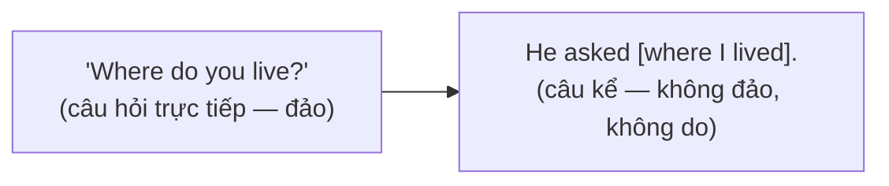
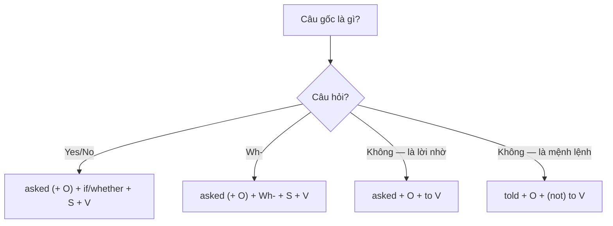

# B1-G011 · Reported Questions, Requests & Commands — Tường thuật câu hỏi, yêu cầu, mệnh lệnh

## Mục lục

- [A. Lesson Information](#a-lesson-information)
- [B. Warm-up](#b-warm-up)
- [C. WHAT](#c-what)
- [D. WHY](#d-why)
- [E. FORM](#e-form)
- [F. HOW](#f-how)
- [G. VISUAL](#g-visual)
- [H. COMPARISON](#h-comparison)
- [I. COMMON MISTAKES](#i-common-mistakes)
- [J. MEMORY TRICKS](#j-memory-tricks)
- [K. REAL-LIFE APPLICATION](#k-real-life-application)
- [L. PRACTICE EXERCISES](#l-practice-exercises)
- [M. KNOWLEDGE CHECK](#m-knowledge-check)
- [N. ANSWER KEY](#n-answer-key)

---

## A. Lesson Information

| Mục | Nội dung |
|---|---|
| **Lesson ID** | B1-G011 |
| **Topic** | Reported Questions (Yes/No, Wh-), Requests and Commands |
| **Tên tiếng Việt** | Tường thuật câu hỏi, lời yêu cầu và mệnh lệnh |
| **CEFR Level** | B1 |
| **Prerequisites** | [B1-G010 — Reported Statements](B1-G010-reported-statements.md), [A2-G028 — Indirect Questions](../../03-A2-ELEMENTARY/grammar/A2-G028-indirect-questions.md) |
| **Estimated Time** | 90 phút |

**Learning Objectives:**

1. Tường thuật câu hỏi Yes/No với ***if / whether***.
2. Tường thuật câu hỏi Wh- với **trật tự câu kể** (S + V, không đảo).
3. Tường thuật lời yêu cầu/mệnh lệnh với ***ask/tell + O + (not) to + V***.
4. Lùi thì và đổi đại từ đúng trong câu hỏi tường thuật.
5. Không dùng dấu hỏi, không dùng *do/did* trong câu hỏi tường thuật.

---

## B. Warm-up

Sau buổi phỏng vấn xin việc, bạn kể với bạn mình:

> "Họ hỏi tôi **đã làm ở đâu**, **có biết dùng Excel không**, và **tại sao tôi muốn rời công ty cũ**. Cuối cùng họ **bảo tôi gửi** bằng cấp qua email."

Một người học viết:

> ❌ *They asked me where **did I work**, **do I** know Excel... They told me **send** my certificates.*

🤔 **Hãy suy nghĩ:** Ở bài câu hỏi gián tiếp (A2-G028), bạn đã học *Can you tell me where **the station is**?* — không đảo trợ động từ. Câu hỏi tường thuật có theo cùng quy tắc không? Và lời yêu cầu "bảo tôi gửi" cần thêm từ gì?

---

## C. WHAT

| Loại câu gốc | Cách tường thuật | Ví dụ |
|---|---|---|
| **Yes/No question** | *ask (+ O) + **if/whether** + S + V* | *"Are you busy?" → She asked **if I was** busy.* |
| **Wh- question** | *ask (+ O) + **Wh-** + S + V* | *"Where do you live?" → He asked **where I lived**.* |
| **Request** (lời nhờ) | *ask + O + **to** V* | *"Please help me." → She asked **me to help** her.* |
| **Command** (mệnh lệnh) | *tell + O + **(not) to** V* | *"Don't be late." → He told **us not to be** late.* |

Câu hỏi tường thuật **không còn là câu hỏi** — nó là câu kể, nên **không đảo**, **không dấu ?**.

---

## D. WHY

Khi tường thuật, câu hỏi gốc trở thành **một phần (tân ngữ) của câu kể**: *She asked [something]*. Vì vậy nó dùng trật tự câu kể, giống câu hỏi gián tiếp.

Mệnh lệnh/lời nhờ: thay vì trích nguyên văn, ta dùng động từ chỉ **hành động nói** (*ask, tell*) + **người nhận** + **to + V** (việc được yêu cầu làm).

---

## E. FORM

**Ký hiệu:** **O** = tân ngữ (người được hỏi/bảo) · **S + V** = trật tự câu kể (đã lùi thì).

### E1. Câu hỏi Yes/No

| Direct | Reported |
|---|---|
| *"**Do you like** coffee?"* | *She asked (me) **if/whether I liked** coffee.* |
| *"**Have you finished**?"* | *He asked **if I had finished**.* |
| *"**Can you** swim?"* | *They asked **whether I could** swim.* |

### E2. Câu hỏi Wh-

| Direct | Reported |
|---|---|
| *"Where **do you work**?"* | *She asked me where **I worked**.* |
| *"What **are you doing**?"* | *He asked what **I was doing**.* |
| *"Why **did you leave**?"* | *They asked why **I had left**.* |
| *"Who **called**?"* (*who* là chủ ngữ) | *She asked who **had called**.* |

### E3. Yêu cầu và mệnh lệnh

| Loại | Công thức | Ví dụ |
|---|---|---|
| Nhờ | **ask + O + to + V** | *"Could you open the window?" → He asked **me to open** the window.* |
| Ra lệnh/bảo | **tell + O + to + V** | *"Sit down." → The teacher told **us to sit** down.* |
| Phủ định | **ask/tell + O + not to + V** | *"Don't touch it." → She told **him not to touch** it.* |

Thay đổi đại từ, thời gian, nơi chốn và lùi thì: giống [B1-G010](B1-G010-reported-statements.md#e2-bảng-lùi-thì-khi-động-từ-tường-thuật-ở-quá-khứ).

---

## F. HOW

| # | Direct | Reported | Phân tích |
|---|---|---|---|
| 1 | *"Are you married?"* | *She asked **if I was** married.* | Yes/No → *if* |
| 2 | *"Do you speak French?"* | *He asked me **whether I spoke** French.* | Bỏ *do*, lùi thì |
| 3 | *"Where do you live?"* | *The officer asked **where I lived**.* | Không đảo |
| 4 | *"What time does the train leave?"* | *I asked **what time the train left**.* | Bỏ *does* |
| 5 | *"How long have you worked here?"* | *They asked **how long I had worked** there.* | *here → there* |
| 6 | *"Will you come to the party?"* | *Lan asked **if I would come** to the party.* | *will → would* |
| 7 | *"Please send me the file."* | *My boss asked **me to send** her the file.* | Lời nhờ |
| 8 | *"Don't park here."* | *The guard told **us not to park** there.* | Mệnh lệnh phủ định |
| 9 | *"Can you help me?"* | *She asked **me to help** her.* / *She asked **if I could help** her.* | Cả hai cách đúng |
| 10 | *"Who broke the window?"* | *The teacher asked **who had broken** the window.* | *who* là chủ ngữ — trật tự giữ nguyên |
| 11 | *"Why are you crying?"* | *Mum asked me **why I was crying**.* | |

---

## G. VISUAL

### Sơ đồ chọn cấu trúc

### Breakdown

`The interviewer | asked me | why | I | wanted | to leave my previous job.`

| Phần | Vai trò |
|---|---|
| asked me | Động từ tường thuật + người được hỏi |
| why | Từ để hỏi giữ nguyên |
| I wanted | S + V (không đảo, đã lùi thì: *do you want → I wanted*) |
| to leave my previous job | Phần còn lại |

---

## H. COMPARISON

### *if* và *whether*

Thường **thay thế được cho nhau**. *Whether* hơi trang trọng hơn và bắt buộc trong một số trường hợp: *whether or not*, sau giới từ (*It depends on **whether**...*), trước *to V* (*She didn't know **whether to** stay*).

### *ask* và *tell*

| *ask* | *tell* |
|---|---|
| Câu hỏi, lời nhờ (lịch sự) | Mệnh lệnh, chỉ dẫn |
| *She asked me to wait.* (nhờ chờ) | *She told me to wait.* (bảo chờ) |

### Câu hỏi tường thuật vs câu hỏi gián tiếp lịch sự

| Câu hỏi gián tiếp (hỏi bây giờ) | Câu hỏi tường thuật (kể lại) |
|---|---|
| *Could you tell me **where the bank is**?* | *She asked **where the bank was**.* |
| Có dấu **?** (vì cả câu là câu hỏi) | Không có dấu ? |

---

## I. COMMON MISTAKES

| # | ❌ Sai | ✅ Đúng | Nguyên nhân | Cách tránh |
|---|---|---|---|---|
| 1 | She asked me where **did I live**. | She asked me where **I lived**. | Giữ đảo ngữ câu hỏi | Trật tự câu kể |
| 2 | He asked **do I like** coffee. | He asked **if I liked** coffee. | Thiếu *if*, giữ *do* | Yes/No → *if/whether* |
| 3 | She asked me what **was my name**? | She asked me what **my name was**. | Đảo + dấu ? | |
| 4 | He told me **close** the door. | He told me **to close** the door. | Thiếu *to* | *tell + O + to V* |
| 5 | She told me **don't** be late. | She told me **not to** be late. | Giữ *don't* | *not to V* |
| 6 | They asked **that** if I was free. | They asked **if** I was free. | Thêm *that* | Không dùng *that* với câu hỏi |
| 7 | He said me to wait. | He **told/asked** me to wait. | *say* không + O + to V | |

---

## J. MEMORY TRICKS

1. **"Câu hỏi tường thuật đã 'nghỉ hưu' khỏi việc hỏi"** 🛑❓: Không đảo, không *do/does/did*, không dấu ?.
2. **"If cho Yes/No"**: Câu trả lời là *yes/no* → cần *if/whether* để giữ ý "có hay không".
3. **"To = việc được giao"** 📋: *ask/tell sb **to** do* — sau *to* là nhiệm vụ.

---

## K. REAL-LIFE APPLICATION

### Kể lại buổi phỏng vấn

> *The interview went well, I think. First, they asked me **where I had studied** and **what my major was**. Then the manager asked **if I had any experience** with international clients. I told them I had worked with Japanese customers for two years. She asked **why I wanted** to leave my current job, and I said I was looking for more challenges. At the end, they asked me **whether I could start** in March. The HR officer told me **to send** my certificates by email and asked me **not to share** the salary details with anyone. They said they **would contact** me within a week.*

**Giải thích:** Kể lại buổi phỏng vấn: được hỏi học ở đâu, chuyên ngành gì, có kinh nghiệm với khách nước ngoài không, vì sao muốn nghỉ việc hiện tại, có thể bắt đầu vào tháng Ba không; được bảo gửi bằng cấp qua email và đề nghị không chia sẻ thông tin lương.

---

## L. PRACTICE EXERCISES

> ✍️ Đáp án: [B1-G011-ANSWERS](../../12-ANSWERS-AND-EXPLANATIONS/B1/B1-G011-ANSWERS.md)

### Level 1 — Recognition

**L1.1.** "Where do you work?" → She asked me where ___.  A. do I work  B. I worked  C. did I work  D. I work?
**L1.2.** "Are you hungry?" → He asked ___ I was hungry.  A. that  B. if  C. what  D. do
**L1.3.** "Please wait here." → She asked me ___ there.  A. wait  B. waiting  C. to wait  D. that I wait
**L1.4.** "Don't touch the screen." → He told the children ___ the screen.  A. don't touch  B. not touch  C. not to touch  D. to not touching
**L1.5.** Câu nào đúng?  A. She asked me what time was it.  B. She asked me what time it was.  C. She asked me what time it was?
**L1.6.** "Who took my pen?" → He asked who ___ his pen.  A. had taken  B. did take  C. took did  D. had he taken

### Level 2 — Controlled Practice

Tường thuật câu hỏi (dùng *asked* và lùi thì).

**L2.1.** Lan: "Do you like jazz?"
**L2.2.** The officer: "Where are you going?"
**L2.3.** My boss: "Have you finished the report?"
**L2.4.** Tom: "Why did you leave early?"
**L2.5.** The receptionist: "How long will you stay?"
**L2.6.** My friend: "Can you lend me some money?" (2 cách)

Tường thuật yêu cầu/mệnh lệnh.

**L2.7.** Teacher → students: "Open your books."
**L2.8.** Mum → me: "Don't stay out late."
**L2.9.** Colleague → me: "Could you check my email, please?"
**L2.10.** Doctor → patient: "Don't eat fried food."

### Level 3 — Error Correction

**L3.1.** She asked me where did I buy my shoes.
**L3.2.** He asked me do I want some tea.
**L3.3.** They asked me what was my job?
**L3.4.** The teacher told us don't talk.
**L3.5.** My father told me finish my homework.
**L3.6.** She asked that if I could come.

### Level 4 — Production

Dịch sang tiếng Anh:

**L4.1.** Cô ấy hỏi tôi đã làm việc ở đây bao lâu.
**L4.2.** Anh ấy hỏi tôi có muốn đi xem phim không.
**L4.3.** Sếp bảo chúng tôi không được dùng điện thoại trong cuộc họp.
**L4.4.** Mẹ nhờ tôi mua ít trứng.

**L4.5.** **Explain:** Vì sao *"Could you tell me where the station is?"* có dấu hỏi còn *"She asked where the station was."* thì không? (2 câu tiếng Việt)

### Level 5 — Real Communication

**L5.1.** Viết đoạn văn 100–120 từ kể lại một cuộc phỏng vấn, buổi khám bệnh hoặc cuộc nói chuyện với giáo viên. Dùng ≥ 3 câu hỏi tường thuật (có cả Yes/No và Wh-) và ≥ 2 yêu cầu/mệnh lệnh tường thuật.
**L5.2.** **Speaking — Report the questions:** Một người bạn mới hỏi bạn 6 câu: *Where are you from? What do you do? Do you like your job? How long have you lived here? Can you cook? Will you come to my party?* Kể lại cho người khác trong 1 phút: *He asked me...*

---

## M. KNOWLEDGE CHECK

### 5 câu hỏi tự kiểm tra

1. Tường thuật câu hỏi Yes/No cần thêm từ gì?
2. Vì sao câu hỏi tường thuật không đảo trợ động từ?
3. Công thức tường thuật mệnh lệnh phủ định?
4. *ask sb to do* và *tell sb to do* khác nhau thế nào?
5. Tường thuật: *"Who called you?"*

### Checklist

- [ ] Tôi không đảo trợ động từ và không dùng dấu ? trong câu hỏi tường thuật.
- [ ] Tôi dùng *if/whether* cho câu hỏi Yes/No.
- [ ] Tôi dùng *ask/tell + O + (not) to V* cho yêu cầu, mệnh lệnh.

### 3 lỗi quan trọng cần nhớ

1. ~~asked where did I live~~ → asked where **I lived**.
2. ~~asked do I like~~ → asked **if I liked**.
3. ~~told me don't~~ → told me **not to**.

### Lịch ôn tập

| Ngày | Việc cần làm |
|---|---|
| Ngày 1 | Làm lại L2 |
| Ngày 3 | Tường thuật 10 câu hỏi bạn được hỏi tuần này |
| Ngày 7 | Bài trộn tường thuật trong [LAB-04 Sentence Transformation](../../10-PRACTICE-LAB/LAB-04-sentence-transformation.md) |

### Liên kết

- ➡️ Bài tiếp theo: [B1-G012 — Passive Voice across Tenses](B1-G012-passive-all-tenses.md)
- 🔁 Ôn: [A2-G028 — Indirect Questions](../../03-A2-ELEMENTARY/grammar/A2-G028-indirect-questions.md)

---

## N. ANSWER KEY

👉 [B1-G011-ANSWERS.md](../../12-ANSWERS-AND-EXPLANATIONS/B1/B1-G011-ANSWERS.md)
