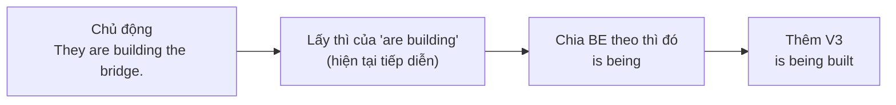
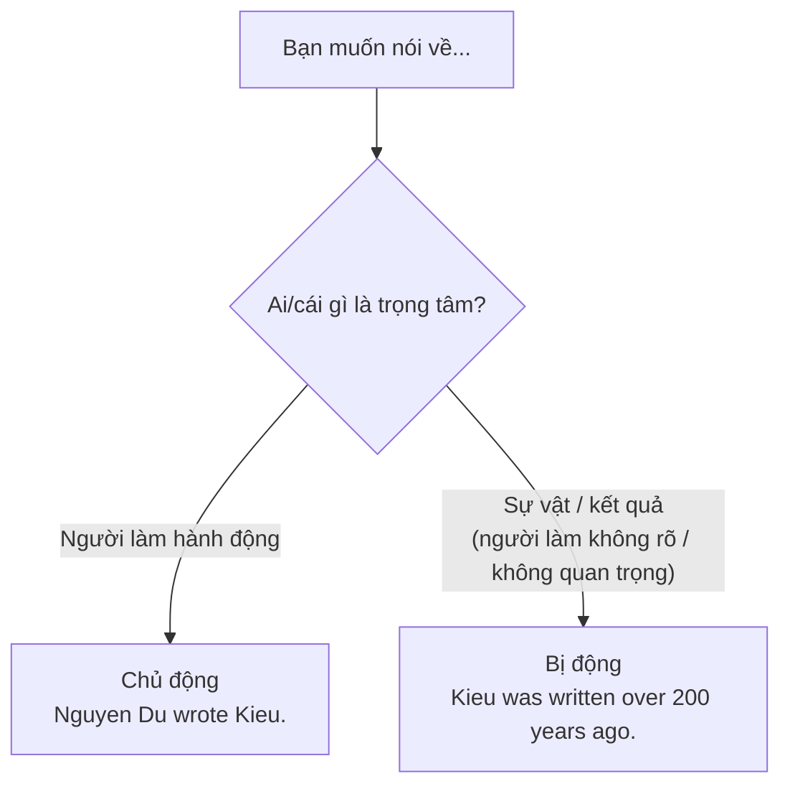

# B1-G012 · Passive Voice across Tenses — Câu bị động ở các thì

## Mục lục

- [A. Lesson Information](#a-lesson-information)
- [B. Warm-up](#b-warm-up)
- [C. WHAT](#c-what)
- [D. WHY](#d-why)
- [E. FORM](#e-form)
- [F. HOW](#f-how)
- [G. VISUAL](#g-visual)
- [H. COMPARISON](#h-comparison)
- [I. COMMON MISTAKES](#i-common-mistakes)
- [J. MEMORY TRICKS](#j-memory-tricks)
- [K. REAL-LIFE APPLICATION](#k-real-life-application)
- [L. PRACTICE EXERCISES](#l-practice-exercises)
- [M. KNOWLEDGE CHECK](#m-knowledge-check)
- [N. ANSWER KEY](#n-answer-key)

---

## A. Lesson Information

| Mục | Nội dung |
|---|---|
| **Lesson ID** | B1-G012 |
| **Topic** | Passive Voice across Tenses (+ modal passives) |
| **Tên tiếng Việt** | Câu bị động ở các thì và với động từ khuyết thiếu |
| **CEFR Level** | B1 |
| **Prerequisites** | [A2-G019 — Passive Voice (basic)](../../03-A2-ELEMENTARY/grammar/A2-G019-passive-voice-basic.md), [B1-G001](B1-G001-present-perfect-continuous.md) (các thì hoàn thành) |
| **Estimated Time** | 90 phút |

**Learning Objectives:**

1. Tạo câu bị động ở **8 dạng**: hiện tại đơn/tiếp diễn/hoàn thành, quá khứ đơn/tiếp diễn/hoàn thành, tương lai *will*, *be going to*.
2. Tạo bị động với **modal verbs**: *can/must/should be + V3*.
3. Quyết định khi nào dùng bị động và khi nào thêm ***by + tác nhân***.
4. Chuyển câu chủ động ↔ bị động chính xác, kể cả câu phủ định và câu hỏi.
5. Nhận diện bị động trong tin tức, hướng dẫn, văn bản học thuật.

---

## B. Warm-up

Đọc hai tiêu đề tin tức:

> 1. *Workers **are building** a new bridge over the Han River.*
> 2. *A new bridge **is being built** over the Han River.*

🤔 **Hãy suy nghĩ:** Thông tin quan trọng nhất với người đọc là gì — những người công nhân hay cây cầu? Ở A2, bạn đã học *is built / was built*. Nhưng nếu việc xây **đang diễn ra** thì bị động sẽ thế nào? Và nếu cây cầu **đã được xây xong** thì sao?

---

## C. WHAT

**Passive voice** (thể bị động) đặt **đối tượng chịu tác động** lên vị trí chủ ngữ. Ta dùng bị động khi:

| Lý do | Ví dụ |
|---|---|
| Không biết ai làm | *My bike **has been stolen**.* |
| Người làm không quan trọng / hiển nhiên | *The road **is being repaired**.* |
| Muốn tập trung vào sự vật/kết quả | *The new hospital **will be opened** next month.* |
| Văn phong trang trọng, khách quan (báo cáo, khoa học) | *The samples **were analysed** in the lab.* |
| Tránh nói thẳng người chịu trách nhiệm | *Mistakes **have been made**.* |

Bị động **chỉ dùng được với ngoại động từ** (động từ có tân ngữ): *They built the bridge* → *The bridge was built*. Không có bị động cho *happen, arrive, die, sleep...*

---

## D. WHY

Mọi câu bị động có cùng "bộ xương": ***be* + V3**. Thì của câu được thể hiện **hoàn toàn qua động từ *be***; V3 không bao giờ thay đổi.



Nói cách khác: **muốn biết bị động ở thì nào, hãy chia *be* ở thì đó.**

---

## E. FORM

**Ký hiệu:** **O** = tân ngữ câu chủ động (thành chủ ngữ câu bị động) · **V3** = quá khứ phân từ.

| Thì | Chủ động | Bị động (**be** + V3) |
|---|---|---|
| Present Simple | They **clean** the room. | The room **is cleaned**. |
| Present Continuous | They **are cleaning** the room. | The room **is being cleaned**. |
| Present Perfect | They **have cleaned** the room. | The room **has been cleaned**. |
| Past Simple | They **cleaned** the room. | The room **was cleaned**. |
| Past Continuous | They **were cleaning** the room. | The room **was being cleaned**. |
| Past Perfect | They **had cleaned** the room. | The room **had been cleaned**. |
| Future *will* | They **will clean** the room. | The room **will be cleaned**. |
| *be going to* | They **are going to clean** the room. | The room **is going to be cleaned**. |
| Modal | They **must/can/should clean** the room. | The room **must/can/should be cleaned**. |

**Phủ định:** thêm *not* sau trợ động từ đầu tiên: *The room **hasn't been** cleaned.*
**Câu hỏi:** đảo trợ động từ đầu tiên: ***Has** the room **been** cleaned? / **Is** it **being** cleaned?*

> 💡 Các thì hoàn thành tiếp diễn (*has been being cleaned*) hầu như không dùng ở bị động.

### *By* + tác nhân (agent)

- Chỉ thêm khi **tác nhân là thông tin quan trọng/mới**: *"Kieu" was written **by Nguyen Du**.*
- Bỏ khi tác nhân không rõ, hiển nhiên hoặc không quan trọng: ~~The thief was arrested by the police~~ → *The thief was arrested.* (đương nhiên là cảnh sát)

---

## F. HOW

| # | English | Tiếng Việt | Phân tích |
|---|---|---|---|
| 1 | *English **is spoken** in many countries.* | Tiếng Anh được nói ở nhiều nước. | HTĐ — sự thật |
| 2 | *Sorry, your room **is** still **being cleaned**.* | Xin lỗi, phòng của quý khách vẫn đang được dọn. | HTTD — đang diễn ra |
| 3 | *My wallet **has been stolen**!* | Ví của tôi bị lấy cắp rồi! | HTHT — kết quả hiện tại, không biết ai |
| 4 | *The temple **was built** in the 11th century.* | Ngôi chùa được xây vào thế kỷ 11. | QKĐ |
| 5 | *When I arrived, the patient **was being examined**.* | Khi tôi đến, bệnh nhân đang được khám. | QKTD |
| 6 | *By the time the firefighters arrived, the house **had been destroyed**.* | Khi lính cứu hỏa đến, ngôi nhà đã bị thiêu rụi. | QKHT |
| 7 | *The results **will be announced** next week.* | Kết quả sẽ được công bố tuần sau. | Tương lai |
| 8 | *A new metro line **is going to be built**.* | Một tuyến metro mới sẽ được xây. | *be going to* |
| 9 | *This medicine **must be kept** in a cool place.* | Thuốc này phải được bảo quản ở nơi mát. | Modal — hướng dẫn |
| 10 | ***Have** the tickets **been booked** yet?* | Vé đã được đặt chưa? | Câu hỏi HTHT |
| 11 | *The email **wasn't sent** because of a technical error.* | Email không được gửi do lỗi kỹ thuật. | Phủ định |
| 12 | *"Kieu" **was written by** Nguyen Du.* | Truyện Kiều được viết bởi Nguyễn Du. | *by* — tác nhân quan trọng |

---

## G. VISUAL

### Quy trình chuyển chủ động → bị động

```text
Chủ động:   The council   has repaired   the road.
              (S)           (V: HTHT)      (O)
                \                           /
Bị động:     The road   has been repaired   (by the council).
               (O→S)    be (HTHT) + V3      (agent — thường bỏ)
```

### Bảng "chỉ chia BE"

```text
is / are            → is cleaned
is being            → is being cleaned
has / have been     → has been cleaned
was / were          → was cleaned
was / were being    → was being cleaned
had been            → had been cleaned
will be             → will be cleaned
is going to be      → is going to be cleaned
must / can be       → must be cleaned
```

---

## H. COMPARISON

### Chủ động hay bị động?



### *by* hay *with*?

| *by* + tác nhân (người/vật thực hiện) | *with* + công cụ |
|---|---|
| *The window was broken **by** a child.* | *The window was broken **with** a stone.* |

### Bị động tiếng Việt và tiếng Anh

Tiếng Việt dùng "được" (tích cực) và "bị" (tiêu cực): *được khen / bị phạt*. Tiếng Anh dùng **cùng một cấu trúc** *be + V3* cho cả hai: *was praised / was fined*. Đừng dịch "được/bị" thành từ riêng.

---

## I. COMMON MISTAKES

| # | ❌ Sai | ✅ Đúng | Nguyên nhân | Cách tránh |
|---|---|---|---|---|
| 1 | The bridge **is building** now. | The bridge **is being built**. | Thiếu *being* và V3 | *be (tiếp diễn) + being + V3* |
| 2 | My phone **has stolen**. | My phone **has been stolen**. | Thiếu *been* | HTHT bị động: *has been + V3* |
| 3 | The accident **was happened** at 9. | The accident **happened** at 9. | Bị động với nội động từ | *happen* không có tân ngữ |
| 4 | The report will **be write** tomorrow. | ...will **be written**... | Thiếu V3 | |
| 5 | The house was built **from** my grandfather. | ...built **by** my grandfather. | Dịch "bởi/từ" | Tác nhân → *by* |
| 6 | My bag was stolen **by someone**. | My bag was stolen. | Thêm tác nhân không mang thông tin | Bỏ *by* khi tác nhân không rõ/hiển nhiên |
| 7 | **Did** the room cleaned? | **Was** the room cleaned? | Dùng *did* | Câu hỏi bị động đảo *be* |

---

## J. MEMORY TRICKS

1. **"Chỉ chia BE, V3 đứng im"** 🧍: V3 không bao giờ đổi; mọi thay đổi thì nằm ở *be*.
2. **"Being = đang"**: Bị động tiếp diễn luôn có *being*.
3. **"Been = đã (hoàn thành)"**: Bị động hoàn thành luôn có *been*.

---

## K. REAL-LIFE APPLICATION

### Bài báo: City upgrades

> *Major changes **are being made** to the city's public transport system. Last year, two new bus routes **were opened**, and more than 300 electric buses **have been added** since January. The first metro line, which **had been delayed** several times, **was finally completed** in December. According to the city council, a second line **is going to be built** next year, and ticket prices **will be reduced** for students. Passengers **are asked** to give feedback through the city's app. "Every comment **will be read**," a spokesperson said.*

**Giải thích:** Thành phố đang cải thiện giao thông công cộng: năm ngoái mở hai tuyến xe buýt mới, từ tháng Giêng thêm hơn 300 xe buýt điện; tuyến metro đầu tiên (từng bị hoãn nhiều lần) hoàn thành vào tháng 12; năm sau sẽ xây tuyến thứ hai, giá vé cho sinh viên sẽ giảm; hành khách được đề nghị góp ý qua ứng dụng.

**Grammar highlights:** 9 động từ bị động ở 7 dạng khác nhau — tin tức thường dùng bị động vì trọng tâm là **sự việc**, không phải người làm.

---

## L. PRACTICE EXERCISES

> ✍️ Đáp án: [B1-G012-ANSWERS](../../12-ANSWERS-AND-EXPLANATIONS/B1/B1-G012-ANSWERS.md)

### Level 1 — Recognition

**L1.1.** The new road ___ at the moment.  A. is building  B. is being built  C. has built  D. builds
**L1.2.** My car ___. I can't find it anywhere!  A. has been stolen  B. has stolen  C. is stealing  D. stole
**L1.3.** The results ___ next Monday.  A. announce  B. will announce  C. will be announced  D. are announcing
**L1.4.** The accident ___ at 8 a.m.  A. was happened  B. happened  C. has been happened  D. is happened
**L1.5.** When we arrived, dinner ___.  A. was being served  B. was serving  C. served  D. has been served
**L1.6.** This form must ___ in black ink.  A. complete  B. be completed  C. completed  D. be complete

### Level 2 — Controlled Practice

Chuyển sang bị động (bỏ tác nhân nếu không cần).

**L2.1.** Someone is repairing my laptop.
**L2.2.** They have cancelled the flight.
**L2.3.** People will hold the festival in October.
**L2.4.** The police had arrested the man before the reporters arrived.
**L2.5.** You must not use mobile phones in the exam room.
**L2.6.** They were painting the house when I visited.
**L2.7.** Somebody is going to collect the rubbish tomorrow.
**L2.8.** Nguyen Du wrote "The Tale of Kieu". (giữ tác nhân)

Chuyển sang câu hỏi bị động.

**L2.9.** The documents have been signed. → ______?
**L2.10.** The package will be delivered today. → When ______?

### Level 3 — Error Correction

**L3.1.** The museum is renovating now.
**L3.2.** My bag has stolen at the station.
**L3.3.** The meeting was took place in Room 3.
**L3.4.** The letters will be send tomorrow.
**L3.5.** This song was sung from a famous singer.
**L3.6.** Did the windows cleaned yesterday?

### Level 4 — Production

Dịch sang tiếng Anh (dùng bị động):

**L4.1.** Phòng của bạn đang được dọn dẹp.
**L4.2.** Cuộc họp đã bị hủy.
**L4.3.** Kết quả sẽ được gửi qua email.
**L4.4.** Khi chúng tôi đến, ngôi nhà đã được bán.

**L4.5.** **Explain:** Vì sao *"The thief was arrested by the police"* thường được rút thành *"The thief was arrested"*? (2 câu tiếng Việt)

### Level 5 — Real Communication

**L5.1.** Viết bản tin ngắn 100–120 từ về những thay đổi ở trường học/công ty/khu phố của bạn (những gì **đã được** làm, **đang được** làm, **sẽ được** làm). Dùng ≥ 6 câu bị động ở ≥ 4 thì khác nhau.
**L5.2.** **Speaking — How is it made?** Mô tả quy trình làm một món ăn hoặc sản phẩm quen thuộc (phở, cà phê, gốm Bát Tràng...) trong 1 phút bằng bị động: *First, the beans are picked... Then they are dried...*

---

## M. KNOWLEDGE CHECK

### 5 câu hỏi tự kiểm tra

1. Công thức chung của câu bị động?
2. Bị động hiện tại tiếp diễn và hiện tại hoàn thành có từ đặc trưng nào?
3. Khi nào giữ *by + tác nhân*?
4. Vì sao không nói *The accident was happened*?
5. Chuyển: *They are going to build a new school.*

### Checklist

- [ ] Tôi tạo được bị động ở 8 thì và với modal.
- [ ] Tôi biết khi nào bỏ tác nhân.
- [ ] Tôi không dùng bị động với nội động từ.

### 3 lỗi quan trọng cần nhớ

1. ~~is building~~ (bị động) → **is being built**.
2. ~~has stolen~~ (bị động) → **has been stolen**.
3. ~~was happened~~ → **happened**.

### Lịch ôn tập

| Ngày | Việc cần làm |
|---|---|
| Ngày 1 | Làm lại L2 |
| Ngày 3 | Gạch chân các câu bị động trong một bài báo tiếng Anh |
| Ngày 7 | Làm lại L5.2 với quy trình khác |

### Liên kết

- ➡️ Bài tiếp theo: [B1-G013 — Defining & Non-defining Relative Clauses](B1-G013-defining-non-defining-relatives.md)
- 🔁 Tra cứu: [PASSIVE-VOICE-GUIDE](../../06-GRAMMAR-REFERENCE/PASSIVE-VOICE-GUIDE.md)
- 🔜 [B1-G017 — Causative](B1-G017-causative-have-get.md), [B2-G004 — Advanced Passive](../../05-B2-UPPER-INTERMEDIATE/grammar/B2-G004-advanced-passive.md)

---

## N. ANSWER KEY

👉 [B1-G012-ANSWERS.md](../../12-ANSWERS-AND-EXPLANATIONS/B1/B1-G012-ANSWERS.md)
