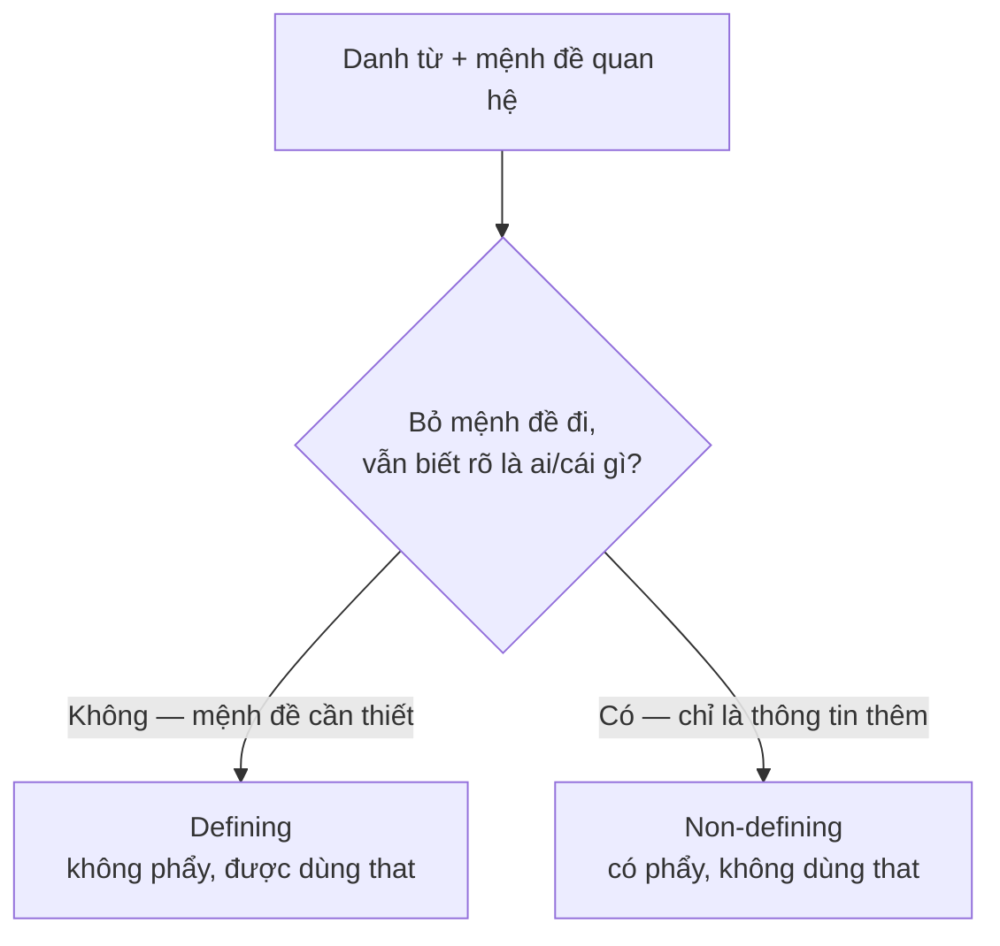

# B1-G013 · Defining & Non-defining Relative Clauses — Mệnh đề quan hệ xác định và không xác định

## Mục lục

- [A. Lesson Information](#a-lesson-information)
- [B. Warm-up](#b-warm-up)
- [C. WHAT](#c-what)
- [D. WHY](#d-why)
- [E. FORM](#e-form)
- [F. HOW](#f-how)
- [G. VISUAL](#g-visual)
- [H. COMPARISON](#h-comparison)
- [I. COMMON MISTAKES](#i-common-mistakes)
- [J. MEMORY TRICKS](#j-memory-tricks)
- [K. REAL-LIFE APPLICATION](#k-real-life-application)
- [L. PRACTICE EXERCISES](#l-practice-exercises)
- [M. KNOWLEDGE CHECK](#m-knowledge-check)
- [N. ANSWER KEY](#n-answer-key)

---

## A. Lesson Information

| Mục | Nội dung |
|---|---|
| **Lesson ID** | B1-G013 |
| **Topic** | Defining & Non-defining Relative Clauses (who, which, that, whose, where, when, whom) |
| **Tên tiếng Việt** | Mệnh đề quan hệ xác định và không xác định |
| **CEFR Level** | B1 |
| **Prerequisites** | [A2-G018 — Relative Clauses (basic)](../../03-A2-ELEMENTARY/grammar/A2-G018-relative-clauses-basic.md) |
| **Estimated Time** | 90 phút |

**Learning Objectives:**

1. Phân biệt **mệnh đề quan hệ xác định** (cần thiết để biết "cái nào/ai") và **không xác định** (thông tin thêm).
2. Đặt **dấu phẩy** đúng với mệnh đề không xác định.
3. Biết khi nào **không dùng *that*** và khi nào **lược bỏ đại từ quan hệ**.
4. Dùng *whose, where, when, whom* và *which* thay cho cả mệnh đề.
5. Đặt giới từ đúng vị trí: *the house **in which** / **which** ... **in***.

---

## B. Warm-up

So sánh hai câu:

> 1. *My brother **who lives in Canada** is a doctor.*
> 2. *My brother, **who lives in Canada**, is a doctor.*

🤔 **Hãy suy nghĩ:** Chỉ khác nhau hai dấu phẩy. Câu nào cho thấy người nói có **nhiều anh/em trai** (và đang chỉ rõ người ở Canada)? Câu nào cho thấy người nói **chỉ có một** anh/em trai, và việc anh ấy sống ở Canada chỉ là thông tin thêm?

---

## C. WHAT

**Relative clause** (mệnh đề quan hệ) là mệnh đề bổ sung thông tin cho một danh từ, bắt đầu bằng **relative pronoun/adverb** (đại từ/trạng từ quan hệ).

| | **Defining** (xác định) | **Non-defining** (không xác định) |
|---|---|---|
| Vai trò | **Xác định** danh từ là ai/cái nào — thiếu nó câu mơ hồ | **Thêm thông tin** về danh từ đã rõ — bỏ đi câu vẫn đủ nghĩa |
| Dấu phẩy | **Không** | **Có** (hai bên) |
| Dùng *that* | ✅ được | ❌ **không** |
| Lược đại từ (khi là tân ngữ) | ✅ được | ❌ không |
| Ví dụ | *The woman **who called you** is my aunt.* | *My aunt, **who lives in Hue**, called you.* |

---

## D. WHY

Câu hỏi then chốt: **"Không có mệnh đề này, người nghe có biết tôi nói về ai/cái nào không?"**



Danh từ đã **xác định sẵn** — tên riêng (*Hanoi, Mr Lam*), *my mother*, vật duy nhất (*the Eiffel Tower*) — thường đi với mệnh đề **không xác định**.

Dấu phẩy trong văn viết tương ứng với **ngắt giọng nhẹ** trong văn nói — như thể người nói "chen" thông tin thêm vào.

---

## E. FORM

### E1. Đại từ/trạng từ quan hệ

| Từ | Thay cho | Chức năng | Defining | Non-defining |
|---|---|---|---|---|
| **who** | người | chủ ngữ/tân ngữ | ✅ | ✅ |
| **whom** | người | tân ngữ (trang trọng), sau giới từ | ✅ | ✅ |
| **which** | vật, con vật | chủ ngữ/tân ngữ | ✅ | ✅ |
| **that** | người, vật | chủ ngữ/tân ngữ | ✅ | ❌ |
| **whose** | sở hữu (người/vật) | + danh từ | ✅ | ✅ |
| **where** | nơi chốn | = *in/at which* | ✅ | ✅ |
| **when** | thời gian | = *on/in which* | ✅ | ✅ |
| **which** (cả mệnh đề) | ý của cả câu trước | | — | ✅ (luôn có phẩy) |

### E2. Lược bỏ đại từ quan hệ (chỉ defining)

Khi đại từ là **tân ngữ** của mệnh đề quan hệ (sau nó có chủ ngữ khác), có thể lược bỏ:

- *The book **(that/which)** I bought is great.* → *The book I bought is great.* ✅
- *The man **who** lives next door...* → **không** lược được (*who* là chủ ngữ).

### E3. Giới từ trong mệnh đề quan hệ

| Thân mật (giới từ ở cuối) | Trang trọng (giới từ trước *which/whom*) |
|---|---|
| *the house (that) I grew up **in*** | *the house **in which** I grew up* |
| *the person (who) I spoke **to*** | *the person **to whom** I spoke* |

> ⚠️ Không dùng giới từ trước *that* hoặc *who*: ❌ *in that*, ❌ *to who*.

### E4. Dấu phẩy

- Mệnh đề không xác định **ở giữa câu**: hai dấu phẩy. *Hanoi**,** which is the capital**,** has many lakes.*
- **Ở cuối câu**: một dấu phẩy trước. *I met Lan**,** who works at the bank.*

---

## F. HOW

| # | English | Tiếng Việt | Phân tích |
|---|---|---|---|
| 1 | *The man **who/that fixed my car** was very kind.* | Người đàn ông sửa xe cho tôi rất tử tế. | Defining — xác định "người nào" |
| 2 | *The phone **(that) I bought last week** is already broken.* | Chiếc điện thoại tôi mua tuần trước đã hỏng. | Defining, lược đại từ tân ngữ |
| 3 | *My father, **who is 70**, still goes jogging.* | Bố tôi, năm nay 70 tuổi, vẫn chạy bộ. | Non-defining — chỉ có một bố |
| 4 | *Da Lat, **which is famous for its flowers**, is cool all year.* | Đà Lạt, nổi tiếng với hoa, mát quanh năm. | Non-defining — tên riêng |
| 5 | *That's the girl **whose** brother plays for the national team.* | Đó là cô gái có anh trai chơi cho đội tuyển. | *whose* + danh từ |
| 6 | *This is the café **where** we first met.* | Đây là quán cà phê nơi chúng ta gặp nhau lần đầu. | *where* = *at which* |
| 7 | *I'll never forget the day **when** I graduated.* | Tôi sẽ không bao giờ quên ngày tôi tốt nghiệp. | *when* |
| 8 | *He passed the exam, **which** surprised everyone.* | Anh ấy thi đỗ, điều đó làm mọi người ngạc nhiên. | *which* thay cả mệnh đề |
| 9 | *The manager, **to whom** I sent the report, hasn't replied.* | Người quản lý mà tôi gửi báo cáo chưa trả lời. | Giới từ + *whom* — trang trọng |
| 10 | *Students **who don't submit** the essay on time will lose marks.* | Sinh viên nào không nộp bài đúng hạn sẽ bị trừ điểm. | Defining — chỉ nhóm sinh viên đó |
| 11 | *My laptop, **which I bought in 2019**, is still fast.* | Laptop của tôi, mua năm 2019, vẫn chạy nhanh. | Non-defining — không lược được *which* |

---

## G. VISUAL

### So sánh trực quan

```text
DEFINING (không phẩy):
  The students [who passed the test] will get a certificate.
  → chỉ những sinh viên đỗ mới được chứng chỉ (nhóm nhỏ hơn).

NON-DEFINING (có phẩy):
  The students, [who passed the test], will get a certificate.
  → tất cả sinh viên (đều đã đỗ) sẽ được chứng chỉ.
```

### Breakdown

`Ho Chi Minh City, | which | is the largest city in Vietnam, | is also its economic centre.`

| Phần | Vai trò |
|---|---|
| Ho Chi Minh City | Danh từ đã xác định (tên riêng) |
| , which ..., | Mệnh đề không xác định — thông tin thêm, có phẩy |
| is also its economic centre | Mệnh đề chính |

---

## H. COMPARISON

### Defining vs Non-defining — cùng câu, khác nghĩa

| Câu | Ý nghĩa |
|---|---|
| *My sister **who lives in Hue** is a teacher.* | Tôi có hơn một chị/em gái; người sống ở Huế là giáo viên. |
| *My sister, **who lives in Hue**, is a teacher.* | Tôi chỉ có một chị/em gái; cô ấy sống ở Huế (thông tin thêm). |

### *which* vs *what*

| *which* (đại từ quan hệ, có danh từ đứng trước) | *what* (= *the thing that*, không có danh từ đứng trước) |
|---|---|
| *The thing **which** I need is time.* | ***What** I need is time.* |
| ❌ *The thing what I need...* | |

### *who* vs *whom*

Trong văn nói, *who* thường thay *whom* cho tân ngữ (*the man who I met*). *Whom* bắt buộc **ngay sau giới từ**: *to whom, with whom*.

---

## I. COMMON MISTAKES

| # | ❌ Sai | ✅ Đúng | Nguyên nhân | Cách tránh |
|---|---|---|---|---|
| 1 | My mother, **that** is a nurse, works nights. | My mother, **who** is a nurse, ... | *that* trong non-defining | Có phẩy → không *that* |
| 2 | Hanoi **which** is the capital has many lakes. | Hanoi**,** which is the capital**,** has... | Thiếu phẩy | Tên riêng → non-defining |
| 3 | The book **which I bought it** is good. | The book which I bought is good. | Lặp tân ngữ | Đại từ quan hệ đã thay *it* |
| 4 | The man **which** lives next door is a pilot. | The man **who/that** lives... | *which* cho người | Người → *who/that* |
| 5 | That's the girl **who's** father is a doctor. | ...**whose** father... | Nhầm *who's/whose* | Sở hữu → *whose* |
| 6 | This is the house **in that** I was born. | ...**in which** I was born / **where** I was born. | Giới từ + *that* | |
| 7 | He failed the test, **what** upset his parents. | ..., **which** upset his parents. | *what* thay cả mệnh đề | Thay cả mệnh đề → *which* |
| 8 | My car, I bought last year, is red. | My car, **which** I bought last year, is red. | Lược đại từ trong non-defining | Non-defining không lược |

---

## J. MEMORY TRICKS

1. **"Phép thử bỏ đi ✂️"**: Bỏ mệnh đề — câu vẫn rõ ai/cái gì? → non-defining (có phẩy).
2. **"Dấu phẩy ghét *that*"**: Thấy dấu phẩy → không bao giờ *that*.
3. **"Whose = của ai/của cái gì"**: luôn có **danh từ** theo sau (*whose car, whose roof*).
4. **"Tên riêng thích dấu phẩy"**: *Hanoi, Mr Lam, my mother* (người duy nhất) → thường non-defining.

---

## K. REAL-LIFE APPLICATION

### Bài đọc: My hometown

> *I grew up in Hoi An, **which** is a small town in central Vietnam. The house **where** I was born is still there, on a street **that** is full of yellow walls and lanterns. My grandmother, **who** is 85, still lives there. She runs a tiny shop **which** sells tailored clothes. The customers **who** come to her shop are mostly tourists **whose** suitcases are already full! The best time to visit is in February, **when** the weather is cool. Last year, the town was flooded, **which** damaged many old houses. But the people, **who** are incredibly strong, rebuilt everything quickly.*

**Giải thích:** Tác giả lớn lên ở Hội An; ngôi nhà nơi tác giả sinh ra vẫn còn trên con phố đầy tường vàng và đèn lồng; bà 85 tuổi vẫn sống ở đó, mở một tiệm may nhỏ; khách chủ yếu là du khách có vali đã đầy; thời điểm đẹp nhất là tháng Hai; năm ngoái lũ làm hư hại nhiều nhà cổ nhưng người dân đã xây lại nhanh chóng.

**Grammar highlights:** Defining: *the house where I was born, a street that..., a tiny shop which sells..., the customers who come..., whose suitcases*. Non-defining: *Hoi An, which..., My grandmother, who..., in February, when..., ..., which damaged... (cả mệnh đề), the people, who...*

---

## L. PRACTICE EXERCISES

> ✍️ Đáp án: [B1-G013-ANSWERS](../../12-ANSWERS-AND-EXPLANATIONS/B1/B1-G013-ANSWERS.md)

### Level 1 — Recognition

**L1.1.** My best friend, ___ lives in Paris, is coming to visit.  A. that  B. who  C. which  D. whose
**L1.2.** The laptop ___ I bought last month has stopped working.  A. who  B. whose  C. (không cần từ)  D. where
**L1.3.** That's the man ___ dog bit me.  A. who  B. who's  C. whose  D. which
**L1.4.** He arrived two hours late, ___ annoyed everyone.  A. that  B. what  C. which  D. who
**L1.5.** Câu nào cho thấy người nói **chỉ có một** anh trai?  A. My brother who works in Japan is an engineer.  B. My brother, who works in Japan, is an engineer.
**L1.6.** This is the hotel ___ we stayed last summer.  A. which  B. where  C. that  D. when

### Level 2 — Controlled Practice

Nối hai câu bằng mệnh đề quan hệ (chú ý dấu phẩy).

**L2.1.** Da Nang is famous for its beaches. It is my favourite city.
**L2.2.** I met a woman. She can speak five languages.
**L2.3.** My grandfather fought in the war. He is now 95.
**L2.4.** This is the restaurant. We had our first date there.
**L2.5.** I have a friend. His father is a famous singer.
**L2.6.** She lost her job. This made her very sad.

Điền đại từ quan hệ; viết **Ø** nếu có thể lược bỏ.

**L2.7.** The film ___ we watched last night was boring.
**L2.8.** The people ___ live upstairs are very noisy.
**L2.9.** My car, ___ is ten years old, still runs well.
**L2.10.** 2020 was the year ___ everything changed.

### Level 3 — Error Correction

**L3.1.** My mother, that is a doctor, works at Bach Mai Hospital.
**L3.2.** The student which won the prize is from Hue.
**L3.3.** The book that I lent you it is very rare.
**L3.4.** Paris which is the capital of France is beautiful.
**L3.5.** That's the woman who's son plays football professionally.
**L3.6.** He forgot my birthday, what made me angry.

### Level 4 — Production

**L4.1.** Dịch: *"Hà Nội, thủ đô của Việt Nam, có hơn một nghìn năm lịch sử."* (dùng *which*)
**L4.2.** Dịch: *"Người phụ nữ mà bạn gặp hôm qua là sếp của tôi."*
**L4.3.** Dịch: *"Anh ấy bỏ việc, điều đó làm mọi người ngạc nhiên."*
**L4.4.** Viết lại trang trọng: *The person I spoke to was very helpful.* (dùng *to whom*)

**L4.5.** **Explain:** Giải thích khác biệt nghĩa giữa *"The employees who work overtime get a bonus"* và *"The employees, who work overtime, get a bonus"* (2–3 câu tiếng Việt).

### Level 5 — Real Communication

**L5.1.** Viết đoạn văn 100–130 từ giới thiệu quê hương hoặc thành phố bạn sống. Dùng ≥ 6 mệnh đề quan hệ, trong đó có ≥ 3 không xác định, ≥ 1 *whose*, ≥ 1 *where/when*, ≥ 1 *which* thay cả mệnh đề.
**L5.2.** **Speaking — Who's who?** Mô tả 5 người/vật trong một bức ảnh (gia đình, đồng nghiệp) bằng mệnh đề quan hệ: *The woman who is wearing a red dress is my aunt, who lives in Saigon...*

---

## M. KNOWLEDGE CHECK

### 5 câu hỏi tự kiểm tra

1. Mệnh đề xác định và không xác định khác nhau thế nào về nghĩa và dấu câu?
2. Vì sao không dùng *that* trong mệnh đề không xác định?
3. Khi nào có thể lược bỏ đại từ quan hệ?
4. *whose* và *who's* khác nhau ra sao?
5. Dùng gì để thay cho cả một mệnh đề phía trước?

### Checklist

- [ ] Tôi đặt dấu phẩy đúng với mệnh đề không xác định.
- [ ] Tôi không dùng *that* sau dấu phẩy.
- [ ] Tôi dùng được *whose, where, when* và *which* thay cả mệnh đề.

### 3 lỗi quan trọng cần nhớ

1. ~~, that~~ → **, who / , which**.
2. ~~The book which I bought it~~ → bỏ *it*.
3. ~~..., what made me angry~~ → **..., which** made me angry.

### Lịch ôn tập

| Ngày | Việc cần làm |
|---|---|
| Ngày 1 | Làm lại L2 |
| Ngày 3 | Viết 5 câu non-defining về các thành phố Việt Nam |
| Ngày 7 | Chuẩn bị cho [B2-G007 — Reduced Relative Clauses](../../05-B2-UPPER-INTERMEDIATE/grammar/B2-G007-relative-clause-reduction.md) |

### Liên kết

- ➡️ Bài tiếp theo: [B1-G014 — Modals of Deduction](B1-G014-modals-deduction-present.md)
- 🔁 Ôn: [A2-G018](../../03-A2-ELEMENTARY/grammar/A2-G018-relative-clauses-basic.md)
- 🎯 **Mini Challenge khối B1-3** — xem [B1 README](../README.md#5-mini-challenges)

---

## N. ANSWER KEY

👉 [B1-G013-ANSWERS.md](../../12-ANSWERS-AND-EXPLANATIONS/B1/B1-G013-ANSWERS.md)
