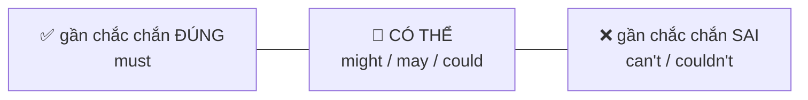
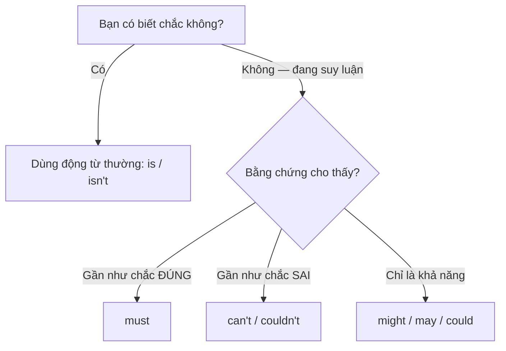

# B1-G014 · Modal Verbs of Deduction (present) — Suy luận ở hiện tại: must, might, could, can't

## Mục lục

- [A. Lesson Information](#a-lesson-information)
- [B. Warm-up](#b-warm-up)
- [C. WHAT](#c-what)
- [D. WHY](#d-why)
- [E. FORM](#e-form)
- [F. HOW](#f-how)
- [G. VISUAL](#g-visual)
- [H. COMPARISON](#h-comparison)
- [I. COMMON MISTAKES](#i-common-mistakes)
- [J. MEMORY TRICKS](#j-memory-tricks)
- [K. REAL-LIFE APPLICATION](#k-real-life-application)
- [L. PRACTICE EXERCISES](#l-practice-exercises)
- [M. KNOWLEDGE CHECK](#m-knowledge-check)
- [N. ANSWER KEY](#n-answer-key)

---

## A. Lesson Information

| Mục | Nội dung |
|---|---|
| **Lesson ID** | B1-G014 |
| **Topic** | Modals of Deduction — present (must, might, may, could, can't) |
| **Tên tiếng Việt** | Động từ khuyết thiếu chỉ suy luận ở hiện tại |
| **CEFR Level** | B1 |
| **Prerequisites** | [A2-G009 — Might/May](../../03-A2-ELEMENTARY/grammar/A2-G009-might-may-possibility.md), [A2-G012 — Must/Have to](../../03-A2-ELEMENTARY/grammar/A2-G012-must-have-to.md) |
| **Estimated Time** | 75 phút |

**Learning Objectives:**

1. Dùng ***must*** khi kết luận **gần như chắc chắn đúng** dựa trên bằng chứng.
2. Dùng ***can't*** khi kết luận **gần như chắc chắn sai**.
3. Dùng ***might / may / could*** khi **có thể đúng** (chưa chắc).
4. Dùng dạng ***must/might/can't + be + V-ing*** cho việc đang diễn ra.
5. Không dùng *mustn't* để suy luận phủ định; giải thích căn cứ cho suy luận.

---

## B. Warm-up

Bạn gọi cho đồng nghiệp Lan nhiều lần nhưng cô ấy không nghe máy. Ba người trong văn phòng phỏng đoán:

> - *"She **must** be in a meeting. Her bag is on her desk."*
> - *"She **might** be at lunch. It's 12:15."*
> - *"She **can't** be at home. I saw her this morning."*

🤔 **Hãy suy nghĩ:** Ba người có mức độ chắc chắn khác nhau. Người nào chắc chắn nhất? Người nào chỉ đoán? Ở A2, *must* nghĩa là "phải" (nghĩa vụ) — ở đây *must* có nghĩa gì?

---

## C. WHAT

**Modals of deduction** (động từ khuyết thiếu chỉ suy luận) diễn tả **mức độ chắc chắn** của người nói về một điều **ở hiện tại**, dựa trên **bằng chứng** hoặc **suy luận logic**.

| Modal | Mức độ | Nghĩa | Ví dụ |
|---|---|---|---|
| **must** | Gần như chắc chắn **đúng** | chắc hẳn là | *He **must** be tired. He worked all night.* |
| **might / may / could** | **Có thể** đúng | có thể là, có lẽ | *She **might** be at lunch.* |
| **can't / couldn't** | Gần như chắc chắn **sai** | không thể nào | *That **can't** be Tom. He's in Japan.* |

> ⚠️ Đây là **nghĩa khác** của *must*: không còn là "phải làm" (nghĩa vụ) mà là "chắc hẳn" (suy luận). Ngữ cảnh cho biết nghĩa nào đang được dùng.

---

## D. WHY

Người nói dùng modal để **cho thấy mình suy nghĩ thế nào**, thay vì khẳng định như một sự thật. Điều này giúp giao tiếp **lịch sự và chính xác**: bạn không nói *She is in a meeting* (nếu bạn không biết chắc), mà nói *She must be in a meeting* (bạn suy ra từ bằng chứng).



Vì sao đối lập của *must* (suy luận) là *can't*, không phải *mustn't*? Vì *mustn't* vẫn mang nghĩa **cấm** (*You mustn't smoke here*). Để nói "chắc chắn không phải", tiếng Anh dùng *can't* = "không thể nào".

---

## E. FORM

**Ký hiệu:** **S** = chủ ngữ · **V** = nguyên mẫu.

| Dạng | Công thức | Ví dụ |
|---|---|---|
| Trạng thái hiện tại | S + must/might/may/could/can't + **be** + adj/N/nơi chốn | *He **must be** hungry.* |
| Động từ khác (trạng thái) | S + modal + **V** | *She **must know** the answer.* |
| Đang diễn ra lúc này | S + modal + **be + V-ing** | *They **might be sleeping**.* |
| Phủ định "có thể không" | S + **might not / may not** + V | *He **might not** be at home.* |

> 💡 *could not / couldn't* cũng có thể dùng như *can't* trong suy luận hiện tại (hơi nhẹ hơn): *It couldn't be true.*

---

## F. HOW

| # | English | Tiếng Việt | Bằng chứng / Phân tích |
|---|---|---|---|
| 1 | *The lights are on. They **must be** at home.* | Đèn sáng. Chắc hẳn họ ở nhà. | Bằng chứng mạnh → *must* |
| 2 | *You've been travelling all day. You **must be** exhausted.* | Bạn đi cả ngày. Chắc bạn mệt lắm. | Suy luận hợp lý; cũng là cách thể hiện đồng cảm |
| 3 | *That **can't be** Minh — he's in Australia this month.* | Đó không thể là Minh — tháng này anh ấy ở Úc. | Mâu thuẫn với điều đã biết → *can't* |
| 4 | *She isn't answering. She **might be driving**.* | Cô ấy không nghe máy. Có thể cô ấy đang lái xe. | Đang diễn ra + không chắc |
| 5 | *This bag **could be** Hoa's. She has one like it.* | Cái túi này có thể là của Hoa. Cô ấy có một cái giống thế. | Có thể |
| 6 | *He speaks perfect Japanese. He **must have** lived in Japan.* → xem [B1-G015](B1-G015-modal-perfects.md) | | Suy luận về **quá khứ** — bài sau |
| 7 | *That restaurant is always full. The food **must be** good.* | Nhà hàng đó lúc nào cũng đông. Đồ ăn chắc hẳn ngon. | |
| 8 | *You **can't be** serious!* | Bạn không thể nghiêm túc được! (Bạn đùa à!) | Cụm cố định — ngạc nhiên |
| 9 | *The keys **may be** in the car. Let's check.* | Chìa khóa có thể ở trong xe. Kiểm tra xem. | *may* — hơi trang trọng hơn *might* |
| 10 | *He **might not know** about the meeting. Nobody told him.* | Có thể anh ấy không biết về cuộc họp. | Phủ định của khả năng |
| 11 | *It's only 10 a.m. She **can't be** at lunch yet.* | Mới 10 giờ. Cô ấy không thể đi ăn trưa rồi. | Logic thời gian |

---

## G. VISUAL

### Thang chắc chắn

```text
✅ ~100%  │ She IS at home.          (biết chắc)
   ~95%   │ She MUST be at home.     (suy luận mạnh)
   ~50%   │ She MIGHT/MAY/COULD be at home.
   ~5%    │ She CAN'T be at home.    (suy luận mạnh: sai)
❌ ~0%    │ She ISN'T at home.       (biết chắc)
```

> Các con số chỉ để hình dung thứ tự, không phải định nghĩa chính xác.

### Sơ đồ chọn modal



---

## H. COMPARISON

### *must* (suy luận) vs *must* (nghĩa vụ)

| Suy luận | Nghĩa vụ |
|---|---|
| *You **must be** tired.* (chắc bạn mệt) | *You **must** wear a helmet.* (bạn phải đội mũ bảo hiểm) |
| Thường đi với *be*, động từ trạng thái | Thường đi với động từ hành động |

### *can't* (suy luận) vs *mustn't*

| *can't* — chắc chắn không phải | *mustn't* — cấm |
|---|---|
| *That **can't** be true.* | *You **mustn't** tell anyone.* |
| ❌ *That mustn't be true.* (không dùng để suy luận) | |

### *could* vs *can* trong suy luận khẳng định

- ✅ *It **could** be Lan.* (có thể là Lan — một khả năng cụ thể)
- ⚠️ *It **can** be cold in Da Lat.* — *can* chỉ khả năng **chung**, không phải suy luận về một trường hợp cụ thể (xem [A2-G009](../../03-A2-ELEMENTARY/grammar/A2-G009-might-may-possibility.md)).

---

## I. COMMON MISTAKES

| # | ❌ Sai | ✅ Đúng | Nguyên nhân | Cách tránh |
|---|---|---|---|---|
| 1 | That **mustn't** be Lan. She's abroad. | That **can't** be Lan. | Dùng *mustn't* để suy luận phủ định | Suy luận phủ định → *can't* |
| 2 | He **must to be** tired. | He **must be** tired. | Thêm *to* | Modal + V |
| 3 | She **must is** at home. | She **must be** at home. | Chia *be* | Sau modal → *be* |
| 4 | She might **sleeping**. | She might **be sleeping**. | Thiếu *be* | *modal + be + V-ing* |
| 5 | It **can be** Lan at the door. | It **could/might be** Lan. | *can* cho khả năng cụ thể | |
| 6 | He **must be** at home. (khi bạn vừa nhìn thấy anh ấy ở nhà) | He **is** at home. | Dùng modal khi đã biết chắc | Biết chắc → không cần modal |

---

## J. MEMORY TRICKS

1. **"Thám tử 🕵️"**: Bằng chứng mạnh → *must*; bằng chứng mâu thuẫn → *can't*; manh mối mơ hồ → *might*.
2. **"Can't là đối thủ của must"**: Trong suy luận, *must* ↔ *can't*. *Mustn't* ở lại "phòng luật lệ" (cấm).
3. **"Đang làm → be + V-ing"**: *must/might/can't* **be doing**.

---

## K. REAL-LIFE APPLICATION

### Hội thoại: Bí ẩn văn phòng

> **Hoa:** Whose umbrella is this? It's been here since Monday.
> **Tuan:** It **can't be** mine — mine is black. It **might be** Lan's. She has a red one.
> **Hoa:** No, it **can't be** hers. She's been on holiday all week.
> **Tuan:** Hmm. It **must belong** to a visitor, then. We had a lot of clients on Monday.
> **Hoa:** You're right. It **could be** Mr Kim's. He was here for the meeting, and it was raining.
> **Tuan:** Look, there's a name tag inside... "K. Park". It **must be** Mr Kim's assistant's!
> **Hoa:** Ha! He **must be looking** for it everywhere. Let's email him.

**Giải thích:** Hoa và Tuấn đoán chủ chiếc ô: không thể là của Tuấn (ô anh màu đen), không thể là của Lan (đi nghỉ cả tuần), chắc hẳn của khách; có thể là của ông Kim; thẻ tên "K. Park" → chắc là của trợ lý ông Kim, người chắc đang tìm khắp nơi.

---

## L. PRACTICE EXERCISES

> ✍️ Đáp án: [B1-G014-ANSWERS](../../12-ANSWERS-AND-EXPLANATIONS/B1/B1-G014-ANSWERS.md)

### Level 1 — Recognition

**L1.1.** He's been working for 14 hours. He ___ be exhausted.  A. can't  B. must  C. mustn't  D. might not
**L1.2.** That ___ be Nam's car. He sold it last year.  A. must  B. mustn't  C. can't  D. may
**L1.3.** I'm not sure where Mai is. She ___ be in the library.  A. must  B. might  C. can't  D. has to
**L1.4.** Don't call now. They ___ having dinner.  A. must be  B. must  C. can't  D. might
**L1.5.** Câu nào là **suy luận** (không phải nghĩa vụ)?  A. You must wear a seat belt.  B. You must be Lan's sister — you look just like her.
**L1.6.** "I've just won 1 billion dong!" — "You ___ be serious!"  A. mustn't  B. can't  C. might  D. must

### Level 2 — Controlled Practice

Viết lại câu dùng *must, might/may/could* hoặc *can't*.

**L2.1.** I'm sure he is Japanese. He speaks Japanese with his parents.
**L2.2.** It's possible that she is at the gym.
**L2.3.** I'm sure that isn't true. Nobody would believe it.
**L2.4.** Perhaps the shop is closed today.
**L2.5.** I'm sure they are watching the match — I can hear them shouting.

Hoàn thành câu với modal + động từ phù hợp (đưa ra suy luận hợp lý).

**L2.6.** The phone is ringing but nobody answers. They ______.
**L2.7.** She's wearing a wedding ring. She ______.
**L2.8.** He only started learning English a month ago. He ______ fluent.
**L2.9.** The restaurant is empty on a Saturday night. The food ______.
**L2.10.** There's a big queue outside the cinema. The film ______.

### Level 3 — Error Correction

**L3.1.** That mustn't be the right answer. It doesn't make sense.
**L3.2.** He must to be very rich. Look at his house!
**L3.3.** She might working late tonight.
**L3.4.** It can be Mr Long at the door. He said he would come.
**L3.5.** They must are on holiday. Their house is dark.
**L3.6.** You can't serious!

### Level 4 — Production

Dịch sang tiếng Anh:

**L4.1.** Chắc hẳn bạn rất vui. Bạn vừa được thăng chức!
**L4.2.** Đó không thể là chìa khóa của tôi. Chìa của tôi ở trong túi.
**L4.3.** Có thể anh ấy đang ngủ. Đừng gọi.
**L4.4.** Chắc hẳn cô ấy biết câu trả lời — cô ấy là giáo viên mà.

**L4.5.** **Explain:** Vì sao *"That mustn't be true"* sai khi muốn nói "Điều đó không thể là thật"? (2 câu tiếng Việt)

### Level 5 — Real Communication

**L5.1.** Viết đoạn văn 80–100 từ: *The mystery neighbour*. Mô tả một người hàng xóm bí ẩn (tưởng tượng) qua các manh mối (giờ ra vào, đồ vật, âm thanh...) và đưa ra ≥ 6 suy luận với *must, might/may/could, can't*.
**L5.2.** **Speaking — Guess the job:** Đưa ra suy luận về nghề nghiệp của 4 người dựa trên manh mối: (a) *always smells of paint, has colourful clothes*; (b) *works at night, wears a uniform, drives a lot*; (c) *speaks five languages, travels every week*; (d) *gets up at 3 a.m., has flour on his hands*.

---

## M. KNOWLEDGE CHECK

### 5 câu hỏi tự kiểm tra

1. *must, might, can't* thể hiện mức độ chắc chắn nào?
2. Vì sao dùng *can't* chứ không phải *mustn't* cho suy luận phủ định?
3. Cấu trúc suy luận về việc đang diễn ra?
4. Khi nào không nên dùng modal suy luận?
5. *You must be tired* và *You must wear a helmet* — *must* khác nghĩa thế nào?

### Checklist

- [ ] Tôi chọn đúng *must/might/can't* theo bằng chứng.
- [ ] Tôi không dùng *mustn't* để suy luận.
- [ ] Tôi dùng được *modal + be + V-ing*.

### 3 lỗi quan trọng cần nhớ

1. ~~mustn't be true~~ → **can't** be true.
2. ~~must to be / must is~~ → **must be**.
3. ~~might sleeping~~ → might **be** sleeping.

### Lịch ôn tập

| Ngày | Việc cần làm |
|---|---|
| Ngày 1 | Làm lại L2 |
| Ngày 3 | Nhìn 5 người xung quanh (trên xe buýt, quán cà phê), suy luận về họ bằng tiếng Anh |
| Ngày 7 | Học tiếp [B1-G015](B1-G015-modal-perfects.md) và so sánh |

### Liên kết

- ➡️ Bài tiếp theo: [B1-G015 — Must have / Might have / Should have](B1-G015-modal-perfects.md)
- 🔁 Tra cứu: [MODAL-VERBS-COMPARISON](../../06-GRAMMAR-REFERENCE/MODAL-VERBS-COMPARISON.md)

---

## N. ANSWER KEY

👉 [B1-G014-ANSWERS.md](../../12-ANSWERS-AND-EXPLANATIONS/B1/B1-G014-ANSWERS.md)
