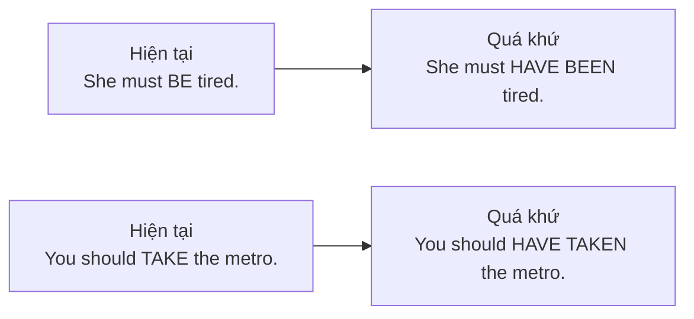
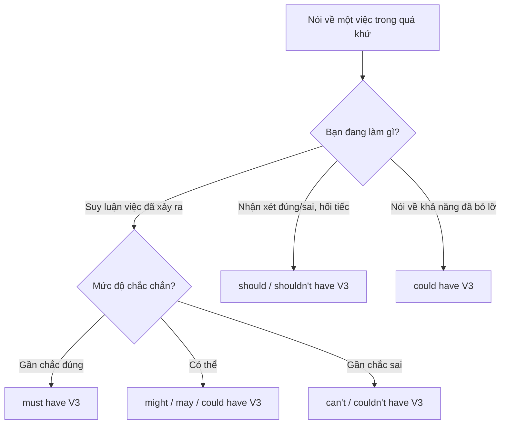

# B1-G015 · Must have / Might have / Could have / Should have — Động từ khuyết thiếu + have + V3

## Mục lục

- [A. Lesson Information](#a-lesson-information)
- [B. Warm-up](#b-warm-up)
- [C. WHAT](#c-what)
- [D. WHY](#d-why)
- [E. FORM](#e-form)
- [F. HOW](#f-how)
- [G. VISUAL](#g-visual)
- [H. COMPARISON](#h-comparison)
- [I. COMMON MISTAKES](#i-common-mistakes)
- [J. MEMORY TRICKS](#j-memory-tricks)
- [K. REAL-LIFE APPLICATION](#k-real-life-application)
- [L. PRACTICE EXERCISES](#l-practice-exercises)
- [M. KNOWLEDGE CHECK](#m-knowledge-check)
- [N. ANSWER KEY](#n-answer-key)

---

## A. Lesson Information

| Mục | Nội dung |
|---|---|
| **Lesson ID** | B1-G015 |
| **Topic** | Modal Perfects: must have, might/may have, could have, can't have, should have, shouldn't have |
| **Tên tiếng Việt** | Động từ khuyết thiếu + *have* + V3 (suy luận và nhận xét về quá khứ) |
| **CEFR Level** | B1 |
| **Prerequisites** | [B1-G014 — Modals of Deduction (present)](B1-G014-modals-deduction-present.md), [A2-G014 — Should](../../03-A2-ELEMENTARY/grammar/A2-G014-should-ought-to.md) |
| **Estimated Time** | 90 phút |

**Learning Objectives:**

1. Suy luận về **quá khứ** với ***must have / might have / can't have + V3***.
2. Nói về **khả năng đã có nhưng không xảy ra** với ***could have + V3***.
3. Phê bình/hối tiếc với ***should have / shouldn't have + V3***.
4. Phát âm đúng dạng rút gọn: *must've, should've, could've* (không viết *must of*).
5. Phân biệt *couldn't have* (suy luận/không thể) với *could have* (lẽ ra có thể).

---

## B. Warm-up

Sáng nay bạn thấy đường phố ướt sũng, cây đổ ngổn ngang. Bạn nói:

> *"It **must have rained** heavily last night."*

Đồng nghiệp đến muộn một tiếng vì kẹt xe. Bạn nói:

> *"You **should have taken** the metro."*

🤔 **Hãy suy nghĩ:** Ở bài trước, bạn nói *It must be...* về **hiện tại**. Giờ bạn suy luận về **quá khứ** (mưa đêm qua) và **nhận xét** việc lẽ ra nên làm (đi metro). Cả hai câu có chung cấu trúc gì?

---

## C. WHAT

Cấu trúc **modal + have + V3** dùng để nói về **quá khứ**:

| Cấu trúc | Chức năng | Nghĩa | Ví dụ |
|---|---|---|---|
| **must have V3** | Suy luận | chắc hẳn đã | *She **must have left** early.* |
| **might / may have V3** | Suy luận | có lẽ đã | *He **might have missed** the bus.* |
| **could have V3** | Suy luận (khả năng) | có thể đã | *They **could have taken** a taxi.* |
| **can't / couldn't have V3** | Suy luận | không thể nào đã | *He **can't have finished** already.* |
| **could have V3** | Khả năng **không thành hiện thực** | lẽ ra đã có thể | *You **could have died**!* |
| **should have V3** | Phê bình / hối tiếc | lẽ ra nên | *I **should have studied** harder.* |
| **shouldn't have V3** | Phê bình / hối tiếc | lẽ ra không nên | *You **shouldn't have said** that.* |

---

## D. WHY

Modal verbs không có dạng quá khứ riêng cho nghĩa suy luận (*must* không có "*musted*"). Vì vậy, tiếng Anh dùng **have + V3** sau modal để chuyển ý nghĩa về **quá khứ**:

*have + V3* ở đây không phải thì hiện tại hoàn thành — nó chỉ là "dấu hiệu quá khứ" sau modal.

---

## E. FORM

**Ký hiệu:** **S** = chủ ngữ · **V3** = quá khứ phân từ.

| | Công thức | Ví dụ |
|---|---|---|
| ➕ | S + modal + **have** + V3 | *He **must have forgotten**.* |
| ➖ | S + modal + **not** + **have** + V3 | *She **can't have seen** us.* / *You **shouldn't have** gone.* |
| ❓ (should/could) | Modal + S + **have** + V3? | ***Should** I **have called** first?* |
| Tiếp diễn | S + modal + **have been** + V-ing | *She **must have been sleeping**.* |

### Phát âm và chính tả

| Viết | Rút gọn (văn nói) | Phát âm |
|---|---|---|
| must have | must've | /ˈmʌstəv/ |
| should have | should've | /ˈʃʊdəv/ |
| could have | could've | /ˈkʊdəv/ |
| might have | might've | /ˈmaɪtəv/ |

> ⚠️ **Không bao giờ viết** *must of, should of, could of* — đây là lỗi chính tả do nghe nhầm âm /əv/.

---

## F. HOW

### Suy luận về quá khứ

| # | English | Tiếng Việt | Bằng chứng / Phân tích |
|---|---|---|---|
| 1 | *The ground is wet. It **must have rained**.* | Đất ướt. Chắc hẳn trời đã mưa. | Bằng chứng mạnh → *must have* |
| 2 | *Lan isn't here. She **might have gone** home.* | Lan không có ở đây. Có lẽ cô ấy đã về nhà. | Khả năng |
| 3 | *He **can't have stolen** the money — he was with me all day.* | Anh ấy không thể đã lấy tiền — anh ấy ở với tôi cả ngày. | Mâu thuẫn → *can't have* |
| 4 | *I can't find my keys. I **may have left** them at the office.* | Tôi không tìm thấy chìa khóa. Có thể tôi để quên ở văn phòng. | |
| 5 | *You look tired. You **must have been working** all night.* | Trông bạn mệt. Chắc bạn đã làm việc cả đêm. | Tiếp diễn |

### Khả năng không thành hiện thực

| # | English | Tiếng Việt | Phân tích |
|---|---|---|---|
| 6 | *You **could have been** killed! Why did you drive so fast?* | Bạn có thể đã mất mạng! Sao lái nhanh thế? | Nguy hiểm đã có thể xảy ra nhưng không |
| 7 | *We **could have won**, but we made too many mistakes.* | Chúng tôi lẽ ra đã có thể thắng, nhưng mắc quá nhiều lỗi. | Cơ hội bị bỏ lỡ |

### Phê bình và hối tiếc

| # | English | Tiếng Việt | Phân tích |
|---|---|---|---|
| 8 | *I failed the test. I **should have studied** more.* | Tôi trượt. Lẽ ra tôi nên học nhiều hơn. | Hối tiếc |
| 9 | *You **shouldn't have told** her the secret.* | Lẽ ra bạn không nên nói bí mật với cô ấy. | Phê bình |
| 10 | *They **should have arrived** by now. I hope they're OK.* | Đáng lẽ giờ này họ đã đến rồi. Mong là họ ổn. | Mong đợi chưa xảy ra |

---

## G. VISUAL

### Hiện tại → quá khứ

| Hiện tại | Quá khứ |
|---|---|
| *He **must be** at home.* | *He **must have been** at home.* |
| *She **might know**.* | *She **might have known**.* |
| *It **can't be** true.* | *It **can't have been** true.* |
| *You **should go**.* | *You **should have gone**.* |

### Sơ đồ chọn cấu trúc

---

## H. COMPARISON

### *should have* vs *must have*

| *should have V3* | *must have V3* |
|---|---|
| Việc **lẽ ra nên làm** (nhưng đã không làm) | Việc **chắc hẳn đã xảy ra** |
| *You **should have called** me.* (bạn đã không gọi) | *He **must have called** while I was out.* (có cuộc gọi nhỡ) |

### *could have* — hai nghĩa

| Suy luận (có thể đã) | Khả năng bỏ lỡ (lẽ ra có thể) |
|---|---|
| *Where's my wallet? I **could have dropped** it in the taxi.* | *You **could have asked** me for help!* (nhưng bạn đã không hỏi) |

### *needn't have V3* (xem trước)

*You **needn't have bought** milk — we had plenty.* = đã làm nhưng không cần thiết → học kỹ ở [B2-G011](../../05-B2-UPPER-INTERMEDIATE/grammar/B2-G011-advanced-modals.md).

---

## I. COMMON MISTAKES

| # | ❌ Sai | ✅ Đúng | Nguyên nhân | Cách tránh |
|---|---|---|---|---|
| 1 | I **should of** studied. | I **should have / should've** studied. | Viết theo âm | Không có *should of* |
| 2 | She must have **went** home. | She must have **gone** home. | Dùng V2 | *have* + V3 |
| 3 | He **mustn't have** seen us. (ý: chắc chắn không thấy) | He **can't have** seen us. | | Suy luận phủ định → *can't have* |
| 4 | You **should called** me. | You should **have called** me. | Thiếu *have* | |
| 5 | It must **has** rained. | It must **have** rained. | Chia *have* theo chủ ngữ | Sau modal → *have* nguyên mẫu |
| 6 | Yesterday he **must be** tired. | Yesterday he **must have been** tired. | Dùng dạng hiện tại cho quá khứ | Quá khứ → *have been* |

---

## J. MEMORY TRICKS

1. **"Modal + have + V3 = máy thời gian về quá khứ ⏪"**.
2. **"Should have = 'giá như mình đã...'"** — hối tiếc/phê bình.
3. **"Nghe /əv/, viết HAVE"** — luôn luôn.

---

## K. REAL-LIFE APPLICATION

### Hội thoại: Bữa tiệc thất bại

> **Mai:** The party was a disaster! Only five people came.
> **Duc:** Really? People **must have been** busy — it was a Friday night.
> **Mai:** Maybe. Or they **might not have seen** the invitation. I only posted it on social media.
> **Duc:** You **should have sent** personal messages. Not everyone checks Facebook.
> **Mai:** I know. And I **shouldn't have chosen** such an expensive restaurant. Some people **could have been** worried about the price.
> **Duc:** Hmm, Tuan **can't have forgotten** — he talked about it all week. He **must have had** a problem.
> **Mai:** Actually, he called me. His car broke down. He **could have taken** a taxi, but he didn't have any cash!

**Giải thích:** Bữa tiệc của Mai chỉ có 5 người đến. Đức đoán mọi người chắc bận; Mai nghĩ có thể họ không thấy lời mời. Đức nói lẽ ra Mai nên nhắn tin riêng; Mai hối tiếc chọn nhà hàng đắt. Tuấn không thể quên — chắc đã gặp sự cố: xe hỏng; lẽ ra có thể đi taxi nhưng không có tiền mặt.

---

## L. PRACTICE EXERCISES

> ✍️ Đáp án: [B1-G015-ANSWERS](../../12-ANSWERS-AND-EXPLANATIONS/B1/B1-G015-ANSWERS.md)

### Level 1 — Recognition

**L1.1.** The street is wet. It ___ in the night.  A. must rain  B. must have rained  C. should have rained  D. can't have rained
**L1.2.** I failed the exam. I ___ harder.  A. must have studied  B. should have studied  C. can't have studied  D. should study
**L1.3.** He ___ the email — he hasn't opened his laptop all day.  A. must have read  B. can't have read  C. should have read  D. mustn't have read
**L1.4.** Which is spelled correctly?  A. could of  B. could have  C. could has  D. could had
**L1.5.** "You could have been injured!" — Người nói muốn nói gì?  A. Bạn đã bị thương  B. Bạn suýt bị thương nhưng không  C. Bạn nên bị thương
**L1.6.** I can't find my phone. I ___ it on the bus.  A. might have left  B. should have left  C. must leave  D. can't have left

### Level 2 — Controlled Practice

Viết lại câu dùng *must have / might have / can't have + V3*.

**L2.1.** I'm sure she forgot about the meeting.
**L2.2.** Perhaps he went to the bank.
**L2.3.** I'm sure they didn't see us — it was very dark.
**L2.4.** It's possible that the parcel arrived while we were out.
**L2.5.** I'm sure you were very nervous before the interview.

Viết câu với *should have / shouldn't have + V3*.

**L2.6.** I didn't bring a jacket and now I'm freezing.
**L2.7.** He ate three bowls of noodles and now he feels sick.
**L2.8.** We didn't book a table, so we couldn't get in.
**L2.9.** She told everyone his secret.
**L2.10.** I didn't back up my files, and my computer crashed.

### Level 3 — Error Correction

**L3.1.** You should of told me earlier.
**L3.2.** She must have took the wrong train.
**L3.3.** He mustn't have heard the alarm — he slept through it.
**L3.4.** I should called you yesterday.
**L3.5.** They might has gone to the beach.
**L3.6.** Last night she must be very tired.

### Level 4 — Production

Dịch sang tiếng Anh:

**L4.1.** Chắc hẳn anh ấy đã quên sinh nhật của tôi.
**L4.2.** Lẽ ra tôi không nên ăn nhiều như vậy.
**L4.3.** Cô ấy không thể đã nói dối — cô ấy là người rất trung thực.
**L4.4.** Chúng ta lẽ ra đã có thể thắng trận đó.

**L4.5.** **Explain:** Phân biệt *"He must have called"* và *"He should have called"* (2–3 câu tiếng Việt).

### Level 5 — Real Communication

**L5.1.** Viết đoạn văn 100–120 từ: *A bad day — what went wrong?* Kể ngắn những gì đã xảy ra, sau đó dùng ≥ 3 câu suy luận (*must/might/can't have*) và ≥ 3 câu hối tiếc/nhận xét (*should/shouldn't have, could have*).
**L5.2.** **Speaking — Mystery:** Khi về nhà, bạn thấy cửa sổ mở, đồ ăn trên bàn đã biến mất, có dấu chân bùn trên sàn và con mèo đang trốn dưới gầm giường. Nói 1 phút suy luận chuyện gì đã xảy ra.
**L5.3.** **Speaking — Advice after the fact:** Bạn của bạn kể: *"I lost my passport in Bangkok because I kept it in my back pocket, and I didn't make a copy."* Nói 4–5 câu với *should have / shouldn't have / could have*.

---

## M. KNOWLEDGE CHECK

### 5 câu hỏi tự kiểm tra

1. Công thức modal + have + V3 dùng để nói về thời gian nào?
2. *must have* và *can't have* thể hiện mức độ chắc chắn nào?
3. *should have* diễn tả điều gì?
4. Hai nghĩa của *could have V3*?
5. Vì sao không viết *should of*?

### Checklist

- [ ] Tôi suy luận về quá khứ với *must/might/can't have*.
- [ ] Tôi diễn đạt hối tiếc/phê bình với *should(n't) have*.
- [ ] Tôi phát âm *should've* đúng và viết *should have*.

### 3 lỗi quan trọng cần nhớ

1. ~~should of~~ → **should have**.
2. ~~must have went~~ → must have **gone**.
3. Suy luận phủ định quá khứ → **can't have**, không phải *mustn't have*.

### Lịch ôn tập

| Ngày | Việc cần làm |
|---|---|
| Ngày 1 | Làm lại L2 |
| Ngày 3 | Viết 3 điều bạn hối tiếc tuần này với *should have* |
| Ngày 7 | Ôn chung B1-G014 + G015 bằng bảng ở mục G |

### Liên kết

- ➡️ Bài tiếp theo: [B1-G016 — Gerund vs Infinitive](B1-G016-gerund-vs-infinitive.md)
- 🔁 Tra cứu: [MODAL-VERBS-COMPARISON](../../06-GRAMMAR-REFERENCE/MODAL-VERBS-COMPARISON.md)

---

## N. ANSWER KEY

👉 [B1-G015-ANSWERS.md](../../12-ANSWERS-AND-EXPLANATIONS/B1/B1-G015-ANSWERS.md)
