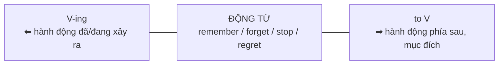

# B1-G016 · Gerund vs Infinitive (meaning change) — Danh động từ và nguyên mẫu: những động từ đổi nghĩa

## Mục lục

- [A. Lesson Information](#a-lesson-information)
- [B. Warm-up](#b-warm-up)
- [C. WHAT](#c-what)
- [D. WHY](#d-why)
- [E. FORM](#e-form)
- [F. HOW](#f-how)
- [G. VISUAL](#g-visual)
- [H. COMPARISON](#h-comparison)
- [I. COMMON MISTAKES](#i-common-mistakes)
- [J. MEMORY TRICKS](#j-memory-tricks)
- [K. REAL-LIFE APPLICATION](#k-real-life-application)
- [L. PRACTICE EXERCISES](#l-practice-exercises)
- [M. KNOWLEDGE CHECK](#m-knowledge-check)
- [N. ANSWER KEY](#n-answer-key)

---

## A. Lesson Information

| Mục | Nội dung |
|---|---|
| **Lesson ID** | B1-G016 |
| **Topic** | Gerund vs Infinitive: verbs that change meaning (stop, remember, forget, try, regret, mean, go on) + verbs with little/no change (like, love, begin, start) |
| **Tên tiếng Việt** | Động từ theo sau bởi V-ing hoặc to V với nghĩa khác nhau |
| **CEFR Level** | B1 |
| **Prerequisites** | [A2-G015 — Gerunds & Infinitives (basic)](../../03-A2-ELEMENTARY/grammar/A2-G015-gerunds-infinitives-basic.md) |
| **Estimated Time** | 90 phút |

**Learning Objectives:**

1. Ôn lại nhóm động từ chỉ đi với **V-ing** (*enjoy, avoid, finish...*) và chỉ đi với **to V** (*want, decide, hope...*).
2. Phân biệt nghĩa của ***stop, remember, forget, try, regret*** khi đi với V-ing và to V.
3. Biết nhóm động từ dùng được cả hai mà **nghĩa gần như không đổi**: *like, love, hate, prefer, begin, start, continue*.
4. Dùng V-ing sau **giới từ** (*interested in learning, before leaving*).
5. Giải thích lựa chọn bằng logic thời gian: V-ing (đã/đang) vs to V (sắp/mục đích).

---

## B. Warm-up

Hai câu chỉ khác dạng động từ:

> 1. *I **stopped smoking** last year.*
> 2. *I **stopped to smoke** a cigarette.*

🤔 **Hãy suy nghĩ:** Người nói câu 1 còn hút thuốc không? Người nói câu 2 dừng lại để làm gì? Một chữ *to* đã biến người bỏ thuốc thành người... dừng xe để hút thuốc!

---

## C. WHAT

Ở A2, bạn đã học: một số động từ **chỉ** đi với V-ing, một số **chỉ** đi với to V. Bài này tập trung vào nhóm khó hơn: động từ đi được **cả hai**, nhưng **nghĩa thay đổi**.

| Động từ | + V-ing | + to V |
|---|---|---|
| **stop** | ngừng hẳn việc đó | dừng (việc khác) **để** làm việc này |
| **remember** | nhớ **đã** làm (ký ức) | nhớ **phải** làm (nhiệm vụ) |
| **forget** | quên **đã** làm (thường dùng phủ định: *I'll never forget...*) | quên **không** làm |
| **try** | thử làm (xem có hiệu quả không) | cố gắng làm (khó khăn) |
| **regret** | hối tiếc **đã** làm | rất tiếc **phải** thông báo (trang trọng) |
| **mean** | có nghĩa là, kéo theo | định, có ý định |
| **go on** | tiếp tục việc đang làm | chuyển sang làm việc khác |

---

## D. WHY

Có một **xu hướng** giúp bạn đoán nghĩa (không phải quy luật tuyệt đối):

- **V-ing** thường hướng về **hành động đã/đang có thật**, đang được nhìn như một sự việc.
- **to V** thường hướng về **hành động phía trước** — mục đích, kế hoạch, việc cần làm.



| | V-ing (nhìn lại) | to V (nhìn tới) |
|---|---|---|
| remember | *I remember **locking** the door.* — ký ức về việc đã khóa | *Remember **to lock** the door.* — việc sắp phải làm |
| stop | *He stopped **talking**.* — dừng việc đang làm | *He stopped **to talk** to me.* — dừng để (sau đó) nói chuyện |

> ⚠️ *try* không theo hoàn toàn xu hướng này — hãy học riêng: *try + V-ing* = thử nghiệm; *try + to V* = nỗ lực.

---

## E. FORM

**Ký hiệu:** **V-ing** = gerund (danh động từ) · **to V** = infinitive (động từ nguyên mẫu có *to*).

### E1. Ôn tập: chỉ V-ing / chỉ to V (thông dụng)

| Chỉ + V-ing | Chỉ + to V |
|---|---|
| enjoy, avoid, finish, mind, keep, suggest, consider, practise, miss, deny, imagine, can't stand, can't help | want, need, decide, hope, plan, promise, agree, refuse, manage, afford, expect, offer, seem, learn, would like |

### E2. Đổi nghĩa

| Cấu trúc | Ví dụ |
|---|---|
| stop + V-ing / stop + to V | *I stopped **drinking** coffee.* / *I stopped **to drink** some coffee.* |
| remember + V-ing / to V | *I remember **meeting** her.* / *Remember **to call** her.* |
| forget + V-ing / to V | *I'll never forget **seeing** the sea for the first time.* / *Don't forget **to buy** milk.* |
| try + V-ing / to V | *Try **restarting** the computer.* / *I tried **to open** the jar, but I couldn't.* |
| regret + V-ing / to V | *I regret **saying** that.* / *We regret **to inform** you that...* |
| mean + V-ing / to V | *A new job means **moving** to Hanoi.* / *I meant **to call** you.* |
| go on + V-ing / to V | *She went on **talking**.* / *After the intro, she went on **to explain** the plan.* |

### E3. Gần như không đổi nghĩa

*like, love, hate, prefer, begin, start, continue* + V-ing **hoặc** to V:

- *It started **raining** / **to rain**.* (như nhau)
- *I like **swimming** / **to swim**.* (gần như nhau; Anh – Anh: *like + V-ing* thiên về sở thích, *like + to V* thiên về thói quen thấy hợp lý)
- ⚠️ *would like / would love / would prefer* → **luôn + to V**.

### E4. Sau giới từ → V-ing

*interested **in learning**, good **at cooking**, before **leaving**, after **finishing**, without **saying**, instead **of going***.

---

## F. HOW

| # | English | Tiếng Việt | Phân tích |
|---|---|---|---|
| 1 | *My dad **stopped smoking** five years ago.* | Bố tôi bỏ thuốc lá năm năm trước. | Ngừng hẳn |
| 2 | *We **stopped to buy** some water on the way.* | Chúng tôi dừng lại để mua nước trên đường. | Mục đích |
| 3 | *I **remember visiting** Hue as a child.* | Tôi nhớ đã đến Huế hồi nhỏ. | Ký ức |
| 4 | *Please **remember to turn off** the lights.* | Nhớ tắt đèn nhé. | Nhiệm vụ phía trước |
| 5 | *I **forgot to send** the email!* | Tôi quên gửi email rồi! | Không làm |
| 6 | *I'll never **forget meeting** my favourite singer.* | Tôi sẽ không bao giờ quên lần gặp ca sĩ yêu thích. | Ký ức |
| 7 | *If you can't sleep, **try drinking** warm milk.* | Nếu không ngủ được, hãy thử uống sữa ấm. | Thử một giải pháp |
| 8 | *I **tried to call** you, but your phone was off.* | Tôi đã cố gọi cho bạn nhưng máy bạn tắt. | Nỗ lực, không thành công |
| 9 | *I **regret not studying** harder at school.* | Tôi hối tiếc đã không học chăm hơn ở trường. | Hối tiếc quá khứ |
| 10 | *We **regret to inform** you that your flight has been cancelled.* | Chúng tôi rất tiếc phải thông báo chuyến bay của quý khách đã bị hủy. | Văn thông báo trang trọng |
| 11 | *Getting this job **means working** at weekends.* | Nhận việc này nghĩa là phải làm cuối tuần. | Kéo theo |
| 12 | *Sorry, I **meant to reply** yesterday.* | Xin lỗi, tôi định trả lời từ hôm qua. | Ý định |

---

## G. VISUAL

### Timeline với *remember*

```text
I remember locking the door.          Remember to lock the door.
   ✕ locked ──── 🧠 remember (now)       🧠 remember (now) ──── ✕ lock (later)
   (hành động TRƯỚC việc nhớ)            (hành động SAU việc nhớ)
```

### Bảng tóm tắt

| Động từ | + V-ing ⬅ | + to V ➡ |
|---|---|---|
| stop | ngừng việc đó | dừng để làm việc khác |
| remember | nhớ đã làm | nhớ phải làm |
| forget | quên đã làm | quên phải làm |
| regret | tiếc đã làm | tiếc phải báo |
| try | thử (thí nghiệm) | cố gắng |

---

## H. COMPARISON

### *try + V-ing* vs *try + to V*

| *try + V-ing* — thử nghiệm | *try + to V* — nỗ lực |
|---|---|
| Hành động **dễ làm**, câu hỏi là nó **có giúp ích không** | Hành động **khó làm**, câu hỏi là **có làm được không** |
| *The TV isn't working. Try **unplugging** it.* | *I tried **to lift** the box, but it was too heavy.* |

### Sau giới từ — V-ing, nhưng *to* là giới từ!

Một số cụm có *to* là **giới từ** → theo sau là V-ing:
*look forward **to meeting**, be used **to living**, object **to paying**, when it comes **to cooking***.
Phép thử: thay bằng danh từ — *look forward to **the party*** đúng → *to* là giới từ.

---

## I. COMMON MISTAKES

| # | ❌ Sai | ✅ Đúng | Nguyên nhân | Cách tránh |
|---|---|---|---|---|
| 1 | I stopped **to smoke** two years ago. (ý: bỏ thuốc) | I stopped **smoking**... | Nhầm nghĩa | Ngừng hẳn → V-ing |
| 2 | Remember **locking** the door when you leave. | Remember **to lock**... | Nhầm nghĩa | Việc phía trước → to V |
| 3 | I enjoy **to read**. | I enjoy **reading**. | | *enjoy* + V-ing |
| 4 | I'm interested **in learn** English. | ...**in learning**... | Sau giới từ | Giới từ → V-ing |
| 5 | I look forward **to hear** from you. | ...**to hearing**... | *to* là giới từ | |
| 6 | I'd like **going** to Japan. | I'd like **to go**... | *would like* + to V | |
| 7 | I tried **opening** the jar, but it was impossible. (ý: cố mà không được) | I tried **to open**... | | Nỗ lực → to V |

---

## J. MEMORY TRICKS

1. **"V-ing nhìn lại ⬅, to V nhìn tới ➡"** — đúng với *remember, forget, stop, regret*. ⚠️ *try* là ngoại lệ — học riêng.
2. **"Stop to = dừng để"**: *to* trong *stop to* giống *in order to* (để).
3. **"Phép thử danh từ cho chữ *to*"**: Nếu đặt được danh từ sau *to* → *to* là giới từ → V-ing.

---

## K. REAL-LIFE APPLICATION

### Email: Lời xin lỗi

> *Hi Huong,*
>
> *I'm so sorry! I **meant to call** you last night, but I **forgot to charge** my phone and it died. I **remember promising** to help you with your presentation — I feel terrible.*
>
> *I **tried to fix** the problem this morning by borrowing my sister's phone, but I didn't have your number. I **regret not writing** it down somewhere.*
>
> *Can we meet today? I can **stop to pick up** coffee on the way. Also, if your slides are still too long, **try cutting** the introduction — it might help.*
>
> *Looking forward **to seeing** you,*
> *Nga*

**Giải thích:** Nga xin lỗi Hương: định gọi tối qua nhưng quên sạc điện thoại; nhớ đã hứa giúp làm bài thuyết trình; sáng nay cố khắc phục bằng điện thoại của chị nhưng không có số; tiếc vì đã không ghi số lại; hẹn gặp hôm nay, sẽ ghé mua cà phê; gợi ý thử cắt bớt phần mở đầu.

---

## L. PRACTICE EXERCISES

> ✍️ Đáp án: [B1-G016-ANSWERS](../../12-ANSWERS-AND-EXPLANATIONS/B1/B1-G016-ANSWERS.md)

### Level 1 — Recognition

**L1.1.** I stopped ___ meat last year. Now I'm vegetarian.  A. to eat  B. eating  C. eat  D. ate
**L1.2.** On the way home, we stopped ___ some fruit.  A. buying  B. to buy  C. buy  D. bought
**L1.3.** Did you remember ___ the bill? It's due today.  A. paying  B. to pay  C. pay  D. paid
**L1.4.** I'll never forget ___ the Northern Lights.  A. to see  B. seeing  C. see  D. saw
**L1.5.** "My laptop is so slow." — "Try ___ some programs."  A. to close  B. closing  C. close  D. closed
**L1.6.** I'm looking forward ___ you.  A. to meet  B. meeting  C. to meeting  D. meet

### Level 2 — Controlled Practice

Chia động từ trong ngoặc (V-ing hoặc to V).

**L2.1.** I remember (go) ___ to this beach when I was five.
**L2.2.** Don't forget (water) ___ the plants while I'm away.
**L2.3.** He tried (climb) ___ the wall, but it was too high.
**L2.4.** We regret (inform) ___ you that the event is cancelled.
**L2.5.** She regrets (not / accept) ___ the job offer.
**L2.6.** If you have a headache, try (drink) ___ more water.
**L2.7.** I meant (tell) ___ you, but I forgot.
**L2.8.** After his speech, the director went on (introduce) ___ the new manager.
**L2.9.** The baby went on (cry) ___ all night.
**L2.10.** Taking this job would mean (move) ___ to another city.

### Level 3 — Error Correction

**L3.1.** I stopped to drink coffee because it kept me awake at night.
**L3.2.** Remember sending me the documents tomorrow.
**L3.3.** I tried to restart the router, and it worked immediately. (ý: thử một giải pháp đơn giản)
**L3.4.** I look forward to hear from you.
**L3.5.** She is good at speak in public.
**L3.6.** I would love going to the concert with you tonight.

### Level 4 — Production

Dịch sang tiếng Anh:

**L4.1.** Tôi nhớ là đã khóa cửa rồi.
**L4.2.** Nhớ khóa cửa trước khi đi ngủ nhé.
**L4.3.** Anh ấy đã ngừng làm việc để nghe điện thoại.
**L4.4.** Tôi hối tiếc vì đã không học tiếng Anh sớm hơn.

**L4.5.** **Explain:** Giải thích sự khác nhau giữa *"I forgot to call her"* và *"I forgot calling her"* (2–3 câu tiếng Việt).

### Level 5 — Real Communication

**L5.1.** Viết đoạn văn 90–110 từ: *Habits I have stopped and things I must remember*. Dùng ≥ 6 cấu trúc trong bài (*stop + V-ing/to V, remember/forget + V-ing/to V, try, regret*).
**L5.2.** **Speaking — Problem solving:** Đưa lời khuyên với *Try + V-ing* cho 5 vấn đề: *can't sleep, phone battery dies quickly, can't remember new words, feel stressed at work, the printer doesn't work*.
**L5.3.** **Speaking — Childhood memories:** Nói 1 phút với *I remember + V-ing... / I'll never forget + V-ing...*

---

## M. KNOWLEDGE CHECK

### 5 câu hỏi tự kiểm tra

1. *stop smoking* và *stop to smoke* khác nhau thế nào?
2. Xu hướng chung của V-ing và to V sau *remember/forget*?
3. *try + V-ing* và *try + to V* khác nhau ra sao?
4. Vì sao *look forward to hearing*?
5. Kể 3 động từ dùng V-ing/to V gần như không đổi nghĩa.

### Checklist

- [ ] Tôi phân biệt được nghĩa của 7 động từ đổi nghĩa.
- [ ] Tôi dùng V-ing sau giới từ (kể cả *to* giới từ).
- [ ] Tôi dùng *would like + to V*.

### 3 lỗi quan trọng cần nhớ

1. Bỏ thói quen → **stop + V-ing**.
2. Nhiệm vụ phía trước → **remember/forget + to V**.
3. ~~look forward to hear~~ → look forward to **hearing**.

### Lịch ôn tập

| Ngày | Việc cần làm |
|---|---|
| Ngày 1 | Làm lại L2 |
| Ngày 3 | Viết 2 câu cho mỗi động từ trong bảng E2 |
| Ngày 7 | Học tiếp [B1-G021 — Verb Patterns](B1-G021-verb-patterns.md) |

### Liên kết

- ➡️ Bài tiếp theo: [B1-G017 — Causative Have / Get](B1-G017-causative-have-get.md)
- 🔜 [B2-G014 — Advanced Gerund & Infinitive Patterns](../../05-B2-UPPER-INTERMEDIATE/grammar/B2-G014-advanced-gerund-infinitive.md)

---

## N. ANSWER KEY

👉 [B1-G016-ANSWERS.md](../../12-ANSWERS-AND-EXPLANATIONS/B1/B1-G016-ANSWERS.md)
