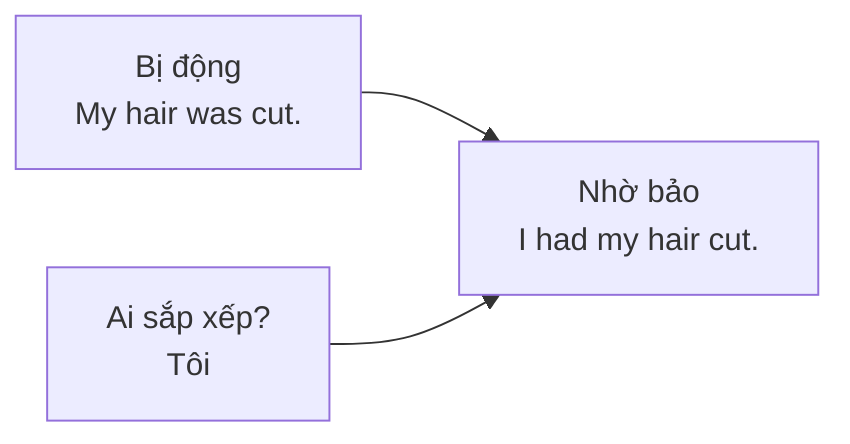

# B1-G017 · Causative Have / Get — Thể nhờ bảo

## Mục lục

- [A. Lesson Information](#a-lesson-information)
- [B. Warm-up](#b-warm-up)
- [C. WHAT](#c-what)
- [D. WHY](#d-why)
- [E. FORM](#e-form)
- [F. HOW](#f-how)
- [G. VISUAL](#g-visual)
- [H. COMPARISON](#h-comparison)
- [I. COMMON MISTAKES](#i-common-mistakes)
- [J. MEMORY TRICKS](#j-memory-tricks)
- [K. REAL-LIFE APPLICATION](#k-real-life-application)
- [L. PRACTICE EXERCISES](#l-practice-exercises)
- [M. KNOWLEDGE CHECK](#m-knowledge-check)
- [N. ANSWER KEY](#n-answer-key)

---

## A. Lesson Information

| Mục | Nội dung |
|---|---|
| **Lesson ID** | B1-G017 |
| **Topic** | Causative: have/get something done; have someone do; get someone to do |
| **Tên tiếng Việt** | Thể nhờ bảo (nhờ/thuê người khác làm việc gì) |
| **CEFR Level** | B1 |
| **Prerequisites** | [B1-G012 — Passive across Tenses](B1-G012-passive-all-tenses.md) |
| **Estimated Time** | 75 phút |

**Learning Objectives:**

1. Dùng ***have/get + O + V3*** khi **người khác làm dịch vụ** cho mình (cắt tóc, sửa xe...).
2. Chia *have/get* theo mọi thì (*I'm having my car repaired, I've had my hair cut*).
3. Dùng ***have + người + V*** và ***get + người + to V*** để nói ai làm việc gì.
4. Dùng *have something done* cho **trải nghiệm không mong muốn** (*I had my phone stolen*).
5. Phân biệt câu nhờ bảo với câu "tự làm".

---

## B. Warm-up

Bạn khoe với đồng nghiệp: *"I cut my hair yesterday!"* Đồng nghiệp ngạc nhiên: *"Wow, you cut it yourself? It looks so professional!"*

Thực ra bạn đi tiệm cắt tóc.

🤔 **Hãy suy nghĩ:** Tiếng Việt nói "Tôi cắt tóc hôm qua" — ai cũng hiểu là đi tiệm. Nhưng tiếng Anh *I cut my hair* nghĩa là **tự tay cắt**. Vậy nói thế nào để rõ là **người khác cắt cho bạn**?

---

## C. WHAT

**Causative** (thể nhờ bảo) diễn tả việc **chủ ngữ sắp xếp/nhờ/thuê/khiến người khác làm việc gì đó**, thường là một dịch vụ.

| Cấu trúc | Ý nghĩa | Ví dụ |
|---|---|---|
| **have + O (vật) + V3** | Nhờ/thuê ai làm việc gì cho mình (trọng tâm: việc được làm) | *I **had my hair cut**.* |
| **get + O (vật) + V3** | Như trên, thân mật hơn; đôi khi nhấn sự cố gắng | *I **got my car washed**.* |
| **have + người + V** | Bảo/nhờ một người cụ thể làm (thường người có trách nhiệm) | *I'll **have my assistant call** you.* |
| **get + người + to V** | Thuyết phục/nhờ ai làm (có thể cần thuyết phục) | *I **got my brother to help** me.* |

---

## D. WHY

Thể nhờ bảo giống một **câu bị động "gắn" vào chủ ngữ**: *My hair was cut (by the hairdresser)* + *I arranged it* → *I had my hair cut*.

Vì vậy phần sau *have/get* luôn là **O + V3** (đối tượng + quá khứ phân từ) — đúng logic bị động: tóc **được** cắt.

---

## E. FORM

**Ký hiệu:** **O** = tân ngữ (vật/việc) · **V3** = quá khứ phân từ · **V** = nguyên mẫu.

### E1. *have/get + O + V3* ở các thì

Chỉ chia ***have/get***; *O + V3* giữ nguyên.

| Thì | Ví dụ |
|---|---|
| Present simple | *I **have** my car **serviced** every six months.* |
| Present continuous | *We'**re having** our kitchen **renovated**.* |
| Past simple | *She **had** her nails **done** yesterday.* |
| Present perfect | *I'**ve** just **had** my eyes **tested**.* |
| Future | *I'**ll get** the documents **printed** tomorrow.* |
| *be going to* | *They'**re going to have** a pool **built**.* |
| Modal | *You **should get** that tooth **checked**.* |
| Phủ định | *I **didn't have** my hair **cut**.* |
| Câu hỏi | ***Did** you **have** your laptop **repaired**?* |

> ⚠️ Câu hỏi và phủ định với *have* (động từ thường) dùng ***do/does/did***: ❌ *Had you your hair cut?*

### E2. *have + người + V* / *get + người + to V*

| Cấu trúc | Ví dụ |
|---|---|
| have + người + **V** | *The manager **had** her secretary **book** the flights.* |
| get + người + **to V** | *I finally **got** my son **to clean** his room.* |

---

## F. HOW

| # | English | Tiếng Việt | Phân tích |
|---|---|---|---|
| 1 | *I **had my hair cut** yesterday.* | Hôm qua tôi đi cắt tóc. | Dịch vụ — người khác cắt |
| 2 | *We **get our windows cleaned** once a month.* | Mỗi tháng chúng tôi thuê lau cửa sổ một lần. | Thói quen |
| 3 | *She'**s having her wedding dress made** in Hoi An.* | Cô ấy đang may váy cưới ở Hội An. | Đang diễn ra |
| 4 | *I need to **get my passport renewed**.* | Tôi cần gia hạn hộ chiếu. | *need to get...* |
| 5 | *Have you **had your eyes tested** recently?* | Gần đây bạn có đi kiểm tra mắt không? | HTHT, câu hỏi |
| 6 | *He **had his wallet stolen** on the bus.* | Anh ấy bị lấy cắp ví trên xe buýt. | Trải nghiệm không mong muốn |
| 7 | *You should **get that cough checked** by a doctor.* | Bạn nên đi khám cơn ho đó. | Lời khuyên |
| 8 | *I'll **have the technician fix** it tomorrow.* | Tôi sẽ bảo kỹ thuật viên sửa nó vào ngày mai. | *have + người + V* |
| 9 | *I **got my sister to lend** me her car.* | Tôi nhờ (thuyết phục) được chị gái cho mượn xe. | *get + người + to V* |
| 10 | *We're **having a new air conditioner installed** next week.* | Tuần sau chúng tôi lắp điều hòa mới. | Kế hoạch |

---

## G. VISUAL

### Tự làm vs nhờ làm

| Tự làm | Người khác làm cho mình |
|---|---|
| *I **cut** my hair.* | *I **had** my hair **cut**.* |
| *She **repaired** her bike.* | *She **had** her bike **repaired**.* |
| *We **painted** the house.* | *We **got** the house **painted**.* |

### Breakdown

`We | 're having | our flat | painted | next week.`

| Phần | Vai trò |
|---|---|
| We | Người sắp xếp |
| 're having | *have* chia hiện tại tiếp diễn (kế hoạch) |
| our flat | Đối tượng chịu tác động |
| painted | V3 — việc được làm |
| next week | Thời gian |

---

## H. COMPARISON

### *have something done* vs *get something done*

| *have* | *get* |
|---|---|
| Trung tính, hơi trang trọng hơn | Thân mật hơn, phổ biến trong văn nói |
| *I had my car serviced.* | *I got my car serviced.* |
| | Đôi khi nhấn sự **xoay xở để hoàn tất**: *I finally **got** the report **finished**.* (tự làm cũng được) |

### *have + người + V* vs *get + người + to V*

| *have someone do* | *get someone to do* |
|---|---|
| Bảo người có trách nhiệm làm (thường nhân viên, thợ) | Thuyết phục/nhờ được (có thể khó khăn) |
| *I'll have Lan send you the file.* | *I got Lan to send me the file.* |
| Không có *to* | Có *to* |

---

## I. COMMON MISTAKES

| # | ❌ Sai | ✅ Đúng | Nguyên nhân | Cách tránh |
|---|---|---|---|---|
| 1 | I **cut my hair** at the salon. | I **had my hair cut** at the salon. | Dịch "tôi cắt tóc" | Người khác làm → *have + O + V3* |
| 2 | I had **cut my hair**. (ý: nhờ cắt) | I had **my hair cut**. | Sai trật tự | *have + O + V3* |
| 3 | She had her car **repair**. | ...her car **repaired**. | Thiếu V3 | |
| 4 | **Had** you your hair cut? | **Did** you **have** your hair cut? | Đảo *have* như trợ động từ | *have* ở đây là động từ thường |
| 5 | I got my brother **help** me. | I got my brother **to help** me. | Thiếu *to* | *get + người + to V* |
| 6 | I had the mechanic **to fix** my car. | I had the mechanic **fix** my car. | Thừa *to* | *have + người + V* |

---

## J. MEMORY TRICKS

1. **"Have + vật + V3 = có người làm cho"** ✂️: "Tôi **có** (sắp xếp) tóc **được** cắt."
2. **"Get thích to"**: *get somebody **to** do*; *have somebody do* (không *to*).
3. **Phép thử**: Câu bạn định nói, chủ ngữ có **tự tay** làm không? Không → causative.

---

## K. REAL-LIFE APPLICATION

### Hội thoại: Chuẩn bị chuyển nhà

> **Lan:** So, is the new flat ready?
> **Minh:** Almost. We **had the walls painted** last week, and we'**re having new curtains made** right now.
> **Lan:** Nice! What about the kitchen?
> **Minh:** We **got the old cupboards removed**, but we **haven't had the new ones installed** yet.
> **Lan:** And the internet?
> **Minh:** That's the problem. I've called the company three times. I finally **got them to promise** a technician on Friday.
> **Lan:** Good luck! Oh, and you should **get the locks changed** — you never know who has the old keys.
> **Minh:** Good idea. I'll **have the landlord arrange** it.

**Giải thích:** Minh chuẩn bị căn hộ mới: tuần trước đã thuê sơn tường, đang đặt may rèm; đã nhờ tháo tủ cũ nhưng chưa lắp tủ mới; gọi nhà mạng ba lần mới "ép" được họ hứa cử kỹ thuật viên thứ Sáu. Lan khuyên thay ổ khóa; Minh sẽ bảo chủ nhà sắp xếp.

---

## L. PRACTICE EXERCISES

> ✍️ Đáp án: [B1-G017-ANSWERS](../../12-ANSWERS-AND-EXPLANATIONS/B1/B1-G017-ANSWERS.md)

### Level 1 — Recognition

**L1.1.** I don't fix my car myself. I ___ at a garage.  A. fix it  B. have it fixed  C. have fixed it  D. get it fix
**L1.2.** She ___ her photo taken for her new passport.  A. had  B. made  C. did  D. let
**L1.3.** I finally got my children ___ their rooms.  A. tidy  B. to tidy  C. tidied  D. tidying
**L1.4.** The boss had his assistant ___ the meeting.  A. to arrange  B. arranged  C. arrange  D. arranging
**L1.5.** "He had his phone stolen." — Nghĩa là:  A. Anh ấy thuê người lấy cắp điện thoại  B. Anh ấy bị lấy cắp điện thoại  C. Anh ấy đã lấy cắp điện thoại
**L1.6.** ___ you have your teeth checked last year?  A. Had  B. Did  C. Have  D. Were

### Level 2 — Controlled Practice

Viết câu nhờ bảo với *have/get + O + V3*.

**L2.1.** A hairdresser cut my hair yesterday. → I ______.
**L2.2.** A mechanic is repairing our car at the moment. → We ______.
**L2.3.** Someone will deliver the furniture tomorrow. → They ______.
**L2.4.** A photographer has taken our wedding photos. → We ______.
**L2.5.** Someone stole her bag at the airport. → She ______.

Hoàn thành với *have + người + V* hoặc *get + người + to V*.

**L2.6.** I'll (have / my secretary / send) ___ you the contract.
**L2.7.** She (get / her husband / cook) ___ dinner every Friday.
**L2.8.** Can you (get / the IT team / check) ___ my laptop?
**L2.9.** The teacher (have / the students / write) ___ an essay.
**L2.10.** Viết câu khuyên: Mái nhà của bạn bị dột. (*should / get / the roof / repair*)

### Level 3 — Error Correction

**L3.1.** I cut my hair at a salon yesterday. (ý: thợ cắt)
**L3.2.** We had painted our house last month. (ý: thuê thợ sơn)
**L3.3.** She is having her dress make in Hoi An.
**L3.4.** Had you your car washed?
**L3.5.** I got my friend lend me his bike.
**L3.6.** The manager had the cleaner to clean the meeting room.

### Level 4 — Production

Dịch sang tiếng Anh:

**L4.1.** Tuần trước tôi đi sửa điện thoại.
**L4.2.** Chúng tôi đang lắp cửa sổ mới.
**L4.3.** Bạn nên đi khám mắt. (*get / test*)
**L4.4.** Tôi đã nhờ được anh trai chở tôi ra sân bay. (*drive*)

**L4.5.** **Explain:** Vì sao *"I repaired my bike"* và *"I had my bike repaired"* khác nghĩa? (2 câu tiếng Việt)

### Level 5 — Real Communication

**L5.1.** Viết đoạn văn 80–100 từ: *Getting ready for Tet* (hoặc một sự kiện lớn). Kể những việc bạn **đã/đang/sẽ thuê người làm** và những việc bạn **tự làm**. Dùng ≥ 5 câu nhờ bảo ở ≥ 3 thì khác nhau.
**L5.2.** **Speaking — Services:** Nói 1 phút về những dịch vụ bạn thường dùng (*I have my... every..., I get my... done at...*) và lần gần nhất bạn dùng chúng.

---

## M. KNOWLEDGE CHECK

### 5 câu hỏi tự kiểm tra

1. Công thức *have something done*?
2. Câu hỏi với *have something done* ở quá khứ dùng trợ động từ gì?
3. *have someone do* và *get someone to do* khác nhau thế nào?
4. *I had my phone stolen* có nghĩa là gì?
5. Chuyển: *A plumber is fixing our sink.* → We...

### Checklist

- [ ] Tôi phân biệt được "tự làm" và "nhờ làm".
- [ ] Tôi chia *have/get* đúng ở nhiều thì.
- [ ] Tôi dùng đúng *have + người + V* và *get + người + to V*.

### 3 lỗi quan trọng cần nhớ

1. Đi tiệm cắt tóc: ~~I cut my hair~~ → I **had my hair cut**.
2. ~~had cut my hair~~ (ý nhờ) → had **my hair cut**.
3. ~~got my friend help~~ → got my friend **to help**.

### Lịch ôn tập

| Ngày | Việc cần làm |
|---|---|
| Ngày 1 | Làm lại L2 |
| Ngày 3 | Liệt kê 6 dịch vụ bạn dùng trong tháng, viết câu nhờ bảo |
| Ngày 7 | Làm lại L5.2 |

### Liên kết

- ➡️ Bài tiếp theo: [B1-G018 — Linking Words](B1-G018-linking-words.md)
- 🔁 Ôn: [B1-G012 — Passive](B1-G012-passive-all-tenses.md)
- 🎯 **Mini Challenge khối B1-4** — xem [B1 README](../README.md#5-mini-challenges)

---

## N. ANSWER KEY

👉 [B1-G017-ANSWERS.md](../../12-ANSWERS-AND-EXPLANATIONS/B1/B1-G017-ANSWERS.md)
