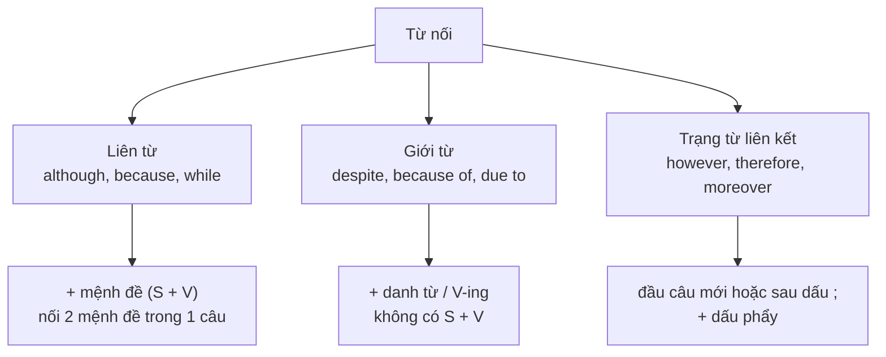

# B1-G018 · Linking Words — Từ nối

## Mục lục

- [A. Lesson Information](#a-lesson-information)
- [B. Warm-up](#b-warm-up)
- [C. WHAT](#c-what)
- [D. WHY](#d-why)
- [E. FORM](#e-form)
- [F. HOW](#f-how)
- [G. VISUAL](#g-visual)
- [H. COMPARISON](#h-comparison)
- [I. COMMON MISTAKES](#i-common-mistakes)
- [J. MEMORY TRICKS](#j-memory-tricks)
- [K. REAL-LIFE APPLICATION](#k-real-life-application)
- [L. PRACTICE EXERCISES](#l-practice-exercises)
- [M. KNOWLEDGE CHECK](#m-knowledge-check)
- [N. ANSWER KEY](#n-answer-key)

---

## A. Lesson Information

| Mục | Nội dung |
|---|---|
| **Lesson ID** | B1-G018 |
| **Topic** | Linking Words: contrast (although, however, despite), addition (moreover, also), result (therefore, so), reason (because, because of, since), sequence |
| **Tên tiếng Việt** | Từ nối — tương phản, bổ sung, kết quả, nguyên nhân, trình tự |
| **CEFR Level** | B1 |
| **Prerequisites** | [A1-G021 — Basic Conjunctions](../../02-A1-BEGINNER/grammar/A1-G021-basic-conjunctions.md) |
| **Estimated Time** | 90 phút |

**Learning Objectives:**

1. Dùng các từ nối theo **5 chức năng**: bổ sung, tương phản, nguyên nhân, kết quả, trình tự.
2. Phân biệt 3 loại cấu trúc: **liên từ** (*although* + mệnh đề), **giới từ** (*despite* + danh từ/V-ing), **trạng từ liên kết** (*However,* + câu mới).
3. Đặt **dấu câu** đúng với từng loại.
4. Thay thế linh hoạt: *although ↔ despite ↔ however* mà giữ nguyên nghĩa.
5. Tránh lỗi cặp đôi kiểu tiếng Việt (*Although..., but...*).

---

## B. Warm-up

Ba câu cùng một ý: "Trời mưa nhưng chúng tôi vẫn đi dạo."

> 1. ***Although** it was raining, we went for a walk.*
> 2. ***Despite** the rain, we went for a walk.*
> 3. *It was raining. **However**, we went for a walk.*

🤔 **Hãy suy nghĩ:** Ba từ cùng nghĩa "tuy nhiên/mặc dù", nhưng phần đứng sau mỗi từ khác nhau: một mệnh đề (*it was raining*), một danh từ (*the rain*), và một câu mới sau dấu chấm. Vì sao?

---

## C. WHAT

**Linking words** (từ nối, còn gọi *connectors*) giúp người đọc thấy **quan hệ logic** giữa các ý. Ở bài thi viết (kể cả VSTEP), dùng đa dạng và chính xác từ nối là tiêu chí quan trọng của điểm **coherence and cohesion** (mạch lạc và liên kết).

| Chức năng | Từ nối thông dụng (B1) |
|---|---|
| **Bổ sung** (addition) | *and, also, too, as well, in addition, moreover, furthermore, besides, what's more* |
| **Tương phản** (contrast) | *but, although, even though, though, however, nevertheless, despite, in spite of, while, whereas, on the other hand* |
| **Nguyên nhân** (reason) | *because, as, since, because of, due to* |
| **Kết quả** (result) | *so, therefore, as a result, consequently, that's why* |
| **Trình tự** (sequence) | *first(ly), second(ly), then, next, after that, finally, in the end* |
| **Ví dụ** (example) | *for example, for instance, such as* |
| **Kết luận** (conclusion) | *in conclusion, to sum up, overall* |

---

## D. WHY

Từ nối không chỉ khác nhau về **nghĩa**, mà còn về **loại từ** — và loại từ quyết định **cái gì theo sau** và **dấu câu**.



Đó là lý do *although it was raining* (mệnh đề), *despite the rain* (danh từ), và *However, ...* (câu mới) đều đúng — nhưng không đổi chỗ cho nhau được.

---

## E. FORM

### E1. Tương phản

| Từ | Loại | Cấu trúc | Ví dụ |
|---|---|---|---|
| although / even though / though | liên từ | + S + V | ***Although** he was tired, he kept working.* |
| despite / in spite of | giới từ | + N / V-ing / *the fact that* + S + V | ***Despite being** tired, he kept working.* |
| however / nevertheless | trạng từ | **.** However, + câu | *He was tired. **However,** he kept working.* |
| but | liên từ đẳng lập | , but + S + V | *He was tired**, but** he kept working.* |
| while / whereas | liên từ (đối lập 2 sự việc) | + S + V | *I like tea, **whereas** my wife prefers coffee.* |
| on the other hand | trạng từ (so sánh 2 mặt) | . On the other hand, ... | *Cities are exciting. **On the other hand,** they are noisy.* |

### E2. Nguyên nhân

| Từ | Loại | Cấu trúc | Ví dụ |
|---|---|---|---|
| because / as / since | liên từ | + S + V | ***As** it was late, we took a taxi.* |
| because of / due to | giới từ | + N / V-ing | *The flight was delayed **due to** fog.* |

### E3. Kết quả

| Từ | Loại | Cấu trúc | Ví dụ |
|---|---|---|---|
| so | liên từ | , so + S + V | *It was late**, so** we took a taxi.* |
| therefore / as a result / consequently | trạng từ | . Therefore, ... (hoặc ; therefore,) | *Sales fell. **As a result,** 50 workers lost their jobs.* |

### E4. Bổ sung

| Từ | Vị trí | Ví dụ |
|---|---|---|
| also | trước V thường / sau *be* | *She **also** speaks French.* |
| too / as well | cuối câu | *She speaks French **too**.* |
| in addition / moreover / furthermore / what's more | đầu câu + dấu phẩy | ***Moreover,** the hotel has a great pool.* |
| in addition to / as well as / besides | + N / V-ing | ***In addition to working** full-time, she studies at night.* |

---

## F. HOW

| # | English | Tiếng Việt | Phân tích |
|---|---|---|---|
| 1 | ***Although** the hotel was expensive, we enjoyed our stay.* | Mặc dù khách sạn đắt, chúng tôi vẫn thích kỳ nghỉ. | *although* + mệnh đề |
| 2 | ***Despite** the high price, we enjoyed our stay.* | Bất chấp giá cao, ... | *despite* + cụm danh từ |
| 3 | *The hotel was expensive. **However,** the service was excellent.* | Khách sạn đắt. Tuy nhiên, dịch vụ tuyệt vời. | *However* đầu câu mới |
| 4 | ***In spite of feeling** ill, she went to work.* | Dù cảm thấy ốm, cô ấy vẫn đi làm. | *in spite of* + V-ing |
| 5 | *The match was cancelled **because of** the storm.* | Trận đấu bị hủy vì bão. | Giới từ + danh từ |
| 6 | *The match was cancelled **because** it was stormy.* | ... vì trời bão. | Liên từ + mệnh đề |
| 7 | *Prices have risen sharply. **As a result,** many families are spending less.* | Giá tăng mạnh. Do đó, nhiều gia đình chi tiêu ít hơn. | Kết quả — văn trang trọng |
| 8 | *Cycling is cheap. **Moreover,** it's good for your health.* | Đạp xe rẻ. Hơn nữa, tốt cho sức khỏe. | Bổ sung |
| 9 | *My brother loves football, **whereas** I prefer tennis.* | Anh tôi thích bóng đá, trong khi tôi thích tennis. | Đối lập 2 người |
| 10 | ***Since** you're here, can you help me move this table?* | Vì bạn ở đây rồi, giúp tôi khiêng cái bàn nhé? | *since* = vì (lý do hiển nhiên) |
| 11 | *Working from home saves time. **On the other hand,** it can be lonely.* | Làm ở nhà tiết kiệm thời gian. Mặt khác, có thể cô đơn. | So sánh 2 mặt |
| 12 | ***Despite the fact that** he studied hard, he failed.* | Mặc dù đã học chăm, anh ấy vẫn trượt. | *despite the fact that* + mệnh đề |

---

## G. VISUAL

### Một ý — ba cách viết

| Liên từ | Giới từ | Trạng từ |
|---|---|---|
| ***Although** it rained, we went out.* | ***Despite** the rain, we went out.* | *It rained. **However,** we went out.* |
| ***Because** it rained, we stayed in.* | ***Because of** the rain, we stayed in.* | *It rained. **Therefore,** we stayed in.* |

### Dấu câu

```text
LIÊN TỪ:    Although it was late, we went out.      We went out although it was late.
GIỚI TỪ:    Despite the late hour, we went out.     We went out despite the late hour.
TRẠNG TỪ:   It was late. However, we went out.      It was late; however, we went out.
```

---

## H. COMPARISON

### *although* vs *despite*

| | although | despite / in spite of |
|---|---|---|
| Theo sau | Mệnh đề (S + V) | Danh từ, V-ing, *the fact that* + mệnh đề |
| Ví dụ | *although **he was** ill* | *despite **his illness** / despite **being** ill* |
| ❌ | ~~although his illness~~ | ~~despite he was ill~~, ~~despite of~~ |

### *however* vs *but*

| *but* | *however* |
|---|---|
| Nối 2 mệnh đề **trong 1 câu** | Mở đầu **câu mới** (hoặc sau dấu ;) |
| Thân mật/trung tính | Trang trọng hơn — hợp văn viết |
| *It was cheap, but it was good.* | *It was cheap. However, it was good.* |

### *so* vs *therefore*

| *so* | *therefore* |
|---|---|
| Liên từ trong câu: *..., so...* | Trạng từ, câu mới hoặc sau ;: *... . Therefore, ...* |
| Văn nói và viết | Văn viết trang trọng |

---

## I. COMMON MISTAKES

| # | ❌ Sai | ✅ Đúng | Nguyên nhân | Cách tránh |
|---|---|---|---|---|
| 1 | **Although** it rained, **but** we went out. | Although it rained, we went out. | Dịch "Mặc dù... nhưng..." | Chỉ một từ nối |
| 2 | **Despite** it was raining, we went out. | Despite **the rain** / Although it was raining... | *despite* + mệnh đề | *despite* + N/V-ing |
| 3 | **Despite of** the rain... | **Despite** the rain / **In spite of** the rain | Trộn hai cụm | *despite* không có *of* |
| 4 | It was late, **however** we went out. | It was late. **However,** we went out. / ...; however, ... | Dùng *however* như *but* | *however* bắt đầu câu mới |
| 5 | **Because of** it was raining... | **Because** it was raining... | | *because of* + danh từ |
| 6 | **Moreover** the food was cheap. | **Moreover,** the food was cheap. | Thiếu dấu phẩy | Trạng từ đầu câu + phẩy |
| 7 | **Because** I was tired. **So** I went to bed. (văn viết) | **Because** I was tired, I went to bed. | Câu không hoàn chỉnh | *Because*-clause cần mệnh đề chính |
| 8 | **On the other hand,** I like tea. (khi không có "mặt thứ nhất") | **However,** ... / **In addition,** ... | Dùng *on the other hand* không có đối chiếu | Cần hai mặt của cùng vấn đề |

---

## J. MEMORY TRICKS

1. **"Ba nhà — ba luật"** 🏠: Nhà **liên từ** mời *mệnh đề*; nhà **giới từ** mời *danh từ/V-ing*; nhà **trạng từ** đứng đầu câu mới với dấu phẩy.
2. **"Despite không có of, In spite có of"**.
3. **"Một ý tương phản — một từ"**: Không ghép *although + but*.

---

## K. REAL-LIFE APPLICATION

### Đoạn văn nghị luận: Working from home

> *Working from home has become very popular. **Firstly**, it saves time **because** employees don't need to travel. **In addition**, it reduces costs **such as** petrol and lunch. **However**, it also has some disadvantages. **Although** people have more freedom, many of them feel lonely. **Moreover**, some workers find it hard to concentrate **because of** noise at home. **Despite** these problems, most people still prefer a mix of home and office work. **Therefore**, companies should offer flexible options. **In conclusion**, working from home is useful, **but** it works best when it is balanced.*

**Giải thích:** Đoạn văn bàn về làm việc tại nhà: lợi ích (tiết kiệm thời gian, chi phí), bất lợi (cô đơn, khó tập trung), kết luận nên có phương án linh hoạt.

**Grammar highlights:** 12 từ nối thuộc 7 chức năng (trình tự, nguyên nhân, bổ sung, ví dụ, tương phản, kết quả, kết luận) — đây chính là "khung xương" của bài viết B1–B2. Xem thêm [W05 — Cohesion & Coherence](../../09-FOUR-SKILLS/Writing/W05-cohesion-coherence.md).

---

## L. PRACTICE EXERCISES

> ✍️ Đáp án: [B1-G018-ANSWERS](../../12-ANSWERS-AND-EXPLANATIONS/B1/B1-G018-ANSWERS.md)

### Level 1 — Recognition

**L1.1.** ___ the traffic, we arrived on time.  A. Although  B. Despite  C. However  D. Because
**L1.2.** The flight was delayed ___ bad weather.  A. because  B. due to  C. although  D. so
**L1.3.** It was expensive. ___, it was worth it.  A. Although  B. Despite  C. However  D. Because of
**L1.4.** ___ she was tired, she finished the report.  A. Despite  B. In spite of  C. Although  D. However
**L1.5.** I love the countryside, ___ my sister prefers the city.  A. whereas  B. despite  C. therefore  D. because of
**L1.6.** Câu nào **đúng**?  A. Although he is rich, but he is unhappy.  B. Although he is rich, he is unhappy.  C. Despite he is rich, he is unhappy.

### Level 2 — Controlled Practice

Viết lại câu với từ trong ngoặc, giữ nguyên nghĩa.

**L2.1.** Although it was cold, they went swimming. (despite)
**L2.2.** Despite his injury, he played the whole match. (although)
**L2.3.** She studied hard, but she failed the test. (however)
**L2.4.** We stayed at home because of the storm. (because)
**L2.5.** The company lost money. 100 people lost their jobs. (as a result)
**L2.6.** Although she earns a lot, she isn't happy. (in spite of the fact that)

Điền từ nối phù hợp: *moreover, so, since, while, for example, in conclusion*.

**L2.7.** Public transport is cheap. ___, it's better for the environment.
**L2.8.** ___ you're going to the shop, could you buy some milk?
**L2.9.** Many cities have serious problems, ___ traffic jams and air pollution.
**L2.10.** I missed the last bus, ___ I took a taxi.

### Level 3 — Error Correction

**L3.1.** Although the film was long, but it was interesting.
**L3.2.** Despite it was raining, we played football.
**L3.3.** In spite the bad weather, the festival was a success.
**L3.4.** He is very talented, however he is lazy.
**L3.5.** Because of the price was too high, we didn't buy the car.
**L3.6.** Despite of his age, he runs every morning.

### Level 4 — Production

**L4.1.** Dịch (dùng *although*): *"Mặc dù tiếng Anh khó, tôi vẫn rất thích học nó."*
**L4.2.** Dịch (dùng *despite + V-ing*): *"Dù đã sống ở Úc 10 năm, anh ấy vẫn nhớ món ăn Việt."*
**L4.3.** Dịch (dùng *As a result*): *"Thành phố xây thêm tuyến metro. Do đó, giao thông đã cải thiện."*
**L4.4.** Viết 2 câu về điện thoại thông minh: một ưu điểm, một nhược điểm, nối bằng *On the other hand*.

**L4.5.** **Explain:** Vì sao *"Despite it was raining"* sai nhưng *"Despite the fact that it was raining"* đúng? (2 câu tiếng Việt)

### Level 5 — Real Communication

**L5.1.** Viết đoạn văn 130–160 từ: *Should students have part-time jobs?* Nêu ưu điểm, nhược điểm và kết luận. Dùng ≥ 8 từ nối thuộc ≥ 5 chức năng; có ít nhất một cặp *although/despite*.
**L5.2.** **Speaking — Pros and cons:** Nói 1,5 phút về ưu/nhược điểm của việc sống ở thành phố lớn, dùng ≥ 6 từ nối (*firstly, moreover, however, although, on the other hand, overall*).

---

## M. KNOWLEDGE CHECK

### 5 câu hỏi tự kiểm tra

1. Ba loại từ nối và cấu trúc theo sau mỗi loại?
2. *although* và *despite* khác nhau thế nào?
3. Dấu câu với *however*?
4. *because* và *because of* khác nhau ra sao?
5. Vì sao *Although..., but...* sai?

### Checklist

- [ ] Tôi dùng đúng cấu trúc sau *although/despite/however*.
- [ ] Tôi đặt dấu câu đúng với trạng từ liên kết.
- [ ] Tôi viết được đoạn văn ưu – nhược điểm có ≥ 6 từ nối.

### 3 lỗi quan trọng cần nhớ

1. ~~Although..., but...~~ → chỉ một từ nối.
2. ~~Despite it was...~~ → Despite **the rain / being.../ the fact that...**.
3. ~~, however we...~~ → **. However,** we...

### Lịch ôn tập

| Ngày | Việc cần làm |
|---|---|
| Ngày 1 | Làm lại L2.1–L2.6 |
| Ngày 3 | Gạch chân từ nối trong một bài báo tiếng Anh, phân loại chức năng |
| Ngày 7 | Viết lại L5.1 với chủ đề khác |

### Liên kết

- ➡️ Bài tiếp theo: [B1-G019 — Complex Sentences](B1-G019-complex-sentences.md)
- 🔜 [B2-G017 — Advanced Linking Devices](../../05-B2-UPPER-INTERMEDIATE/grammar/B2-G017-advanced-linking-devices.md)
- 🔁 Viết: [W05 — Cohesion & Coherence](../../09-FOUR-SKILLS/Writing/W05-cohesion-coherence.md)

---

## N. ANSWER KEY

👉 [B1-G018-ANSWERS.md](../../12-ANSWERS-AND-EXPLANATIONS/B1/B1-G018-ANSWERS.md)
