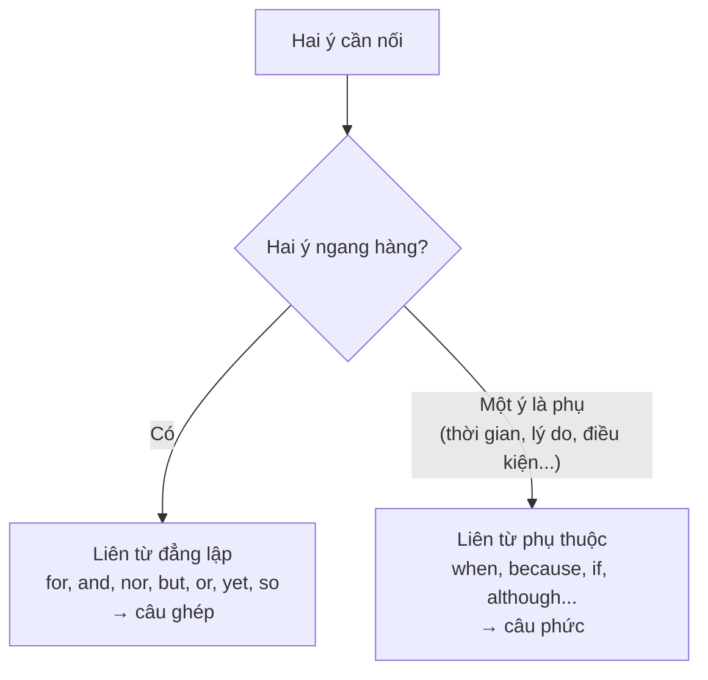

# B1-G019 · Conjunctions & Complex Sentences — Liên từ và câu phức

## Mục lục

- [A. Lesson Information](#a-lesson-information)
- [B. Warm-up](#b-warm-up)
- [C. WHAT](#c-what)
- [D. WHY](#d-why)
- [E. FORM](#e-form)
- [F. HOW](#f-how)
- [G. VISUAL](#g-visual)
- [H. COMPARISON](#h-comparison)
- [I. COMMON MISTAKES](#i-common-mistakes)
- [J. MEMORY TRICKS](#j-memory-tricks)
- [K. REAL-LIFE APPLICATION](#k-real-life-application)
- [L. PRACTICE EXERCISES](#l-practice-exercises)
- [M. KNOWLEDGE CHECK](#m-knowledge-check)
- [N. ANSWER KEY](#n-answer-key)

---

## A. Lesson Information

| Mục | Nội dung |
|---|---|
| **Lesson ID** | B1-G019 |
| **Topic** | Simple, Compound and Complex Sentences; Coordinating vs Subordinating Conjunctions; Noun clauses with *that/what/whether* |
| **Tên tiếng Việt** | Câu đơn, câu ghép, câu phức; liên từ đẳng lập và phụ thuộc; mệnh đề danh từ |
| **CEFR Level** | B1 |
| **Prerequisites** | [B1-G018 — Linking Words](B1-G018-linking-words.md), [B1-G013 — Relative Clauses](B1-G013-defining-non-defining-relatives.md) |
| **Estimated Time** | 90 phút |

**Learning Objectives:**

1. Phân biệt **câu đơn** (simple), **câu ghép** (compound), **câu phức** (complex).
2. Phân biệt **liên từ đẳng lập** (FANBOYS) và **liên từ phụ thuộc** (*because, when, if, although...*).
3. Nhận diện **mệnh đề chính** và **mệnh đề phụ**; đặt dấu phẩy đúng.
4. Dùng **mệnh đề danh từ** với *that, what, whether, how* làm chủ ngữ/tân ngữ.
5. Tránh lỗi **câu không hoàn chỉnh** (fragment) và **câu dính liền** (run-on).

---

## B. Warm-up

Hai đoạn văn cùng nội dung:

> **A.** *I moved to Hanoi. I didn't know anyone. I joined a club. I met my best friend there. She helped me a lot.*
>
> **B.** *When I moved to Hanoi, I didn't know anyone, so I joined a club, where I met my best friend. What I appreciate most is that she helped me through a difficult time.*

🤔 **Hãy suy nghĩ:** Đoạn A chỉ gồm câu đơn — đúng ngữ pháp nhưng giống văn của học sinh tiểu học. Đoạn B dùng những công cụ gì để nối các ý? Giám khảo bài thi B1–B2 sẽ đánh giá đoạn nào cao hơn ở tiêu chí "range of structures" (độ đa dạng cấu trúc)?

---

## C. WHAT

| Loại câu | Cấu trúc | Ví dụ |
|---|---|---|
| **Simple sentence** (câu đơn) | 1 mệnh đề độc lập | *I moved to Hanoi.* |
| **Compound sentence** (câu ghép) | 2+ mệnh đề độc lập nối bằng **liên từ đẳng lập** | *I moved to Hanoi**, but** I didn't know anyone.* |
| **Complex sentence** (câu phức) | 1 mệnh đề chính + 1+ **mệnh đề phụ thuộc** | ***When** I moved to Hanoi, I didn't know anyone.* |

- **Mệnh đề độc lập / chính** (independent/main clause): đứng một mình được thành câu.
- **Mệnh đề phụ thuộc** (dependent/subordinate clause): **không** đứng một mình được — *When I moved to Hanoi.* ❌

---

## D. WHY

Liên từ cho biết **quan hệ** giữa các ý, và **loại liên từ** cho biết **vị thế** của mỗi ý:



Câu phức giúp người viết **nhấn mạnh** ý quan trọng (đặt ở mệnh đề chính) và **làm nền** cho ý phụ.

---

## E. FORM

### E1. Liên từ đẳng lập — FANBOYS

| Liên từ | Nghĩa | Ví dụ |
|---|---|---|
| **F**or | vì (trang trọng, văn chương) | *He was tired, **for** he had worked all night.* |
| **A**nd | và | *I cooked**, and** she washed up.* |
| **N**or | cũng không | *He doesn't smoke**, nor** does he drink.* (đảo ngữ sau *nor*) |
| **B**ut | nhưng | *It's old**, but** it works.* |
| **O**r | hoặc | *Hurry up**, or** we'll miss the bus.* |
| **Y**et | tuy vậy | *She's rich**, yet** she lives simply.* |
| **S**o | vì vậy | *It rained**, so** we stayed in.* |

**Dấu phẩy:** đặt **trước** liên từ khi nối hai mệnh đề độc lập.

### E2. Liên từ phụ thuộc

| Chức năng | Liên từ |
|---|---|
| Thời gian | when, while, before, after, as soon as, until, since, once |
| Lý do | because, as, since |
| Tương phản | although, even though, while, whereas |
| Điều kiện | if, unless, as long as, provided that |
| Mục đích | so that, in order that |
| Kết quả | so ... that, such ... that |

**Dấu phẩy:** Mệnh đề phụ **đứng đầu** → có dấu phẩy; đứng **sau** → thường không cần.

- ***Because** it was late**,** we took a taxi.*
- *We took a taxi **because** it was late.*

### E3. Mệnh đề danh từ (noun clauses)

Mệnh đề đóng vai trò **danh từ** — làm chủ ngữ hoặc tân ngữ.

| Liên từ | Vai trò | Ví dụ |
|---|---|---|
| **that** | tân ngữ / sau tính từ | *I think **(that)** she's right.* / *I'm sure **that** he'll come.* |
| **what** (= the thing that) | chủ ngữ / tân ngữ | ***What** I need is a holiday.* / *I don't understand **what** he said.* |
| **whether / if** | tân ngữ (có/không) | *I don't know **whether** she's coming.* |
| **wh-** (how, why, where...) | tân ngữ / chủ ngữ | ***How** he did it is a mystery.* |

> ⚠️ Mệnh đề danh từ dùng **trật tự câu kể** (giống câu hỏi gián tiếp): *I don't know where **she lives*** (không phải *where does she live*).

---

## F. HOW

| # | English | Loại | Phân tích |
|---|---|---|---|
| 1 | *I wanted to go out**, but** it was raining.* | Ghép | 2 mệnh đề độc lập + *but* |
| 2 | *She studied hard**, so** she passed.* | Ghép | |
| 3 | ***When** the meeting finished, everyone left quickly.* | Phức | Mệnh đề phụ thời gian ở đầu → phẩy |
| 4 | *I'll call you **as soon as** I arrive.* | Phức | Mệnh đề phụ ở sau → không phẩy |
| 5 | ***Although** he's young, he's very experienced.* | Phức | Tương phản |
| 6 | *We left early **so that** we could avoid the traffic.* | Phức | Mục đích |
| 7 | ***What** surprised me most was the price.* | Phức (mệnh đề danh từ làm chủ ngữ) | *What* = điều mà |
| 8 | *Nobody knows **why** she left.* | Phức (tân ngữ) | Trật tự câu kể |
| 9 | *I'm not sure **whether** I can come.* | Phức | *whether* = liệu |
| 10 | ***When** I moved to Hanoi, I didn't know anyone**, so** I joined a club.* | Ghép – phức | Kết hợp cả hai |
| 11 | *He doesn't eat meat**, nor** does he drink milk.* | Ghép | *nor* + đảo ngữ |
| 12 | *The fact **that** she lied hurt me.* | Phức | *the fact that* + mệnh đề |

---

## G. VISUAL

### Cây câu phức

```text
When I moved to Hanoi,      I didn't know anyone.
└─ mệnh đề phụ (thời gian) ─┘└──── mệnh đề chính ────┘
   không đứng một mình được     đứng một mình được
```

### Fragment và run-on

| Lỗi | Ví dụ ❌ | Sửa ✅ |
|---|---|---|
| **Fragment** (câu cụt — chỉ có mệnh đề phụ) | *Because I was tired.* | *I went to bed early because I was tired.* |
| **Run-on** (câu dính — 2 mệnh đề độc lập không có liên từ) | *I was tired I went to bed.* | *I was tired, so I went to bed.* / *I was tired. I went to bed.* |
| **Comma splice** (nối 2 mệnh đề độc lập chỉ bằng dấu phẩy) | *I was tired, I went to bed.* | *I was tired; I went to bed.* / *...tired, so I...* |

---

## H. COMPARISON

### Đẳng lập vs phụ thuộc

| | Đẳng lập (*but, so, and*) | Phụ thuộc (*although, because, when*) |
|---|---|---|
| Vị trí | Luôn **giữa** hai mệnh đề | Đầu hoặc giữa câu |
| Đầu câu? | Hạn chế trong văn trang trọng | ✅ (*Although..., ...*) |
| Ví dụ | *It was cheap, **but** good.* | ***Although** it was cheap, it was good.* |

### *that* — đại từ quan hệ hay liên từ?

| *that* — đại từ quan hệ (bổ nghĩa cho danh từ) | *that* — liên từ (mở đầu mệnh đề danh từ) |
|---|---|
| *The book **that** I bought...* (*that* = cuốn sách) | *I know **that** you're busy.* (*that* không thay cho gì) |
| Thay được bằng *which* | Không thay được bằng *which* |

### *what* vs *that*

- ***What** I want is peace.* — *what* = *the thing that*, không cần danh từ trước.
- ❌ *The thing what I want...* → ✅ *The thing **that** I want...*

---

## I. COMMON MISTAKES

| # | ❌ Sai | ✅ Đúng | Nguyên nhân | Cách tránh |
|---|---|---|---|---|
| 1 | Because I was busy. (đứng một mình trong bài viết) | I didn't call because I was busy. | Fragment | Mệnh đề phụ cần mệnh đề chính |
| 2 | I love Hanoi, it is beautiful. | I love Hanoi **because** it is beautiful. / I love Hanoi. It is beautiful. | Comma splice | Nối bằng liên từ hoặc tách câu |
| 3 | I don't know where **does she live**. | I don't know where **she lives**. | Đảo trong mệnh đề danh từ | Trật tự câu kể |
| 4 | **What** I need it is time. | **What** I need **is** time. | Lặp chủ ngữ | Mệnh đề *what* đã là chủ ngữ |
| 5 | **Although** it was late**, but** we stayed. | **Although** it was late, we stayed. | Hai liên từ | |
| 6 | When I arrived I called you. (văn viết) | When I arrived**,** I called you. | Thiếu phẩy | Mệnh đề phụ đầu câu → phẩy |
| 7 | He doesn't smoke, nor **he drinks**. | ..., nor **does he drink**. | Không đảo sau *nor* | *nor* + trợ động từ + S |

---

## J. MEMORY TRICKS

1. **FANBOYS** — 7 liên từ đẳng lập; mọi liên từ khác (when, because, if...) là phụ thuộc.
2. **"Phép thử đứng một mình"**: Che phần còn lại — mệnh đề có đứng một mình thành câu hoàn chỉnh không? Không → mệnh đề phụ.
3. **"What = cái mà"**: *What I like* = cái mà tôi thích.

---

## K. REAL-LIFE APPLICATION

### Đoạn văn: My first job

> *When I graduated from university, I had no idea **what** I wanted to do. I applied for many jobs**, but** nobody replied. **Although** I felt discouraged, I kept trying. One day, a small travel company invited me for an interview**, so** I prepared carefully. The manager asked me **why** I wanted the job. I told her **that** I loved meeting new people. **What** surprised me was **that** she offered me the job immediately. **Since** then, I have learned **that** confidence is often more important than experience.*

**Giải thích:** Sau khi tốt nghiệp, tác giả không biết muốn làm gì; nộp đơn nhiều nơi nhưng không ai trả lời; dù nản vẫn cố gắng; được một công ty du lịch mời phỏng vấn; quản lý hỏi vì sao muốn làm; điều bất ngờ là được nhận ngay. Bài học: sự tự tin thường quan trọng hơn kinh nghiệm.

**Grammar highlights:** câu ghép (*but, so*), câu phức (*When, Although, Since*), mệnh đề danh từ (*what I wanted to do, why I wanted the job, that I loved..., What surprised me, that confidence is...*).

---

## L. PRACTICE EXERCISES

> ✍️ Đáp án: [B1-G019-ANSWERS](../../12-ANSWERS-AND-EXPLANATIONS/B1/B1-G019-ANSWERS.md)

### Level 1 — Recognition

Xác định loại câu: **S** (simple), **C** (compound), **X** (complex).

**L1.1.** The train left at six.
**L1.2.** The train left at six, but we missed it.
**L1.3.** Because we missed the train, we took a bus.
**L1.4.** I don't know what time it is.

Chọn đáp án đúng.

**L1.5.** I don't understand ___.  A. what does he mean  B. what he means  C. what means he
**L1.6.** Câu nào là **comma splice** (lỗi)?  A. I was hungry, so I ate.  B. I was hungry, I ate.  C. Because I was hungry, I ate.

### Level 2 — Controlled Practice

Nối hai câu đơn bằng từ trong ngoặc.

**L2.1.** She was ill. She went to work. (although)
**L2.2.** I'll call you. I get home. (as soon as)
**L2.3.** We left early. We wanted to get good seats. (so that ... could)
**L2.4.** He doesn't like coffee. He doesn't like tea. (nor)
**L2.5.** You can come with us. You can stay here. (or)

Viết mệnh đề danh từ.

**L2.6.** Where does he live? → I don't know ______.
**L2.7.** Is the shop open today? → Can you check ______?
**L2.8.** I need a long holiday. → ______ is a long holiday. (what)
**L2.9.** She was late. → Everyone noticed ______. (that)
**L2.10.** How did they escape? → ______ remains a mystery.

### Level 3 — Error Correction

Sửa lỗi fragment, run-on, comma splice hoặc trật tự.

**L3.1.** Because the shop was closed.
**L3.2.** I love my job it is very interesting.
**L3.3.** She studied hard, she passed the exam.
**L3.4.** I wonder why is she crying.
**L3.5.** What I want it is a quiet life.
**L3.6.** Although he was tired but he finished the report.

### Level 4 — Production

**L4.1.** Viết lại đoạn A ở phần Warm-up thành 2–3 câu dùng ít nhất 1 câu ghép và 2 câu phức.
**L4.2.** Dịch: *"Điều tôi thích nhất ở thành phố này là con người."* (*What...*)
**L4.3.** Dịch: *"Tôi không chắc liệu cô ấy có đến bữa tiệc không."* (*whether*)
**L4.4.** Viết một câu ghép – phức về một ngày làm việc của bạn (dùng cả FANBOYS và liên từ phụ thuộc).

**L4.5.** **Explain:** Giải thích vì sao *"I was tired, I went to bed."* bị coi là lỗi trong văn viết và đưa ra 3 cách sửa (tiếng Việt).

### Level 5 — Real Communication

**L5.1.** Viết đoạn văn 120–150 từ: *An important decision in my life*. Dùng ≥ 3 câu ghép, ≥ 4 câu phức (với ≥ 3 liên từ phụ thuộc khác nhau) và ≥ 2 mệnh đề danh từ (*what, that, why, whether*). Không có fragment/run-on.
**L5.2.** **Speaking — Expand the sentence:** Bắt đầu từ câu đơn *"I learn English."* Mở rộng thành câu dài hơn bằng cách thêm lần lượt: lý do, thời gian, tương phản, mục đích. Nói to từng phiên bản.

---

## M. KNOWLEDGE CHECK

### 5 câu hỏi tự kiểm tra

1. Câu đơn, ghép, phức khác nhau thế nào?
2. Kể 7 liên từ FANBOYS.
3. Khi nào cần dấu phẩy với mệnh đề phụ?
4. Fragment, run-on, comma splice là gì?
5. Trật tự từ trong mệnh đề danh từ *I don't know where...*?

### Checklist

- [ ] Tôi phân biệt được mệnh đề chính và phụ.
- [ ] Tôi không viết fragment và comma splice.
- [ ] Tôi dùng được *what/that/whether* để tạo mệnh đề danh từ.

### 3 lỗi quan trọng cần nhớ

1. Mệnh đề phụ không đứng một mình: ~~Because I was busy.~~
2. Hai mệnh đề độc lập không nối bằng dấu phẩy đơn thuần.
3. ~~I don't know where does she live~~ → where **she lives**.

### Lịch ôn tập

| Ngày | Việc cần làm |
|---|---|
| Ngày 1 | Làm lại L2 |
| Ngày 3 | Viết lại một đoạn văn cũ của bạn, thay câu đơn bằng câu ghép/phức |
| Ngày 7 | Ôn với [B1-G023 — Adverbial Clauses](B1-G023-adverbial-clauses.md) |

### Liên kết

- ➡️ Bài tiếp theo: [B1-G020 — Phrasal Verbs](B1-G020-phrasal-verbs.md)
- 🔁 Viết: [W01 — Sentence Construction](../../09-FOUR-SKILLS/Writing/W01-sentence-construction.md)

---

## N. ANSWER KEY

👉 [B1-G019-ANSWERS.md](../../12-ANSWERS-AND-EXPLANATIONS/B1/B1-G019-ANSWERS.md)
