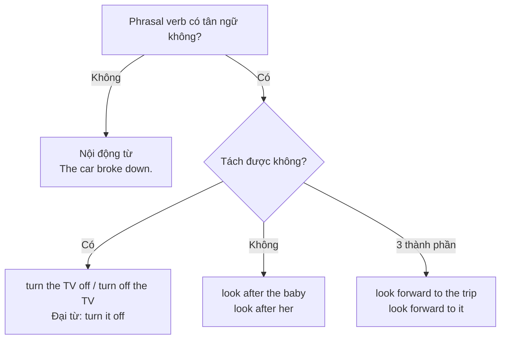

# B1-G020 · Phrasal Verbs — Cụm động từ

## Mục lục

- [A. Lesson Information](#a-lesson-information)
- [B. Warm-up](#b-warm-up)
- [C. WHAT](#c-what)
- [D. WHY](#d-why)
- [E. FORM](#e-form)
- [F. HOW](#f-how)
- [G. VISUAL](#g-visual)
- [H. COMPARISON](#h-comparison)
- [I. COMMON MISTAKES](#i-common-mistakes)
- [J. MEMORY TRICKS](#j-memory-tricks)
- [K. REAL-LIFE APPLICATION](#k-real-life-application)
- [L. PRACTICE EXERCISES](#l-practice-exercises)
- [M. KNOWLEDGE CHECK](#m-knowledge-check)
- [N. ANSWER KEY](#n-answer-key)

---

## A. Lesson Information

| Mục | Nội dung |
|---|---|
| **Lesson ID** | B1-G020 |
| **Topic** | Phrasal Verbs: separable, inseparable, intransitive, three-part |
| **Tên tiếng Việt** | Cụm động từ — tách được, không tách được, nội động từ, cụm 3 thành phần |
| **CEFR Level** | B1 |
| **Prerequisites** | [A1-G007 — Object Pronouns](../../02-A1-BEGINNER/grammar/A1-G007-object-pronouns.md), [B1-G016 — Gerund vs Infinitive](B1-G016-gerund-vs-infinitive.md) |
| **Estimated Time** | 90 phút |

**Learning Objectives:**

1. Hiểu phrasal verb = động từ + tiểu từ (*up, out, off, on, down, away, back...*) với **nghĩa mới**.
2. Phân biệt 4 loại: **nội động từ** (*break down*), **tách được** (*turn the TV off*), **không tách được** (*look after the kids*), **3 thành phần** (*look forward to*).
3. Đặt **đại từ tân ngữ** đúng vị trí: *turn **it** off* ✅ — ~~turn off it~~ ❌.
4. Nắm khoảng **40 phrasal verb B1** thông dụng theo nhóm nghĩa.
5. Biết khi nào nên dùng phrasal verb (văn nói) và động từ một từ (văn trang trọng).

---

## B. Warm-up

> *A: Did you **find out** why the car **broke down**?*
> *B: Yes, the mechanic **looked into** it. I need to **pick** it **up** tomorrow.*
> *A: OK. Don't **put** it **off** — we're **setting off** for Da Lat on Saturday!*

🤔 **Hãy suy nghĩ:** Đoạn hội thoại có 6 phrasal verb. Bạn đoán được nghĩa của bao nhiêu chỉ bằng cách ghép nghĩa *break* (làm vỡ) + *down* (xuống)? Vì sao *pick **it** up* nhưng *looked **into it***?

---

## C. WHAT

**Phrasal verb** = **động từ** + **tiểu từ** (particle: trạng từ hoặc giới từ), thường mang nghĩa **khác** với động từ gốc.

| Phrasal verb | Nghĩa từng phần | Nghĩa thực |
|---|---|---|
| *give up* | cho + lên | **từ bỏ** |
| *turn down* | xoay + xuống | **từ chối** / vặn nhỏ |
| *run out of* | chạy + ra + của | **hết, cạn** |
| *get over* | lấy + qua | **vượt qua, hồi phục** |
| *look after* | nhìn + sau | **chăm sóc** |

Có phrasal verb **nghĩa đen** (dễ đoán: *sit down, go out, come back*) và **nghĩa bóng** (khó đoán: *put up with* = chịu đựng).

---

## D. WHY

Người bản ngữ dùng phrasal verb **rất thường xuyên** trong văn nói và văn viết thân mật. Nếu không biết, bạn sẽ khó nghe hiểu phim, podcast và hội thoại hằng ngày.



---

## E. FORM

### E1. Loại 1 — Nội động từ (không tân ngữ)

| Phrasal verb | Nghĩa | Ví dụ |
|---|---|---|
| break down | hỏng (máy) | *Our car **broke down** on the highway.* |
| set off | khởi hành | *We **set off** at 5 a.m.* |
| get up | thức dậy | *I **get up** at six.* |
| grow up | lớn lên | *She **grew up** in Hue.* |
| turn up / show up | xuất hiện | *He **turned up** an hour late.* |
| give up | bỏ cuộc | *Don't **give up**!* |
| take off | cất cánh | *The plane **took off** on time.* |
| run out | hết | *Time is **running out**.* |

### E2. Loại 2 — Tách được (separable)

Danh từ đứng **giữa hoặc sau**; **đại từ bắt buộc đứng giữa**.

| Phrasal verb | Nghĩa | Ví dụ |
|---|---|---|
| turn on / off | bật / tắt | *Turn **the light** off. / Turn off **the light**. / Turn **it** off.* |
| pick up | đón; nhặt | *I'll pick **you** up at 7.* |
| put off | hoãn | *They put **the meeting** off.* |
| fill in / out | điền (mẫu đơn) | *Please fill **this form** in.* |
| find out | tìm ra | *I found out **the truth**.* |
| give back | trả lại | *Give **it** back!* |
| turn down | từ chối | *She turned **the offer** down.* |
| look up | tra cứu | *Look **it** up in the dictionary.* |
| take off | cởi (quần áo) | *Take **your shoes** off.* |
| throw away | vứt đi | *Don't throw **it** away.* |
| try on | thử (quần áo) | *Can I try **these jeans** on?* |
| bring up | nuôi dạy; nêu ra | *She brought up **three children**. / He brought **the issue** up.* |

### E3. Loại 3 — Không tách được (inseparable)

Tân ngữ (cả danh từ và đại từ) luôn đứng **sau** tiểu từ.

| Phrasal verb | Nghĩa | Ví dụ |
|---|---|---|
| look after | chăm sóc | *She looks after **her mother**. / looks after **her**.* |
| look for | tìm kiếm | *I'm looking for **my keys**.* |
| look into | điều tra, xem xét | *The police are looking into **it**.* |
| get over | hồi phục, vượt qua | *He got over **the flu** quickly.* |
| come across | tình cờ gặp/thấy | *I came across **an old photo**.* |
| run into | tình cờ gặp (người) | *I ran into **my teacher** at the mall.* |
| take after | giống (người thân) | *She takes after **her father**.* |
| deal with | xử lý | *Who will deal with **this problem**?* |

### E4. Loại 4 — Ba thành phần (không tách được)

| Phrasal verb | Nghĩa | Ví dụ |
|---|---|---|
| look forward to | mong đợi | *I'm looking forward to **seeing** you.* (*to* + V-ing) |
| get on with | hòa hợp | *I get on well with **my colleagues**.* |
| put up with | chịu đựng | *I can't put up with **the noise**.* |
| run out of | hết | *We've run out of **milk**.* |
| come up with | nghĩ ra | *She came up with **a great idea**.* |
| catch up with | đuổi kịp | *Go ahead — I'll catch up with **you**.* |
| keep up with | theo kịp | *It's hard to keep up with **technology**.* |
| cut down on | cắt giảm | *I'm cutting down on **sugar**.* |

---

## F. HOW

| # | English | Tiếng Việt | Phân tích |
|---|---|---|---|
| 1 | *Could you **turn** the music **down**? I'm trying to sleep.* | Bạn vặn nhỏ nhạc được không? | Tách được |
| 2 | *I've **lost** my glasses — can you help me **look for** them?* | ... giúp tôi tìm nó? | Không tách: *look for them* |
| 3 | *The interview was **put off** until next week.* | Buổi phỏng vấn bị hoãn. | Bị động của phrasal verb |
| 4 | *She **turned down** the job because the salary was low.* | Cô ấy từ chối công việc. | |
| 5 | *We **ran out of** petrol in the middle of nowhere.* | Chúng tôi hết xăng ở nơi hẻo lánh. | 3 thành phần |
| 6 | *I really **take after** my mum — we both love cooking.* | Tôi rất giống mẹ. | Không tách |
| 7 | *If you don't know a word, **look** it **up**.* | ... tra nó. | Đại từ ở giữa |
| 8 | *The plane **took off** two hours late.* | Máy bay cất cánh trễ 2 giờ. | Nội động từ |
| 9 | *Please **take off** your shoes before entering.* | Vui lòng cởi giày. | Cùng *take off* — nghĩa khác, có tân ngữ |
| 10 | *I can't **put up with** his rudeness any more.* | Tôi không thể chịu đựng sự thô lỗ của anh ấy nữa. | 3 thành phần |
| 11 | *How did you **come up with** such a clever solution?* | Làm sao bạn nghĩ ra giải pháp hay vậy? | |
| 12 | *We're **looking forward to hearing** from you.* | Chúng tôi mong nhận phản hồi. | *to* + V-ing |

---

## G. VISUAL

### Vị trí đại từ

```text
TÁCH ĐƯỢC:      turn  [it]  off          ✅
                turn  off   [it]         ❌

KHÔNG TÁCH:     look  after [her]        ✅
                look  [her] after        ❌
```

### Nghĩa thường gặp của tiểu từ

| Tiểu từ | Ý nghĩa thường gặp | Ví dụ |
|---|---|---|
| **up** | hoàn thành, tăng | *eat up, use up, turn up (the volume), clean up* |
| **down** | giảm, ghi lại, hỏng | *turn down, cut down, write down, break down* |
| **out** | ra ngoài, hết, tìm ra | *go out, run out, find out, work out* |
| **off** | rời đi, ngắt, hoãn | *set off, turn off, put off, take off* |
| **on** | tiếp tục, bật | *go on, carry on, turn on* |
| **back** | trở lại | *come back, give back, call back* |

---

## H. COMPARISON

### Phrasal verb vs động từ trang trọng

| Phrasal verb (thân mật) | Động từ một từ (trang trọng) |
|---|---|
| find out | discover |
| put off | postpone |
| look into | investigate |
| come up with | devise / propose |
| cut down on | reduce |
| turn down | reject / decline |
| get over | recover from |
| go up | increase |

> 💡 Trong **email trang trọng hoặc essay**, ưu tiên cột phải; trong **hội thoại**, cột trái nghe tự nhiên hơn.

### Một phrasal verb — nhiều nghĩa

| *take off* | *pick up* | *turn up* |
|---|---|---|
| cất cánh (máy bay) | đón (ai) | xuất hiện |
| cởi (quần áo) | nhặt lên | vặn to |
| thành công nhanh (*Her career took off.*) | học được (*pick up a language*) | |

---

## I. COMMON MISTAKES

| # | ❌ Sai | ✅ Đúng | Nguyên nhân | Cách tránh |
|---|---|---|---|---|
| 1 | Turn off **it**. | Turn **it** off. | Đại từ sau tiểu từ | Loại tách được: đại từ ở giữa |
| 2 | I'm looking **her** after. | I'm looking after **her**. | Tách loại không tách được | Học thuộc nhóm không tách |
| 3 | I look forward to **see** you. | I look forward to **seeing** you. | *to* là giới từ | + V-ing |
| 4 | We **ran out** milk. | We ran out **of** milk. | Thiếu *of* | *run out of* + N |
| 5 | The meeting was **put off it**. | The meeting was **put off**. | Thừa tân ngữ trong bị động | |
| 6 | I'd like to **find out** your company. (email) | I'd like to **learn more about** your company. | Sai nghĩa/văn phong | *find out* + thông tin, không + tổ chức |
| 7 | He **gave up to smoke**. | He **gave up smoking**. | | *give up* + V-ing |

---

## J. MEMORY TRICKS

1. **"Đại từ ngồi giữa"** 🧍: Với loại tách được, *it/them/him/her* luôn chui vào giữa: *turn **it** off, pick **them** up*.
2. **Học theo cụm và tình huống**, không học từng từ: *Run out of → milk, money, time, patience*.
3. **Sổ tay theo tiểu từ**: Mỗi trang một tiểu từ (*up, out, off...*); ghi phrasal verb + câu ví dụ của chính bạn. Xem [VOC-16 — Common Phrasal Verbs](../../07-VOCABULARY/VOC-16-common-phrasal-verbs.md).

---

## K. REAL-LIFE APPLICATION

### Hội thoại: Moving house

> **Lan:** *How's the move going?*
> **Tom:** *Exhausting! I've been **throwing away** so much old stuff. I **came across** my school reports yesterday.*
> **Lan:** *Ha! Do you need help **packing up**?*
> **Tom:** *That'd be great. And can you **look after** my cat this weekend? She hates boxes.*
> **Lan:** *Sure. When do you **set off**?*
> **Tom:** *Saturday morning. The van will **pick** me **up** at seven. I'm really **looking forward to** having my own place.*
> **Lan:** *I bet. Just don't **run out of** energy before you **unpack**!*

**Dịch tóm tắt:** Tom đang chuyển nhà, vứt bỏ nhiều đồ cũ, tình cờ thấy học bạ cũ. Lan đề nghị giúp đóng gói và trông mèo. Tom khởi hành sáng thứ Bảy, xe tải đón lúc 7 giờ.

**Grammar highlights:** *throwing away, came across, packing up, look after, set off, pick me up* (đại từ ở giữa), *looking forward to having*, *run out of*.

---

## L. PRACTICE EXERCISES

> ✍️ Đáp án: [B1-G020-ANSWERS](../../12-ANSWERS-AND-EXPLANATIONS/B1/B1-G020-ANSWERS.md)

### Level 1 — Recognition

**L1.1.** Nối phrasal verb với nghĩa: (1) give up (2) put off (3) look after (4) find out (5) turn down — a. hoãn b. từ chối c. từ bỏ d. chăm sóc e. tìm ra
**L1.2.** Câu nào **đúng**?  A. Turn off it, please.  B. Turn it off, please.  C. Turn it, please, off.
**L1.3.** Câu nào **đúng**?  A. Can you look the baby after?  B. Can you look after the baby?
**L1.4.** We've run ___ sugar.  A. out  B. out of  C. off
**L1.5.** I'm looking forward ___ you next week.  A. to see  B. seeing  C. to seeing
**L1.6.** "The plane **took off**" — *took off* ở đây nghĩa là?  A. cởi ra  B. cất cánh  C. thành công

### Level 2 — Controlled Practice

Thay phần in đậm bằng đại từ và đặt đúng vị trí.

**L2.1.** Please fill in **the form**.
**L2.2.** I'll pick up **the children** at four.
**L2.3.** She takes after **her grandmother**.
**L2.4.** Could you turn down **the TV**?
**L2.5.** I came across **these letters** in the attic.

Điền phrasal verb đúng dạng: *put up with, come up with, get on with, cut down on, break down, grow up*.

**L2.6.** My laptop ___ in the middle of the presentation.
**L2.7.** I ___ in a small village near Hue.
**L2.8.** The doctor told him to ___ salt.
**L2.9.** How do you ___ your new flatmate?
**L2.10.** I can't ___ this noise any longer!

### Level 3 — Error Correction

**L3.1.** If you don't know the word, look up it.
**L3.2.** I'm looking my glasses for.
**L3.3.** We ran out petrol on the way home.
**L3.4.** He finally gave up to smoke last year.
**L3.5.** I look forward to meet you.
**L3.6.** Can you give back it to me tomorrow?

### Level 4 — Production

Viết lại câu bằng phrasal verb.

**L4.1.** The concert has been **postponed** until June. (put)
**L4.2.** She **rejected** the invitation politely. (turn)
**L4.3.** It took me weeks to **recover from** the illness. (get)
**L4.4.** We must **reduce** the amount of plastic we use. (cut)

**L4.5.** **Explain:** Vì sao nói *"Turn it off"* nhưng *"Look after it"*? (giải thích bằng tiếng Việt về hai loại phrasal verb)

### Level 5 — Real Communication

**L5.1.** Viết email thân mật (100–130 từ) kể cho bạn về một tuần bận rộn. Dùng ≥ 8 phrasal verb khác nhau, gồm ≥ 2 loại tách được (có đại từ ở giữa), ≥ 2 loại không tách được và ≥ 1 loại 3 thành phần.
**L5.2.** **Speaking — My daily routine with phrasal verbs:** Nói 1 phút về một ngày của bạn với ≥ 6 phrasal verb (*get up, set off, pick up, look after, catch up with, turn off...*). Ghi âm và kiểm tra vị trí đại từ.

---

## M. KNOWLEDGE CHECK

### 5 câu hỏi tự kiểm tra

1. Phrasal verb là gì? Cho ví dụ nghĩa đen và nghĩa bóng.
2. 4 loại phrasal verb?
3. Đại từ đặt ở đâu với loại tách được?
4. Sau *look forward to* dùng dạng gì?
5. Trong essay, nên thay *find out, put off* bằng từ nào?

### Checklist

- [ ] Tôi biết ≥ 30 phrasal verb trong bài.
- [ ] Tôi đặt đại từ đúng vị trí.
- [ ] Tôi chọn phrasal verb hay động từ trang trọng phù hợp ngữ cảnh.

### 3 lỗi quan trọng cần nhớ

1. ~~Turn off it~~ → Turn **it** off.
2. ~~run out milk~~ → run out **of** milk.
3. ~~look forward to see~~ → look forward to **seeing**.

### Lịch ôn tập

| Ngày | Việc cần làm |
|---|---|
| Ngày 1 | Làm flashcard 40 phrasal verb (mặt sau: câu ví dụ) |
| Ngày 3 | Xem một tập phim, ghi lại 5 phrasal verb nghe được |
| Ngày 7 | Ôn với [VOC-16 — Common Phrasal Verbs](../../07-VOCABULARY/VOC-16-common-phrasal-verbs.md) |

### Liên kết

- ➡️ Bài tiếp theo: [B1-G021 — Verb Patterns](B1-G021-verb-patterns.md)
- 🔁 Từ vựng: [VOC-16 — Common Phrasal Verbs](../../07-VOCABULARY/VOC-16-common-phrasal-verbs.md)

---

## N. ANSWER KEY

👉 [B1-G020-ANSWERS.md](../../12-ANSWERS-AND-EXPLANATIONS/B1/B1-G020-ANSWERS.md)
