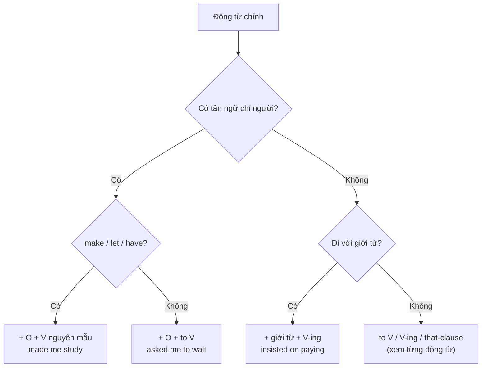

# B1-G021 · Verb Patterns — Các mẫu động từ

## Mục lục

- [A. Lesson Information](#a-lesson-information)
- [B. Warm-up](#b-warm-up)
- [C. WHAT](#c-what)
- [D. WHY](#d-why)
- [E. FORM](#e-form)
- [F. HOW](#f-how)
- [G. VISUAL](#g-visual)
- [H. COMPARISON](#h-comparison)
- [I. COMMON MISTAKES](#i-common-mistakes)
- [J. MEMORY TRICKS](#j-memory-tricks)
- [K. REAL-LIFE APPLICATION](#k-real-life-application)
- [L. PRACTICE EXERCISES](#l-practice-exercises)
- [M. KNOWLEDGE CHECK](#m-knowledge-check)
- [N. ANSWER KEY](#n-answer-key)

---

## A. Lesson Information

| Mục | Nội dung |
|---|---|
| **Lesson ID** | B1-G021 |
| **Topic** | Verb Patterns: verb + object + to-infinitive; make/let + object + bare infinitive; verb + preposition + V-ing; verb + that-clause; suggest/recommend |
| **Tên tiếng Việt** | Các mẫu động từ: V + O + to V, make/let + O + V, V + giới từ + V-ing, V + that |
| **CEFR Level** | B1 |
| **Prerequisites** | [B1-G016 — Gerund vs Infinitive](B1-G016-gerund-vs-infinitive.md) |
| **Estimated Time** | 90 phút |

**Learning Objectives:**

1. Dùng mẫu **V + O + to-infinitive**: *ask/tell/want/advise/allow/encourage/remind/warn someone to do*.
2. Dùng mẫu **V + O + bare infinitive**: *make/let someone do*, và bị động *be made to do*.
3. Dùng **V + giới từ + V-ing**: *insist on, apologise for, succeed in, think of/about, be interested in*.
4. Dùng đúng **suggest / recommend** (không theo mẫu *suggest someone to do*).
5. Dùng **V + that-clause**: *explain that, agree that, admit that*.

---

## B. Warm-up

> *My parents **made me study** every evening. They **didn't let me go** out on weekdays. My teacher **encouraged me to enter** a speaking contest, and she **suggested that I practise** with a recording. In the end I **succeeded in winning** second prize.*

🤔 **Hãy suy nghĩ:** Tìm 5 động từ in đậm. Mỗi động từ có "đồ đi kèm" khác nhau: *make me **study*** (không *to*), *encouraged me **to enter*** (có *to*), *succeeded **in winning*** (giới từ + V-ing). Làm sao nhớ được?

---

## C. WHAT

**Verb patterns** là các "khuôn" mà một động từ yêu cầu phía sau. Ở B1, bạn cần nắm 5 khuôn mở rộng (ngoài *V + to V* và *V + V-ing* đã học ở [B1-G016](B1-G016-gerund-vs-infinitive.md)):

| Mẫu | Ví dụ |
|---|---|
| **V + O + to V** | *She asked **me to wait**.* |
| **V + O + V (bare)** | *He made **me laugh**.* |
| **V + giới từ + V-ing** | *I'm thinking **of moving**.* |
| **V + (O) + that + mệnh đề** | *He admitted **that** he was wrong.* |
| **suggest/recommend + V-ing / that...** | *She suggested **going** home. / ...suggested **that we go** home.* |

---

## D. WHY

Tiếng Việt chỉ đặt các động từ cạnh nhau: *"bảo tôi đợi", "bắt tôi học", "gợi ý tôi đi"* — không có *to*, không có giới từ. Vì vậy người Việt hay viết ~~She suggested me to go~~ hoặc ~~He made me to study~~.



---

## E. FORM

### E1. V + O + to-infinitive

| Động từ | Ví dụ |
|---|---|
| ask, tell | *The teacher **told us to sit** down.* |
| want, would like | *I **want you to be** honest.* |
| advise, encourage | *The doctor **advised him to rest**.* |
| allow, permit | *They don't **allow students to use** phones.* |
| remind, warn | ***Remind me to call** Mum. / He **warned us not to swim** there.* |
| expect, persuade, invite, teach | *She **persuaded me to join** the gym.* |

**Phủ định:** *not* đứng trước *to*: *told me **not to** worry*.

### E2. make / let + O + bare infinitive

| Mẫu | Nghĩa | Ví dụ |
|---|---|---|
| **make + O + V** | bắt, khiến | *The film **made me cry**.* |
| **let + O + V** | cho phép | *My boss **let me leave** early.* |
| **be made + to V** (bị động) | bị bắt | *I **was made to wait** for two hours.* |
| **be allowed to V** (bị động của *let*) | được phép | *We **were allowed to leave** early.* (*let* không dùng ở bị động) |

> 💡 *help + O + (to) V*: *She helped me **(to) carry** the bags* — cả hai đều đúng.

### E3. V + giới từ + V-ing

| Động từ + giới từ | Ví dụ |
|---|---|
| insist on | *He **insisted on paying**.* |
| apologise for | *I **apologise for being** late.* |
| succeed in | *She **succeeded in passing** the exam.* |
| think of / about | *We're **thinking of moving** to Da Nang.* |
| look forward to | *I'm **looking forward to meeting** you.* |
| be interested in / good at / afraid of / tired of | *He's **tired of waiting**.* |
| prevent / stop + O + from | *The rain **prevented us from going** out.* |
| thank + O + for | *Thank you **for helping** me.* |
| accuse + O + of | *They **accused him of lying**.* |

### E4. suggest / recommend

| ✅ Đúng | ❌ Sai |
|---|---|
| *She **suggested going** to the beach.* | ~~suggested to go~~ |
| *She **suggested (that) we go** to the beach.* | ~~suggested us to go~~ |
| *I **recommend booking** early.* / *I **recommend (that) you book** early.* | ~~recommend you to book~~ (hiếm, không khuyến khích ở bài thi) |

> Sau *suggest/recommend that*, động từ thường ở dạng **nguyên mẫu** (*we go, he book*) hoặc *should + V* (*we should go*). Dạng chia thường (*we went*) cũng gặp trong văn nói thân mật Anh–Anh, nhưng ở bài thi nên dùng nguyên mẫu hoặc *should*.

### E5. V + that-clause

| Động từ | Ví dụ |
|---|---|
| say, explain, admit, agree, promise, realise, hope | *He **admitted that** he had made a mistake.* |
| tell + O + that | *She **told me that** she was leaving.* |

---

## F. HOW

| # | English | Tiếng Việt | Mẫu |
|---|---|---|---|
| 1 | *My manager **asked me to prepare** the report.* | Quản lý yêu cầu tôi chuẩn bị báo cáo. | V + O + to V |
| 2 | *The guide **warned us not to touch** the animals.* | HDV cảnh báo chúng tôi không chạm vào động vật. | Phủ định *not to* |
| 3 | *Sad songs always **make me feel** nostalgic.* | Nhạc buồn luôn khiến tôi hoài niệm. | make + O + V |
| 4 | *My parents never **let me stay** out late.* | Bố mẹ không bao giờ cho tôi đi khuya. | let + O + V |
| 5 | *At school we **were made to wear** uniforms.* | Ở trường chúng tôi bị bắt mặc đồng phục. | Bị động *made to* |
| 6 | *He **apologised for forgetting** my birthday.* | Anh ấy xin lỗi vì quên sinh nhật tôi. | V + for + V-ing |
| 7 | *The heavy traffic **prevented me from arriving** on time.* | Giao thông đông khiến tôi không đến đúng giờ. | prevent + O + from + V-ing |
| 8 | *I **suggest that you take** a taxi.* | Tôi gợi ý bạn đi taxi. | suggest that + S + V |
| 9 | *My friend **suggested trying** the new Korean restaurant.* | Bạn tôi gợi ý thử nhà hàng Hàn mới. | suggest + V-ing |
| 10 | *She **persuaded her parents to let her study** abroad.* | Cô ấy thuyết phục bố mẹ cho đi du học. | Kết hợp 2 mẫu |
| 11 | *We're **thinking about starting** a small business.* | Chúng tôi đang tính mở kinh doanh nhỏ. | V + about + V-ing |
| 12 | *The manager **explained that** the shop would close early.* | Quản lý giải thích rằng cửa hàng sẽ đóng sớm. | V + that |

---

## G. VISUAL

### Ba "khuôn" có tân ngữ

```text
asked   + me + TO wait          (V + O + to V)
made    + me +    wait          (make/let + O + V)
stopped + me + FROM waiting     (V + O + giới từ + V-ing)
```

### Bảng tra nhanh

| Không *to* | Có *to* | Giới từ + V-ing |
|---|---|---|
| make, let, (help) | ask, tell, want, advise, allow, encourage, remind, warn, persuade, expect | insist on, apologise for, succeed in, prevent from, thank for, accuse of |

---

## H. COMPARISON

### make vs let vs allow

| | Chủ động | Bị động |
|---|---|---|
| **make** (bắt) | *They made me **wait**.* | *I was made **to wait**.* (có *to*!) |
| **let** (cho phép, thân mật) | *They let me **go**.* | ❌ không dùng → *I was allowed to go.* |
| **allow** (cho phép, trang trọng hơn) | *They allowed me **to go**.* | *I was allowed **to go**.* |

### suggest vs advise

| suggest | advise |
|---|---|
| ~~suggest someone to do~~ | ✅ *advise someone to do* |
| *suggest doing / suggest that someone (should) do* | *advise doing* (không tân ngữ) |

---

## I. COMMON MISTAKES

| # | ❌ Sai | ✅ Đúng | Nguyên nhân | Cách tránh |
|---|---|---|---|---|
| 1 | He **made me to clean** the room. | He **made me clean** the room. | Thêm *to* | make + O + V |
| 2 | She **suggested me to go** home. | She **suggested (that) I go** home. / suggested **going** home. | Theo khuôn *advise* | *suggest* không + O + to V |
| 3 | They **let me to use** the car. | They **let me use** the car. | | let + O + V |
| 4 | I **was let** to leave. | I **was allowed** to leave. | *let* không bị động | Dùng *allowed* |
| 5 | He **insisted to pay**. | He **insisted on paying**. | Thiếu giới từ | insist **on** + V-ing |
| 6 | The teacher **said me** to be quiet. | The teacher **told me** to be quiet. | *say* không + người + to V | *tell/ask + O + to V* |
| 7 | I **want that you come**. | I **want you to come**. | Dịch "muốn rằng" | want + O + to V |
| 8 | She warned me **to not** go. | She warned me **not to** go. | Vị trí *not* | *not* trước *to* |

---

## J. MEMORY TRICKS

1. **"MaLe không to"** 👫: **Ma**ke, **Le**t → không có *to*. (Bị động *be made* thì **lấy lại** *to*.)
2. **"Suggest không chỉ thẳng mặt ai"**: không bao giờ *suggest **somebody to***. Dùng *suggest doing* hoặc *suggest that somebody do*.
3. **"Giới từ + V-ing — luôn luôn"**: sau mọi giới từ (*on, for, in, of, about, from, to* trong *look forward to*) → V-ing.

---

## K. REAL-LIFE APPLICATION

### Kể về giáo viên đáng nhớ

> *The teacher who influenced me most was Mrs Hoa, my high school English teacher. She **encouraged us to speak** English in every lesson and never **let us use** Vietnamese, which **made some students feel** nervous at first. She often **asked me to read** aloud. When I failed a test, she **didn't make me feel** stupid; instead, she **suggested that I keep** a vocabulary notebook. She also **persuaded my parents to buy** me an English dictionary. Thanks to her, I **succeeded in winning** a scholarship. I'll always **thank her for believing** in me.*

**Giải thích:** Cô Hoa khuyến khích học sinh nói tiếng Anh, không cho dùng tiếng Việt, hay yêu cầu tác giả đọc to, gợi ý giữ sổ từ vựng, thuyết phục bố mẹ mua từ điển. Nhờ cô, tác giả giành được học bổng.

**Grammar highlights:** 9 mẫu động từ: *encourage/ask/persuade + O + to V*, *let/make + O + V*, *suggest that I keep*, *succeed in winning*, *thank her for believing*.

---

## L. PRACTICE EXERCISES

> ✍️ Đáp án: [B1-G021-ANSWERS](../../12-ANSWERS-AND-EXPLANATIONS/B1/B1-G021-ANSWERS.md)

### Level 1 — Recognition

**L1.1.** My boss made me ___ late.  A. to stay  B. stay  C. staying
**L1.2.** The doctor advised him ___ smoking.  A. stop  B. to stop  C. stopping
**L1.3.** She suggested ___ a taxi.  A. to take  B. us to take  C. taking
**L1.4.** He apologised ___ late.  A. to be  B. for being  C. being
**L1.5.** We ___ to leave early.  A. were let  B. were allowed  C. let
**L1.6.** Câu nào **đúng**?  A. I want that you help me.  B. I want you to help me.  C. I want you help me.

### Level 2 — Controlled Practice

Viết lại câu dùng động từ trong ngoặc.

**L2.1.** "Please close the window," she said to me. (ask)
**L2.2.** "Don't touch the wire," the electrician said to us. (warn)
**L2.3.** My parents didn't allow me to have a phone. (let)
**L2.4.** They forced us to work at the weekend. (make — bị động: *We...*)
**L2.5.** "Let's go to the cinema," said Nam. (suggest — dùng V-ing)
**L2.6.** "You should book early," the agent told us. (recommend — dùng *that*)
**L2.7.** "I'll pay," he said firmly. (insist)
**L2.8.** Because of the storm, we couldn't go out. (prevent)
**L2.9.** "Don't forget to lock the door," Mum said to me. (remind)
**L2.10.** "You stole the money!" they said to him. (accuse)

### Level 3 — Error Correction

**L3.1.** The film made me to cry.
**L3.2.** My teacher suggested me to read more books.
**L3.3.** The manager said us to wait outside.
**L3.4.** He insisted to help me.
**L3.5.** I was let to go home early.
**L3.6.** She warned me to not be late.

### Level 4 — Production

**L4.1.** Dịch: *"Bố mẹ tôi không cho tôi đi du lịch một mình."* (*let*)
**L4.2.** Dịch: *"Huấn luyện viên bắt chúng tôi chạy 5 km mỗi sáng."* (*make*)
**L4.3.** Dịch: *"Bạn tôi thuyết phục tôi tham gia câu lạc bộ tiếng Anh."* (*persuade*)
**L4.4.** Dịch: *"Tôi gợi ý chúng ta gặp nhau ở quán cà phê."* (*suggest that*)

**L4.5.** **Explain:** Vì sao *"He made me wait"* không có *to* nhưng *"I was made to wait"* lại có *to*? (Trả lời ngắn bằng tiếng Việt.)

### Level 5 — Real Communication

**L5.1.** Viết đoạn văn 120–150 từ về **a person who influenced you**. Dùng ≥ 8 mẫu động từ khác nhau trong bài: ≥ 3 *V + O + to V*, ≥ 1 *make*, ≥ 1 *let*, ≥ 2 *V + giới từ + V-ing*, ≥ 1 *suggest/recommend*.
**L5.2.** **Speaking — Giving advice:** Một người bạn sắp phỏng vấn xin việc. Nói 1 phút cho lời khuyên, dùng *I'd advise you to..., I suggest (that) you..., I recommend + V-ing..., Don't let them make you feel..., Remind yourself to...*.

---

## M. KNOWLEDGE CHECK

### 5 câu hỏi tự kiểm tra

1. Những động từ nào đi với *O + V* không *to*?
2. Bị động của *make someone do*?
3. Bị động của *let* thay bằng gì?
4. Hai cách đúng dùng *suggest*?
5. Kể 4 cụm *động từ + giới từ + V-ing*.

### Checklist

- [ ] Tôi không viết ~~make/let someone to do~~.
- [ ] Tôi không viết ~~suggest someone to do~~.
- [ ] Tôi dùng V-ing sau giới từ.

### 3 lỗi quan trọng cần nhớ

1. ~~made me to cry~~ → made me **cry**.
2. ~~suggested me to go~~ → suggested **going** / suggested **that I go**.
3. ~~said me to wait~~ → **told** me to wait.

### Lịch ôn tập

| Ngày | Việc cần làm |
|---|---|
| Ngày 1 | Làm lại L2 |
| Ngày 3 | Viết 10 câu về bố mẹ/thầy cô với *make, let, encourage, ask* |
| Ngày 7 | Ôn cùng [B1-G016 — Gerund vs Infinitive](B1-G016-gerund-vs-infinitive.md) |

### Liên kết

- ➡️ Bài tiếp theo: [B1-G022 — Comparison Structures](B1-G022-comparison-structures.md)
- 🔜 [B2-G014 — Advanced Gerund & Infinitive](../../05-B2-UPPER-INTERMEDIATE/grammar/B2-G014-advanced-gerund-infinitive.md)

---

## N. ANSWER KEY

👉 [B1-G021-ANSWERS.md](../../12-ANSWERS-AND-EXPLANATIONS/B1/B1-G021-ANSWERS.md)
