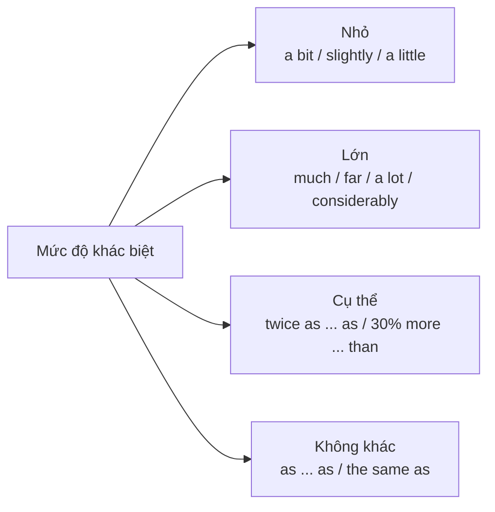

# B1-G022 · Comparison Structures — Cấu trúc so sánh nâng cao

## Mục lục

- [A. Lesson Information](#a-lesson-information)
- [B. Warm-up](#b-warm-up)
- [C. WHAT](#c-what)
- [D. WHY](#d-why)
- [E. FORM](#e-form)
- [F. HOW](#f-how)
- [G. VISUAL](#g-visual)
- [H. COMPARISON](#h-comparison)
- [I. COMMON MISTAKES](#i-common-mistakes)
- [J. MEMORY TRICKS](#j-memory-tricks)
- [K. REAL-LIFE APPLICATION](#k-real-life-application)
- [L. PRACTICE EXERCISES](#l-practice-exercises)
- [M. KNOWLEDGE CHECK](#m-knowledge-check)
- [N. ANSWER KEY](#n-answer-key)

---

## A. Lesson Information

| Mục | Nội dung |
|---|---|
| **Lesson ID** | B1-G022 |
| **Topic** | Advanced comparison: the + comparative, the + comparative; comparative + and + comparative; modifiers (much, far, a bit, slightly); not as ... as; twice as ... as; the same as; similar to / different from |
| **Tên tiếng Việt** | So sánh nâng cao: càng... càng..., ngày càng..., bổ nghĩa cho so sánh hơn, so sánh gấp nhiều lần |
| **CEFR Level** | B1 |
| **Prerequisites** | [A2-G027 — Comparisons](../../03-A2-ELEMENTARY/grammar/A2-G027-comparisons.md) |
| **Estimated Time** | 75 phút |

**Learning Objectives:**

1. Dùng **"càng... càng..."**: *The more you practise, the better you get.*
2. Dùng **"ngày càng..."**: *It's getting **hotter and hotter** / **more and more expensive**.*
3. Bổ nghĩa cho so sánh hơn: ***much / far / a lot*** (nhiều), ***a bit / slightly / a little*** (một chút).
4. Dùng so sánh **gấp nhiều lần**: *twice as big as, three times more expensive than*.
5. Dùng ***not as ... as, the same as, similar to, different from*** chính xác.

---

## B. Warm-up

> *Life in Ho Chi Minh City is getting **more and more expensive**. Rent is **much higher than** it was five years ago — some flats cost **twice as much as** they did in 2020. **The bigger** the city grows, **the worse** the traffic becomes.*

🤔 **Hãy suy nghĩ:** Đoạn văn có 4 cấu trúc so sánh mà bài A2 chưa dạy. Bạn nhận ra cấu trúc nào tương ứng với "ngày càng", "càng... càng", "gấp đôi"?

---

## C. WHAT

Ở A2 bạn đã học *taller than, the tallest, as tall as*. B1 mở rộng để so sánh **chính xác hơn** và **diễn tả xu hướng**:

| Cấu trúc | Nghĩa | Ví dụ |
|---|---|---|
| **The + so sánh hơn ..., the + so sánh hơn ...** | càng... càng... | *The sooner, the better.* |
| **So sánh hơn + and + so sánh hơn** | ngày càng | *bigger and bigger, more and more popular* |
| **much / far / a lot + so sánh hơn** | hơn nhiều | *much cheaper* |
| **a bit / slightly / a little + so sánh hơn** | hơn một chút | *slightly older* |
| **twice / three times + as ... as** | gấp 2/3 lần | *twice as fast as* |
| **not as/so ... as** | không bằng | *not as cold as* |
| **the same (N) as / similar to / different from** | giống / tương tự / khác | *the same age as* |

---

## D. WHY

Trong bài viết miêu tả **biểu đồ, xu hướng, so sánh hai lựa chọn** (kể cả VSTEP Writing/Speaking), cấu trúc so sánh giản đơn không đủ chính xác. "Đắt hơn" khác rất xa "đắt hơn **một chút**" và "đắt **gấp ba**".



---

## E. FORM

### E1. Càng... càng...

```text
The + comparative (+ S + V), the + comparative (+ S + V)
```

| Ví dụ |
|---|
| ***The more** you read, **the more** you learn.* |
| ***The older** I get, **the happier** I feel.* |
| ***The more expensive** the hotel (is), **the better** the service (is).* — đúng ngữ pháp; *is* có thể lược (về nội dung thì chưa chắc đã đúng!) |
| ***The sooner, the better.*** (rút gọn) |
| ***The more** money he earns, **the less** time he has.* (*more/less* + danh từ) |

### E2. Ngày càng...

| Loại tính từ | Cấu trúc | Ví dụ |
|---|---|---|
| Ngắn | **-er and -er** | *hotter and hotter, faster and faster* |
| Dài | **more and more + adj** | *more and more popular* |
| Danh từ | **more and more + N** | *more and more people* |
| Giảm | **less and less + adj** | *less and less interested* |

> Thường đi với *get, become, grow*: *It's **getting** colder and colder.*

### E3. Bổ nghĩa cho so sánh hơn

| Mức | Từ | Ví dụ |
|---|---|---|
| Nhiều | **much, far, a lot, considerably** | *This phone is **much** better than my old one.* |
| Ít | **a bit, a little, slightly** | *I'm **slightly** taller than my brother.* |
| Không thể dùng | ~~very~~ | ❌ *very cheaper* |

Với so sánh nhất: ***by far** the best* (tốt nhất, hơn hẳn).

### E4. So sánh gấp nhiều lần

| Cấu trúc | Ví dụ |
|---|---|
| **twice / three times + as + adj + as** | *The new stadium is **twice as big as** the old one.* |
| **twice / three times + as many/much + N + as** | *He earns **three times as much (money) as** me.* |
| **X times + comparative + than** | *This flat is **three times more expensive than** that one.* (phổ biến, được chấp nhận) |
| **half as ... as** | *It's **half as expensive as** the original.* |

### E5. Giống / khác

| Cấu trúc | Ví dụ |
|---|---|
| **the same + (N) + as** | *She is **the same age as** me.* / *My bag is **the same as** yours.* |
| **similar to** | *Your idea is **similar to** mine.* |
| **different from** (Anh–Mỹ cũng dùng *different than*) | *Life here is **different from** life in Vietnam.* |
| **not as/so + adj + as** | *The film was**n't as good as** the book.* |
| **like** (giới từ) | *She looks **like** her mother.* |

---

## F. HOW

| # | English | Tiếng Việt | Phân tích |
|---|---|---|---|
| 1 | ***The more** you practise speaking, **the more confident** you become.* | Càng luyện nói, bạn càng tự tin. | Càng... càng |
| 2 | *English is becoming **more and more important** in Vietnam.* | Tiếng Anh ngày càng quan trọng ở VN. | Ngày càng (tính từ dài) |
| 3 | *The days are getting **shorter and shorter**.* | Ngày càng ngắn lại. | Ngày càng (tính từ ngắn) |
| 4 | *The new metro is **much faster than** the bus.* | Metro mới nhanh hơn xe buýt nhiều. | *much* |
| 5 | *This year's results are **slightly better than** last year's.* | Kết quả năm nay tốt hơn một chút. | *slightly* |
| 6 | *A flat in the centre costs **twice as much as** one in the suburbs.* | Căn hộ ở trung tâm đắt gấp đôi. | Gấp đôi |
| 7 | *My salary isn't **as high as** I expected.* | Lương không cao như tôi mong đợi. | *not as ... as* |
| 8 | *Vietnamese grammar is **very different from** English grammar.* | Ngữ pháp tiếng Việt rất khác tiếng Anh. | *different from* — có thể dùng *very* trước *different* (tính từ thường) |
| 9 | *Phở is **by far the most popular** dish among tourists here.* | Phở là món phổ biến nhất, hơn hẳn. | *by far* + so sánh nhất |
| 10 | ***The less** sugar you eat, **the healthier** you'll be.* | Càng ăn ít đường, càng khỏe. | *less* + danh từ không đếm được |
| 11 | *Fewer and fewer people use cash these days.* | Ngày càng ít người dùng tiền mặt. | *fewer and fewer* + danh từ đếm được số nhiều |
| 12 | *Her phone is **the same model as** mine.* | Điện thoại của cô ấy cùng mẫu với của tôi. | *the same + N + as* |

---

## G. VISUAL

### Thang mức độ

```text
not as ... as     slightly / a bit     much / far      twice as ... as
     <                   ≈+                ++               ×2
"không bằng"       "hơn chút"          "hơn nhiều"      "gấp đôi"
```

### Công thức "càng... càng..."

```text
The  more    you study,   the  better   your English gets.
     ↑ so sánh hơn 1           ↑ so sánh hơn 2
```

---

## H. COMPARISON

### *very* vs *much* trước tính từ

| Tính từ thường | So sánh hơn |
|---|---|
| ***very** good* ✅ | ***much** better* ✅ — ~~very better~~ ❌ |
| ***very** expensive* ✅ | ***far** more expensive* ✅ |

### *less* vs *fewer*

| *less* + không đếm được | *fewer* + đếm được số nhiều |
|---|---|
| *less time, less money, less sugar* | *fewer people, fewer cars, fewer mistakes* |

> Trong văn nói, nhiều người bản ngữ vẫn nói *less people*, nhưng ở bài thi nên dùng *fewer*.

### *as ... as* vs *the same as*

| *as + adj + as* | *the same + N + as* |
|---|---|
| *She's **as tall as** me.* | *She's **the same height as** me.* |

---

## I. COMMON MISTAKES

| # | ❌ Sai | ✅ Đúng | Nguyên nhân | Cách tránh |
|---|---|---|---|---|
| 1 | **The more** you practise, **you get better**. | The more you practise, **the better** you get. | Thiếu *the + comparative* ở vế 2 | Hai vế đều *the + so sánh hơn* |
| 2 | It's getting **more and more hot**. | It's getting **hotter and hotter**. | Tính từ ngắn | -er and -er |
| 3 | This is **very cheaper**. | This is **much cheaper**. | *very* không đi với so sánh hơn | *much/far/a lot* |
| 4 | He's **twice taller than** me. | He's **twice as tall as** me. | Cấu trúc gấp đôi | twice **as** ... **as** |
| 5 | My phone is **the same with** yours. | ... **the same as** yours. | Giới từ | *the same as* |
| 6 | Life here is different **with** Vietnam. | ... different **from** life in Vietnam. | Giới từ; so sánh không tương xứng | *different from* + đối tượng cùng loại |
| 7 | **Less and less** people read newspapers. | **Fewer and fewer** people... | *people* đếm được | *fewer* |

---

## J. MEMORY TRICKS

1. **"Hai chữ THE như hai bàn cân"** ⚖️: *The more..., the more...* — vế nào cũng phải có *the*.
2. **"Very ghét -er"**: Không bao giờ *very* + so sánh hơn — thay bằng *much*.
3. **"Gấp — kẹp giữa hai AS"**: *twice **as** big **as***.

---

## K. REAL-LIFE APPLICATION

### Miêu tả xu hướng (dạng bài viết biểu đồ đơn giản)

> *Online shopping in Vietnam has become **more and more popular** over the last ten years. In 2015, only a small number of people bought things online, but now the number is **several times higher**. Young people shop online **far more often than** older people. Delivery is also **much faster** — some orders now arrive within two hours. However, online shopping is**n't as popular** in rural areas **as** in big cities, because internet access is **slightly worse** there. Overall, **the easier** it becomes to pay by phone, **the more** people will shop online.*

**Dịch tóm tắt:** Mua sắm trực tuyến ngày càng phổ biến ở VN; người trẻ mua online thường xuyên hơn nhiều so với người lớn tuổi; giao hàng nhanh hơn nhiều; ở nông thôn ít phổ biến hơn thành phố; thanh toán càng dễ, càng nhiều người mua online.

> ℹ️ Đoạn văn là ví dụ luyện tập; không dẫn số liệu thống kê cụ thể.

---

## L. PRACTICE EXERCISES

> ✍️ Đáp án: [B1-G022-ANSWERS](../../12-ANSWERS-AND-EXPLANATIONS/B1/B1-G022-ANSWERS.md)

### Level 1 — Recognition

**L1.1.** The ___ you sleep, the more tired you feel.  A. less  B. fewer  C. little
**L1.2.** Prices are getting ___.  A. high and high  B. higher and higher  C. more and more high
**L1.3.** This laptop is ___ than the old one.  A. very lighter  B. much lighter  C. more lighter
**L1.4.** A taxi costs ___ a bus ticket.  A. three times as much as  B. three times much than  C. as three times as
**L1.5.** Her bag is the same ___ mine.  A. with  B. like  C. as
**L1.6.** ___ people are buying newspapers.  A. Less and less  B. Fewer and fewer  C. Few and few

### Level 2 — Controlled Practice

Viết câu "càng... càng..." từ gợi ý.

**L2.1.** you / practise / much → you / improve / much
**L2.2.** the hotel / expensive → the service / good
**L2.3.** I / get / old → I / feel / wise
**L2.4.** we / leave / early → we / arrive / soon

Điền *much, slightly, twice as ... as, not as ... as, more and more, different from*.

**L2.5.** My new flat is ___ big ___ my old one — it has four rooms instead of two.
**L2.6.** The weather today is ___ warmer than yesterday — only one degree.
**L2.7.** The film was ___ exciting ___ the trailer suggested. I was disappointed.
**L2.8.** Electric cars are becoming ___ common in Vietnam.
**L2.9.** City life is very ___ country life.
**L2.10.** Flying is ___ quicker than taking the train — 2 hours instead of 30.

### Level 3 — Error Correction

**L3.1.** The more you exercise, you are healthier.
**L3.2.** It's getting more and more cold.
**L3.3.** This book is very more interesting than the film.
**L3.4.** My brother is twice older than me.
**L3.5.** Your phone is similar with mine.
**L3.6.** Less and less students walk to school nowadays.

### Level 4 — Production

**L4.1.** Dịch: *"Càng học nhiều từ vựng, bạn càng dễ đọc hiểu."*
**L4.2.** Dịch: *"Không khí ở Hà Nội ngày càng ô nhiễm."*
**L4.3.** Dịch: *"Căn nhà này rộng gấp ba căn hộ của tôi."*
**L4.4.** Viết 2 câu so sánh điện thoại của bạn với điện thoại của một người bạn, dùng *slightly* và *far*.

**L4.5.** **Explain:** Vì sao *"very cheaper"* sai, còn *"very cheap"* đúng? (Tiếng Việt, 1–2 câu.)

### Level 5 — Real Communication

**L5.1.** Viết đoạn văn 120–150 từ so sánh **cuộc sống hiện nay với 20 năm trước** ở quê bạn. Dùng ≥ 1 cấu trúc *càng... càng*, ≥ 2 *ngày càng*, ≥ 2 bổ nghĩa (*much/slightly...*), ≥ 1 *gấp nhiều lần*, ≥ 1 *not as ... as*.
**L5.2.** **Speaking — Compare two options:** Nói 1,5 phút: *Should a student live in a dormitory or rent a private room?* So sánh giá, tiện nghi, tự do, an toàn bằng cấu trúc trong bài.

---

## M. KNOWLEDGE CHECK

### 5 câu hỏi tự kiểm tra

1. Công thức "càng... càng"?
2. "Ngày càng" với tính từ ngắn và dài?
3. Những từ nào bổ nghĩa được cho so sánh hơn? Từ nào không?
4. Cách nói "gấp đôi"?
5. Giới từ sau *the same, similar, different*?

### Checklist

- [ ] Tôi viết đúng *The more..., the better...*.
- [ ] Tôi dùng *much/slightly* trước so sánh hơn, không dùng *very*.
- [ ] Tôi phân biệt *less/fewer*.

### 3 lỗi quan trọng cần nhớ

1. ~~The more..., you get better~~ → **the better** you get.
2. ~~very cheaper~~ → **much** cheaper.
3. ~~twice bigger than~~ → twice **as big as**.

### Lịch ôn tập

| Ngày | Việc cần làm |
|---|---|
| Ngày 1 | Làm lại L2 |
| Ngày 3 | Viết 5 câu "càng... càng" về việc học tiếng Anh |
| Ngày 7 | Áp dụng trong [W10 — Advantages & Disadvantages](../../09-FOUR-SKILLS/Writing/W10-advantages-disadvantages.md) |

### Liên kết

- ➡️ Bài tiếp theo: [B1-G023 — Adverbial Clauses](B1-G023-adverbial-clauses.md)

---

## N. ANSWER KEY

👉 [B1-G022-ANSWERS.md](../../12-ANSWERS-AND-EXPLANATIONS/B1/B1-G022-ANSWERS.md)
