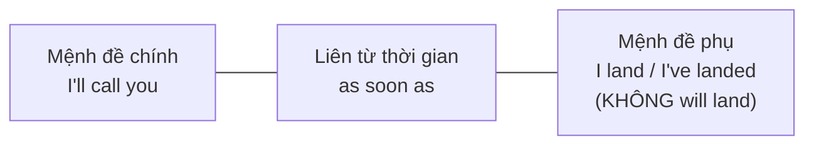

# B1-G023 · Adverbial Clauses — Mệnh đề trạng ngữ (thời gian, mục đích, nhượng bộ)

## Mục lục

- [A. Lesson Information](#a-lesson-information)
- [B. Warm-up](#b-warm-up)
- [C. WHAT](#c-what)
- [D. WHY](#d-why)
- [E. FORM](#e-form)
- [F. HOW](#f-how)
- [G. VISUAL](#g-visual)
- [H. COMPARISON](#h-comparison)
- [I. COMMON MISTAKES](#i-common-mistakes)
- [J. MEMORY TRICKS](#j-memory-tricks)
- [K. REAL-LIFE APPLICATION](#k-real-life-application)
- [L. PRACTICE EXERCISES](#l-practice-exercises)
- [M. KNOWLEDGE CHECK](#m-knowledge-check)
- [N. ANSWER KEY](#n-answer-key)

---

## A. Lesson Information

| Mục | Nội dung |
|---|---|
| **Lesson ID** | B1-G023 |
| **Topic** | Adverbial clauses of time (as soon as, until, by the time, once, while), purpose (so that, in order to, so as to), and concession (even though, even if, whatever/however) |
| **Tên tiếng Việt** | Mệnh đề trạng ngữ chỉ thời gian, mục đích, nhượng bộ |
| **CEFR Level** | B1 |
| **Prerequisites** | [B1-G019 — Complex Sentences](B1-G019-complex-sentences.md), [A2-G017 — First Conditional](../../03-A2-ELEMENTARY/grammar/A2-G017-first-conditional.md) |
| **Estimated Time** | 90 phút |

**Learning Objectives:**

1. Dùng **mệnh đề thời gian** với *as soon as, until, by the time, once, while, after, before* — và **không dùng *will*** trong mệnh đề thời gian chỉ tương lai.
2. Phân biệt **mục đích**: *to V, in order to, so as to, so that + can/could/will/would*.
3. Phân biệt **nhượng bộ**: *although, even though, even if*.
4. Dùng ***whatever, wherever, whenever, however + adj*** ("dù... gì/đâu/khi nào/thế nào").
5. Dùng **thì đúng** trong mệnh đề trạng ngữ tương lai và quá khứ.

---

## B. Warm-up

> *I'll call you **as soon as** I **land**.*
> *Don't leave **until** I **come** back.*
> ***By the time** you **get** this message, I'll be on the plane.*

🤔 **Hãy suy nghĩ:** Cả 3 câu nói về tương lai. Vì sao động từ sau *as soon as, until, by the time* lại ở **hiện tại đơn** chứ không phải *will land, will come, will get*?

---

## C. WHAT

**Mệnh đề trạng ngữ** (adverbial clause) là mệnh đề phụ trả lời câu hỏi **khi nào? để làm gì? mặc dù gì?** cho mệnh đề chính.

| Loại | Liên từ | Ví dụ |
|---|---|---|
| **Thời gian** | when, while, as, as soon as, once, until/till, before, after, by the time, since | ***Once** you finish, you can go.* |
| **Mục đích** | so that, in order that; (cụm) to, in order to, so as to | *I left early **so that** I could catch the train.* |
| **Nhượng bộ** | although, even though, though, even if, whatever, however, no matter what | ***Even if** it rains, we'll go.* |

> Mệnh đề lý do (*because, as, since*) và điều kiện (*if, unless*) đã có ở [B1-G018](B1-G018-linking-words.md) và các bài câu điều kiện.

---

## D. WHY

**Quy tắc vàng:** Trong mệnh đề **thời gian** (và điều kiện) nói về **tương lai**, tiếng Anh dùng **hiện tại** (hoặc hiện tại hoàn thành), không dùng *will*. *Will* chỉ nằm ở mệnh đề chính.



Lý do: liên từ thời gian đã "đặt" sự việc vào tương lai, nên không cần đánh dấu tương lai lần nữa.

---

## E. FORM

### E1. Mệnh đề thời gian

| Liên từ | Nghĩa | Ví dụ |
|---|---|---|
| **as soon as** | ngay khi | *I'll text you **as soon as** I **arrive**.* |
| **once** | một khi, khi đã | ***Once** you**'ve tried** it, you'll love it.* |
| **until / till** | cho đến khi | *Wait here **until** I **get** back.* |
| **by the time** | trước lúc, vào lúc mà | ***By the time** we **arrived**, the film **had started**.* |
| **while / as** | trong khi | ***While** I **was cooking**, the phone rang.* |
| **before / after** | trước / sau khi | ***After** you **finish**, please lock the door.* |
| **since** | kể từ khi | *I've lived here **since** I **was** ten.* |

| Thời điểm | Mệnh đề chính | Mệnh đề thời gian |
|---|---|---|
| Tương lai | **will / be going to / imperative** | **hiện tại đơn / HTHT** |
| Quá khứ | quá khứ / QKHT | quá khứ đơn |

> 💡 **HTHT** trong mệnh đề thời gian nhấn mạnh việc **hoàn tất** trước: *I'll leave when I've finished.*

> 💡 *by the time*: tương lai → *will have done* ở mệnh đề chính (xem [B1-G006](B1-G006-future-perfect.md)); quá khứ → *had done*.

### E2. Mệnh đề / cụm mục đích

| Cấu trúc | Khi nào | Ví dụ |
|---|---|---|
| **to + V** | chủ ngữ giống nhau | *I went to the bank **to get** some money.* |
| **in order to / so as to + V** | trang trọng hơn | *He left early **in order to avoid** the traffic.* |
| **in order not to / so as not to + V** | mục đích phủ định | *Speak quietly **so as not to wake** the baby.* |
| **so that + S + can/will** (hiện tại/tương lai) | hai chủ ngữ khác nhau, hoặc có modal | *I'll explain slowly **so that** everyone **can** understand.* |
| **so that + S + could/would** (quá khứ) | | *She saved money **so that** she **could** buy a laptop.* |

> ⚠️ Phủ định mục đích **không** dùng ~~not to~~ đơn lẻ trong văn trang trọng; dùng *so as not to / in order not to / so that ... won't*.

### E3. Nhượng bộ

| Liên từ | Nghĩa | Ví dụ |
|---|---|---|
| **although / though** | mặc dù (sự thật) | ***Although** it was late, she kept working.* |
| **even though** | mặc dù (nhấn mạnh hơn) | ***Even though** he's a millionaire, he lives simply.* |
| **even if** | **ngay cả khi** (giả định, có thể xảy ra hoặc không) | ***Even if** you apologise, she won't forgive you.* |
| **whatever / whoever / wherever / whenever** | bất cứ cái gì/ai/đâu/khi nào | ***Whatever** you decide, I'll support you.* |
| **however + adj/adv** | dù... đến đâu | ***However hard** I try, I can't remember his name.* |
| **no matter + what/how/where...** | dù... | ***No matter what** happens, stay calm.* |

---

## F. HOW

| # | English | Tiếng Việt | Phân tích |
|---|---|---|---|
| 1 | *I'll send you the file **as soon as** I **get** to the office.* | Tôi sẽ gửi file ngay khi đến văn phòng. | HT đơn sau *as soon as* |
| 2 | *You can't leave **until** you**'ve finished** the test.* | Bạn không được rời đi cho đến khi làm xong. | HTHT — nhấn mạnh hoàn tất |
| 3 | ***By the time** the ambulance **arrived**, the man **had** already **died**.* | Lúc xe cứu thương đến, người đàn ông đã mất. | Quá khứ: QKĐ + QKHT |
| 4 | ***By the time** you **graduate**, you**'ll have learned** a lot.* | Đến lúc tốt nghiệp, bạn sẽ học được nhiều. | Tương lai hoàn thành |
| 5 | *I'm saving money **so that** I **can** travel next summer.* | Tôi tiết kiệm để có thể đi du lịch hè tới. | *so that + can* |
| 6 | *She took notes **so as not to forget** the details.* | Cô ấy ghi chép để không quên chi tiết. | Mục đích phủ định |
| 7 | ***Even if** you **take** a taxi now, you'll miss the train.* | Ngay cả khi bạn đi taxi bây giờ, bạn vẫn lỡ tàu. | Giả định |
| 8 | ***Even though** she **was** exhausted, she finished the marathon.* | Mặc dù kiệt sức, cô ấy vẫn hoàn thành marathon. | Sự thật |
| 9 | ***Wherever** you go in Vietnam, people are friendly.* | Dù bạn đi đâu ở VN, mọi người đều thân thiện. | *wherever* |
| 10 | ***However** busy you **are**, make time for your family.* | Dù bận đến đâu, hãy dành thời gian cho gia đình. | *however + adj* |
| 11 | ***Once** you **understand** the rule, the exercises are easy.* | Một khi hiểu quy tắc, bài tập sẽ dễ. | *once* |
| 12 | ***While** we **were waiting** for the bus, it started to rain.* | Trong khi chờ xe buýt, trời bắt đầu mưa. | *while* + QKTD |

---

## G. VISUAL

### "Will" không vào mệnh đề thời gian

```text
I'll call you    when / as soon as / after / once / until   I  ARRIVE.
└─ will ở đây ─┘                                         └─ hiện tại ─┘
```

### even though vs even if

```text
even though  →  ✅ sự thật đã/đang xảy ra       "Even though it's raining..."  (trời ĐANG mưa)
even if      →  ❓ giả định, chưa chắc xảy ra   "Even if it rains..."          (có thể mưa hoặc không)
```

---

## H. COMPARISON

### *to V* vs *so that*

| *to / in order to + V* | *so that + S + modal + V* |
|---|---|
| Cùng chủ ngữ | Thường khác chủ ngữ hoặc cần *can/could* |
| *I study hard **to pass** the exam.* | *I explain clearly **so that** students **can** understand.* |

### *until* vs *by the time*

| *until* | *by the time* |
|---|---|
| Hành động **kéo dài** đến mốc | Hành động **hoàn tất trước** mốc |
| *I'll wait **until** 6.* (đợi suốt đến 6h) | *I'll have finished **by the time** you arrive.* (xong trước lúc bạn đến) |

### *however* — hai cách dùng

| Trạng từ liên kết (B1-G018) | Liên từ nhượng bộ (bài này) |
|---|---|
| ***However,** it was too late.* (Tuy nhiên) | ***However late** it is, call me.* (Dù muộn thế nào) |

---

## I. COMMON MISTAKES

| # | ❌ Sai | ✅ Đúng | Nguyên nhân | Cách tránh |
|---|---|---|---|---|
| 1 | I'll call you when I **will arrive**. | ... when I **arrive**. | Dịch "khi tôi sẽ đến" | Không *will* sau liên từ thời gian |
| 2 | Wait here **until** I **will come** back. | ... until I **come** back. | | |
| 3 | I study hard **for pass** the exam. | ... **to pass** the exam. | *for* + V | *to* + V (mục đích) |
| 4 | She whispered **so that not** to wake him. | ... **so as not to** wake him. / **so that** she **wouldn't** wake him. | Trộn hai cấu trúc | |
| 5 | **Even** it rains, we'll go. | **Even if** it rains... | Thiếu *if* | *even* là trạng từ, không là liên từ |
| 6 | **Even if** he's rich, he lives simply. (biết chắc anh ấy giàu) | **Even though** he's rich... | Nhầm sự thật/giả định | Sự thật → *even though* |
| 7 | **No matter** you do, I'll love you. | **No matter what** you do... | Thiếu từ để hỏi | *no matter + what/how/where* |
| 8 | **However** I try hard, I can't... | **However hard** I try... | Tách *however* khỏi tính từ | *however + adj/adv + S + V* |

---

## J. MEMORY TRICKS

1. **"Thời gian không cần sẽ"** ⏰: Sau *when, as soon as, until, before, after, once, by the time* → không *will*.
2. **"Even though = đã biết, Even if = nếu như"**: *though* gần *thought* (đã nghĩ đến sự thật); *if* = giả định.
3. **"Có modal thì so that"**: thấy *can/could/will/would* đi sau → *so that*.

---

## K. REAL-LIFE APPLICATION

### Tin nhắn dặn dò

> *Hi Minh, I'm leaving for the airport now. **As soon as** you **get** home, please feed the cat. Don't let her out **until** she**'s eaten**. I've left the keys under the mat **so that** you **can** get in. **Even if** you're busy, please water the plants **once** a day — **whenever** it's convenient. **By the time** I **get** back on Sunday, the new sofa **will have been** delivered, so please be at home on Saturday morning. **However** tired you **are**, don't forget to lock the door! Thanks a million!*

**Dịch tóm tắt:** Ngay khi về nhà, hãy cho mèo ăn; đừng thả mèo ra cho đến khi nó ăn xong; chìa khóa để dưới thảm để bạn vào được; dù bận cũng tưới cây mỗi ngày một lần; đến lúc tôi về Chủ nhật, sofa mới sẽ được giao; dù mệt đến đâu cũng đừng quên khóa cửa.

**Grammar highlights:** *as soon as you get, until she's eaten, so that you can, even if you're busy, whenever it's convenient, by the time I get back... will have been delivered, however tired you are*.

---

## L. PRACTICE EXERCISES

> ✍️ Đáp án: [B1-G023-ANSWERS](../../12-ANSWERS-AND-EXPLANATIONS/B1/B1-G023-ANSWERS.md)

### Level 1 — Recognition

**L1.1.** I'll phone you as soon as I ___ home.  A. get  B. will get  C. got
**L1.2.** ___ we arrived, the concert had already started.  A. Until  B. By the time  C. As soon as
**L1.3.** She saves money ___ she can buy a car.  A. to  B. so that  C. in order to
**L1.4.** ___ he's 80, he still swims every day. (Ông ấy thực sự 80 tuổi)  A. Even if  B. Even though  C. However
**L1.5.** ___ you go, I'll follow you.  A. Wherever  B. However  C. Whatever where
**L1.6.** He spoke quietly ___ wake the baby.  A. not to  B. so as not to  C. so that not

### Level 2 — Controlled Practice

Chia động từ trong ngoặc.

**L2.1.** I'll wait here until you (finish) ___.
**L2.2.** By the time she (arrive) ___ at the station, the train had left.
**L2.3.** Once you (read) ___ the instructions, you can start.
**L2.4.** While I (walk) ___ home last night, I saw a shooting star.
**L2.5.** By the time you get here, we (eat) ___ all the cake! (dùng tương lai hoàn thành)

Nối câu dùng từ trong ngoặc.

**L2.6.** I set two alarms. I didn't want to oversleep. (so as not to)
**L2.7.** She speaks slowly. Her students can understand her. (so that)
**L2.8.** You may apologise. She won't forgive you. (even if)
**L2.9.** I try hard. I can't open this jar. (however hard)
**L2.10.** He went to the library. He wanted to borrow some books. (to)

### Level 3 — Error Correction

**L3.1.** Call me when you will finish work.
**L3.2.** I went to the shop for buy some milk.
**L3.3.** Even it's expensive, I'll buy it.
**L3.4.** No matter you say, I won't change my mind.
**L3.5.** She left early so that she catch the train.
**L3.6.** However I study hard, I can't remember these words.

### Level 4 — Production

**L4.1.** Dịch: *"Tôi sẽ không đi ngủ cho đến khi làm xong bài tập."*
**L4.2.** Dịch: *"Lúc chúng tôi đến bãi biển thì trời đã tối."* (*By the time*)
**L4.3.** Dịch: *"Dù bạn chọn gì, tôi cũng ủng hộ bạn."* (*Whatever*)
**L4.4.** Dịch: *"Cô ấy học tiếng Anh mỗi tối để có thể làm việc ở nước ngoài."* (*so that*)

**L4.5.** **Explain:** Phân biệt *"Even though it's cold, I'll go swimming"* và *"Even if it's cold, I'll go swimming"* (tiếng Việt, 2 câu).

### Level 5 — Real Communication

**L5.1.** Viết một tin nhắn / email 100–130 từ dặn dò người trông nhà giúp bạn khi bạn đi vắng. Dùng ≥ 4 liên từ thời gian khác nhau, ≥ 2 cấu trúc mục đích, ≥ 2 cấu trúc nhượng bộ (*even if, whatever, however + adj...*). Chú ý không dùng *will* sai chỗ.
**L5.2.** **Speaking — Future plans:** Nói 1 phút về kế hoạch sau khi bạn đạt B2: *As soon as I..., Once I've..., By the time I'm 30, I'll have..., I'm studying hard so that...*.

---

## M. KNOWLEDGE CHECK

### 5 câu hỏi tự kiểm tra

1. Thì nào dùng sau *as soon as/until/when* khi nói về tương lai?
2. *until* khác *by the time* thế nào?
3. *to V* và *so that* khác nhau ra sao?
4. *even though* vs *even if*?
5. Trật tự từ với *however* nghĩa "dù... đến đâu"?

### Checklist

- [ ] Tôi không dùng *will* trong mệnh đề thời gian.
- [ ] Tôi dùng được *so that + can/could*.
- [ ] Tôi phân biệt *even though / even if*.

### 3 lỗi quan trọng cần nhớ

1. ~~when I will arrive~~ → when I **arrive**.
2. ~~for buy~~ → **to** buy.
3. ~~Even it rains~~ → **Even if** it rains.

### Lịch ôn tập

| Ngày | Việc cần làm |
|---|---|
| Ngày 1 | Làm lại L2 |
| Ngày 3 | Viết 5 câu về kế hoạch tuần tới với *as soon as, once, until, before, after* |
| Ngày 7 | Ôn cùng [B1-G024 — So / Such](B1-G024-so-such.md) |

### Liên kết

- ➡️ Bài tiếp theo: [B1-G024 — So / Such ... that](B1-G024-so-such.md)
- 🔜 [B2-G019 — Purpose, Result, Reason](../../05-B2-UPPER-INTERMEDIATE/grammar/B2-G019-purpose-result-reason.md)

---

## N. ANSWER KEY

👉 [B1-G023-ANSWERS.md](../../12-ANSWERS-AND-EXPLANATIONS/B1/B1-G023-ANSWERS.md)
