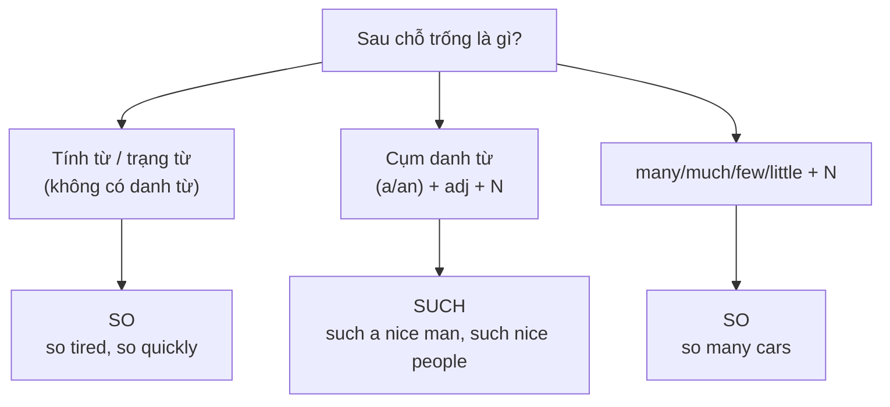

# B1-G024 · So / Such ... that; Too / Enough (review) — Quá... đến nỗi

## Mục lục

- [A. Lesson Information](#a-lesson-information)
- [B. Warm-up](#b-warm-up)
- [C. WHAT](#c-what)
- [D. WHY](#d-why)
- [E. FORM](#e-form)
- [F. HOW](#f-how)
- [G. VISUAL](#g-visual)
- [H. COMPARISON](#h-comparison)
- [I. COMMON MISTAKES](#i-common-mistakes)
- [J. MEMORY TRICKS](#j-memory-tricks)
- [K. REAL-LIFE APPLICATION](#k-real-life-application)
- [L. PRACTICE EXERCISES](#l-practice-exercises)
- [M. KNOWLEDGE CHECK](#m-knowledge-check)
- [N. ANSWER KEY](#n-answer-key)

---

## A. Lesson Information

| Mục | Nội dung |
|---|---|
| **Lesson ID** | B1-G024 |
| **Topic** | so + adj/adv (+ that); such (a/an) + (adj) + noun (+ that); so much/many/few/little; too ... to / not ... enough to (review & transformation) |
| **Tên tiếng Việt** | So / Such... that (quá... đến nỗi); ôn too / enough và chuyển đổi câu |
| **CEFR Level** | B1 |
| **Prerequisites** | [A2-G025 — Too / Enough](../../03-A2-ELEMENTARY/grammar/A2-G025-too-enough.md) |
| **Estimated Time** | 75 phút |

**Learning Objectives:**

1. Dùng **so + tính từ/trạng từ** và **such + (a/an) + tính từ + danh từ** để nhấn mạnh.
2. Dùng **so/such ... that** để nói **kết quả**.
3. Dùng **so much/many/few/little + danh từ**.
4. Chuyển đổi qua lại giữa **so ... that ↔ such ... that ↔ too ... to ↔ not ... enough to**.
5. Tránh nhầm **so that** (mục đích) với **so ... that** (kết quả).

---

## B. Warm-up

> *The film was **so** boring **that** I fell asleep.*
> *It was **such a** boring film **that** I fell asleep.*
> *The film was **too** boring **to** watch till the end.*

🤔 **Hãy suy nghĩ:** Ba câu cùng ý "Phim chán đến mức...". Vì sao câu 1 dùng *so*, câu 2 dùng *such a*? Điều gì đứng ngay sau mỗi từ?

---

## C. WHAT

| Cấu trúc | Nghĩa | Ví dụ |
|---|---|---|
| **so + adj/adv** | rất, quá (cảm thán) | *It's **so** hot today!* |
| **such + (a/an) + adj + N** | thật là, quá | *It's **such a** hot day!* |
| **so + adj/adv + that + mệnh đề** | quá... đến nỗi | *It was **so** hot **that** we stayed inside.* |
| **such + (a/an) + adj + N + that** | quá... đến nỗi | *It was **such a** hot day **that** we stayed inside.* |
| **so many/much/few/little + N + that** | nhiều/ít... đến nỗi | *There were **so many** people **that** we couldn't move.* |

---

## D. WHY

*So* và *such* có nghĩa giống nhau, nhưng **khác loại từ đi sau**: *so* đi với **tính từ/trạng từ** (không có danh từ), *such* đi với **cụm danh từ**.



---

## E. FORM

### E1. so

| Cấu trúc | Ví dụ |
|---|---|
| so + adj | *She was **so** kind.* |
| so + adv | *He drove **so** fast **that** the police stopped him.* |
| so + many + N đếm được số nhiều | ***so many** mistakes* |
| so + much + N không đếm được | ***so much** traffic* |
| so + few / little | ***so few** tickets, **so little** time* |

### E2. such

| Cấu trúc | Ví dụ |
|---|---|
| such + a/an + (adj) + N số ít | ***such a** good idea* |
| such + (adj) + N số nhiều | ***such** friendly people* |
| such + (adj) + N không đếm được | ***such** awful weather* |
| such + a lot of + N | ***such a lot of** work* |

### E3. *that* có thể lược bỏ trong văn nói

*It was so cold **(that)** the lake froze.*

### E4. Ôn *too* và *enough*

| Cấu trúc | Ví dụ |
|---|---|
| too + adj + (for O) + to V | *The box is **too heavy for me to lift**.* |
| (not) + adj + enough + (for O) + to V | *He is**n't old enough to drive**.* |
| enough + N + to V | *We don't have **enough money to buy** a car.* |

### E5. Chuyển đổi câu (dạng bài thi rất phổ biến)

| Gốc | Chuyển đổi |
|---|---|
| *The coffee was so hot that I couldn't drink it.* | *The coffee was **too hot (for me) to drink**.* |
| | *It was **such hot coffee that** I couldn't drink it.* |
| | *The coffee was**n't cool enough (for me) to drink**.* |

> ⚠️ Khi chuyển sang *too/enough ... to*, **bỏ tân ngữ** nếu nó trùng chủ ngữ: ~~too hot to drink **it**~~.

---

## F. HOW

| # | English | Tiếng Việt | Phân tích |
|---|---|---|---|
| 1 | *The exam was **so** difficult **that** nobody finished it.* | Bài thi khó đến nỗi không ai làm xong. | so + adj + that |
| 2 | *It was **such a** difficult exam **that** nobody finished it.* | | such a + adj + N |
| 3 | *They are **such** lovely people!* | Họ là những người thật dễ mến! | such + số nhiều (không *a*) |
| 4 | *She speaks **so** quickly **that** I can't follow her.* | Cô ấy nói nhanh đến nỗi tôi không theo kịp. | so + adv |
| 5 | *There was **so much** noise **that** I couldn't sleep.* | Ồn đến nỗi tôi không ngủ được. | so much + không đếm được |
| 6 | *I've had **so many** problems with this car!* | Tôi gặp bao nhiêu vấn đề với chiếc xe này! | so many |
| 7 | *We had **such** bad weather **that** the flight was cancelled.* | Thời tiết xấu đến nỗi chuyến bay bị hủy. | such + N không đếm được |
| 8 | *The suitcase is **too** heavy **for me to carry**.* | Va li quá nặng để tôi mang. | too ... for O to V |
| 9 | *He isn't experienced **enough to lead** the team.* | Anh ấy chưa đủ kinh nghiệm để dẫn dắt nhóm. | not ... enough to |
| 10 | *It was **such a lot of** homework **that** I stayed up late.* | Nhiều bài tập đến nỗi tôi thức khuya. | such a lot of |
| 11 | *I was **so** tired I went straight to bed.* | Mệt đến nỗi tôi đi ngủ ngay. | Lược *that* |
| 12 | *There were **so few** customers **that** the shop closed early.* | Ít khách đến nỗi cửa hàng đóng sớm. | so few |

---

## G. VISUAL

```text
SO     + [adj / adv]                       + (that) ...
         so  tired       so  quickly

SUCH   + [a/an + adj + noun]               + (that) ...
         such  a  tiring  day
SUCH   + [adj + plural / uncountable noun]
         such  tiring  days    such  awful  weather
```

---

## H. COMPARISON

### *so ... that* (kết quả) vs *so that* (mục đích)

| *so + adj + that* — **kết quả** | *so that* — **mục đích** ([B1-G023](B1-G023-adverbial-clauses.md)) |
|---|---|
| *He spoke **so** quietly **that** nobody heard him.* (nói nhỏ → hậu quả: không ai nghe) | *He spoke quietly **so that** nobody would hear him.* (nói nhỏ → để không ai nghe) |
| Có tính từ/trạng từ **giữa** *so* và *that* | *so that* đi liền nhau |

### *so/such* vs *too*

| *so ... that* | *too ... to* |
|---|---|
| Kết quả có thể tích cực hoặc tiêu cực | Thường mang nghĩa **tiêu cực** (không thể) |
| *It was so cheap that I bought two.* ✅ | ~~It was too cheap to buy~~ (vô lý) |

### *very* vs *so*

| *very* | *so* |
|---|---|
| Trung tính, mô tả | Cảm thán, nhấn mạnh, thường kéo theo kết quả |
| *It's very hot.* | *It's **so** hot! / so hot that...* |
| ❌ ~~very hot that~~ | ✅ *so hot that* |

---

## I. COMMON MISTAKES

| # | ❌ Sai | ✅ Đúng | Nguyên nhân | Cách tránh |
|---|---|---|---|---|
| 1 | It was **so** a beautiful day. | It was **such a** beautiful day. | *so* + cụm danh từ | Có danh từ → *such* |
| 2 | She is **such** kind. | She is **so** kind. | *such* + tính từ đơn | Không danh từ → *so* |
| 3 | They are **such a** nice people. | They are **such** nice people. | *a* + số nhiều | Số nhiều → bỏ *a* |
| 4 | It was **very** hot **that** we stayed home. | It was **so** hot that... | | *very* không đi với *that* |
| 5 | The tea was too hot to drink **it**. | The tea was too hot to drink. | Thừa tân ngữ | Tân ngữ trùng chủ ngữ → bỏ |
| 6 | There was **so many** traffic. | There was **so much** traffic. | *traffic* không đếm được | *much* |
| 7 | He's not **enough old** to vote. | He's not **old enough** to vote. | Vị trí *enough* với tính từ | adj + enough |

---

## J. MEMORY TRICKS

1. **"Such thích danh từ, So thích tính từ"** — *Such* có chữ **"h"** như **"hàng hóa"** (danh từ, đồ vật).
2. **"Có a thì such"**: thấy *a/an* → luôn là *such a/an*.
3. **"Enough đứng sau tính từ, trước danh từ"**: *old **enough** / **enough** money*.

---

## K. REAL-LIFE APPLICATION

### Review một kỳ nghỉ

> *Our trip to Ha Giang was amazing. The mountains were **so** beautiful **that** we stopped every ten minutes to take photos. The local people were **such** friendly people — one family even invited us for lunch. The roads were **too** narrow **for** big buses **to** use, so we rented motorbikes. On the second day, there was **so much** fog **that** we couldn't see the road, and we had to wait for two hours. It was **such an** unforgettable experience **that** I'm already planning to go back next year!*

**Dịch tóm tắt:** Núi đẹp đến nỗi cứ 10 phút lại dừng chụp ảnh; người dân rất thân thiện; đường quá hẹp cho xe buýt lớn nên thuê xe máy; sương mù dày đến nỗi phải chờ 2 tiếng; trải nghiệm khó quên đến nỗi đã lên kế hoạch quay lại.

---

## L. PRACTICE EXERCISES

> ✍️ Đáp án: [B1-G024-ANSWERS](../../12-ANSWERS-AND-EXPLANATIONS/B1/B1-G024-ANSWERS.md)

### Level 1 — Recognition

**L1.1.** It was ___ a long journey.  A. so  B. such  C. very
**L1.2.** The children were ___ excited that they couldn't sleep.  A. so  B. such  C. too
**L1.3.** They are ___ good friends.  A. such a  B. such  C. so
**L1.4.** There were ___ people that we couldn't get in.  A. so much  B. so many  C. such many
**L1.5.** He isn't ___ to join the army.  A. enough old  B. old enough  C. too old
**L1.6.** "He spoke loudly **so that** everyone could hear." — Câu nói về:  A. kết quả  B. mục đích

### Level 2 — Controlled Practice

Điền *so, such, such a/an*.

**L2.1.** It's ___ lovely weather today!
**L2.2.** I've never seen ___ beautiful sunset.
**L2.3.** The questions were ___ easy that everyone got full marks.
**L2.4.** We had ___ little time that we took a taxi.
**L2.5.** She's ___ honest person that everyone trusts her.

Viết lại câu bắt đầu bằng từ cho sẵn, giữ nguyên nghĩa.

**L2.6.** The book was so interesting that I read it in one night. → It was ______.
**L2.7.** It was such a heavy box that I couldn't lift it. → The box was too ______.
**L2.8.** The water is too cold for us to swim in. → The water isn't ______.
**L2.9.** He is so young that he can't drive. → He isn't ______.
**L2.10.** The film was so funny that we laughed all the time. → It was ______.

### Level 3 — Error Correction

**L3.1.** It was so a hot day that we went to the beach.
**L3.2.** My grandmother is such generous.
**L3.3.** They were such a kind people.
**L3.4.** The soup was too salty to eat it.
**L3.5.** There was so many rain that the streets flooded.
**L3.6.** She is enough tall to reach the top shelf.

### Level 4 — Production

**L4.1.** Dịch (dùng *so ... that*): *"Bài giảng nhàm chán đến nỗi một nửa lớp ngủ gật."*
**L4.2.** Dịch (dùng *such ... that*): *"Đó là một nhà hàng nổi tiếng đến nỗi bạn phải đặt bàn trước một tuần."*
**L4.3.** Dịch (dùng *too ... to*): *"Trời quá tối để chúng tôi nhìn thấy đường."*
**L4.4.** Dịch (dùng *not ... enough*): *"Căn phòng không đủ rộng cho 20 người."*

**L4.5.** **Explain:** Phân biệt *"He worked so hard that he got promoted"* và *"He worked hard so that he would get promoted"*. (2 câu tiếng Việt)

### Level 5 — Real Communication

**L5.1.** Viết một bài review 100–130 từ về một nhà hàng, khách sạn hoặc chuyến đi (thật hoặc tưởng tượng). Dùng ≥ 3 *so ... that*, ≥ 2 *such ... that*, ≥ 1 *too ... to*, ≥ 1 *(not) ... enough*.
**L5.2.** **Speaking — Exaggeration game:** Kể 1 phút về "the worst day of my life" với cấu trúc phóng đại: *I was so tired that..., It was such a disaster that..., There was so much traffic that...*.

---

## M. KNOWLEDGE CHECK

### 5 câu hỏi tự kiểm tra

1. *so* đi với gì? *such* đi với gì?
2. Khi nào dùng *such a* và khi nào *such* (không *a*)?
3. *so many* và *so much* khác nhau thế nào?
4. Vị trí *enough* với tính từ và danh từ?
5. *so ... that* và *so that* khác nhau ra sao?

### Checklist

- [ ] Tôi chọn đúng *so/such* dựa vào từ phía sau.
- [ ] Tôi chuyển đổi được giữa 4 cấu trúc.
- [ ] Tôi không thêm tân ngữ thừa sau *too ... to V*.

### 3 lỗi quan trọng cần nhớ

1. ~~so a beautiful day~~ → **such a** beautiful day.
2. ~~such a nice people~~ → **such** nice people.
3. ~~too hot to drink it~~ → too hot to drink.

### Lịch ôn tập

| Ngày | Việc cần làm |
|---|---|
| Ngày 1 | Làm lại L2.6–L2.10 |
| Ngày 3 | Viết 6 câu cảm thán với *so/such* về bạn bè, gia đình |
| Ngày 7 | Luyện chuyển đổi câu trong [LAB-04 — Sentence Transformation](../../10-PRACTICE-LAB/LAB-04-sentence-transformation.md) |

### Liên kết

- ➡️ Bài tiếp theo: [B1-G025 — Both, Either, Neither, Each, Every](B1-G025-both-either-neither-each-every.md)

---

## N. ANSWER KEY

👉 [B1-G024-ANSWERS.md](../../12-ANSWERS-AND-EXPLANATIONS/B1/B1-G024-ANSWERS.md)
