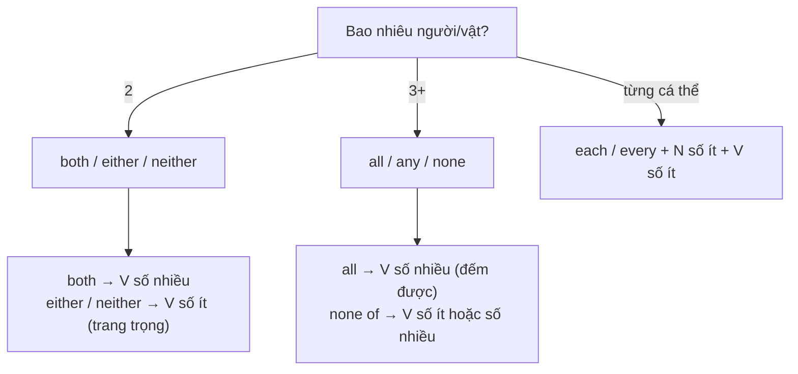

# B1-G025 · Both, Either, Neither, Each, Every, All, None — Từ hạn định chỉ số lượng

## Mục lục

- [A. Lesson Information](#a-lesson-information)
- [B. Warm-up](#b-warm-up)
- [C. WHAT](#c-what)
- [D. WHY](#d-why)
- [E. FORM](#e-form)
- [F. HOW](#f-how)
- [G. VISUAL](#g-visual)
- [H. COMPARISON](#h-comparison)
- [I. COMMON MISTAKES](#i-common-mistakes)
- [J. MEMORY TRICKS](#j-memory-tricks)
- [K. REAL-LIFE APPLICATION](#k-real-life-application)
- [L. PRACTICE EXERCISES](#l-practice-exercises)
- [M. KNOWLEDGE CHECK](#m-knowledge-check)
- [N. ANSWER KEY](#n-answer-key)

---

## A. Lesson Information

| Mục | Nội dung |
|---|---|
| **Lesson ID** | B1-G025 |
| **Topic** | both / either / neither (two things); all / none / each / every (three or more); both ... and, either ... or, neither ... nor; subject–verb agreement |
| **Tên tiếng Việt** | Cả hai / một trong hai / không cái nào; tất cả / mỗi / không ai; các cặp liên từ |
| **CEFR Level** | B1 |
| **Prerequisites** | [A2-G024 — Quantifiers](../../03-A2-ELEMENTARY/grammar/A2-G024-quantifiers.md) |
| **Estimated Time** | 75 phút |

**Learning Objectives:**

1. Dùng ***both, either, neither*** cho **hai** người/vật; ***all, none, any*** cho **ba trở lên**.
2. Dùng ***each*** và ***every*** đúng sắc thái và hòa hợp **động từ số ít**.
3. Dùng cấu trúc ***both/either/neither/all/none + of + the/my/them***.
4. Dùng các cặp ***both ... and, either ... or, neither ... nor*** với hòa hợp chủ–vị đúng.
5. Tránh **phủ định kép** với *neither/none*.

---

## B. Warm-up

> **Waiter:** *Would you like tea or coffee?*
> **Customer A:** *Either is fine.*
> **Customer B:** *Neither, thanks. Just water.*
> **Customer C:** *Can I have both?*

🤔 **Hãy suy nghĩ:** Ba khách hàng trả lời bằng *either, neither, both*. Nếu người phục vụ đưa ra **năm** loại đồ uống, các từ này còn dùng được không?

---

## C. WHAT

| Số lượng | Khẳng định tất cả | Bất kỳ một | Phủ định tất cả |
|---|---|---|---|
| **Hai** | **both** (cả hai) | **either** (một trong hai, cái nào cũng được) | **neither** (không cái nào trong hai) |
| **Ba trở lên** | **all** (tất cả) | **any** (bất kỳ) | **none** (không ai/cái nào) |

| Từ | Nhấn mạnh | Ví dụ |
|---|---|---|
| **each** | **từng cá thể riêng** (2 trở lên) | ***Each** student has a locker.* |
| **every** | **cả nhóm, không trừ ai** (3 trở lên) | ***Every** student passed.* |

---

## D. WHY

Tiếng Việt dùng "cả hai, tất cả, mỗi, không ai" tương tự, nhưng tiếng Anh tách bạch **2 vs 3+** và có quy tắc **hòa hợp động từ** riêng — đây là phần hay bị kiểm tra trong bài thi.



---

## E. FORM

### E1. both / either / neither

| Cấu trúc | Ví dụ | Động từ |
|---|---|---|
| **both + N số nhiều** | ***Both** restaurants **are** good.* | số nhiều |
| **both (of) the/my + N số nhiều** | ***Both (of) my** sisters **live** abroad.* | số nhiều |
| **both of + us/you/them** | ***Both of them** **are** doctors.* | số nhiều |
| **either / neither + N số ít** | ***Neither** answer **is** correct.* | số ít |
| **either / neither of + the/my + N số nhiều** | ***Neither of** my parents **speaks** English.* | số ít (trang trọng); số nhiều chấp nhận trong văn nói |

> ⚠️ *Neither* đã mang nghĩa phủ định → động từ **khẳng định**: ***Neither** of them **came**.* (không ~~didn't come~~)

### E2. Các cặp liên từ

| Cặp | Nghĩa | Ví dụ | Hòa hợp động từ |
|---|---|---|---|
| **both A and B** | cả A và B | ***Both** Lan **and** Mai **are** here.* | số nhiều |
| **either A or B** | hoặc A hoặc B | ***Either** you **or** Tom **has** to go.* | theo **B** (chủ ngữ gần) |
| **neither A nor B** | không A cũng không B | ***Neither** the manager **nor** the staff **were** happy.* | theo **B** |

### E3. all / none / any

| Cấu trúc | Ví dụ |
|---|---|
| **all + N số nhiều / không đếm được** | ***All** children **need** love. / **All** information **is** confidential.* |
| **all (of) the/my + N** | ***All (of) the** students **passed**.* |
| **all of + us/them** | *I invited **all of them**.* |
| **none of + the/my/us/them** | ***None of** my friends **likes/like** jazz.* |
| **no + N** (không dùng *none* trước danh từ trực tiếp) | *There's **no** milk.* / ~~none milk~~ |

### E4. each / every

| | each | every |
|---|---|---|
| + N số ít | ***each** room* | ***every** room* |
| + of | ✅ ***each of** the rooms* | ❌ ~~every of~~ → ***every one of** the rooms* |
| Đứng một mình | ✅ *They cost $5 **each**.* | ❌ |
| Hai người | ✅ *She had a bag in **each** hand.* | ❌ ~~every hand~~ |
| Tần suất | | ***every** day, **every** two weeks* |

> Động từ sau *each/every + N* luôn **số ít**: ***Every** student **has** a laptop.*

---

## F. HOW

| # | English | Tiếng Việt | Phân tích |
|---|---|---|---|
| 1 | ***Both** my parents **are** teachers.* | Cả bố và mẹ tôi đều là giáo viên. | both + N số nhiều |
| 2 | *You can park on **either** side of the street.* | Bạn có thể đỗ xe bên nào của đường cũng được. | either + N số ít |
| 3 | ***Neither** of the hotels **has** a pool.* | Cả hai khách sạn đều không có bể bơi. | neither + V khẳng định số ít |
| 4 | *I like **both** pizza **and** pasta.* | Tôi thích cả pizza lẫn mì Ý. | both ... and |
| 5 | *We can **either** take the bus **or** walk.* | Ta có thể đi xe buýt hoặc đi bộ. | either ... or |
| 6 | *He **neither** smokes **nor** drinks.* | Anh ấy không hút thuốc cũng không uống rượu. | neither ... nor (động từ khẳng định) |
| 7 | ***All** the tickets **were** sold in an hour.* | Toàn bộ vé bán hết trong một giờ. | all + số nhiều |
| 8 | ***None of** the students **knew** the answer.* | Không học sinh nào biết đáp án. | none of |
| 9 | ***Each** participant **will receive** a certificate.* | Mỗi người tham gia sẽ nhận chứng chỉ. | each — từng người |
| 10 | ***Every** room in the hotel **has** a sea view.* | Phòng nào của khách sạn cũng nhìn ra biển. | every — toàn bộ |
| 11 | *"Which one do you want?" — "**Either**. I don't mind."* | Cái nào cũng được. | either đứng một mình |
| 12 | *"Have you been to Paris or Rome?" — "**Neither**."* | Chưa đến nơi nào. | neither đứng một mình |

---

## G. VISUAL

```text
            CÓ                  MỘT BẤT KỲ             KHÔNG
2 vật      both  ●●            either  ●○ / ○●        neither  ○○
3+ vật     all   ●●●           any     ●○○ ...        none     ○○○
```

### each vs every

```text
each   → 👤 👤 👤  nhìn từng người một
every  → [👤👤👤👤] nhìn cả nhóm, không trừ ai
```

---

## H. COMPARISON

### *neither* vs *not ... either*

| *neither* (chủ ngữ/đầu câu) | *not ... either* |
|---|---|
| ***Neither** answer is correct.* | *I do**n't** like **either** answer.* (cùng nghĩa: không thích cả hai) |
| *A: I don't like it. — B: **Neither do I**.* | *B: I do**n't either**.* |

### *none of* vs *no*

| *none of* + the/my/them | *no* + danh từ |
|---|---|
| ***None of the** food was fresh.* | *There was **no** fresh food.* |

### *all* vs *every*

| *all* + N số nhiều + V số nhiều | *every* + N số ít + V số ít |
|---|---|
| ***All** students **have** to wear uniforms.* | ***Every** student **has** to wear a uniform.* |
| ***all day*** = suốt cả ngày | ***every day*** = mỗi ngày |

---

## I. COMMON MISTAKES

| # | ❌ Sai | ✅ Đúng | Nguyên nhân | Cách tránh |
|---|---|---|---|---|
| 1 | **Neither** of them **didn't** come. | Neither of them **came**. | Phủ định kép | *neither* đã phủ định |
| 2 | **Every** students **have** a book. | Every **student has** a book. | *every* + số nhiều | *every* + N số ít + V số ít |
| 3 | **Every of** the rooms is clean. | **Each of** / **Every one of** the rooms... | | *every* không + *of* |
| 4 | **Both** of them **is** here. | Both of them **are** here. | | *both* → số nhiều |
| 5 | I like **both** coffee **or** tea. | I like both coffee **and** tea. | Sai cặp | both–and, either–or, neither–nor |
| 6 | **None** student passed. | **No** student passed. / **None of the** students passed. | | *none* + *of* |
| 7 | Both of my three brothers... | **All** (of) my three brothers... | *both* chỉ cho 2 | 3+ → *all* |
| 8 | **The both** girls... | **Both (the)** girls... | Sai vị trí *the* | *both* đứng trước *the* |

---

## J. MEMORY TRICKS

1. **"B-E-N cho 2, A-A-N cho nhiều"**: **B**oth, **E**ither, **N**either ↔ **A**ll, **A**ny, **N**one.
2. **"Neither tự đã có NO"**: *N-either* = *not either* → không thêm *not*.
3. **"Every không bao giờ có of"**: *every of* ❌ → *every one of* ✅.

---

## K. REAL-LIFE APPLICATION

### Chọn khách sạn

> **Linh:** *I've found two hotels in Nha Trang. **Both** of them are near the beach.*
> **Duc:** *Do **either** of them have free breakfast?*
> **Linh:** ***Neither** of them does, unfortunately. But **each** room has a balcony.*
> **Duc:** *Hmm. What about the reviews?*
> **Linh:** *The first one has **both** good reviews **and** a lower price. **None of** the reviews mention noise.*
> **Duc:** *Great. **Either** is fine with me, but let's book the cheaper one. **Every** penny counts!*

**Dịch tóm tắt:** Hai khách sạn đều gần biển; không cái nào có bữa sáng miễn phí; mỗi phòng có ban công; khách sạn thứ nhất vừa review tốt vừa rẻ hơn; không review nào nhắc đến tiếng ồn; cái nào cũng được, nhưng đặt cái rẻ hơn.

> 💡 *Do either of them have...?* — trong câu hỏi văn nói, *either of + số nhiều* hay đi với động từ số nhiều; văn trang trọng: *Does either of them have...?*

---

## L. PRACTICE EXERCISES

> ✍️ Đáp án: [B1-G025-ANSWERS](../../12-ANSWERS-AND-EXPLANATIONS/B1/B1-G025-ANSWERS.md)

### Level 1 — Recognition

**L1.1.** I have two brothers. ___ of them live in Hanoi.  A. All  B. Both  C. Every
**L1.2.** "Monday or Tuesday?" — "___ is fine."  A. Both  B. Either  C. Neither
**L1.3.** ___ student in the class has a tablet.  A. All  B. Every  C. Both
**L1.4.** ___ of my friends came to the party. I was alone.  A. None  B. All  C. Each
**L1.5.** Neither Tom nor his brothers ___ at home.  A. was  B. were
**L1.6.** Câu nào **đúng**?  A. Neither of them didn't call.  B. Neither of them called.  C. Neither of them not called.

### Level 2 — Controlled Practice

Điền *both, either, neither, all, none, each, every*.

**L2.1.** ___ of my parents can swim — they never learned.
**L2.2.** The shop is open ___ day except Sunday.
**L2.3.** I've read ___ the Harry Potter books — all seven of them.
**L2.4.** You can sit at ___ end of the table. It doesn't matter.
**L2.5.** The tickets cost 200,000 dong ___.
**L2.6.** ___ of the five candidates had enough experience, so we didn't hire anyone.

Nối câu dùng cặp liên từ.

**L2.7.** Lan speaks French. Mai speaks French too. (both ... and)
**L2.8.** We can go to the cinema. Or we can stay home. (either ... or)
**L2.9.** He doesn't eat meat. He doesn't eat fish. (neither ... nor)
**L2.10.** The teacher wasn't satisfied. The students weren't satisfied. (neither ... nor — chú ý động từ)

### Level 3 — Error Correction

**L3.1.** Every students must bring an ID card.
**L3.2.** Neither of my sisters don't like spicy food.
**L3.3.** Both of the answer are wrong.
**L3.4.** Every of the participants got a T-shirt.
**L3.5.** I'd like both tea or coffee.
**L3.6.** None student was late.

### Level 4 — Production

**L4.1.** Dịch: *"Cả hai bộ phim đều hay, nhưng tôi thích bộ thứ hai hơn."*
**L4.2.** Dịch: *"Không ai trong số bạn tôi biết nấu ăn."*
**L4.3.** Dịch: *"Mỗi học sinh nhận được một món quà nhỏ."*
**L4.4.** Dịch: *"Bạn có thể trả bằng tiền mặt hoặc bằng thẻ."* (*either ... or*)

**L4.5.** **Explain:** Vì sao nói *"She had a bag in each hand"* mà không nói *"in every hand"*? (tiếng Việt)

### Level 5 — Real Communication

**L5.1.** Viết đoạn văn 100–130 từ so sánh **hai thành phố/hai trường/hai công việc** bạn biết. Dùng ≥ 6 từ trong bài (gồm *both, either, neither, each/every*) và ≥ 2 cặp liên từ (*both...and, neither...nor*...). Chú ý hòa hợp động từ.
**L5.2.** **Speaking — Survey results:** Hỏi 4–5 người trong nhà/bạn bè một câu hỏi (ví dụ: *Do you drink coffee?*). Báo cáo kết quả trong 1 phút: *All of them..., None of them..., Both my parents..., Neither of my sisters..., Each person...*.

---

## M. KNOWLEDGE CHECK

### 5 câu hỏi tự kiểm tra

1. Nhóm từ cho 2 vật và nhóm cho 3+ vật?
2. Động từ sau *every + N* chia thế nào?
3. *each* và *every* khác nhau ở những điểm nào?
4. Hòa hợp động từ với *either ... or / neither ... nor*?
5. Vì sao *Neither of them didn't come* sai?

### Checklist

- [ ] Tôi dùng *both/either/neither* chỉ cho 2.
- [ ] Tôi không viết ~~every of~~, ~~every students~~.
- [ ] Tôi tránh phủ định kép với *neither/none*.

### 3 lỗi quan trọng cần nhớ

1. ~~Neither ... didn't~~ → Neither ... **did**.
2. ~~every students~~ → every **student**.
3. ~~both ... or~~ → both ... **and**.

### Lịch ôn tập

| Ngày | Việc cần làm |
|---|---|
| Ngày 1 | Làm lại L2 |
| Ngày 3 | Viết 6 câu về gia đình với *both, neither, all, none, each, every* |
| Ngày 7 | Ôn hòa hợp chủ–vị: [B2-G022 — Subject-Verb Agreement](../../05-B2-UPPER-INTERMEDIATE/grammar/B2-G022-subject-verb-agreement.md) |

### Liên kết

- ➡️ Bài tiếp theo: [B1-G026 — Expressing Opinions](B1-G026-expressing-opinions.md)

---

## N. ANSWER KEY

👉 [B1-G025-ANSWERS.md](../../12-ANSWERS-AND-EXPLANATIONS/B1/B1-G025-ANSWERS.md)
