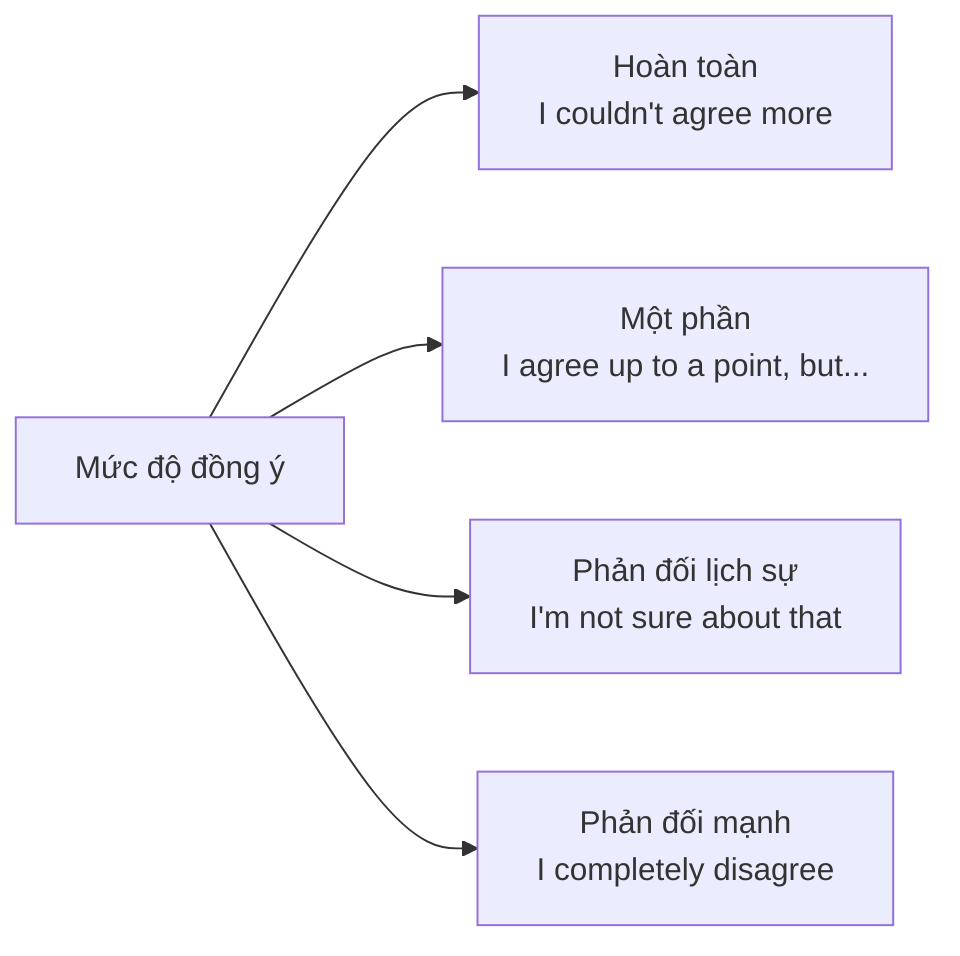

# B1-G026 · Expressing Opinions, Agreeing & Disagreeing — Bày tỏ quan điểm

## Mục lục

- [A. Lesson Information](#a-lesson-information)
- [B. Warm-up](#b-warm-up)
- [C. WHAT](#c-what)
- [D. WHY](#d-why)
- [E. FORM](#e-form)
- [F. HOW](#f-how)
- [G. VISUAL](#g-visual)
- [H. COMPARISON](#h-comparison)
- [I. COMMON MISTAKES](#i-common-mistakes)
- [J. MEMORY TRICKS](#j-memory-tricks)
- [K. REAL-LIFE APPLICATION](#k-real-life-application)
- [L. PRACTICE EXERCISES](#l-practice-exercises)
- [M. KNOWLEDGE CHECK](#m-knowledge-check)
- [N. ANSWER KEY](#n-answer-key)

---

## A. Lesson Information

| Mục | Nội dung |
|---|---|
| **Lesson ID** | B1-G026 |
| **Topic** | Language and grammar for opinions: I think / I don't think + that-clause; In my opinion / As far as I'm concerned; agreeing / partially agreeing / disagreeing; softening (I'm not sure..., I'd say...); so do I / neither do I |
| **Tên tiếng Việt** | Ngôn ngữ bày tỏ quan điểm, đồng ý, phản đối, làm mềm ý kiến |
| **CEFR Level** | B1 |
| **Prerequisites** | [B1-G018 — Linking Words](B1-G018-linking-words.md), [B1-G019 — Complex Sentences](B1-G019-complex-sentences.md) |
| **Estimated Time** | 90 phút |

**Learning Objectives:**

1. Dùng các cụm **nêu quan điểm** ở nhiều mức độ trang trọng.
2. Dùng đúng **I don't think ...** (chuyển phủ định lên động từ *think*).
3. **Đồng ý, đồng ý một phần, phản đối** lịch sự.
4. **Làm mềm** quan điểm (hedging cơ bản): *I'd say, it seems to me, I'm not sure that...*
5. Dùng ***So do I / Neither do I / I do / I don't*** để phản hồi ngắn.

---

## B. Warm-up

> **A:** *I think social media is bad for teenagers.*
> **B:** *I see your point, but **I don't think** it's all bad. **It seems to me that** it helps shy students make friends.*
> **C:** *I agree with you to some extent. **As far as I'm concerned**, the problem is how much time they spend online.*

🤔 **Hãy suy nghĩ:** B không đồng ý nhưng không nói *"You're wrong"*. B dùng những cách nào để phản đối mà vẫn lịch sự? Và vì sao B nói *I don't think it's all bad* chứ không *I think it isn't all bad*?

---

## C. WHAT

Bài này kết hợp **ngữ pháp** (mệnh đề *that*, phủ định chuyển, đảo ngữ ngắn với *so/neither*) và **chức năng giao tiếp** (functional language) — thứ mà phần thi Nói và Viết B1–B2 đòi hỏi liên tục.

| Chức năng | Cụm điển hình |
|---|---|
| Nêu quan điểm | *I think / I believe / In my opinion / Personally, ...* |
| Đồng ý | *I agree / Exactly / That's true / I couldn't agree more* |
| Đồng ý một phần | *I agree to some extent, but... / That's partly true, but...* |
| Phản đối lịch sự | *I'm not sure I agree / I see your point, but... / I'm afraid I disagree* |
| Làm mềm | *I'd say... / It seems to me that... / I tend to think...* |
| Phản hồi ngắn | *So do I / Neither do I / I do / I don't* |

---

## D. WHY

Ở trình độ B1, giám khảo không chỉ chấm bạn **nói gì** mà còn chấm **cách** bạn nói: có dùng **đa dạng** cụm nêu quan điểm không, có **lịch sự** khi phản đối không.



> 💡 Văn hóa giao tiếp tiếng Anh thường **làm mềm** sự phản đối. Nói thẳng *"You're wrong"* trong thảo luận có thể bị coi là thô lỗ.

---

## E. FORM

### E1. Nêu quan điểm

| Mức | Cụm | Cấu trúc |
|---|---|---|
| Thân mật | *I think (that)..., I reckon..., I feel...* | + mệnh đề |
| Trung tính | *In my opinion, ... / In my view, ... / Personally, ...* | + dấu phẩy + câu |
| Trang trọng | *As far as I'm concerned, ... / It seems to me that... / I'm convinced that...* | |
| Hỏi ý kiến | *What do you think about...? / How do you feel about...? / What's your view on...?* | |

### E2. Phủ định chuyển (transferred negation)

| ✅ Tự nhiên | ❌ / Ít tự nhiên |
|---|---|
| *I **don't think** it's a good idea.* | *I think it **isn't** a good idea.* (đúng ngữ pháp nhưng kém tự nhiên) |
| *I **don't believe** he'll come.* | |
| *I **don't expect** it will rain.* | |

> Với *think, believe, expect, suppose, imagine*, người bản ngữ thường đặt phủ định vào động từ chính.

### E3. Đồng ý / phản đối

| Đồng ý | Đồng ý một phần | Phản đối lịch sự |
|---|---|---|
| *I (totally) agree (with you).* | *I agree up to a point, but...* | *I see what you mean, but...* |
| *That's a good point.* | *That's partly true. However, ...* | *I'm not sure I agree.* |
| *Exactly. / Absolutely.* | *You may be right, but...* | *I'm afraid I see it differently.* |
| *I couldn't agree more.* | *I take your point, but...* | *I don't think that's quite right.* |

> ⚠️ *agree* là **động từ**: *I **agree**.* — không ~~I am agree~~.

### E4. Phản hồi ngắn: So do I / Neither do I

| Câu của A | Đồng ý | Không đồng ý |
|---|---|---|
| *I **love** jazz.* (khẳng định) | ***So do I.*** / *Me too.* | *I **don't**.* |
| *I **don't like** jazz.* (phủ định) | ***Neither do I.*** / *Me neither.* | *I **do**.* |
| *I**'m** tired.* | ***So am I.*** | *I'm **not**.* |
| *I **can't** swim.* | ***Neither can I.*** | *I **can**.* |
| *I **went** there last year.* | ***So did I.*** | *I **didn't**.* |

> Trợ động từ phải **khớp** với câu gốc: *be → am/is/are*, động từ thường → *do/does/did*, modal → giữ nguyên.

---

## F. HOW

| # | English | Tiếng Việt | Phân tích |
|---|---|---|---|
| 1 | ***In my opinion,** online learning is just as effective as classroom learning.* | Theo tôi, học online hiệu quả không kém học trên lớp. | Trung tính |
| 2 | *I **don't think** homework should be banned.* | Tôi không nghĩ nên cấm bài tập về nhà. | Phủ định chuyển |
| 3 | ***As far as I'm concerned,** health is more important than money.* | Theo quan điểm của tôi, sức khỏe quan trọng hơn tiền. | Trang trọng |
| 4 | *"Cities should ban cars." — "**I agree up to a point, but** what about people with disabilities?"* | Tôi đồng ý phần nào, nhưng... | Đồng ý một phần |
| 5 | *"**I see what you mean, but** I'm not sure it would work in practice."* | Tôi hiểu ý bạn, nhưng... | Phản đối lịch sự |
| 6 | *"Exams are stressful." — "**I couldn't agree more.**"* | Tôi hoàn toàn đồng ý. | Đồng ý mạnh |
| 7 | *"I don't like horror films." — "**Neither do I.**"* | Tôi cũng không. | Neither + trợ động từ + S |
| 8 | *"I've been to Japan." — "**So have I!**"* | Tôi cũng vậy! | Khớp *have* |
| 9 | ***It seems to me that** people are working longer hours than before.* | Tôi thấy dường như... | Làm mềm |
| 10 | *"**What's your view on** working from home?"* | Bạn nghĩ sao về... | Hỏi ý kiến |
| 11 | ***Personally,** I'd rather live in a small town.* | Cá nhân tôi... | |
| 12 | *"**I'm afraid I disagree.** I think the price is too high."* | Tôi e là tôi không đồng ý. | Phản đối trang trọng |

---

## G. VISUAL

### Cấu trúc một câu trả lời quan điểm (Speaking/Writing)

```text
1. QUAN ĐIỂM   →  In my opinion, ...
2. LÝ DO       →  This is because ... / The main reason is that ...
3. VÍ DỤ       →  For example, ...
4. NHƯỢNG BỘ   →  Admittedly, ... / Although some people think ..., ...
5. KẾT         →  So overall, I believe ...
```

### So / Neither — khớp trợ động từ

```text
A: I  CAN  drive.           →  B: So  CAN  I.
A: I  DON'T eat meat.       →  B: Neither  DO  I.
A: She  IS  tired.          →  B: So  AM  I.
A: We  WENT  home early.    →  B: So  DID  we.
```

---

## H. COMPARISON

### *I think* vs *In my opinion*

| *I think (that) + mệnh đề* | *In my opinion, + câu* |
|---|---|
| Ngữ pháp: động từ + mệnh đề | Cụm giới từ + dấu phẩy |
| ❌ ~~In my opinion, I think...~~ (thừa) | Chỉ dùng một trong hai |

### *Me too / Me neither* vs *So do I / Neither do I*

| Thân mật | Trung tính – trang trọng hơn |
|---|---|
| *Me too. / Me neither.* | *So do I. / Neither do I.* |

### *agree with / agree on / agree to*

| Cụm | Ví dụ |
|---|---|
| agree **with** + người / ý kiến | *I agree **with** you / with this idea.* |
| agree **on** + vấn đề chung | *We agreed **on** a price.* |
| agree **to** + đề nghị / V | *He agreed **to** help me.* |

---

## I. COMMON MISTAKES

| # | ❌ Sai | ✅ Đúng | Nguyên nhân | Cách tránh |
|---|---|---|---|---|
| 1 | I **am agree** with you. | I **agree** with you. | Dịch "tôi đồng ý" thành *be + agree* | *agree* là động từ |
| 2 | **In my opinion, I think** it's good. | In my opinion, it's good. / I think it's good. | Thừa | Một cụm thôi |
| 3 | I think it **isn't** a good idea. | I **don't think** it's a good idea. | | Phủ định chuyển (tự nhiên hơn) |
| 4 | "I don't like it." — "**So do I.**" | **Neither do I.** | Không khớp phủ định | Câu phủ định → *Neither* |
| 5 | "I'm hungry." — "**So do I.**" | **So am I.** | Không khớp trợ động từ | *be* → *am* |
| 6 | **According to me**, ... | **In my opinion**, ... | Dịch "theo tôi" | *according to* + người khác/nguồn |
| 7 | **Neither I do.** | **Neither do I.** | Trật tự | Đảo trợ động từ |
| 8 | You are wrong. (trong thảo luận lịch sự) | I'm not sure I agree. / I see it differently. | Quá thẳng | Làm mềm |

---

## J. MEMORY TRICKS

1. **"Agree không cần BE"** 🙅: Giống *like, want* — *I agree*, không ~~I am agree~~.
2. **"According to — cho NGƯỜI KHÁC"**: *according to the news / to experts* — không dùng cho chính mình.
3. **"Tiếng vọng"**: *So/Neither* + **lặp lại trợ động từ** của người nói như tiếng vọng: *I **can** → So **can** I*.

---

## K. REAL-LIFE APPLICATION

### Thảo luận nhóm: Should university be free?

> **Mai:** *What do you think about free university education?*
> **Khoa:** *Personally, I believe it should be free. Education is a right, not a privilege.*
> **Mai:** *I agree up to a point, but who would pay for it? Taxes would go up.*
> **Khoa:** *That's a fair point. However, it seems to me that society benefits when more people are educated.*
> **Lan:** *I couldn't agree more. But I don't think it should be free for everyone — maybe only for students from low-income families.*
> **Mai:** *Hmm, I'm not sure that's fair either. How would you decide who qualifies?*
> **Khoa:** *Good question. I suppose there'd need to be clear rules.*
> **Lan:** *Exactly. So overall, we agree education matters, but we see the funding differently.*

**Dịch tóm tắt:** Ba bạn thảo luận có nên miễn học phí đại học không. Khoa ủng hộ; Mai đồng ý một phần nhưng lo về thuế; Lan đề xuất chỉ miễn cho sinh viên thu nhập thấp; cả nhóm đồng ý giáo dục quan trọng nhưng khác quan điểm về nguồn tài chính.

**Kỹ năng:** hỏi ý kiến · nêu quan điểm · đồng ý một phần · phản đối lịch sự · tóm tắt.

---

## L. PRACTICE EXERCISES

> ✍️ Đáp án: [B1-G026-ANSWERS](../../12-ANSWERS-AND-EXPLANATIONS/B1/B1-G026-ANSWERS.md)

### Level 1 — Recognition

**L1.1.** "I love spicy food." — "___"  A. So do I.  B. Neither do I.  C. So am I.
**L1.2.** "I can't swim." — "___"  A. So can I.  B. Neither can I.  C. Neither do I.
**L1.3.** Câu nào **đúng**?  A. I am agree with you.  B. I agree with you.  C. I agreeing with you.
**L1.4.** Câu nào **tự nhiên nhất**?  A. I think it won't rain.  B. I don't think it will rain.  C. I think it doesn't will rain.
**L1.5.** Cụm nào là **phản đối lịch sự**?  A. You're totally wrong.  B. I see your point, but...  C. Exactly.
**L1.6.** "I was tired yesterday." — "___"  A. So did I.  B. So was I.  C. So I was.

### Level 2 — Controlled Practice

Phản hồi đồng ý bằng *So/Neither + trợ động từ + I*.

**L2.1.** I've never been to Europe. → ___
**L2.2.** I'm learning Japanese. → ___
**L2.3.** I didn't enjoy the film. → ___
**L2.4.** I'd like a cup of tea. → ___
**L2.5.** I hate waiting in queues. → ___

Viết lại dùng *I don't think*.

**L2.6.** I think she isn't coming tonight.
**L2.7.** I think that restaurant isn't very good.

Điền giới từ: *with, on, to*.

**L2.8.** I completely agree ___ your point about pollution.
**L2.9.** After an hour, we finally agreed ___ a date for the meeting.
**L2.10.** The landlord agreed ___ repair the air conditioner.

### Level 3 — Error Correction

**L3.1.** According to me, smartphones are necessary.
**L3.2.** In my opinion, I think the price is too high.
**L3.3.** "I don't eat pork." — "So do I."
**L3.4.** I'm not agree with this idea.
**L3.5.** "She can play the guitar." — "So do I."
**L3.6.** "I'm not hungry." — "Neither I am."

### Level 4 — Production

**L4.1.** Viết 3 cách nêu quan điểm (thân mật, trung tính, trang trọng) cho ý: *"Học sinh nên mặc đồng phục."*
**L4.2.** Phản hồi đồng ý một phần với câu: *"Everyone should learn to code at school."*
**L4.3.** Phản đối lịch sự câu: *"Tourism only brings problems to local communities."*
**L4.4.** Hỏi ý kiến người khác về chủ đề *working four days a week* bằng 2 cách khác nhau.

**L4.5.** **Explain:** Vì sao người học nên tránh nói *"You are wrong"* trong thảo luận tiếng Anh, và nên thay bằng gì? (tiếng Việt, 2–3 câu)

### Level 5 — Real Communication

**L5.1.** Viết đoạn văn 130–160 từ trả lời câu hỏi: *Do you think students should be allowed to use phones in class?* Theo cấu trúc: quan điểm → 2 lý do → ví dụ → nhượng bộ ý kiến trái chiều → kết luận. Dùng ≥ 4 cụm quan điểm/đồng ý/phản đối khác nhau.
**L5.2.** **Speaking — Discussion role-play:** Với một người bạn (hoặc tự đóng 2 vai), thảo luận 2 phút chủ đề *Is it better to rent or buy a house?* Mỗi người dùng ≥ 2 cụm đồng ý một phần và ≥ 1 cụm phản đối lịch sự. Ghi âm lại.

---

## M. KNOWLEDGE CHECK

### 5 câu hỏi tự kiểm tra

1. Kể 3 cụm nêu quan điểm trang trọng.
2. Phủ định chuyển là gì? Cho ví dụ.
3. Phản hồi "Tôi cũng vậy" với câu phủ định thế nào?
4. *agree with / on / to* khác nhau ra sao?
5. Vì sao *According to me* không tự nhiên?

### Checklist

- [ ] Tôi không viết ~~I am agree~~.
- [ ] Tôi phản hồi *So/Neither* khớp trợ động từ.
- [ ] Tôi phản đối lịch sự bằng ≥ 3 cách.

### 3 lỗi quan trọng cần nhớ

1. ~~I am agree~~ → I **agree**.
2. ~~According to me~~ → **In my opinion**.
3. ~~In my opinion, I think~~ → chọn một.

### Lịch ôn tập

| Ngày | Việc cần làm |
|---|---|
| Ngày 1 | Làm lại L2 |
| Ngày 3 | Chọn 3 chủ đề xã hội, nói 1 phút mỗi chủ đề theo cấu trúc 5 bước |
| Ngày 7 | Luyện với [S04 — Expressing Opinions](../../09-FOUR-SKILLS/Speaking/S04-expressing-opinions.md) và [W08 — Opinion Essays](../../09-FOUR-SKILLS/Writing/W08-opinion-essays.md) |

### Liên kết

- ✅ Đây là bài cuối của B1. Tiếp theo: [B1 Skills Practice](../B1-SKILLS-PRACTICE.md) → [B1 Exit Test](../../11-EXAMS-AND-ASSESSMENTS/B1-EXIT-TEST.md)
- 🔜 [B2-G025 — Hedging & Academic Language](../../05-B2-UPPER-INTERMEDIATE/grammar/B2-G025-hedging-academic-language.md)

---

## N. ANSWER KEY

👉 [B1-G026-ANSWERS.md](../../12-ANSWERS-AND-EXPLANATIONS/B1/B1-G026-ANSWERS.md)
