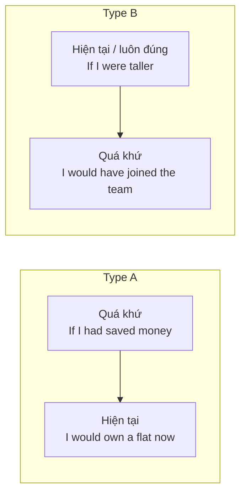

# B2-G001 · Mixed Conditionals — Câu điều kiện hỗn hợp

## Mục lục

- [A. Lesson Information](#a-lesson-information)
- [B. Warm-up](#b-warm-up)
- [C. WHAT](#c-what)
- [D. WHY](#d-why)
- [E. FORM](#e-form)
- [F. HOW](#f-how)
- [G. VISUAL](#g-visual)
- [H. COMPARISON](#h-comparison)
- [I. COMMON MISTAKES](#i-common-mistakes)
- [J. MEMORY TRICKS](#j-memory-tricks)
- [K. REAL-LIFE APPLICATION](#k-real-life-application)
- [L. PRACTICE EXERCISES](#l-practice-exercises)
- [M. KNOWLEDGE CHECK](#m-knowledge-check)
- [N. ANSWER KEY](#n-answer-key)

---

## A. Lesson Information

| Mục | Nội dung |
|---|---|
| **Lesson ID** | B2-G001 |
| **Topic** | Mixed Conditionals: past condition → present result; present condition → past result |
| **Tên tiếng Việt** | Câu điều kiện hỗn hợp: điều kiện quá khứ → kết quả hiện tại, và ngược lại |
| **CEFR Level** | B2 |
| **Prerequisites** | [B1-G007 — Second Conditional](../../04-B1-INTERMEDIATE/grammar/B1-G007-second-conditional.md), [B1-G008 — Third Conditional](../../04-B1-INTERMEDIATE/grammar/B1-G008-third-conditional.md) |
| **Estimated Time** | 90 phút |

**Learning Objectives:**

1. Hiểu vì sao cần **trộn** loại 2 và loại 3 khi thời gian của điều kiện và kết quả **khác nhau**.
2. Dùng **Mixed type A**: *If + had V3, would + V* (quá khứ → hiện tại).
3. Dùng **Mixed type B**: *If + V2/were, would have + V3* (đặc điểm/sự thật hiện tại → kết quả quá khứ).
4. Dùng thêm biến thể với *could/might* và *would be + V-ing*.
5. Viết lại câu thực tế thành câu điều kiện hỗn hợp chính xác.

---

## B. Warm-up

Đọc hai câu:

> *If I had studied medicine, I **would be** a doctor now.*
> *If I weren't so shy, I **would have spoken** to her at the party last night.*

🤔 **Hãy suy nghĩ:** Câu 1 nói về quá khứ hay hiện tại? Câu 2 thì sao? Cả hai câu đều **không** phải loại 2 "thuần" hay loại 3 "thuần". Chúng "mượn" vế nào của loại nào?

---

## C. WHAT

**Câu điều kiện hỗn hợp** (mixed conditional) kết hợp **mệnh đề *if* của một loại** với **mệnh đề chính của loại khác**, vì điều kiện và kết quả nằm ở **hai thời điểm khác nhau**.

| Kiểu | Điều kiện | Kết quả | Ví dụ |
|---|---|---|---|
| **Type A** (3 → 2) | Quá khứ không có thật | Hiện tại không có thật | *If I **had taken** the job, I **would live** in Singapore now.* |
| **Type B** (2 → 3) | Hiện tại/luôn đúng không có thật | Quá khứ không có thật | *If I **spoke** French, I **would have understood** the film.* |

---

## D. WHY

Câu điều kiện "chuẩn" giả sử điều kiện và kết quả **cùng thời điểm**. Nhưng đời thực thường không vậy: **một quyết định trong quá khứ** ảnh hưởng **cuộc sống hiện tại**; **một đặc điểm lâu dài** đã gây ra **một sự kiện quá khứ**.



Ở trình độ B2, bài thi (Writing, Speaking) đánh giá cao khả năng diễn đạt **quan hệ nhân quả xuyên thời gian** như vậy.

---

## E. FORM

### E1. Type A — quá khứ → hiện tại

```text
If + S + had + V3 ...,   S + would/could/might + V (nguyên mẫu) ... (now)
```

| Ví dụ | Thực tế |
|---|---|
| *If I **had gone** to bed earlier, I **wouldn't be** so tired now.* | Tôi đã ngủ muộn → bây giờ mệt. |
| *If she **hadn't moved** to Hanoi, she **wouldn't know** her husband.* | Cô ấy đã chuyển đến Hà Nội → giờ cô ấy biết chồng mình. |
| *If they **had booked** earlier, they **could be** on the beach right now.* | Họ không đặt sớm → giờ không ở biển. |

### E2. Type B — hiện tại/luôn đúng → quá khứ

```text
If + S + V2 / were ...,   S + would/could/might + have + V3 ...
```

| Ví dụ | Thực tế |
|---|---|
| *If I **weren't** afraid of flying, I **would have visited** you last year.* | Tôi sợ đi máy bay (luôn vậy) → năm ngoái không đến thăm. |
| *If he **were** more careful, he **wouldn't have crashed** the car.* | Anh ấy bất cẩn (tính cách) → đã gây tai nạn. |
| *If we **didn't have** a dog, we **could have gone** away for the weekend.* | Chúng tôi có chó → đã không đi được. |

### E3. Biến thể

| Biến thể | Ví dụ |
|---|---|
| *would be + V-ing* (đang diễn ra bây giờ) | *If I had accepted the offer, I **would be working** in London now.* |
| *could/might* thay *would* | *If you had told me, I **might be able** to help now.* |
| Đảo vị trí hai mệnh đề | *I'd be rich now **if** I had bought that land.* (không phẩy) |

---

## F. HOW

| # | English | Tiếng Việt | Phân tích |
|---|---|---|---|
| 1 | *If I **had learned** English as a child, I **would be** fluent now.* | Nếu hồi nhỏ học tiếng Anh, giờ tôi đã thành thạo. | Type A |
| 2 | *If he **hadn't lost** his passport, he **would be** in Paris today.* | Nếu không mất hộ chiếu, hôm nay anh ấy đã ở Paris. | Type A — *today* |
| 3 | *If we **had left** on time, we **would be sitting** in the theatre now.* | ... giờ chúng ta đã đang ngồi trong rạp. | Type A + tiếp diễn |
| 4 | *If I **were** better at maths, I **would have passed** the exam.* | Nếu tôi giỏi toán hơn, tôi đã đỗ kỳ thi. | Type B — năng lực lâu dài |
| 5 | *If she **didn't live** so far away, she **would have come** to the party.* | Nếu cô ấy không sống quá xa, cô ấy đã đến bữa tiệc. | Type B |
| 6 | *If you **weren't** so stubborn, you **would have listened** to my advice.* | Nếu bạn không bướng thế, bạn đã nghe lời tôi. | Type B — tính cách |
| 7 | *If the government **had invested** in public transport, traffic **wouldn't be** so bad today.* | Nếu chính phủ đã đầu tư..., giao thông hôm nay đã không tệ vậy. | Type A — văn nghị luận |
| 8 | *If I **hadn't met** you, my life **would be** completely different.* | Nếu không gặp bạn, đời tôi giờ đã hoàn toàn khác. | Type A |
| 9 | *If I **spoke** Japanese, I **could have helped** the tourists yesterday.* | Nếu tôi nói tiếng Nhật, hôm qua tôi đã giúp được du khách. | Type B + *could* |
| 10 | *If he **had taken** the medicine, he **might feel** better now.* | Nếu anh ấy đã uống thuốc, giờ có thể đã khỏe hơn. | Type A + *might* |
| 11 | *I **wouldn't be** stuck here **if** I **hadn't missed** the last bus.* | Tôi đã không bị kẹt ở đây nếu không lỡ chuyến cuối. | Đảo vế |
| 12 | *If she **weren't** such a hard worker, she **wouldn't have been** promoted.* | Nếu cô ấy không chăm chỉ, đã không được thăng chức. | Type B — phủ định kép mang nghĩa khẳng định |

---

## G. VISUAL

### Bản đồ 4 loại câu điều kiện không có thật

```text
                    KẾT QUẢ HIỆN TẠI           KẾT QUẢ QUÁ KHỨ
ĐIỀU KIỆN          ┌───────────────────────┬──────────────────────────┐
HIỆN TẠI           │ Loại 2                │ Mixed type B             │
(If + V2/were)     │ ... would + V         │ ... would have + V3      │
                   ├───────────────────────┼──────────────────────────┤
ĐIỀU KIỆN          │ Mixed type A          │ Loại 3                   │
QUÁ KHỨ            │ ... would + V         │ ... would have + V3      │
(If + had V3)      └───────────────────────┴──────────────────────────┘
```

### Cách xác định: 2 câu hỏi

```text
1. Điều kiện nói về KHI NÀO?   → quá khứ cụ thể: had V3   |  hiện tại/luôn đúng: V2/were
2. Kết quả nói về KHI NÀO?     → bây giờ: would V          |  quá khứ: would have V3
```

---

## H. COMPARISON

### Loại 3 vs Mixed type A

| Loại 3 | Mixed A |
|---|---|
| *If I had studied harder, I **would have passed** the exam.* | *If I had studied harder, I **would have** a better job **now**.* |
| Kết quả trong quá khứ (kỳ thi đã qua) | Kết quả **hiện tại** (công việc bây giờ) |

### Loại 2 vs Mixed type B

| Loại 2 | Mixed B |
|---|---|
| *If I were rich, I **would buy** a house.* | *If I were rich, I **would have bought** that house last year.* |
| Kết quả giả định hiện tại/tương lai | Kết quả giả định trong **quá khứ** |

### Dấu hiệu thời gian quyết định

| Dấu hiệu | Gợi ý |
|---|---|
| *now, today, at the moment, still* trong mệnh đề chính | Kết quả hiện tại → *would + V* |
| *yesterday, last year, at the time, then* trong mệnh đề chính | Kết quả quá khứ → *would have + V3* |
| Tính từ chỉ đặc điểm lâu dài (*shy, tall, lazy, good at*) trong mệnh đề *if* | Điều kiện hiện tại → *V2/were* |

---

## I. COMMON MISTAKES

| # | ❌ Sai | ✅ Đúng | Nguyên nhân | Cách tránh |
|---|---|---|---|---|
| 1 | If I had taken the job, I **would have lived** in Singapore **now**. | ... I **would live** in Singapore now. | Dùng loại 3 máy móc | *now* → *would + V* |
| 2 | If I **would have** studied, I'd be a doctor. | If I **had studied**, ... | *would* trong mệnh đề *if* | Mệnh đề *if* không có *would* |
| 3 | If I **was** more confident, I would have applied. (văn trang trọng) | If I **were** more confident, ... | | Văn trang trọng ưu tiên *were* (văn nói chấp nhận *was*) |
| 4 | If he **didn't miss** the bus **yesterday**, he wouldn't be late. | If he **hadn't missed** the bus yesterday, he wouldn't **have been** late. / ...he wouldn't be here so late **now**. | Điều kiện quá khứ cụ thể cần *had V3* | Có mốc quá khứ → *had V3* |
| 5 | If I hadn't eaten so much, I **wouldn't have felt** sick **now**. | ... I **wouldn't feel** sick now. | | |
| 6 | If she **is** taller, she would have become a model. | If she **were** taller, ... | Dùng hiện tại thật | Không có thật → *V2/were* |

---

## J. MEMORY TRICKS

1. **"Hai câu hỏi KHI NÀO"** ⏱️: Hỏi riêng thời điểm của điều kiện và kết quả — mỗi vế tự chọn "loại" của mình.
2. **"Quyết định quá khứ → cuộc sống hiện tại"** = Type A (phổ biến nhất). *If I had chosen..., I would be... now.*
3. **"Tính cách hiện tại → sự cố quá khứ"** = Type B. *If I weren't so..., I would have...*

---

## K. REAL-LIFE APPLICATION

### Đoạn văn: Crossroads

> *Ten years ago, I had two offers: a scholarship to study engineering in Germany, or a job in my uncle's company in Can Tho. I chose the job. Sometimes I wonder what would have happened otherwise. **If I had gone** to Germany, I **would probably speak** German now, and I **might be working** for a car company. On the other hand, **if I hadn't stayed** in Vietnam, I **wouldn't know** my wife, and we **wouldn't have** our two wonderful children. To be honest, **if I were** a more adventurous person, I **would have chosen** Germany without hesitation. But I'm not — and I don't regret my decision.*

**Dịch tóm tắt:** Mười năm trước tác giả chọn làm việc ở công ty chú thay vì học bổng ở Đức. Nếu đi Đức, giờ có lẽ nói được tiếng Đức và làm cho hãng xe; nhưng nếu không ở lại, sẽ không quen vợ và không có hai con. Nếu là người phiêu lưu hơn, đã chọn Đức — nhưng không hối tiếc.

**Grammar highlights:** Type A (*had gone → would speak / might be working*; *hadn't stayed → wouldn't know*), Type B (*were → would have chosen*).

---

## L. PRACTICE EXERCISES

> ✍️ Đáp án: [B2-G001-ANSWERS](../../12-ANSWERS-AND-EXPLANATIONS/B2/B2-G001-ANSWERS.md)

### Level 1 — Recognition

Xác định loại: **2**, **3**, **A** (mixed quá khứ→hiện tại), **B** (mixed hiện tại→quá khứ).

**L1.1.** If I had saved more money, I would own a car now.
**L1.2.** If I were you, I would apologise.
**L1.3.** If she weren't so busy, she would have come to the wedding.
**L1.4.** If they had played better, they would have won the final.

Chọn đáp án đúng.

**L1.5.** If I hadn't broken my leg, I ___ skiing with my friends right now.  A. would have been  B. would be  C. will be
**L1.6.** If he ___ so lazy, he would have finished the project on time.  A. hadn't been  B. weren't  C. wouldn't be

### Level 2 — Controlled Practice

Chia động từ trong ngoặc.

**L2.1.** If I (accept) ___ that job in Da Nang, I (live) ___ near the beach now.
**L2.2.** If she (be) ___ more organised, she (not / miss) ___ the deadline last week.
**L2.3.** We (not / be) ___ lost now if we (bring) ___ a map.
**L2.4.** If he (not / be) ___ allergic to cats, he (adopt) ___ that kitten yesterday.
**L2.5.** If I (go) ___ to bed earlier last night, I (not / feel) ___ so sleepy now.

Viết câu điều kiện hỗn hợp từ tình huống thực tế.

**L2.6.** I didn't study law. I'm not a lawyer now.
**L2.7.** She doesn't speak English well. She didn't get the job.
**L2.8.** They missed the flight. They aren't in Bangkok now.
**L2.9.** I'm not good at singing. I didn't join the choir.
**L2.10.** He didn't take the medicine. He still feels ill.

### Level 3 — Error Correction

**L3.1.** If I had taken that job, I would have been rich now.
**L3.2.** If I would have listened to you, I wouldn't be in trouble now.
**L3.3.** If he is a better driver, he wouldn't have had the accident.
**L3.4.** If she didn't lose her keys yesterday, she would be at home now.
**L3.5.** If we had invested in that company, we would have been millionaires today.
**L3.6.** If I wasn't so tired, I would go to the party last night.

### Level 4 — Production

**L4.1.** Dịch: *"Nếu tôi đã học tiếng Anh nghiêm túc từ hồi đại học, giờ tôi đã có công việc tốt hơn."*
**L4.2.** Dịch: *"Nếu anh ấy không nhút nhát như vậy, anh ấy đã tỏ tình với cô ấy từ năm ngoái."*
**L4.3.** Dịch: *"Nếu chúng ta không bị lạc đường, giờ chúng ta đã đang ăn tối ở nhà hàng rồi."*
**L4.4.** Viết 2 câu (1 type A, 1 type B) về cuộc sống của chính bạn.

**L4.5.** **Explain:** Vì sao câu *"If I had taken the job, I would live in Singapore now"* không dùng *would have lived*? (tiếng Việt, 2 câu)

### Level 5 — Real Communication

**L5.1.** Viết đoạn văn 150–180 từ: *"A turning point in my life"*. Kể về một quyết định/sự kiện trong quá khứ và tưởng tượng cuộc sống hiện tại của bạn sẽ khác thế nào. Dùng ≥ 3 câu type A, ≥ 1 câu type B, ≥ 1 câu loại 3.
**L5.2.** **Speaking — "Sliding doors":** Nói 2 phút về một người nổi tiếng (hoặc nhân vật lịch sử). Nếu họ đã đưa ra một lựa chọn khác, thế giới hôm nay sẽ khác thế nào? Dùng ≥ 4 câu hỗn hợp.

---

## M. KNOWLEDGE CHECK

### 5 câu hỏi tự kiểm tra

1. Công thức type A và type B?
2. Khi nào dùng type A thay vì loại 3?
3. Dấu hiệu nào cho biết kết quả ở hiện tại?
4. Vì sao mệnh đề *if* không có *would*?
5. Cho ví dụ type B về tính cách.

### Checklist

- [ ] Tôi xác định được thời gian của từng vế.
- [ ] Tôi viết đúng type A và type B.
- [ ] Tôi không đặt *would* trong mệnh đề *if*.

### 3 lỗi quan trọng cần nhớ

1. ~~would have lived ... now~~ → **would live** ... now.
2. ~~If I would have...~~ → If I **had**...
3. ~~If he is..., he would have...~~ → If he **were**...

### Lịch ôn tập

| Ngày | Việc cần làm |
|---|---|
| Ngày 1 | Làm lại L2 |
| Ngày 3 | Viết 5 câu type A về các quyết định của gia đình bạn |
| Ngày 7 | Ôn cùng [B2-G002 — Advanced Conditionals](B2-G002-advanced-conditionals.md) |

### Liên kết

- ➡️ Bài tiếp theo: [B2-G002 — Advanced Conditional Structures](B2-G002-advanced-conditionals.md)
- 📚 Tổng hợp: [ALL-CONDITIONALS](../../06-GRAMMAR-REFERENCE/ALL-CONDITIONALS.md)

---

## N. ANSWER KEY

👉 [B2-G001-ANSWERS.md](../../12-ANSWERS-AND-EXPLANATIONS/B2/B2-G001-ANSWERS.md)
