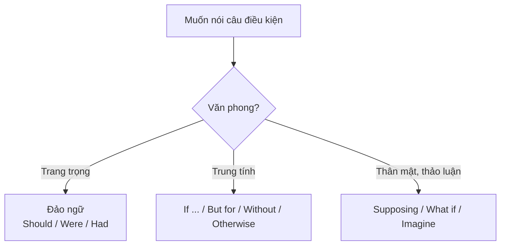

# B2-G002 · Advanced Conditional Structures — Điều kiện nâng cao

## Mục lục

- [A. Lesson Information](#a-lesson-information)
- [B. Warm-up](#b-warm-up)
- [C. WHAT](#c-what)
- [D. WHY](#d-why)
- [E. FORM](#e-form)
- [F. HOW](#f-how)
- [G. VISUAL](#g-visual)
- [H. COMPARISON](#h-comparison)
- [I. COMMON MISTAKES](#i-common-mistakes)
- [J. MEMORY TRICKS](#j-memory-tricks)
- [K. REAL-LIFE APPLICATION](#k-real-life-application)
- [L. PRACTICE EXERCISES](#l-practice-exercises)
- [M. KNOWLEDGE CHECK](#m-knowledge-check)
- [N. ANSWER KEY](#n-answer-key)

---

## A. Lesson Information

| Mục | Nội dung |
|---|---|
| **Lesson ID** | B2-G002 |
| **Topic** | Inverted conditionals (Should / Were / Had); But for / Without; Otherwise; If it weren't for / If it hadn't been for; Supposing / Imagine; If + should |
| **Tên tiếng Việt** | Đảo ngữ câu điều kiện; But for / Without; Otherwise; Supposing |
| **CEFR Level** | B2 |
| **Prerequisites** | [B2-G001 — Mixed Conditionals](B2-G001-mixed-conditionals.md) |
| **Estimated Time** | 90 phút |

**Learning Objectives:**

1. Đảo ngữ ba loại câu điều kiện: ***Should** you need..., **Were** I you..., **Had** I known...*
2. Dùng ***But for / Without + N*** và ***If it weren't for / If it hadn't been for***.
3. Dùng ***otherwise*** ("nếu không thì") đúng thì.
4. Dùng ***Supposing / Suppose / Imagine / What if*** để đặt giả thuyết.
5. Chọn cấu trúc phù hợp **văn phong** (trang trọng vs thân mật).

---

## B. Warm-up

Câu trong một email công việc:

> ***Should** you have any questions, please do not hesitate to contact me.*

Và một câu trong bài phát biểu nhận giải:

> ***Had it not been for** my parents' support, I **would never have** become a musician.*

🤔 **Hãy suy nghĩ:** Hai câu này không có từ *if*, nhưng vẫn là câu điều kiện. Từ nào đã "thay chỗ" của *if*? Vì sao người viết chọn cách này thay vì *If you have any questions...*?

---

## C. WHAT

| Cấu trúc | Tương đương | Văn phong |
|---|---|---|
| **Should + S + V** | *If + S + V (hiện tại)* — có thể xảy ra | Trang trọng (email, thông báo) |
| **Were + S + to V / Were + S + adj/N** | *If + S + were / V2* — loại 2 | Trang trọng |
| **Had + S + V3** | *If + S + had V3* — loại 3 | Trang trọng, văn viết |
| **But for / Without + N** | *If it weren't for / If it hadn't been for* | Trung tính – trang trọng |
| **Otherwise** | *If not...* | Mọi văn phong |
| **Supposing / Suppose / Imagine / What if** | *If* (giả thuyết) | Văn nói, thảo luận |

---

## D. WHY



Đảo ngữ điều kiện xuất hiện nhiều trong **thư trang trọng, báo chí, văn học** và là dạng **biến đổi câu** rất phổ biến trong các bài thi B2. Người học biết dùng chúng tạo ấn tượng về **độ đa dạng ngữ pháp**.

---

## E. FORM

### E1. Đảo ngữ (bỏ *if*, đưa trợ động từ lên đầu)

| Loại | Câu gốc | Đảo ngữ |
|---|---|---|
| 1 (khả năng thật) | *If you need help, call me.* | ***Should** you need help, call me.* |
| 2 (be) | *If I were you, I'd accept.* | ***Were** I you, I'd accept.* |
| 2 (động từ thường) | *If he knew the truth, he'd be angry.* | ***Were** he **to know** the truth, he'd be angry.* |
| 3 | *If I had known, I would have helped.* | ***Had** I known, I would have helped.* |
| Phủ định | *If it hadn't rained, ...* | ***Had it not** rained, ...* (KHÔNG ~~Hadn't it rained~~) |

### E2. *If it weren't for / But for / Without*

| Thời gian | Cấu trúc | Ví dụ |
|---|---|---|
| Hiện tại | *If it weren't for + N, ... would + V* | ***If it weren't for** the internet, I **couldn't work** from home.* |
| Quá khứ | *If it hadn't been for + N, ... would have + V3* | ***If it hadn't been for** the seatbelt, he **would have died**.* |
| Đảo ngữ | *Were it not for / Had it not been for + N* | ***Had it not been for** your help, we **would have failed**.* |
| Ngắn gọn | *But for / Without + N* | ***Without** your help, we **would have failed**.* |

### E3. *Otherwise*

| Cấu trúc | Ví dụ |
|---|---|
| Câu thực + *otherwise* + hậu quả | *Hurry up, **otherwise** we'll miss the bus.* (loại 1) |
| Sự thật hiện tại + *otherwise* + would | *I'm busy; **otherwise** I **would come** with you.* (loại 2) |
| Sự thật quá khứ + *otherwise* + would have | *She left early; **otherwise** she **would have met** him.* (loại 3) |

### E4. Supposing / Suppose / Imagine / What if

| Ví dụ | Ghi chú |
|---|---|
| ***Supposing** you won the lottery, what would you do?* | giả định hiện tại → *V2* |
| ***What if** it rains tomorrow?* | khả năng thật → hiện tại |
| ***Imagine** you had been born in 1900. How would your life have been different?* | giả định quá khứ → *had V3* |

### E5. *If ... should* và *If ... happen to*

*If you **should see** Mai, tell her to call me.* = *If you **happen to** see Mai...* (nếu tình cờ — khả năng thấp).

---

## F. HOW

| # | English | Tiếng Việt | Phân tích |
|---|---|---|---|
| 1 | ***Should** the flight **be** delayed, passengers will receive a meal voucher.* | Nếu chuyến bay bị hoãn, hành khách sẽ nhận phiếu ăn. | Đảo loại 1 — thông báo |
| 2 | ***Were** I in your position, I would talk to a lawyer.* | Nếu tôi ở vị trí của bạn, ... | Đảo loại 2 — lời khuyên |
| 3 | ***Were** the government **to raise** taxes, many businesses would close.* | Nếu chính phủ tăng thuế, ... | *Were + S + to V* |
| 4 | ***Had** we **left** five minutes later, we would have been caught in the storm.* | Nếu chúng tôi đi muộn hơn 5 phút, ... | Đảo loại 3 |
| 5 | ***Had** she **not** warned us, we would have lost everything.* | Nếu cô ấy không cảnh báo, ... | Đảo phủ định |
| 6 | ***But for** the doctor's quick action, the patient would have died.* | Nếu không nhờ bác sĩ hành động nhanh, ... | But for + N |
| 7 | ***Without** water, plants cannot survive.* | Không có nước, cây không sống được. | Without — sự thật chung |
| 8 | ***If it weren't for** my glasses, I wouldn't be able to read this.* | Nếu không có kính, ... | Hiện tại |
| 9 | *Take an umbrella, **otherwise** you'll get wet.* | ..., nếu không bạn sẽ bị ướt. | Otherwise + loại 1 |
| 10 | *I didn't have his number; **otherwise** I would have called him.* | ..., nếu không thì tôi đã gọi. | Otherwise + loại 3 |
| 11 | ***Supposing** you lost your job, how would you pay the rent?* | Giả sử bạn mất việc, ... | Supposing + V2 |
| 12 | ***What if** nobody comes to the party?* | Lỡ không ai đến dự tiệc thì sao? | What if — lo lắng |

---

## G. VISUAL

### Công thức đảo ngữ: "Bỏ IF — Đẩy trợ động từ lên"

```text
If  you   should  need help    →   Should  you  need help, ...
If  I     were    you          →   Were    I    you, ...
If  I     had     known        →   Had     I    known, ...
If  it    had not rained       →   Had     it   not rained, ...
```

---

## H. COMPARISON

### *Without* vs *Unless*

| *Without* + **danh từ** | *Unless* + **mệnh đề** (xem [B2-G003](B2-G003-unless-provided-in-case.md)) |
|---|---|
| ***Without** your help, I'd fail.* | ***Unless** you help me, I'll fail.* |

### Đảo ngữ vs *If*

| *If* | Đảo ngữ |
|---|---|
| Mọi văn phong | Trang trọng; ít dùng trong hội thoại thân mật |
| Phủ định: *If I hadn't...* | Phủ định: *Had I **not**...* (không rút gọn) |

### *Should* (đảo) vs *should* (nên)

| Đảo ngữ điều kiện | Lời khuyên |
|---|---|
| ***Should** you need anything, call me.* = Nếu bạn cần... | *You **should** call me.* = Bạn nên gọi. |

---

## I. COMMON MISTAKES

| # | ❌ Sai | ✅ Đúng | Nguyên nhân | Cách tránh |
|---|---|---|---|---|
| 1 | **Hadn't** I lost my wallet, ... | **Had I not** lost my wallet, ... | Rút gọn phủ định khi đảo | Đảo ngữ: *Had + S + not* |
| 2 | **If had** I known, ... | **Had** I known, ... | Giữ *if* | Đảo ngữ bỏ *if* |
| 3 | **Were** I **know**, ... | **Were** I **to know**, ... / **If I knew**, ... | Thiếu *to* | *Were + S + to V* |
| 4 | **But for** you helped me, ... | **But for** your help, ... | *But for* + mệnh đề | *But for/Without* + N |
| 5 | **If it wasn't for** him, I would have died. (quá khứ) | **If it hadn't been for** him, I would have died. | Sai thời | Kết quả quá khứ → *hadn't been for* |
| 6 | Hurry, **otherwise** we **would** miss the train. | Hurry, **otherwise** we**'ll** miss the train. | Sai loại | Tình huống thật → *will* |
| 7 | **Should** you **needed** help, ... | **Should** you **need** help, ... | | *Should + V nguyên mẫu* |

---

## J. MEMORY TRICKS

1. **"S-W-H" = 1-2-3** 🔢: **S**hould (loại 1), **W**ere (loại 2), **H**ad (loại 3).
2. **"Đảo ngữ không thích rút gọn"**: *Had I **not**...*, không ~~Hadn't I~~.
3. **"But for — Bỏ câu, giữ danh"**: Sau *but for/without* chỉ có danh từ.

---

## K. REAL-LIFE APPLICATION

### Email trang trọng

> *Dear Mr Nguyen,*
>
> *Thank you for your interest in our services. Please find attached our price list for 2026.*
>
> ***Should** you wish to arrange a meeting, please contact my assistant. **Were** you **to place** an order before 30 November, we would be happy to offer a 10% discount.*
>
> *I would also like to thank you for your recommendation last year. **Had it not been for** your introduction, we **would never have** started working with Lotus Hotels.*
>
> *We look forward to hearing from you. **Otherwise**, I will contact you again next month.*
>
> *Yours sincerely,*
> *Tran Thu Ha*

**Dịch tóm tắt:** Cảm ơn đã quan tâm; gửi kèm bảng giá. Nếu muốn hẹn gặp, liên hệ trợ lý. Nếu đặt hàng trước 30/11 sẽ giảm 10%. Nếu không nhờ ông giới thiệu, chúng tôi đã không hợp tác với Lotus Hotels. Nếu không nhận được phản hồi, tôi sẽ liên hệ lại tháng sau.

---

## L. PRACTICE EXERCISES

> ✍️ Đáp án: [B2-G002-ANSWERS](../../12-ANSWERS-AND-EXPLANATIONS/B2/B2-G002-ANSWERS.md)

### Level 1 — Recognition

**L1.1.** ___ you require further information, please contact us.  A. Should  B. Would  C. Were
**L1.2.** ___ I known about the problem, I would have fixed it.  A. If  B. Had  C. Were
**L1.3.** ___ your advice, I would have made a terrible mistake.  A. Unless  B. But for  C. Otherwise
**L1.4.** We'd better leave now; ___ we'll be late.  A. unless  B. otherwise  C. without
**L1.5.** ___ not been for the rain, the match would have finished.  A. Had it  B. Hadn't it  C. If it
**L1.6.** ___ you were offered the job, would you accept it?  A. Supposing  B. Should  C. Unless

### Level 2 — Controlled Practice

Viết lại câu bằng đảo ngữ.

**L2.1.** If you need any help, just ask.
**L2.2.** If I were the manager, I would change the rules.
**L2.3.** If they had arrived earlier, they would have seen the show.
**L2.4.** If she hadn't been so tired, she would have gone out.
**L2.5.** If the company decided to close the factory, 500 people would lose their jobs. (Were ... to)

Viết lại với từ trong ngoặc.

**L2.6.** If it hadn't been for the firefighters, the whole building would have burned down. (But for)
**L2.7.** If it weren't for my sister, I would feel lonely. (Without)
**L2.8.** I didn't know you were in town. If I had, I would have called you. (otherwise)
**L2.9.** Without the scholarship, I couldn't have studied abroad. (Had it not been for)
**L2.10.** If you lost your passport abroad, what would you do? (Supposing)

### Level 3 — Error Correction

**L3.1.** Hadn't she helped me, I would have failed.
**L3.2.** Should you will need assistance, call reception.
**L3.3.** But for he arrived on time, we would have missed the train.
**L3.4.** Were I knew the answer, I would tell you.
**L3.5.** If it wasn't for his help last year, I would have lost my job.
**L3.6.** Study hard, otherwise you would fail the exam.

### Level 4 — Production

**L4.1.** Dịch (dùng *Should*): *"Nếu quý khách có bất kỳ câu hỏi nào, vui lòng liên hệ bộ phận chăm sóc khách hàng."*
**L4.2.** Dịch (dùng *Had*): *"Nếu tôi biết trước giá cao như vậy, tôi đã không đặt phòng."*
**L4.3.** Dịch (dùng *But for*): *"Nếu không nhờ sự hỗ trợ của đồng nghiệp, dự án đã thất bại."*
**L4.4.** Dịch (dùng *otherwise*): *"Tôi phải làm thêm giờ, nếu không tôi đã đi xem phim với bạn."*

**L4.5.** **Explain:** Vì sao *"Hadn't I known..."* sai mà phải nói *"Had I not known..."*? (tiếng Việt)

### Level 5 — Real Communication

**L5.1.** Viết email trang trọng 120–150 từ gửi khách hàng (giả định) thông báo thay đổi lịch giao hàng. Dùng ≥ 2 câu đảo ngữ điều kiện (*Should/Were/Had*), ≥ 1 *otherwise*, ≥ 1 *but for/without/if it weren't for*.
**L5.2.** **Speaking — "What if...?":** Nói 2 phút trả lời: *"Supposing you could change one decision in your past, what would it be and how would your life be different now?"* Dùng ≥ 1 *Supposing/What if*, ≥ 1 câu hỗn hợp từ [B2-G001](B2-G001-mixed-conditionals.md), ≥ 1 *If it hadn't been for...*

---

## M. KNOWLEDGE CHECK

### 5 câu hỏi tự kiểm tra

1. Ba từ dùng để đảo ngữ cho loại 1, 2, 3?
2. Đảo ngữ phủ định loại 3 viết thế nào?
3. *But for* đi với gì?
4. *If it weren't for* và *If it hadn't been for* khác nhau ra sao?
5. *otherwise* + thì gì khi nói về sự thật quá khứ?

### Checklist

- [ ] Tôi đảo ngữ đúng ba loại.
- [ ] Tôi không rút gọn phủ định khi đảo.
- [ ] Tôi dùng *otherwise* đúng thì.

### 3 lỗi quan trọng cần nhớ

1. ~~Hadn't I~~ → **Had I not**.
2. ~~But for he helped~~ → But for **his help**.
3. ~~Were I knew~~ → **Were I to know** / **If I knew**.

### Lịch ôn tập

| Ngày | Việc cần làm |
|---|---|
| Ngày 1 | Làm lại L2 |
| Ngày 3 | Viết lại 5 câu điều kiện bất kỳ bằng đảo ngữ |
| Ngày 7 | Ôn cùng [B2-G009 — Inversion](B2-G009-inversion.md) |

### Liên kết

- ➡️ Bài tiếp theo: [B2-G003 — Unless, Provided That, In Case](B2-G003-unless-provided-in-case.md)
- 📚 [ALL-CONDITIONALS](../../06-GRAMMAR-REFERENCE/ALL-CONDITIONALS.md)

---

## N. ANSWER KEY

👉 [B2-G002-ANSWERS.md](../../12-ANSWERS-AND-EXPLANATIONS/B2/B2-G002-ANSWERS.md)
