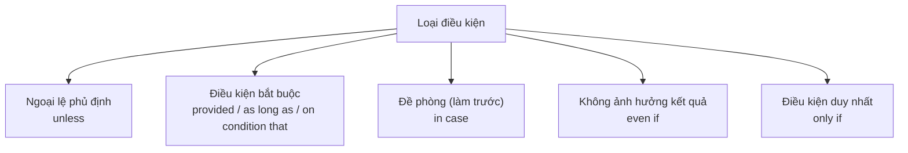

# B2-G003 · Unless, Provided That, As Long As, In Case — Các liên từ điều kiện

## Mục lục

- [A. Lesson Information](#a-lesson-information)
- [B. Warm-up](#b-warm-up)
- [C. WHAT](#c-what)
- [D. WHY](#d-why)
- [E. FORM](#e-form)
- [F. HOW](#f-how)
- [G. VISUAL](#g-visual)
- [H. COMPARISON](#h-comparison)
- [I. COMMON MISTAKES](#i-common-mistakes)
- [J. MEMORY TRICKS](#j-memory-tricks)
- [K. REAL-LIFE APPLICATION](#k-real-life-application)
- [L. PRACTICE EXERCISES](#l-practice-exercises)
- [M. KNOWLEDGE CHECK](#m-knowledge-check)
- [N. ANSWER KEY](#n-answer-key)

---

## A. Lesson Information

| Mục | Nội dung |
|---|---|
| **Lesson ID** | B2-G003 |
| **Topic** | unless; provided (that) / providing (that); as long as / so long as; on condition that; in case; even if; only if |
| **Tên tiếng Việt** | Các liên từ điều kiện: trừ khi, miễn là, với điều kiện, phòng khi, ngay cả khi, chỉ khi |
| **CEFR Level** | B2 |
| **Prerequisites** | [A2-G017 — First Conditional](../../03-A2-ELEMENTARY/grammar/A2-G017-first-conditional.md), [B1-G023 — Adverbial Clauses](../../04-B1-INTERMEDIATE/grammar/B1-G023-adverbial-clauses.md) |
| **Estimated Time** | 75 phút |

**Learning Objectives:**

1. Dùng ***unless*** = *if ... not* và biết khi nào **không** thay được.
2. Dùng ***provided (that), providing, as long as, on condition that*** để nêu **điều kiện bắt buộc**.
3. Phân biệt ***in case*** (phòng khi — đề phòng) với ***if*** (nếu — điều kiện).
4. Dùng ***even if*** và ***only if*** (kèm đảo ngữ *Only if...* ở mức nhận biết).
5. Áp dụng quy tắc **không dùng *will*** sau các liên từ này khi nói về tương lai.

---

## B. Warm-up

> *I'll take an umbrella **in case** it rains.*
> *I'll take an umbrella **if** it rains.*

🤔 **Hãy suy nghĩ:** Hai câu chỉ khác một từ. Trong câu nào bạn mang ô **ngay bây giờ**, dù trời chưa mưa? Trong câu nào bạn chỉ mang ô **khi** trời đã mưa?

---

## C. WHAT

| Liên từ | Nghĩa | Ví dụ |
|---|---|---|
| **unless** | trừ khi, nếu ... không | *You'll fail **unless** you study.* |
| **provided (that) / providing (that)** | miễn là, với điều kiện là | *You can borrow it **provided** you return it tomorrow.* |
| **as long as / so long as** | miễn là (thân mật hơn) | *I don't mind **as long as** you're happy.* |
| **on condition that** | với điều kiện (trang trọng, hợp đồng) | *He was released **on condition that** he left the country.* |
| **in case** | phòng khi, đề phòng | *Take a jacket **in case** it gets cold.* |
| **even if** | ngay cả khi | ***Even if** it rains, the event will go ahead.* |
| **only if** | chỉ khi | *I'll go **only if** you come with me.* |

---

## D. WHY

*If* là liên từ điều kiện chung nhất. Các liên từ khác giúp nói **chính xác hơn** về **loại** điều kiện:



Bài thi B2 thường kiểm tra **biến đổi câu** giữa *if not ↔ unless*, và **phân biệt *in case* với *if***.

---

## E. FORM

### E1. Thì động từ

Giống mệnh đề *if* loại 1: **hiện tại** cho tương lai; không dùng *will*.

| Liên từ | Ví dụ |
|---|---|
| unless | *I won't go **unless** you **come**.* |
| provided | ***Provided** the weather **is** good, we'll eat outside.* |
| in case | *I'll write it down **in case** I **forget**.* |

### E2. *unless* = *if ... not*

| *if ... not* | *unless* |
|---|---|
| *If you don't hurry, you'll be late.* | ***Unless** you hurry, you'll be late.* |
| *If it doesn't rain, we'll play.* | ***Unless** it rains, we'll play.* |

> ⚠️ *unless* đã mang nghĩa phủ định → động từ sau nó **khẳng định**: ~~Unless you don't hurry~~.

### E3. *in case* (đề phòng)

| Thời điểm | Cấu trúc | Ví dụ |
|---|---|---|
| Hiện tại/tương lai | *in case + hiện tại đơn* | *Take your phone **in case** you **get** lost.* |
| Quá khứ | *in case + quá khứ đơn* hoặc *should* | *I took my phone **in case** I **got** lost.* |
| Cụm danh từ | *in case of + N* (thông báo) | ***In case of** fire, use the stairs.* |

### E4. *provided / as long as / on condition that*

- *provided (that)* — trung tính, hay gặp trong văn viết.
- *as long as / so long as* — thân mật hơn, rất phổ biến trong văn nói.
- *on condition that* — trang trọng, hay gặp trong văn bản pháp lý, hợp đồng.

### E5. *only if* và *even if*

| Cấu trúc | Ví dụ |
|---|---|
| *only if* (cuối hoặc giữa câu) | *You can enter **only if** you have a ticket.* |
| *Only if* đầu câu → **đảo ngữ** mệnh đề chính | ***Only if** you have a ticket **can you** enter.* (xem [B2-G009](B2-G009-inversion.md)) |
| *even if* | ***Even if** you apologise, she won't forgive you.* |

---

## F. HOW

| # | English | Tiếng Việt | Phân tích |
|---|---|---|---|
| 1 | ***Unless** you book now, there won't be any seats left.* | Nếu không đặt ngay, sẽ không còn chỗ. | unless = if not |
| 2 | *I won't sign the contract **unless** they change clause 5.* | Tôi sẽ không ký trừ khi họ sửa điều 5. | Ngoại lệ duy nhất |
| 3 | *You can use my car **provided that** you fill it up afterwards.* | Bạn dùng xe tôi được, miễn là đổ đầy xăng sau đó. | Điều kiện bắt buộc |
| 4 | ***As long as** you're honest with me, we won't have any problems.* | Miễn là bạn trung thực, ... | Thân mật |
| 5 | *The loan was approved **on condition that** the company reduced its costs.* | Khoản vay được duyệt với điều kiện công ty giảm chi phí. | Trang trọng, quá khứ |
| 6 | *Save the file every ten minutes **in case** the computer crashes.* | Lưu file mỗi 10 phút phòng khi máy bị treo. | Đề phòng |
| 7 | *I'll give you my number **in case** you need anything.* | Tôi cho bạn số, phòng khi bạn cần gì. | Đề phòng |
| 8 | *I bought extra food **in case** more guests came.* | Tôi mua thêm đồ ăn phòng khi có thêm khách. | Quá khứ |
| 9 | ***In case of** emergency, break the glass.* | Trong trường hợp khẩn cấp, đập vỡ kính. | Biển báo |
| 10 | ***Even if** I had the money, I wouldn't buy that car.* | Ngay cả khi có tiền, tôi cũng không mua xe đó. | even if + loại 2 |
| 11 | *Refunds are given **only if** you have the receipt.* | Chỉ hoàn tiền khi có hóa đơn. | Điều kiện duy nhất |
| 12 | *Don't call me **unless** it's urgent.* | Đừng gọi trừ khi khẩn cấp. | Mệnh lệnh + unless |

---

## G. VISUAL

### *in case* vs *if*

```text
IF:       ☔ trời mưa  ──►  🌂 tôi mang ô          (hành động SAU điều kiện)
IN CASE:  🌂 tôi mang ô ──►  (☔ có thể mưa)         (hành động TRƯỚC, để đề phòng)
```

### Thang mức độ "điều kiện"

```text
only if        →  điều kiện DUY NHẤT
provided/as long as → điều kiện CẦN
if             →  điều kiện CHUNG
even if        →  điều kiện KHÔNG thay đổi kết quả
```

---

## H. COMPARISON

### *unless* vs *if not* — khi nào KHÔNG thay được?

| Tình huống | Ví dụ |
|---|---|
| ✅ Thay được: điều kiện **ngoại lệ** | *I'll be there unless my train is late.* |
| ❌ Không nên thay: kết quả là **cảm xúc** về điều phủ định | *I'll be **sad if** you **don't** come.* — ~~sad unless you come~~ (nghe lạ) |
| ❌ Câu hỏi | *What will you do **if** she **doesn't** call?* — ~~unless she calls~~ |
| ❌ Loại 3 quá khứ (thường dùng *if not*) | *If I hadn't met you, ...* |

### *provided* vs *in case*

| *provided* | *in case* |
|---|---|
| Điều kiện để việc xảy ra | Lý do đề phòng |
| *You can go **provided** you finish your homework.* | *Take some money **in case** you need a taxi.* |

---

## I. COMMON MISTAKES

| # | ❌ Sai | ✅ Đúng | Nguyên nhân | Cách tránh |
|---|---|---|---|---|
| 1 | **Unless** you **don't** study, you'll fail. | **Unless** you study, you'll fail. | Phủ định kép | *unless* đã phủ định |
| 2 | Take a coat **in case** it **will** rain. | ... in case it **rains**. | *will* sau liên từ | Hiện tại đơn |
| 3 | I'll call you **in case** I'm late. (ý: chỉ gọi khi muộn) | I'll call you **if** I'm late. | Nhầm *in case* với *if* | *in case* = đề phòng, làm trước |
| 4 | **In case** fire, use the stairs. | **In case of** fire, ... | Thiếu *of* | *in case of* + N |
| 5 | **Provided** you **will** pay, you can join. | **Provided** you pay, ... | | |
| 6 | I'll be happy **unless** you come. | I'll be happy **if** you come. | Sai nghĩa | Đọc lại nghĩa "trừ khi" |
| 7 | **Only if** you have a ticket you **can** enter. | **Only if** you have a ticket **can you** enter. | Thiếu đảo ngữ | *Only if* đầu câu → đảo |

---

## J. MEMORY TRICKS

1. **"In case — Làm trước cho chắc"** 🎒: Bạn **chuẩn bị trước**, dù điều kiện có xảy ra hay không.
2. **"Unless = If + NOT"** — đã có NOT bên trong, không thêm NOT nữa.
3. **"Provided = Miễn là có điều kiện đi kèm"** — giống "được thôi, **nhưng** phải...".

---

## K. REAL-LIFE APPLICATION

### Thỏa thuận thuê nhà (trích)

> *The tenant may keep a pet **provided that** written permission is obtained from the landlord. The deposit will be returned in full **on condition that** the apartment is left in good condition. **Unless** either party gives one month's notice, the agreement will be renewed automatically.*
>
> ***In case of** a water leak, the tenant must contact the landlord immediately. Spare keys will be kept by the building manager **in case** the tenant loses theirs.*

**Dịch tóm tắt:** Người thuê được nuôi thú cưng miễn là có sự cho phép bằng văn bản; tiền đặt cọc hoàn đủ với điều kiện căn hộ được giữ tốt; trừ khi một bên báo trước 1 tháng, hợp đồng tự gia hạn; khi rò nước phải báo ngay; chìa dự phòng do quản lý tòa nhà giữ phòng khi người thuê làm mất.

---

## L. PRACTICE EXERCISES

> ✍️ Đáp án: [B2-G003-ANSWERS](../../12-ANSWERS-AND-EXPLANATIONS/B2/B2-G003-ANSWERS.md)

### Level 1 — Recognition

**L1.1.** Take some cash ___ the card machine doesn't work.  A. unless  B. in case  C. provided
**L1.2.** You can't come in ___ you have an invitation.  A. unless  B. in case  C. even if
**L1.3.** I'll lend you the money ___ you pay me back next week.  A. in case  B. unless  C. provided
**L1.4.** ___ it rains, the festival will go ahead. (Lễ hội không bị ảnh hưởng)  A. Unless  B. Even if  C. In case
**L1.5.** ___ fire, do not use the lift.  A. In case  B. In case of  C. Unless
**L1.6.** Câu nào **sai**?  A. Unless you hurry, we'll miss the bus.  B. Unless you don't hurry, we'll miss the bus.  C. If you don't hurry, we'll miss the bus.

### Level 2 — Controlled Practice

Viết lại câu bằng *unless*.

**L2.1.** If you don't water the plants, they will die.
**L2.2.** If he doesn't apologise, I won't speak to him.
**L2.3.** We'll have the party in the garden if it doesn't rain.

Điền *in case* hoặc *if*.

**L2.4.** I'll take a book ___ I get bored on the train.
**L2.5.** Call me ___ you need a lift — I'll come and get you.
**L2.6.** Let's buy extra bread ___ our guests are hungry.

Viết lại với từ trong ngoặc.

**L2.7.** You can borrow my laptop, but you must be careful with it. (provided)
**L2.8.** I don't care where we go. I just want to be with you. (as long as)
**L2.9.** I wrote down her address because I thought I might forget it. (in case)
**L2.10.** The prisoner was released, but he had to report to the police every week. (on condition that)

### Level 3 — Error Correction

**L3.1.** Unless you don't finish your work, you can't go out.
**L3.2.** Take an umbrella in case it will rain.
**L3.3.** In case emergency, call 115.
**L3.4.** You can stay here provided you will keep quiet.
**L3.5.** I'll be really upset unless you come to my wedding.
**L3.6.** Only if you practise every day you will improve.

### Level 4 — Production

**L4.1.** Dịch: *"Bạn sẽ không được vào phòng thi trừ khi mang theo thẻ dự thi."*
**L4.2.** Dịch: *"Tôi sẽ mang theo sạc dự phòng phòng khi điện thoại hết pin."*
**L4.3.** Dịch: *"Bạn có thể làm việc ở nhà miễn là hoàn thành công việc đúng hạn."*
**L4.4.** Dịch: *"Ngay cả khi tôi có thời gian, tôi cũng không muốn đi bữa tiệc đó."*

**L4.5.** **Explain:** Giải thích khác biệt giữa *"I'll bring a map in case we get lost"* và *"I'll bring a map if we get lost"*.

### Level 5 — Real Communication

**L5.1.** Viết **bộ quy định** 100–130 từ cho một câu lạc bộ, ký túc xá hoặc nhóm học (giả định). Dùng ≥ 2 *unless*, ≥ 2 *provided/as long as/on condition that*, ≥ 2 *in case / in case of*, ≥ 1 *even if* hoặc *only if*.
**L5.2.** **Speaking — Negotiation:** Đóng vai thương lượng với chủ nhà về việc thuê phòng (giá, thú cưng, sửa chữa). Mỗi bên dùng ≥ 3 liên từ điều kiện khác nhau. Ví dụ: *I'll sign the contract provided that..., I can't accept unless..., As long as you...*

---

## M. KNOWLEDGE CHECK

### 5 câu hỏi tự kiểm tra

1. *unless* tương đương với gì? Khi nào không nên dùng?
2. *in case* khác *if* thế nào?
3. *in case* và *in case of* khác nhau ra sao?
4. Kể 3 cách diễn đạt "miễn là", từ thân mật đến trang trọng.
5. Thì động từ sau các liên từ này khi nói về tương lai?

### Checklist

- [ ] Tôi không viết ~~unless ... don't~~.
- [ ] Tôi phân biệt *in case* và *if*.
- [ ] Tôi dùng *provided/as long as* để đặt điều kiện.

### 3 lỗi quan trọng cần nhớ

1. ~~Unless you don't~~ → **Unless you**.
2. ~~in case it will rain~~ → in case it **rains**.
3. ~~In case fire~~ → **In case of** fire.

### Lịch ôn tập

| Ngày | Việc cần làm |
|---|---|
| Ngày 1 | Làm lại L2 |
| Ngày 3 | Viết 5 câu *in case* về việc chuẩn bị cho một chuyến đi |
| Ngày 7 | Ôn cùng [B2-G002](B2-G002-advanced-conditionals.md) và [ALL-CONDITIONALS](../../06-GRAMMAR-REFERENCE/ALL-CONDITIONALS.md) |

### Liên kết

- ➡️ Bài tiếp theo: [B2-G004 — Advanced Passive](B2-G004-advanced-passive.md)

---

## N. ANSWER KEY

👉 [B2-G003-ANSWERS.md](../../12-ANSWERS-AND-EXPLANATIONS/B2/B2-G003-ANSWERS.md)
