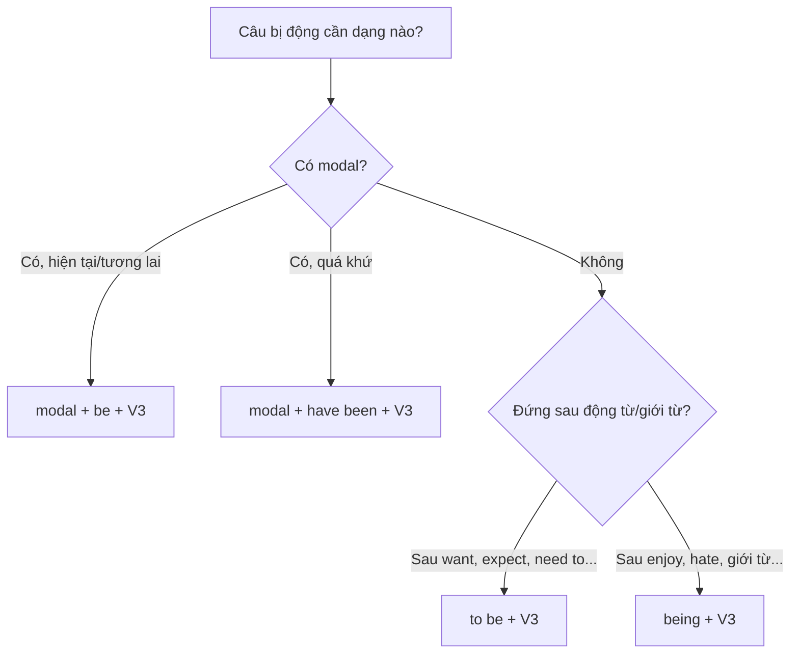

# B2-G004 · Advanced Passive Voice — Bị động nâng cao

## Mục lục

- [A. Lesson Information](#a-lesson-information)
- [B. Warm-up](#b-warm-up)
- [C. WHAT](#c-what)
- [D. WHY](#d-why)
- [E. FORM](#e-form)
- [F. HOW](#f-how)
- [G. VISUAL](#g-visual)
- [H. COMPARISON](#h-comparison)
- [I. COMMON MISTAKES](#i-common-mistakes)
- [J. MEMORY TRICKS](#j-memory-tricks)
- [K. REAL-LIFE APPLICATION](#k-real-life-application)
- [L. PRACTICE EXERCISES](#l-practice-exercises)
- [M. KNOWLEDGE CHECK](#m-knowledge-check)
- [N. ANSWER KEY](#n-answer-key)

---

## A. Lesson Information

| Mục | Nội dung |
|---|---|
| **Lesson ID** | B2-G004 |
| **Topic** | Passive with two objects; passive modals (must be done, should have been done); passive infinitive & gerund (to be done, being done); get-passive; passive with phrasal/prepositional verbs; verbs of perception (be seen to do) |
| **Tên tiếng Việt** | Bị động với hai tân ngữ, động từ khuyết thiếu, nguyên mẫu/danh động từ bị động, bị động với *get*, cụm động từ |
| **CEFR Level** | B2 |
| **Prerequisites** | [B1-G012 — Passive across Tenses](../../04-B1-INTERMEDIATE/grammar/B1-G012-passive-all-tenses.md) |
| **Estimated Time** | 90 phút |

**Learning Objectives:**

1. Chuyển bị động cho động từ có **hai tân ngữ** (*give, send, offer, show, tell...*).
2. Dùng **bị động với modal**: *can be done, must be done, should have been done*.
3. Dùng **nguyên mẫu bị động** (*to be done*) và **danh động từ bị động** (*being done*).
4. Dùng ***get + V3*** (bị động thân mật, nhấn mạnh sự thay đổi/việc không mong muốn).
5. Giữ **giới từ/tiểu từ** trong bị động của cụm động từ: *The meeting was **put off**; She was **looked after**.*

---

## B. Warm-up

> *I hate **being interrupted**.*
> *She expects **to be promoted** next year.*
> *The report **should have been finished** yesterday.*
> *My bike **got stolen** last week.*

🤔 **Hãy suy nghĩ:** Bốn câu đều bị động, nhưng không có câu nào dùng *is/was + V3* đơn giản như ở B1. Bạn nhận ra những "khung" bị động mới nào?

---

## C. WHAT

Ở B1, bạn đã học bị động ở các thì (*is done, was done, has been done, will be done...*). B2 mở rộng bị động sang:

| Dạng | Cấu trúc | Ví dụ |
|---|---|---|
| Hai tân ngữ | *S (người) + be + V3 + vật* / *S (vật) + be + V3 + to + người* | *I **was given** a prize.* / *A prize **was given** to me.* |
| Modal hiện tại | *modal + be + V3* | *It **must be done** today.* |
| Modal quá khứ | *modal + have been + V3* | *It **should have been done** yesterday.* |
| Nguyên mẫu bị động | *to be + V3* | *I want **to be told** the truth.* |
| Danh động từ bị động | *being + V3* | *I hate **being lied** to.* |
| Get-passive | *get + V3* | *He **got fired**.* |

---

## D. WHY

Bị động nâng cao là công cụ quan trọng trong **văn viết học thuật, báo chí, báo cáo** — nơi người viết muốn tập trung vào **hành động/kết quả** chứ không vào **người làm**.



---

## E. FORM

### E1. Động từ hai tân ngữ

*Someone gave **me** (người) **a book** (vật).*

| Bị động | Ví dụ | Ghi chú |
|---|---|---|
| Người làm chủ ngữ (**phổ biến hơn**) | ***I was given** a book.* | Tự nhiên nhất |
| Vật làm chủ ngữ | ***A book was given to** me.* | Cần *to/for* trước người |

Động từ thường gặp: *give, send, offer, show, tell, teach, lend, pay, promise, award*.

> ⚠️ Một số động từ chỉ dùng được vật làm chủ ngữ: *explain, describe, suggest, introduce*: *The rules **were explained to** us.* (không ~~We were explained the rules~~).

### E2. Modal bị động

| Thời điểm | Cấu trúc | Ví dụ |
|---|---|---|
| Hiện tại/tương lai | **modal + be + V3** | *Phones **must be switched** off.* / *This **can't be done**.* |
| Quá khứ | **modal + have been + V3** | *The accident **could have been avoided**.* / *He **must have been told**.* |

### E3. Nguyên mẫu và danh động từ bị động

| Dạng | Sau | Ví dụ |
|---|---|---|
| **to be + V3** | *want, expect, hope, need, would like, seem, appear*, tính từ + *to* | *Nobody likes **to be criticised**.* / *This room needs **to be cleaned**.* |
| **being + V3** | *enjoy, hate, mind, avoid, remember*, giới từ | *I don't mind **being photographed**.* / *She's afraid of **being left** alone.* |
| **to have been + V3** | sự việc hoàn tất trước (xem [B2-G013](B2-G013-perfect-infinitives-gerunds.md)) | *He seems **to have been injured**.* |

> 💡 *need + V-ing* cũng mang nghĩa bị động: *The car **needs washing**.* = *needs to be washed*.

### E4. Get-passive

| Dùng khi | Ví dụ |
|---|---|
| Văn nói, thân mật | *My phone **got broken**.* |
| Sự việc không mong muốn/bất ngờ | *He **got arrested**.* / *I **got caught** in the rain.* |
| Thay đổi trạng thái | *They **got married** last year.* / *I **got lost**.* |

### E5. Cụm động từ và động từ + giới từ

Giữ nguyên giới từ/tiểu từ **ngay sau V3**:

| Chủ động | Bị động |
|---|---|
| *They **put off** the meeting.* | *The meeting **was put off**.* |
| *Her grandmother **looks after** her.* | *She **is looked after** by her grandmother.* |
| *Everyone **laughed at** him.* | *He **was laughed at**.* |
| *Somebody **has dealt with** the problem.* | *The problem **has been dealt with**.* |

### E6. Động từ tri giác/sai khiến ở bị động

| Chủ động (không *to*) | Bị động (có *to*) |
|---|---|
| *They **saw** him **leave**.* | *He **was seen to leave**.* |
| *They **made** us **wait**.* | *We **were made to wait**.* |

---

## F. HOW

| # | English | Tiếng Việt | Phân tích |
|---|---|---|---|
| 1 | *All employees **were given** a bonus at the end of the year.* | Toàn bộ nhân viên được thưởng cuối năm. | Hai tân ngữ — người làm chủ ngữ |
| 2 | *The procedure **was explained to** the patients.* | Quy trình được giải thích cho bệnh nhân. | *explain* — chỉ vật làm chủ ngữ |
| 3 | *Seatbelts **must be worn** at all times.* | Phải thắt dây an toàn mọi lúc. | Modal hiện tại |
| 4 | *The fire **could have been prevented**.* | Đám cháy lẽ ra đã có thể ngăn chặn được. | Modal quá khứ |
| 5 | *Applications **should be submitted** by Friday.* | Đơn nên được nộp trước thứ Sáu. | Modal — thông báo |
| 6 | *She expects **to be promoted** soon.* | Cô ấy mong được thăng chức sớm. | Nguyên mẫu bị động |
| 7 | *I can't stand **being told** what to do.* | Tôi không chịu nổi việc bị sai bảo. | Danh động từ bị động |
| 8 | *He left without **being noticed**.* | Anh ấy rời đi mà không bị ai để ý. | Giới từ + being V3 |
| 9 | *Our flight **got cancelled**, so we **got stuck** at the airport.* | Chuyến bay bị hủy, chúng tôi bị kẹt ở sân bay. | Get-passive — thân mật |
| 10 | *The children **are being looked after** by a nanny.* | Bọn trẻ đang được bảo mẫu chăm sóc. | Cụm động từ — tiếp diễn |
| 11 | *The suspect **was seen to enter** the building at 9 p.m.* | Nghi phạm được nhìn thấy vào tòa nhà lúc 9 giờ tối. | Tri giác bị động + to |
| 12 | *The house **needs painting**.* | Ngôi nhà cần được sơn. | need + V-ing = bị động |

---

## G. VISUAL

### Bản đồ bị động nâng cao

```text
                be + V3                          have been + V3
modal  →   must be done                     must have been done
to     →   to be done                       to have been done
-ing   →   being done                       having been done
get    →   get done   (thân mật)
```

---

## H. COMPARISON

### *be*-passive vs *get*-passive

| *be* + V3 | *get* + V3 |
|---|---|
| Trung tính, mọi văn phong | Thân mật, văn nói |
| Trạng thái hoặc hành động | Nhấn mạnh **sự thay đổi/sự việc bất ngờ** |
| *The window **was broken**.* (có thể chỉ trạng thái) | *The window **got broken** during the party.* (sự việc xảy ra) |

### *need to be done* vs *need doing*

| *needs to be cleaned* | *needs cleaning* |
|---|---|
| Trung tính | Phổ biến trong Anh–Anh, thân mật |
| Hai dạng **cùng nghĩa** | |

---

## I. COMMON MISTAKES

| # | ❌ Sai | ✅ Đúng | Nguyên nhân | Cách tránh |
|---|---|---|---|---|
| 1 | The problem **must solved**. | The problem **must be solved**. | Thiếu *be* | modal + **be** + V3 |
| 2 | It **should have done** yesterday. | It **should have been done** yesterday. | Thiếu *been* | modal + have **been** + V3 |
| 3 | **We were explained** the rules. | **The rules were explained to us.** | *explain* không hai tân ngữ | Vật làm chủ ngữ |
| 4 | She was **looked** by her aunt. | She was **looked after** by her aunt. | Bỏ tiểu từ | Giữ *after* |
| 5 | I hate **to be lied**. | I hate **being lied to**. | Thiếu giới từ *to* | *lie to sb* → *be lied to* |
| 6 | He was seen **leave** the house. | He was seen **to leave** the house. | Thiếu *to* | Tri giác bị động + *to* |
| 7 | I don't like **be photographed**. | I don't like **being photographed**. | | Sau *like* (sở thích chung) → *being V3* hoặc *to be V3* |

---

## J. MEMORY TRICKS

1. **"Thêm BE vào khuôn cũ"** 🧩: Lấy khuôn chủ động (*must do, to do, doing*), thay động từ bằng **be + V3** → *must **be done**, to **be done**, **being** done*.
2. **"Giới từ đi theo động từ như hình với bóng"**: *laugh at → be laughed **at***.
3. **"Thấy/bắt — bị động thêm TO"**: *see/make sb do → be seen/made **to** do*.

---

## K. REAL-LIFE APPLICATION

### Thông báo công ty

> *Following last month's security incident, the following measures **must be taken** by all staff:*
>
> *- ID badges **should be worn** at all times and **must not be lent** to anyone.*
> *- Visitors **are to be accompanied** by a member of staff and **will be given** a temporary pass.*
> *- Laptops **must not be left** unattended in public areas.*
>
> *An investigation found that the incident **could have been avoided** if the door **had been locked**. Staff are reminded that they risk **being disciplined** if these rules **are ignored**. All concerns **will be dealt with** confidentially.*

**Dịch tóm tắt:** Sau sự cố an ninh, toàn bộ nhân viên phải đeo thẻ, không cho mượn; khách phải có nhân viên đi kèm và được cấp thẻ tạm; không bỏ laptop nơi công cộng. Sự cố lẽ ra tránh được nếu cửa được khóa. Nhân viên có thể bị kỷ luật nếu bỏ qua quy định.

---

## L. PRACTICE EXERCISES

> ✍️ Đáp án: [B2-G004-ANSWERS](../../12-ANSWERS-AND-EXPLANATIONS/B2/B2-G004-ANSWERS.md)

### Level 1 — Recognition

**L1.1.** All mobile phones must ___ off during the exam.  A. switch  B. be switched  C. been switched
**L1.2.** The accident could have ___ if the driver had been more careful.  A. avoided  B. be avoided  C. been avoided
**L1.3.** I hate ___ when I'm working.  A. interrupting  B. being interrupted  C. to interrupt
**L1.4.** She hopes ___ for the national team.  A. to be selected  B. being selected  C. to select
**L1.5.** The new rules were explained ___ the staff.  A. — (không có gì)  B. to  C. for
**L1.6.** He was made ___ the form again.  A. fill  B. filling  C. to fill

### Level 2 — Controlled Practice

Chuyển sang bị động.

**L2.1.** They offered her a job in Singapore. (bắt đầu bằng *She*)
**L2.2.** Someone sent the documents to the wrong address. (bắt đầu bằng *The documents*)
**L2.3.** You must complete this form in black ink.
**L2.4.** They should have repaired the bridge years ago.
**L2.5.** Nobody has dealt with my complaint yet.
**L2.6.** The police saw two men climb over the wall.
**L2.7.** I don't like people laughing at me. (dùng *being*)
**L2.8.** Students expect teachers to treat them fairly. (bắt đầu: *Students expect...*)
**L2.9.** They might cancel the concert because of the storm.
**L2.10.** Someone stole my wallet on the bus. (dùng *get*)

### Level 3 — Error Correction

**L3.1.** The documents must signed by the manager.
**L3.2.** This mistake should have noticed earlier.
**L3.3.** We were explained the situation by the director.
**L3.4.** The children are being looked by their grandparents.
**L3.5.** I remember to be taken to the zoo when I was five.
**L3.6.** The thief was seen enter the shop.

### Level 4 — Production

**L4.1.** Dịch: *"Tất cả hành lý phải được kiểm tra trước khi lên máy bay."*
**L4.2.** Dịch: *"Vụ tai nạn lẽ ra đã có thể tránh được."*
**L4.3.** Dịch: *"Không ai thích bị chỉ trích trước mặt người khác."*
**L4.4.** Dịch: *"Tôi được tặng một chiếc đồng hồ nhân dịp tốt nghiệp."*

**L4.5.** **Explain:** Vì sao nói *"I was given a watch"* được nhưng không nói *"I was explained the rules"*? (tiếng Việt)

### Level 5 — Real Communication

**L5.1.** Viết **bản hướng dẫn an toàn** 120–150 từ cho một phòng thí nghiệm, bể bơi hoặc công trường (giả định). Dùng ≥ 4 modal bị động (hiện tại), ≥ 1 modal bị động quá khứ, ≥ 1 *to be V3*, ≥ 1 *being V3*, ≥ 1 cụm động từ ở bị động.
**L5.2.** **Speaking — Complaint story:** Kể 1,5 phút về một lần bạn gặp dịch vụ tồi (nhà hàng, hãng bay...). Dùng *get*-passive (*got cancelled, got lost...*) và modal quá khứ bị động (*should have been told, could have been avoided*).

---

## M. KNOWLEDGE CHECK

### 5 câu hỏi tự kiểm tra

1. Hai cách chuyển bị động với *give*?
2. Modal bị động hiện tại và quá khứ?
3. Khi nào dùng *to be V3*, khi nào *being V3*?
4. *get*-passive dùng khi nào?
5. Bị động của *They saw him leave*?

### Checklist

- [ ] Tôi viết đúng modal bị động hai thì.
- [ ] Tôi giữ giới từ/tiểu từ trong bị động.
- [ ] Tôi dùng *being V3* sau giới từ.

### 3 lỗi quan trọng cần nhớ

1. ~~must solved~~ → must **be** solved.
2. ~~should have done~~ (bị động) → should have **been** done.
3. ~~was seen leave~~ → was seen **to** leave.

### Lịch ôn tập

| Ngày | Việc cần làm |
|---|---|
| Ngày 1 | Làm lại L2 |
| Ngày 3 | Tìm 5 câu bị động trong một bài báo tiếng Anh, phân loại dạng |
| Ngày 7 | Ôn với [PASSIVE-VOICE-GUIDE](../../06-GRAMMAR-REFERENCE/PASSIVE-VOICE-GUIDE.md) |

### Liên kết

- ➡️ Bài tiếp theo: [B2-G005 — Passive Reporting Structures](B2-G005-passive-reporting.md) *(nên học [B2-G013](B2-G013-perfect-infinitives-gerunds.md) trước)*

---

## N. ANSWER KEY

👉 [B2-G004-ANSWERS.md](../../12-ANSWERS-AND-EXPLANATIONS/B2/B2-G004-ANSWERS.md)
