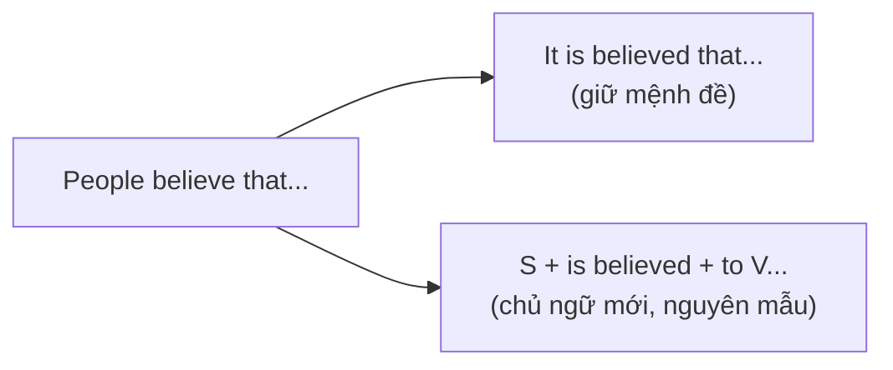

# B2-G005 · Passive Reporting Structures — Bị động tường thuật (It is said that... / He is said to...)

## Mục lục

- [A. Lesson Information](#a-lesson-information)
- [B. Warm-up](#b-warm-up)
- [C. WHAT](#c-what)
- [D. WHY](#d-why)
- [E. FORM](#e-form)
- [F. HOW](#f-how)
- [G. VISUAL](#g-visual)
- [H. COMPARISON](#h-comparison)
- [I. COMMON MISTAKES](#i-common-mistakes)
- [J. MEMORY TRICKS](#j-memory-tricks)
- [K. REAL-LIFE APPLICATION](#k-real-life-application)
- [L. PRACTICE EXERCISES](#l-practice-exercises)
- [M. KNOWLEDGE CHECK](#m-knowledge-check)
- [N. ANSWER KEY](#n-answer-key)

---

## A. Lesson Information

| Mục | Nội dung |
|---|---|
| **Lesson ID** | B2-G005 |
| **Topic** | It + passive reporting verb + that-clause; Subject + passive reporting verb + to-infinitive (simple, continuous, perfect); There is said to be... |
| **Tên tiếng Việt** | Cấu trúc bị động tường thuật: người ta nói rằng..., được cho là... |
| **CEFR Level** | B2 |
| **Prerequisites** | [B2-G004 — Advanced Passive](B2-G004-advanced-passive.md), [B2-G013 — Perfect Infinitives & Gerunds](B2-G013-perfect-infinitives-gerunds.md) |
| **Estimated Time** | 90 phút |

> ℹ️ **Thứ tự học:** Bài này dùng *to have + V3* (nguyên mẫu hoàn thành) từ [B2-G013](B2-G013-perfect-infinitives-gerunds.md). Nên học G013 trước G005; mã bài được giữ nguyên theo Curriculum Map.

**Learning Objectives:**

1. Dùng **It is said / believed / thought / reported / expected... that + mệnh đề**.
2. Dùng **S + is said / believed... + to V** (sự việc **cùng lúc** với lúc nói).
3. Dùng **S + is said... + to be V-ing** (đang diễn ra) và **to have V3** (đã xảy ra **trước**).
4. Dùng **There is said to be / There are thought to be...**
5. Chuyển đổi chính xác giữa chủ động – *It*-passive – *S*-passive.

---

## B. Warm-up

Tin tức:

> ***It is reported that** the president **is** visiting Japan next week.*
> *The president **is reported to be visiting** Japan next week.*
>
> ***It is believed that** the painting **was stolen** in 1990.*
> *The painting **is believed to have been stolen** in 1990.*

🤔 **Hãy suy nghĩ:** Mỗi cặp có cùng nghĩa. Trong cách thứ hai, chủ ngữ là *the president / the painting*, và động từ sau đó có dạng *to be V-ing* và *to have been V3*. Vì sao lại có dạng "to have" ở cặp thứ hai?

---

## C. WHAT

Cấu trúc bị động tường thuật dùng để thuật lại **thông tin, ý kiến, tin đồn** mà **không nói rõ ai** là người nói/tin. Đặc trưng của **báo chí, văn học thuật, báo cáo**.

| Chủ động | It-passive | Subject-passive |
|---|---|---|
| *People say that he is rich.* | ***It is said that** he is rich.* | ***He is said to be** rich.* |

**Động từ tường thuật thường gặp:** *say, believe, think, know, report, expect, consider, claim, estimate, understand, allege, suppose, rumour*.

---

## D. WHY



Người viết chọn dạng thứ hai khi muốn **đưa chủ thể chính lên đầu câu** (tin tức về *the president*, không phải về "người ta"). Ngoài ra, cấu trúc này giúp thể hiện **khoảng cách** với thông tin: người viết không khẳng định đó là sự thật — rất quan trọng khi viết **học thuật** (xem [B2-G025 — Hedging](B2-G025-hedging-academic-language.md)).

---

## E. FORM

### E1. It-passive

```text
It + is/was + V3 (said, believed...) + that + mệnh đề
```

| Ví dụ |
|---|
| ***It is thought that** prices **will rise** next year.* |
| ***It was reported that** two people **had been injured**.* |
| ***It is estimated that** 10 million people **visit** the city every year.* |

### E2. Subject-passive — chọn dạng nguyên mẫu theo thời gian

```text
S + is/was + V3 + to-infinitive
```

| Quan hệ thời gian (mệnh đề *that* so với động từ tường thuật) | Nguyên mẫu | Ví dụ |
|---|---|---|
| **Cùng lúc / tương lai** (trạng thái, thói quen) | **to + V** | *He **is said to live** in Paris.* |
| **Cùng lúc, đang diễn ra** | **to be + V-ing** | *She **is believed to be hiding** in the mountains.* |
| **Trước đó** (đã xảy ra) | **to have + V3** | *He **is thought to have left** the country.* |
| **Trước đó, bị động** | **to have been + V3** | *The bridge **is said to have been built** in 1890.* |
| **Cùng lúc, bị động** | **to be + V3** | *The building **is believed to be owned** by a bank.* |

### E3. Thời của động từ tường thuật

| Chủ động | Subject-passive |
|---|---|
| *People **say** he **is** rich.* | *He **is said to be** rich.* |
| *People **said** he **was** rich.* | *He **was said to be** rich.* (cùng lúc trong quá khứ) |
| *People **said** he **had been** rich.* | *He **was said to have been** rich.* (trước đó nữa) |

### E4. *There is said to be*

| Chủ động | Bị động |
|---|---|
| *People say **there is** gold in the river.* | ***There is said to be** gold in the river.* |
| *People think **there were** 500 guests.* | ***There are thought to have been** 500 guests.* |

---

## F. HOW

| # | English | Tiếng Việt | Phân tích |
|---|---|---|---|
| 1 | ***It is said that** this restaurant serves the best phở in Hanoi.* | Người ta nói nhà hàng này có phở ngon nhất HN. | It-passive |
| 2 | *This restaurant **is said to serve** the best phở in Hanoi.* | | to V — hiện tại |
| 3 | *The suspect **is believed to be hiding** in the area.* | Nghi phạm được cho là đang trốn trong khu vực. | to be V-ing |
| 4 | *The ship **is thought to have sunk** in a storm.* | Con tàu được cho là đã chìm trong một cơn bão. | to have V3 |
| 5 | *The temple **is believed to have been built** in the 11th century.* | Ngôi đền được cho là được xây vào thế kỷ 11. | to have been V3 |
| 6 | ***It is expected that** the new law **will come** into force in July.* | Luật mới dự kiến có hiệu lực vào tháng 7. | Tương lai |
| 7 | *The new law **is expected to come** into force in July.* | | to V — tương lai |
| 8 | ***There are estimated to be** over 2,000 species of plants in the park.* | Ước tính có hơn 2.000 loài thực vật. | There + to be |
| 9 | *The company **was reported to be losing** money.* | Công ty được báo cáo là đang thua lỗ. | Quá khứ — đang diễn ra |
| 10 | *She **is known to have worked** for the UN.* | Được biết bà ấy từng làm cho LHQ. | to have V3 |
| 11 | ***It is alleged that** the minister accepted bribes.* | Người ta cáo buộc bộ trưởng đã nhận hối lộ. | *allege* — pháp lý, báo chí |
| 12 | *The minister **is alleged to have accepted** bribes.* | | to have V3 |

> ℹ️ Các câu ví dụ là câu minh họa ngữ pháp, không phải tin tức thật.

---

## G. VISUAL

### Quy trình chuyển đổi 4 bước

```text
Câu gốc:   People believe that the thief escaped through the window.
           ─────┬──────          ───┬───── ──┬───
1. Chủ ngữ mới = chủ ngữ mệnh đề that:   The thief
2. be + V3 của động từ tường thuật:      is believed
3. So sánh thời gian:  believe (hiện tại)  ↔  escaped (quá khứ)  → TRƯỚC
4. Nguyên mẫu tương ứng:                 to have escaped
Kết quả:   The thief is believed to have escaped through the window.
```

### Bảng chọn nguyên mẫu

| Mệnh đề *that* | → Nguyên mẫu |
|---|---|
| hiện tại đơn / will | to V |
| hiện tại tiếp diễn | to be V-ing |
| quá khứ đơn / hiện tại hoàn thành | to have V3 |
| bị động (hiện tại) | to be V3 |
| bị động (quá khứ) | to have been V3 |

---

## H. COMPARISON

### It-passive vs Subject-passive

| It-passive | Subject-passive |
|---|---|
| Giữ nguyên mệnh đề — dễ viết hơn | Ngắn gọn, tự nhiên hơn trong báo chí |
| Chủ đề câu: *thông tin* | Chủ đề câu: *người/vật* được nói đến |
| ***It is said that** she is a genius.* | ***She is said to be** a genius.* |

### *say* — lưu ý

*say* ở bị động tường thuật: *He **is said to be**...* ✅. Nhưng chủ động KHÔNG có *say somebody to be*: ~~People say him to be rich~~ ❌. Tương tự *rumour* chủ yếu dùng ở bị động: *It is rumoured that... / He is rumoured to...*

---

## I. COMMON MISTAKES

| # | ❌ Sai | ✅ Đúng | Nguyên nhân | Cách tránh |
|---|---|---|---|---|
| 1 | He **is said that** he is rich. | **It is said that** he is rich. / He **is said to be** rich. | Trộn hai dạng | Chọn một dạng |
| 2 | The ship is thought **to sink** in 1912. | ... **to have sunk** in 1912. | Sai quan hệ thời gian | Việc trước → *to have V3* |
| 3 | The castle is believed **to have built** in 1400. | ... **to have been built** ... | Thiếu bị động | Lâu đài *được xây* → *been* |
| 4 | **It is said** him **to be** rich. | **He is said to be** rich. | | Chủ ngữ là người được nói đến |
| 5 | She is reported **to hide** in the forest now. | ... **to be hiding** ... | | *now* → đang diễn ra |
| 6 | **There is said to have** a treasure here. | **There is said to be** a treasure here. | | *There + be* → *to be* |

---

## J. MEMORY TRICKS

1. **"Đồng hồ hai kim"** ⏰: So sánh thời gian của **động từ tường thuật** và **sự việc**. Cùng lúc → *to V*; xảy ra trước → *to have V3*.
2. **"It giữ that — Người giữ to"**: *It is said **that**...* / *He is said **to**...*
3. **"Có bị động trong — thêm been"**: Nếu sự việc là bị động (*was built*), nguyên mẫu cũng bị động (*to have **been** built*).

---

## K. REAL-LIFE APPLICATION

### Bài báo du lịch (minh họa)

> ***Hidden Treasures of the Highlands***
>
> *The small village of Ban Lac **is said to be** one of the most peaceful places in northern Vietnam. The village **is believed to have been founded** more than 300 years ago by families who moved from the lowlands. **It is thought that** the traditional stilt houses **have** hardly **changed** since then.*
>
> *Local legend says there is a cave behind the waterfall. **There is said to be** a hidden spring inside, and its water **is believed to cure** illness. Tourism **is expected to grow** rapidly in the next few years, and several new homestays **are reported to be** under construction.*

> ℹ️ Làng và truyền thuyết là ví dụ minh họa; không dùng làm thông tin du lịch thực tế.

**Dịch tóm tắt:** Làng Bản Lác được cho là một trong những nơi yên bình nhất miền Bắc; được tin là được lập hơn 300 năm trước; nhà sàn được cho là hầu như không thay đổi. Theo truyền thuyết có hang sau thác, bên trong được cho là có mạch nước chữa bệnh. Du lịch dự kiến tăng nhanh; nhiều homestay mới được báo là đang xây.

---

## L. PRACTICE EXERCISES

> ✍️ Đáp án: [B2-G005-ANSWERS](../../12-ANSWERS-AND-EXPLANATIONS/B2/B2-G005-ANSWERS.md)

### Level 1 — Recognition

**L1.1.** The actor is said ___ in a small village.  A. to live  B. living  C. that he lives
**L1.2.** The ship is thought ___ in a storm in 1880.  A. to sink  B. to have sunk  C. sinking
**L1.3.** ___ believed that the economy will improve.  A. It is  B. There is  C. He is
**L1.4.** The thieves are reported ___ the country at the moment.  A. to leave  B. to be leaving  C. to have been left
**L1.5.** The palace is believed ___ in the 15th century.  A. to have built  B. to have been built  C. to be building
**L1.6.** There ___ to be over 100 people trapped in the building.  A. are thought  B. is thought  C. thinks

### Level 2 — Controlled Practice

Viết lại theo hai cách (It-passive và Subject-passive).

**L2.1.** People say that the old man is over 100 years old.
**L2.2.** People believe that the company is planning a merger.
**L2.3.** Experts think that the fire started in the kitchen.
**L2.4.** Journalists reported that the singer had cancelled her tour.
**L2.5.** People expect that the new airport will open in 2028.

Viết lại bắt đầu bằng từ cho sẵn.

**L2.6.** People know that she speaks six languages. → She ______.
**L2.7.** People consider that he was the best player of his generation. → He ______.
**L2.8.** It is thought that the painting was stolen by an insider. → The painting ______.
**L2.9.** People say that there are wolves in these mountains. → There ______.
**L2.10.** It is reported that the minister is resigning. → The minister ______.

### Level 3 — Error Correction

**L3.1.** He is said that he is very generous.
**L3.2.** The bridge is believed to have built by the French.
**L3.3.** The fire is thought to start at midnight last night.
**L3.4.** It is said him to be a talented musician.
**L3.5.** There is said to have a ghost in the castle.
**L3.6.** The police are believed searching the area now.

### Level 4 — Production

**L4.1.** Dịch (subject-passive): *"Chùa Một Cột được cho là được xây vào năm 1049."*
**L4.2.** Dịch (It-passive): *"Người ta ước tính rằng có khoảng 8 triệu xe máy ở TP. Hồ Chí Minh."* (số liệu minh họa)
**L4.3.** Dịch (subject-passive): *"Nhà khoa học này được biết là đã đoạt nhiều giải thưởng."*
**L4.4.** Dịch (subject-passive): *"Hai bên được cho là đang đàm phán một thỏa thuận mới."*

**L4.5.** **Explain:** Vì sao *"The ship is thought to have sunk in 1880"* dùng *to have sunk* chứ không *to sink*? (tiếng Việt)

### Level 5 — Real Communication

**L5.1.** Viết một bản tin ngắn 120–150 từ (giả định) về một sự kiện (phát hiện khảo cổ, vụ trộm, dự án xây dựng...). Dùng ≥ 2 câu It-passive và ≥ 4 câu Subject-passive với ít nhất 3 dạng nguyên mẫu khác nhau (*to V, to be V-ing, to have V3, to have been V3*).
**L5.2.** **Speaking — Local legends:** Nói 1,5 phút về một địa điểm/truyền thuyết ở quê bạn, dùng *It is said that..., ... is believed to have..., There is said to be...*.

---

## M. KNOWLEDGE CHECK

### 5 câu hỏi tự kiểm tra

1. Hai cấu trúc bị động tường thuật?
2. Khi nào dùng *to have V3*?
3. Khi nào dùng *to be V-ing*?
4. Bị động tường thuật với *there*?
5. Vì sao cấu trúc này phổ biến trong báo chí?

### Checklist

- [ ] Tôi chuyển được câu chủ động sang hai dạng bị động tường thuật.
- [ ] Tôi chọn đúng dạng nguyên mẫu theo thời gian.
- [ ] Tôi không trộn *is said that* với chủ ngữ người.

### 3 lỗi quan trọng cần nhớ

1. ~~He is said that~~ → **It** is said that / He is said **to**.
2. Việc trước → **to have V3**.
3. Bị động + trước → **to have been V3**.

### Lịch ôn tập

| Ngày | Việc cần làm |
|---|---|
| Ngày 1 | Làm lại L2 |
| Ngày 3 | Tìm 5 câu bị động tường thuật trong báo tiếng Anh |
| Ngày 7 | Ôn cùng [B2-G025 — Hedging](B2-G025-hedging-academic-language.md) |

### Liên kết

- ➡️ Bài tiếp theo: [B2-G006 — Advanced Reported Speech](B2-G006-advanced-reported-speech.md)

---

## N. ANSWER KEY

👉 [B2-G005-ANSWERS.md](../../12-ANSWERS-AND-EXPLANATIONS/B2/B2-G005-ANSWERS.md)
