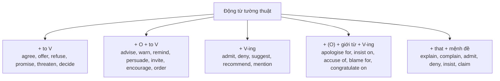

# B2-G006 · Advanced Reported Speech — Tường thuật với động từ tường thuật

## Mục lục

- [A. Lesson Information](#a-lesson-information)
- [B. Warm-up](#b-warm-up)
- [C. WHAT](#c-what)
- [D. WHY](#d-why)
- [E. FORM](#e-form)
- [F. HOW](#f-how)
- [G. VISUAL](#g-visual)
- [H. COMPARISON](#h-comparison)
- [I. COMMON MISTAKES](#i-common-mistakes)
- [J. MEMORY TRICKS](#j-memory-tricks)
- [K. REAL-LIFE APPLICATION](#k-real-life-application)
- [L. PRACTICE EXERCISES](#l-practice-exercises)
- [M. KNOWLEDGE CHECK](#m-knowledge-check)
- [N. ANSWER KEY](#n-answer-key)

---

## A. Lesson Information

| Mục | Nội dung |
|---|---|
| **Lesson ID** | B2-G006 |
| **Topic** | Reporting verbs and their patterns: verb + to V (agree, offer, refuse, promise, threaten); verb + O + to V (advise, warn, remind, persuade, invite); verb + V-ing (admit, deny, suggest, recommend); verb + prep + V-ing (apologise for, insist on, accuse sb of, blame sb for, congratulate sb on); verb + that |
| **Tên tiếng Việt** | Động từ tường thuật và các mẫu cấu trúc đi kèm |
| **CEFR Level** | B2 |
| **Prerequisites** | [B1-G011 — Reported Questions & Commands](../../04-B1-INTERMEDIATE/grammar/B1-G011-reported-questions-commands.md), [B1-G021 — Verb Patterns](../../04-B1-INTERMEDIATE/grammar/B1-G021-verb-patterns.md) |
| **Estimated Time** | 90 phút |

**Learning Objectives:**

1. Thay *say/tell* bằng **động từ tường thuật** thể hiện **chức năng** của lời nói (hứa, từ chối, cảnh báo, xin lỗi...).
2. Dùng đúng **5 mẫu cấu trúc** của động từ tường thuật.
3. Tường thuật **ý chính** thay vì từng chữ.
4. Tránh lỗi kết hợp sai (*~~suggest him to~~, ~~deny to do~~*).
5. Dùng động từ tường thuật trong **văn viết** (tóm tắt, báo cáo, bài luận).

---

## B. Warm-up

Lời nói trực tiếp:

> *"I'm really sorry I broke your vase," said Tom.*

Tường thuật kiểu B1: *Tom said that he was really sorry he had broken my vase.*
Tường thuật kiểu B2: *Tom **apologised for breaking** my vase.*

🤔 **Hãy suy nghĩ:** Câu B2 ngắn hơn nhưng vẫn đủ ý. Từ *apologised* đã "gói" những thông tin gì của câu gốc?

---

## C. WHAT

**Động từ tường thuật** (reporting verbs) mô tả **chức năng** của lời nói: hứa, đề nghị, từ chối, buộc tội... Thay vì chép lại lời, ta **tóm tắt ý định** của người nói.

| Lời nói | Chức năng | Tường thuật |
|---|---|---|
| *"I'll definitely help you."* | Hứa | *She **promised to help** me.* |
| *"No, I won't sign it."* | Từ chối | *He **refused to sign** it.* |
| *"Don't touch the wire!"* | Cảnh báo | *He **warned** us **not to touch** the wire.* |
| *"I didn't take the money."* | Phủ nhận | *She **denied taking** the money.* |
| *"You lied to me!"* | Buộc tội | *He **accused** me **of lying** to him.* |

---

## D. WHY



Ở B2, giám khảo đánh giá cao việc dùng **động từ tường thuật chính xác** thay vì lặp lại *said/told*. Đây cũng là kỹ năng cốt lõi để **tóm tắt** và **paraphrase**.

---

## E. FORM

### E1. Verb + to V

| Động từ | Lời gốc | Tường thuật |
|---|---|---|
| agree | *"OK, I'll do it."* | *He **agreed to do** it.* |
| offer | *"Shall I carry your bag?"* | *She **offered to carry** my bag.* |
| refuse | *"I won't apologise."* | *He **refused to apologise**.* |
| promise | *"I'll be on time."* | *She **promised to be** on time.* |
| threaten | *"Pay or I'll call the police."* | *He **threatened to call** the police.* |
| claim | *"I'm a doctor."* | *He **claimed to be** a doctor.* |

### E2. Verb + O + to V

| Động từ | Lời gốc | Tường thuật |
|---|---|---|
| advise | *"You should see a doctor."* | *She **advised me to see** a doctor.* |
| warn | *"Don't swim here."* | *He **warned us not to swim** there.* |
| remind | *"Don't forget to lock the door."* | *Mum **reminded me to lock** the door.* |
| persuade | (sau khi thuyết phục) | *He **persuaded me to join** the team.* |
| invite | *"Would you like to come to dinner?"* | *They **invited us to come** to dinner.* |
| encourage | *"Go on, apply for it!"* | *She **encouraged me to apply**.* |

### E3. Verb + V-ing

| Động từ | Lời gốc | Tường thuật |
|---|---|---|
| admit | *"Yes, I broke it."* | *He **admitted breaking** it.* (hoặc *admitted that he had broken it*) |
| deny | *"I didn't cheat."* | *She **denied cheating**.* |
| suggest | *"Let's take a taxi."* | *He **suggested taking** a taxi.* |
| recommend | *"Try the fish."* | *The waiter **recommended trying** the fish.* |

### E4. Verb + (O) + preposition + V-ing

| Động từ | Lời gốc | Tường thuật |
|---|---|---|
| apologise **for** | *"Sorry I'm late."* | *He **apologised for being** late.* |
| insist **on** | *"I'm paying — no arguments!"* | *She **insisted on paying**.* |
| accuse sb **of** | *"You stole my phone!"* | *She **accused him of stealing** her phone.* |
| blame sb **for** | *"It's your fault we lost."* | *He **blamed me for losing** the game.* |
| congratulate sb **on** | *"Well done on passing!"* | *They **congratulated me on passing**.* |
| thank sb **for** | *"Thanks for helping."* | *She **thanked us for helping**.* |
| complain **about** | *"The room is too noisy."* | *He **complained about** the noise.* |

### E5. Verb + that-clause

*explain, complain, admit, deny, insist, claim, point out, announce, confirm*:
*She **explained that** the train had been cancelled.*

> 💡 Nhiều động từ có **nhiều mẫu**: *admit doing / admit that...*; *suggest doing / suggest that sb (should) do*; *promise to do / promise that...*

---

## F. HOW

| # | Lời trực tiếp | Tường thuật | Mẫu |
|---|---|---|---|
| 1 | *"I'll call you every day," he said to her.* | *He **promised to call** her every day.* | + to V |
| 2 | *"No, I won't lend you any more money."* | *She **refused to lend** me any more money.* | + to V |
| 3 | *"If I were you, I'd take the job."* | *He **advised me to take** the job.* | + O + to V |
| 4 | *"Don't forget your passport!"* | *She **reminded me to bring** my passport.* | + O + to V |
| 5 | *"Be careful — the floor is wet."* | *He **warned us that** the floor was wet.* | + O + that |
| 6 | *"Yes, I made a mistake."* | *The manager **admitted making** a mistake.* | + V-ing |
| 7 | *"I've never seen that man before."* | *She **denied having seen** / **ever seeing** the man before.* | + V-ing (perfect gerund — xem [B2-G013](B2-G013-perfect-infinitives-gerunds.md)) |
| 8 | *"Why don't we go to the beach?"* | *She **suggested going** to the beach.* | + V-ing |
| 9 | *"I'm sorry I didn't reply sooner."* | *He **apologised for not replying** sooner.* | + for + V-ing |
| 10 | *"You cheated in the exam!"* | *The teacher **accused** him **of cheating**.* | + O + of + V-ing |
| 11 | *"Congratulations on your promotion!"* | *Everyone **congratulated** her **on** her promotion / **on being** promoted.* | + O + on |
| 12 | *"You really must stay for dinner."* | *They **insisted on** us/our **staying** for dinner.* / *They **insisted that** we stay.* | + on + V-ing / + that |

---

## G. VISUAL

### Nhóm động từ theo "phản ứng"

```text
😊 Đồng ý / Giúp:     agree to, offer to, promise to
😠 Từ chối / Đe dọa:  refuse to, threaten to
👉 Bảo người khác:    advise/warn/remind/persuade/invite  + sb + to
🙇 Thừa nhận / Phủ nhận: admit / deny + V-ing
💡 Gợi ý:             suggest / recommend + V-ing
🎯 Giới từ cố định:   apologise for · insist on · accuse of · blame for · congratulate on
```

---

## H. COMPARISON

### *suggest* vs *advise*

| *suggest* | *advise* |
|---|---|
| *suggest + V-ing* / *suggest that sb (should) do* | *advise sb to do* / *advise doing* |
| ~~suggest sb to do~~ ❌ | ✅ *advised me to rest* |

### *deny* vs *refuse*

| *deny* = phủ nhận (đã làm) | *refuse* = từ chối (làm) |
|---|---|
| *He **denied stealing** the car.* | *He **refused to give** back the car.* |
| + V-ing | + to V |

### *say* vs *tell* vs động từ tường thuật

| *say (that)* | *tell sb (that) / tell sb to do* | Động từ tường thuật |
|---|---|---|
| Trung tính, chép ý | Trung tính, có người nghe | Thể hiện **chức năng** của lời nói |

---

## I. COMMON MISTAKES

| # | ❌ Sai | ✅ Đúng | Nguyên nhân | Cách tránh |
|---|---|---|---|---|
| 1 | She **suggested me to go**. | She **suggested (that) I go** / **suggested going**. | Theo khuôn *advise* | *suggest* không + O + to |
| 2 | He **denied to steal** the money. | He **denied stealing** the money. | | *deny* + V-ing |
| 3 | He **apologised to be** late. | He **apologised for being** late. | | *apologise for* + V-ing |
| 4 | They **accused him to lie**. | They **accused him of lying**. | | *accuse sb of* + V-ing |
| 5 | She **insisted to pay**. | She **insisted on paying**. | | *insist on* + V-ing |
| 6 | He **refused** that he had taken it. | He **denied** that he had taken it. | Nhầm *refuse/deny* | Phủ nhận → *deny* |
| 7 | I **explained him** the problem. | I **explained the problem to him**. / I explained **to him that**... | | *explain sth to sb* |
| 8 | She **promised me to come**. | She **promised to come**. / She **promised me (that) she would come**. | Thêm O trước to V | *promise to V* (không O) |

---

## J. MEMORY TRICKS

1. **"Hứa – Từ chối – Đồng ý – Đề nghị → TO"**: promise, refuse, agree, offer + to V (đều là "ý định của chính mình").
2. **"Thừa nhận – Phủ nhận – Gợi ý → ING"**: admit, deny, suggest + V-ing.
3. **"Giới từ cố định — học theo cặp"**: *apologise **for**, insist **on**, accuse **of**, blame **for**, congratulate **on***.

---

## K. REAL-LIFE APPLICATION

### Biên bản cuộc họp (minutes)

> ***Minutes — Project Team Meeting, 14 October***
>
> *The manager **opened** the meeting by **thanking** everyone **for working** overtime last week. She **explained that** the client **had asked** for changes to the design.*
>
> *Minh **suggested hiring** a freelance designer, but Lan **pointed out that** the budget was limited. After some discussion, the manager **agreed to request** additional funding.*
>
> *Hoa **apologised for missing** the previous deadline and **promised to finish** the report by Friday. The manager **reminded everyone to update** the shared calendar and **warned** the team **not to share** the files outside the company.*
>
> *Finally, the team **congratulated** Duc **on being** promoted to senior developer.*

**Dịch tóm tắt:** Quản lý cảm ơn mọi người làm thêm giờ; giải thích khách hàng đã yêu cầu sửa thiết kế. Minh gợi ý thuê designer tự do; Lan chỉ ra ngân sách hạn chế; quản lý đồng ý xin thêm kinh phí. Hoa xin lỗi vì trễ hạn, hứa xong báo cáo trước thứ Sáu. Quản lý nhắc cập nhật lịch chung, cảnh báo không chia sẻ tài liệu ra ngoài. Cả nhóm chúc mừng Đức được thăng chức.

---

## L. PRACTICE EXERCISES

> ✍️ Đáp án: [B2-G006-ANSWERS](../../12-ANSWERS-AND-EXPLANATIONS/B2/B2-G006-ANSWERS.md)

### Level 1 — Recognition

**L1.1.** He denied ___ the window.  A. to break  B. breaking  C. break
**L1.2.** She offered ___ me with my homework.  A. helping  B. to help  C. help
**L1.3.** The teacher warned us ___ late again.  A. not being  B. to not be  C. not to be
**L1.4.** They accused her ___ the documents.  A. of losing  B. for losing  C. to lose
**L1.5.** My friend suggested ___ the new café.  A. me to try  B. trying  C. to try
**L1.6.** He apologised ___ my name.  A. to forget  B. for forgetting  C. forgetting

### Level 2 — Controlled Practice

Tường thuật lại bằng động từ trong ngoặc.

**L2.1.** "I'll pay you back next week," said Nam. (promise)
**L2.2.** "I won't work on Sunday," said Lan. (refuse)
**L2.3.** "You should drink more water," the doctor said to me. (advise)
**L2.4.** "Yes, I ate the last piece of cake," said my brother. (admit)
**L2.5.** "I didn't take your charger," said Mai. (deny)
**L2.6.** "Let's have a barbecue on Saturday," said Tom. (suggest)
**L2.7.** "I'm sorry I shouted at you," she said to me. (apologise)
**L2.8.** "You broke my headphones!" Hoa said to her sister. (accuse)
**L2.9.** "Well done on winning the competition!" said the principal to us. (congratulate)
**L2.10.** "Give me the money, or I'll tell your parents," said the boy. (threaten)

### Level 3 — Error Correction

**L3.1.** She suggested me to take a break.
**L3.2.** He denied to have cheated in the test.
**L3.3.** The waiter insisted to carry our bags.
**L3.4.** They blamed me of the mistake.
**L3.5.** I explained them the new rules.
**L3.6.** She refused that she had lied.

### Level 4 — Production

**L4.1.** Dịch: *"Giám đốc từ chối bình luận về tin đồn."*
**L4.2.** Dịch: *"Cô ấy nhắc tôi gửi email cho khách hàng."*
**L4.3.** Dịch: *"Anh ấy phủ nhận việc đã nói dối cảnh sát."*
**L4.4.** Dịch: *"Họ chúc mừng chúng tôi đã hoàn thành dự án đúng hạn."*

**L4.5.** **Explain:** Vì sao *deny* và *refuse* không thay thế cho nhau được? Cho ví dụ.

### Level 5 — Real Communication

**L5.1.** Viết **biên bản cuộc họp** hoặc **tóm tắt một cuộc tranh cãi** (thật hoặc tưởng tượng) 130–160 từ. Dùng ≥ 8 động từ tường thuật khác nhau, thuộc ≥ 4 mẫu cấu trúc. Không dùng *said/told* quá 1 lần.
**L5.2.** **Speaking — Retell a conversation:** Xem một đoạn phim/hội thoại ngắn (hoặc nhớ lại một cuộc trò chuyện gần đây). Kể lại trong 1,5 phút bằng ≥ 5 động từ tường thuật (*She insisted on..., He refused to..., They agreed to...*).

---

## M. KNOWLEDGE CHECK

### 5 câu hỏi tự kiểm tra

1. Kể 4 động từ + to V, 4 động từ + O + to V.
2. Kể 4 động từ + V-ing.
3. Giới từ sau *apologise, insist, accuse, blame, congratulate*?
4. Hai cách đúng dùng *suggest*?
5. *deny* và *refuse* khác nhau thế nào?

### Checklist

- [ ] Tôi chọn đúng mẫu cấu trúc cho từng động từ tường thuật.
- [ ] Tôi tóm tắt được ý chính thay vì chép lời.
- [ ] Tôi không lạm dụng *said/told* khi viết báo cáo.

### 3 lỗi quan trọng cần nhớ

1. ~~suggest sb to do~~ → suggest **doing** / suggest **that** sb do.
2. ~~deny to do~~ → deny **doing**.
3. ~~accuse sb to do~~ → accuse sb **of doing**.

### Lịch ôn tập

| Ngày | Việc cần làm |
|---|---|
| Ngày 1 | Làm lại L2 |
| Ngày 3 | Làm flashcard 25 động từ tường thuật + mẫu cấu trúc |
| Ngày 7 | Viết tóm tắt một bài báo, dùng ≥ 5 động từ tường thuật |

### Liên kết

- ➡️ Bài tiếp theo: [B2-G007 — Reduced Relative Clauses](B2-G007-relative-clause-reduction.md)

---

## N. ANSWER KEY

👉 [B2-G006-ANSWERS.md](../../12-ANSWERS-AND-EXPLANATIONS/B2/B2-G006-ANSWERS.md)
