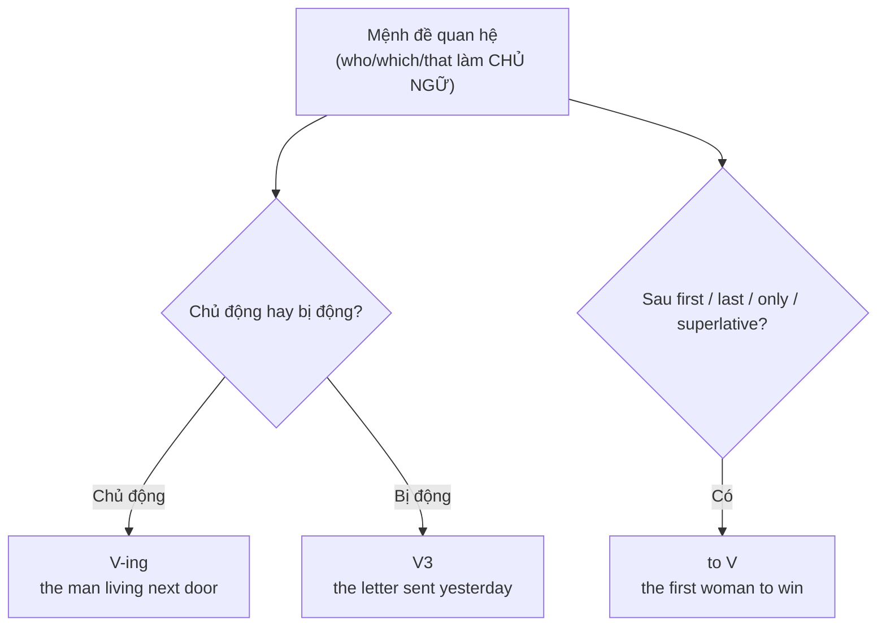

# B2-G007 · Reduced Relative Clauses — Rút gọn mệnh đề quan hệ

## Mục lục

- [A. Lesson Information](#a-lesson-information)
- [B. Warm-up](#b-warm-up)
- [C. WHAT](#c-what)
- [D. WHY](#d-why)
- [E. FORM](#e-form)
- [F. HOW](#f-how)
- [G. VISUAL](#g-visual)
- [H. COMPARISON](#h-comparison)
- [I. COMMON MISTAKES](#i-common-mistakes)
- [J. MEMORY TRICKS](#j-memory-tricks)
- [K. REAL-LIFE APPLICATION](#k-real-life-application)
- [L. PRACTICE EXERCISES](#l-practice-exercises)
- [M. KNOWLEDGE CHECK](#m-knowledge-check)
- [N. ANSWER KEY](#n-answer-key)

---

## A. Lesson Information

| Mục | Nội dung |
|---|---|
| **Lesson ID** | B2-G007 |
| **Topic** | Reducing relative clauses: present participle (V-ing), past participle (V3), to-infinitive (the first/last/only... to do), adjective/prepositional phrases; relative clauses with prepositions (in which, of whom) |
| **Tên tiếng Việt** | Rút gọn mệnh đề quan hệ bằng V-ing, V3, to V; mệnh đề quan hệ có giới từ |
| **CEFR Level** | B2 |
| **Prerequisites** | [B1-G013 — Defining & Non-defining Relative Clauses](../../04-B1-INTERMEDIATE/grammar/B1-G013-defining-non-defining-relatives.md), [B1-G012 — Passive across Tenses](../../04-B1-INTERMEDIATE/grammar/B1-G012-passive-all-tenses.md) |
| **Estimated Time** | 90 phút |

**Learning Objectives:**

1. Rút gọn mệnh đề quan hệ **chủ động** bằng **V-ing**: *the man **standing** there*.
2. Rút gọn mệnh đề quan hệ **bị động** bằng **V3**: *the car **parked** outside*.
3. Rút gọn bằng **to V** sau *the first, the last, the only, the best, superlatives*.
4. Rút gọn khi có ***be* + tính từ/cụm giới từ**: *the people (who are) **in the room***.
5. Dùng mệnh đề quan hệ **có giới từ** trang trọng: *the house **in which** I grew up; many students, **most of whom**...*

---

## B. Warm-up

So sánh:

> *The woman **who is sitting** next to the window is my boss.*
> *The woman **sitting** next to the window is my boss.*
>
> *The cars **that were made** in this factory are exported to Japan.*
> *The cars **made** in this factory are exported to Japan.*

🤔 **Hãy suy nghĩ:** Câu thứ hai trong mỗi cặp đã bỏ đi những từ nào? Vì sao cặp 1 giữ **V-ing**, còn cặp 2 giữ **V3**?

---

## C. WHAT

**Rút gọn mệnh đề quan hệ** = bỏ **đại từ quan hệ** (*who/which/that*) và **trợ động từ *be*** (nếu có), giữ lại **phân từ** hoặc **nguyên mẫu**.

| Mệnh đề đầy đủ | Rút gọn | Dạng |
|---|---|---|
| *people **who live** in cities* | *people **living** in cities* | Chủ động → V-ing |
| *a book **which was written** in 1900* | *a book **written** in 1900* | Bị động → V3 |
| *the first person **who arrived*** | *the first person **to arrive*** | Sau *first/last/only* → to V |
| *the books **which are on** the table* | *the books **on** the table* | Cụm giới từ |

---

## D. WHY



Văn viết B2 (bài luận, báo cáo, tin tức) dùng câu rút gọn để **ngắn gọn, trang trọng, mật độ thông tin cao**. Đọc hiểu B2 cũng đòi hỏi nhận ra phân từ đứng sau danh từ là **mệnh đề quan hệ rút gọn**, không phải động từ chính.

> ⚠️ **Chỉ rút gọn được khi đại từ quan hệ làm CHỦ NGỮ** của mệnh đề. *The book **(that) I bought*** — *that* làm tân ngữ → chỉ có thể **lược bỏ *that***, không rút gọn thành V-ing.

---

## E. FORM

### E1. Chủ động → V-ing

| Đầy đủ | Rút gọn |
|---|---|
| *Students **who want** to join should register.* | *Students **wanting** to join should register.* |
| *The road **that leads** to the village is narrow.* | *The road **leading** to the village is narrow.* |

> 💡 Rút gọn V-ing được dùng cả với động từ **trạng thái** (*want, belong, contain*): *a box **containing** old letters*.

> ⚠️ Không dùng V-ing để rút gọn một **hành động đơn lẻ, đã hoàn tất** trong quá khứ: *The man **who called** yesterday* → ~~*The man calling yesterday*~~ (nghe như đang gọi). Giữ mệnh đề đầy đủ.

### E2. Bị động → V3

| Đầy đủ | Rút gọn |
|---|---|
| *The money **that was stolen** has been found.* | *The money **stolen** has been found.* |
| *Products **which are made** in Vietnam* | *Products **made** in Vietnam* |
| *The bridge **which is being built*** | *The bridge **being built*** (bị động tiếp diễn) |

### E3. to-infinitive

Sau ***the first / second / last / only / next*** và **so sánh nhất**:

| Đầy đủ | Rút gọn |
|---|---|
| *She was the first woman **who won** the prize.* | *She was the first woman **to win** the prize.* |
| *He's the only person **who can** help us.* | *He's the only person **to help** us.* (ít tự nhiên hơn với *can*; thường giữ *who can*) |
| *the youngest player **who has ever scored*** | *the youngest player **ever to score*** |
| (Bị động) *the last house **that was sold*** | *the last house **to be sold*** |

Cũng dùng **to V** để chỉ **mục đích/việc cần làm**: *I have a lot of work **to do**.* / *There's nothing **to eat**.*

### E4. *be* + tính từ / cụm giới từ / cụm danh từ

| Đầy đủ | Rút gọn |
|---|---|
| *The people **who are in** the room* | *The people **in** the room* |
| *A bag **which is full of** money* | *A bag **full of** money* |
| *Mr Lam, **who is** our manager,* | *Mr Lam, **our manager**,* (đồng vị ngữ) |

### E5. Mệnh đề quan hệ có giới từ (trang trọng)

| Thân mật | Trang trọng |
|---|---|
| *the house **which/that** I grew up **in*** | *the house **in which** I grew up* |
| *the person **who** I spoke **to*** | *the person **to whom** I spoke* |
| *I have three brothers. **All of them** live abroad.* | *I have three brothers, **all of whom** live abroad.* |
| *She wrote two books. **Neither of them** sold well.* | *She wrote two books, **neither of which** sold well.* |

> Sau giới từ: **whom** (người), **which** (vật) — không dùng *who* hay *that*.

---

## F. HOW

| # | English | Tiếng Việt | Phân tích |
|---|---|---|---|
| 1 | *The man **standing** at the door is my uncle.* | Người đàn ông đứng ở cửa là chú tôi. | V-ing — chủ động |
| 2 | *Anyone **wishing** to leave early should inform the manager.* | Ai muốn về sớm nên báo quản lý. | V-ing — trạng thái |
| 3 | *Most of the furniture **sold** in this shop is imported.* | Phần lớn đồ nội thất bán ở đây là hàng nhập. | V3 — bị động |
| 4 | *The questions **asked** at the interview were difficult.* | Các câu hỏi được hỏi trong buổi phỏng vấn khó. | V3 |
| 5 | *Neil Armstrong was the first person **to walk** on the moon.* | Neil Armstrong là người đầu tiên đi trên Mặt Trăng. | to V |
| 6 | *She was the last candidate **to be interviewed**.* | Cô ấy là ứng viên cuối cùng được phỏng vấn. | to be V3 |
| 7 | *The children **in the garden** are my cousins.* | Bọn trẻ trong vườn là anh em họ tôi. | Cụm giới từ |
| 8 | *Hanoi, **the capital of Vietnam**, has a population of over 8 million.* | Hà Nội, thủ đô VN, ... | Đồng vị ngữ (số liệu làm tròn, minh họa) |
| 9 | *The new hospital **being built** near my house will open next year.* | Bệnh viện mới đang được xây... | being V3 |
| 10 | *The company **for which** she works is based in Singapore.* | Công ty mà cô ấy làm việc có trụ sở ở Singapore. | Giới từ + which |
| 11 | *The survey had 500 respondents, **most of whom** were under 30.* | ... phần lớn trong số họ dưới 30 tuổi. | most of whom |
| 12 | *There are many problems **to be solved**.* | Có nhiều vấn đề cần được giải quyết. | to be V3 |

---

## G. VISUAL

### Quy trình rút gọn 3 bước

```text
The woman  [who is sitting]  next to the window ...
           ───┬── ─┬─
1. Đại từ quan hệ là chủ ngữ?  → who = chủ ngữ ✅
2. Bỏ đại từ quan hệ + be      → [sitting]
3. Chủ động → V-ing / Bị động → V3

The woman  sitting  next to the window ...
```

### Không rút gọn được

```text
The book  [that I bought]   → that = TÂN NGỮ  → chỉ bỏ "that": The book I bought
The man   [whose car ...]   → whose            → không rút gọn
```

---

## H. COMPARISON

### V-ing vs V3 sau danh từ

| V-ing (chủ động — danh từ **làm** hành động) | V3 (bị động — danh từ **nhận** hành động) |
|---|---|
| *the people **interviewing** the candidates* (những người phỏng vấn) | *the people **interviewed** for the survey* (những người được phỏng vấn) |
| *a girl **singing** a song* | *a song **sung** by a girl* |

### Phân từ rút gọn vs động từ chính

| Rút gọn mệnh đề | Động từ chính |
|---|---|
| *The man **arrested** yesterday is a famous actor.* (V3 — người bị bắt) | *The police **arrested** the man yesterday.* |

> 💡 Khi đọc: nếu câu đã có động từ chính (*is*), thì V3/V-ing đứng sau danh từ là **mệnh đề rút gọn**.

---

## I. COMMON MISTAKES

| # | ❌ Sai | ✅ Đúng | Nguyên nhân | Cách tránh |
|---|---|---|---|---|
| 1 | The book **writing** by Nguyen Du is famous. | The book **written** by Nguyen Du... | Nhầm chủ/bị động | Sách **được** viết → V3 |
| 2 | The students **attended** the class were tired. | The students **attending** the class... / **who attended**... | Nhầm V3 với V-ing | Học sinh **tham dự** (chủ động) → V-ing |
| 3 | She was the first woman **won** the prize. | ... the first woman **to win** ... | | *the first* + to V |
| 4 | The house **in that** I grew up... | The house **in which** I grew up... | *that* sau giới từ | Giới từ + *which/whom* |
| 5 | I have two sisters, **both of them** are doctors. | ..., **both of whom** are doctors. | Comma splice | *of whom* nối mệnh đề |
| 6 | The film **I watching** last night was boring. | The film **(that) I watched** last night... | Rút gọn khi đại từ là tân ngữ | Chỉ bỏ *that* |
| 7 | The man **calling** me yesterday was rude. | The man **who called** me yesterday... | V-ing cho hành động đơn đã xong | Giữ mệnh đề đầy đủ |

---

## J. MEMORY TRICKS

1. **"Làm → -ING, Bị → V3"** 🔄: Danh từ **tự làm** → V-ing; danh từ **bị/được** → V3.
2. **"Thứ nhất – cuối cùng – duy nhất → TO"**: *the first/last/only... **to** do*.
3. **"Giới từ ghét THAT"**: sau giới từ chỉ có *which/whom*.

---

## K. REAL-LIFE APPLICATION

### Đoạn văn mô tả khảo sát (văn học thuật)

> *A survey **conducted** by a local university last year asked 1,000 young people **living** in Hanoi about their reading habits. Participants, **most of whom** were students, were asked to estimate the number of books **read** in the previous twelve months. Respondents **aged** 18 to 22 read the most, while those **working** full-time read the least. Interestingly, the only group **to report** an increase in reading was people **using** e-readers. The full report, **available** on the university website, includes several recommendations **aimed** at libraries and schools.*

> ℹ️ Khảo sát và số liệu là giả định để luyện ngữ pháp.

**Dịch tóm tắt:** Một khảo sát do đại học thực hiện hỏi 1.000 bạn trẻ sống ở Hà Nội về thói quen đọc; phần lớn người tham gia là sinh viên. Nhóm 18–22 tuổi đọc nhiều nhất; người đi làm toàn thời gian đọc ít nhất. Nhóm duy nhất báo cáo đọc nhiều hơn là người dùng máy đọc sách. Báo cáo đầy đủ có trên website, kèm khuyến nghị cho thư viện và trường học.

---

## L. PRACTICE EXERCISES

> ✍️ Đáp án: [B2-G007-ANSWERS](../../12-ANSWERS-AND-EXPLANATIONS/B2/B2-G007-ANSWERS.md)

### Level 1 — Recognition

**L1.1.** The girl ___ to Mr Hung is his daughter.  A. talked  B. talking  C. to talk
**L1.2.** Most of the coffee ___ in this café comes from Dak Lak.  A. serving  B. served  C. to serve
**L1.3.** She was the first student ___ the test.  A. finishing  B. finished  C. to finish
**L1.4.** The hotel ___ we stayed was very comfortable.  A. in that  B. in which  C. which
**L1.5.** I met 20 people at the conference, many of ___ were from Japan.  A. them  B. whom  C. who
**L1.6.** Câu nào **không thể** rút gọn mệnh đề quan hệ bằng phân từ?  A. The man who lives next door is a pilot.  B. The cake that I made was delicious.  C. The letters which were sent yesterday arrived today.

### Level 2 — Controlled Practice

Rút gọn mệnh đề quan hệ.

**L2.1.** The woman who is waiting outside wants to see you.
**L2.2.** The products which are sold online are often cheaper.
**L2.3.** He was the only person who passed the exam.
**L2.4.** The bridge which is being built across the river will be finished next year.
**L2.5.** Anyone who wants to attend the workshop must register by Friday.
**L2.6.** The keys which are on the table are mine.

Nối hai câu bằng giới từ + *which/whom*.

**L2.7.** This is the company. My father worked for it for 30 years.
**L2.8.** I spoke to a lawyer. She was very helpful. (*to whom*)
**L2.9.** The class has 30 students. Half of them are from the countryside.
**L2.10.** I bought three books. None of them was interesting.

### Level 3 — Error Correction

**L3.1.** The book writing by this author became a bestseller.
**L3.2.** People lived in big cities often suffer from stress.
**L3.3.** He was the youngest player scoring in the final.
**L3.4.** The city in that I was born is very small now.
**L3.5.** I have many friends, most of them speak English.
**L3.6.** The man calling me last night didn't leave his name.

### Level 4 — Production

**L4.1.** Dịch (rút gọn V3): *"Các món ăn được phục vụ ở nhà hàng này đều được nấu từ nguyên liệu địa phương."*
**L4.2.** Dịch (rút gọn V-ing): *"Những học sinh tham gia cuộc thi sẽ nhận được giấy chứng nhận."*
**L4.3.** Dịch (to V): *"Cô ấy là người phụ nữ Việt Nam đầu tiên đạt giải này."* (giả định)
**L4.4.** Dịch (of whom): *"Tôi có hai người anh, cả hai đều sống ở nước ngoài."*

**L4.5.** **Explain:** Vì sao *"The cake that I made"* không rút gọn thành *"The cake making"* hay *"The cake made by me"* một cách tự nhiên? (gợi ý: vai trò của *that*)

### Level 5 — Real Communication

**L5.1.** Viết đoạn văn 130–160 từ mô tả **một sản phẩm, dịch vụ hoặc địa điểm** ở Việt Nam cho khách nước ngoài (kiểu brochure). Dùng ≥ 3 rút gọn V-ing, ≥ 3 rút gọn V3, ≥ 1 *the first/only... to V*, ≥ 1 mệnh đề quan hệ có giới từ.
**L5.2.** **Speaking — Describe a photo:** Chọn một bức ảnh có nhiều người (lễ hội, chợ, lớp học). Mô tả trong 1 phút bằng câu rút gọn: *The man **wearing** a red hat..., The fruit **sold** at the stall..., The children **in** the front row...*

---

## M. KNOWLEDGE CHECK

### 5 câu hỏi tự kiểm tra

1. Khi nào rút gọn bằng V-ing, khi nào bằng V3?
2. Điều kiện để rút gọn được mệnh đề quan hệ?
3. Sau *the first / the only* dùng dạng gì?
4. Sau giới từ dùng đại từ quan hệ nào?
5. Viết lại: *I have two cats. Both of them are black.* (dùng *of which*)

### Checklist

- [ ] Tôi phân biệt V-ing (chủ động) và V3 (bị động) sau danh từ.
- [ ] Tôi không rút gọn khi đại từ quan hệ là tân ngữ.
- [ ] Tôi dùng *most of whom / both of which* đúng.

### 3 lỗi quan trọng cần nhớ

1. ~~a book writing by~~ → a book **written** by.
2. ~~the first person won~~ → the first person **to win**.
3. ~~in that~~ → **in which**.

### Lịch ôn tập

| Ngày | Việc cần làm |
|---|---|
| Ngày 1 | Làm lại L2 |
| Ngày 3 | Gạch chân mệnh đề rút gọn trong một bài báo tiếng Anh |
| Ngày 7 | Học tiếp [B2-G008 — Participle Clauses](B2-G008-participle-clauses.md) |

### Liên kết

- ➡️ Bài tiếp theo: [B2-G008 — Participle Clauses](B2-G008-participle-clauses.md)
- 🔜 [B2-G020 — Complex Noun Phrases](B2-G020-complex-noun-phrases.md)

---

## N. ANSWER KEY

👉 [B2-G007-ANSWERS.md](../../12-ANSWERS-AND-EXPLANATIONS/B2/B2-G007-ANSWERS.md)
