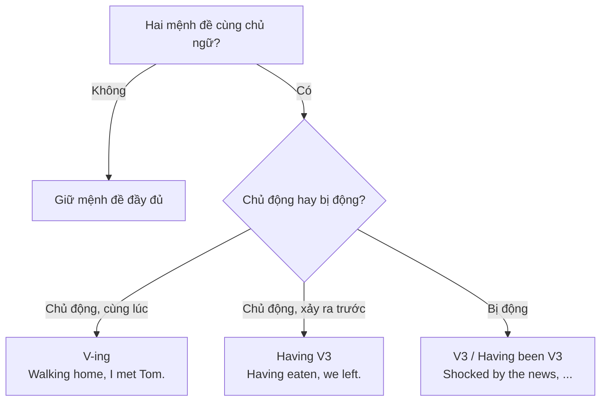

# B2-G008 · Participle Clauses — Mệnh đề phân từ

## Mục lục

- [A. Lesson Information](#a-lesson-information)
- [B. Warm-up](#b-warm-up)
- [C. WHAT](#c-what)
- [D. WHY](#d-why)
- [E. FORM](#e-form)
- [F. HOW](#f-how)
- [G. VISUAL](#g-visual)
- [H. COMPARISON](#h-comparison)
- [I. COMMON MISTAKES](#i-common-mistakes)
- [J. MEMORY TRICKS](#j-memory-tricks)
- [K. REAL-LIFE APPLICATION](#k-real-life-application)
- [L. PRACTICE EXERCISES](#l-practice-exercises)
- [M. KNOWLEDGE CHECK](#m-knowledge-check)
- [N. ANSWER KEY](#n-answer-key)

---

## A. Lesson Information

| Mục | Nội dung |
|---|---|
| **Lesson ID** | B2-G008 |
| **Topic** | Adverbial participle clauses: present participle (V-ing), past participle (V3), perfect participle (Having V3); with conjunctions (after, before, while, when, since); dangling participles |
| **Tên tiếng Việt** | Mệnh đề phân từ thay cho mệnh đề trạng ngữ: V-ing, V3, Having V3 |
| **CEFR Level** | B2 |
| **Prerequisites** | [B2-G007 — Reduced Relative Clauses](B2-G007-relative-clause-reduction.md), [B1-G023 — Adverbial Clauses](../../04-B1-INTERMEDIATE/grammar/B1-G023-adverbial-clauses.md) |
| **Estimated Time** | 90 phút |

**Learning Objectives:**

1. Dùng **V-ing** để rút gọn mệnh đề chỉ **thời gian, lý do, kết quả, hành động đồng thời** (chủ động).
2. Dùng **V3** để rút gọn mệnh đề **bị động**.
3. Dùng **Having + V3** để nhấn mạnh hành động **xảy ra trước**.
4. Kết hợp với liên từ: ***After finishing..., While waiting..., When asked...***
5. Tránh lỗi **dangling participle** (chủ ngữ ngầm sai).

---

## B. Warm-up

> ***Feeling** tired, she went to bed early.*
> ***Built** in 1900, the house needs a lot of repairs.*
> ***Having finished** the report, he went home.*

🤔 **Hãy suy nghĩ:** Viết lại mỗi câu bằng mệnh đề đầy đủ (*Because..., Although..., After...*). Ai là người "feeling tired"? Cái gì "built in 1900"? Chủ ngữ ngầm của phân từ là gì?

---

## C. WHAT

**Mệnh đề phân từ** (participle clause) là cách rút gọn **mệnh đề trạng ngữ** khi **chủ ngữ của hai mệnh đề giống nhau**.

| Mệnh đề đầy đủ | Mệnh đề phân từ |
|---|---|
| ***Because she felt** tired, she went to bed early.* | ***Feeling** tired, she went to bed early.* |
| ***Since it was built** in 1900, the house needs repairs.* | ***Built** in 1900, the house needs repairs.* |
| ***After he had finished** the report, he went home.* | ***Having finished** the report, he went home.* |

---

## D. WHY



Mệnh đề phân từ chủ yếu xuất hiện trong **văn viết** (truyện, báo chí, học thuật). Dùng chúng trong bài luận B2 giúp tăng **độ đa dạng cấu trúc**, nhưng cần dùng chính xác — lỗi *dangling participle* khiến câu buồn cười hoặc sai nghĩa.

---

## E. FORM

### E1. V-ing (chủ động, cùng lúc hoặc ngay sau)

| Ý nghĩa | Ví dụ | = Mệnh đề đầy đủ |
|---|---|---|
| Thời gian | ***Walking** home, I saw an accident.* | *While I was walking home...* |
| Lý do | ***Not knowing** what to do, I called my father.* | *Because I didn't know...* |
| Hành động liên tiếp | ***Opening** the door, she screamed.* | *She opened the door and screamed.* |
| Kết quả (sau dấu phẩy) | *The river flooded, **destroying** many homes.* | *..., and it destroyed many homes.* |

> Phủ định: ***Not** + V-ing* — *Not having a car, I take the bus.*

### E2. V3 (bị động)

| Ví dụ | = Mệnh đề đầy đủ |
|---|---|
| ***Shocked** by the news, he couldn't speak.* | *Because he was shocked...* |
| ***Written** in simple English, the book is easy to read.* | *Because it is written...* |
| ***Seen** from above, the city looks like a map.* | *When it is seen from above...* |

### E3. Having + V3 (hành động trước)

| Dạng | Ví dụ |
|---|---|
| Chủ động | ***Having lived** in Japan for ten years, she speaks Japanese fluently.* |
| Bị động | ***Having been told** the news, he rushed to the hospital.* |
| Phủ định | ***Not having studied**, he failed the test.* |

### E4. Kèm liên từ (giữ liên từ cho rõ nghĩa)

| Liên từ | Ví dụ |
|---|---|
| after / before | ***After finishing** work, she went to the gym.* / ***Before leaving**, lock the door.* |
| while / when | ***While waiting** for the bus, I read the news.* / ***When asked** about the plan, he said nothing.* |
| since | ***Since moving** to Da Nang, I've been much healthier.* |
| although / if / unless (bị động) | ***Although injured**, he finished the race.* / ***If stored** properly, the medicine lasts a year.* |

---

## F. HOW

| # | English | Tiếng Việt | Phân tích |
|---|---|---|---|
| 1 | ***Looking** out of the window, I saw a rainbow.* | Nhìn ra cửa sổ, tôi thấy cầu vồng. | V-ing — thời gian |
| 2 | ***Being** a vegetarian, she didn't eat the soup.* | Vì ăn chay, cô ấy không ăn súp. | V-ing — lý do |
| 3 | ***Not wanting** to wake the baby, we whispered.* | Không muốn đánh thức em bé, chúng tôi thì thầm. | Phủ định |
| 4 | *The typhoon hit the coast, **causing** serious damage.* | Bão đổ bộ, gây thiệt hại nghiêm trọng. | Kết quả |
| 5 | ***Surrounded** by mountains, the village is very peaceful.* | Được bao quanh bởi núi, ngôi làng rất yên bình. | V3 |
| 6 | ***Made** from recycled plastic, these bags are eco-friendly.* | Làm từ nhựa tái chế, ... | V3 |
| 7 | ***Having finished** her degree, she moved to Singapore.* | Học xong, cô ấy chuyển đến Singapore. | Having V3 |
| 8 | ***Having been rejected** three times, he finally got the job.* | Sau ba lần bị từ chối, ... | Having been V3 |
| 9 | ***After graduating**, I worked as a journalist.* | Sau khi tốt nghiệp, ... | after + V-ing |
| 10 | ***When asked** about his salary, he refused to answer.* | Khi được hỏi về lương, ... | when + V3 |
| 11 | ***Since starting** yoga, I've felt much calmer.* | Từ khi tập yoga, ... | since + V-ing |
| 12 | ***If used** correctly, this app can save you hours.* | Nếu được dùng đúng cách, ... | if + V3 |

---

## G. VISUAL

### Ba loại phân từ trên trục thời gian

```text
                     Mệnh đề chính
──────────●──────────────●──────────────►
   Having V3            V-ing
   (xảy ra TRƯỚC)       (CÙNG LÚC / ngay trước-sau)

V3 = bị động (thời gian theo ngữ cảnh)
```

### Dangling participle — lỗi "chủ ngữ lạc"

```text
❌ Walking down the street, the trees looked beautiful.
   → Ai đi bộ? "the trees" ??? (cây đi bộ!)

✅ Walking down the street, I thought the trees looked beautiful.
   → Chủ ngữ "I" = người đi bộ ✓
```

---

## H. COMPARISON

### V-ing vs Having V3

| V-ing | Having V3 |
|---|---|
| Hai hành động gần như **cùng lúc** hoặc nối tiếp ngay | Hành động 1 **hoàn tất** rồi mới đến hành động 2; hoặc kéo dài trước đó |
| ***Opening** the box, she found a ring.* | ***Having lived** abroad for years, he found it hard to readjust.* |

### Mệnh đề phân từ (B2-G008) vs mệnh đề quan hệ rút gọn (B2-G007)

| Mệnh đề quan hệ rút gọn | Mệnh đề phân từ trạng ngữ |
|---|---|
| Bổ nghĩa cho **danh từ** đứng ngay trước | Bổ nghĩa cho **cả mệnh đề chính** |
| *The man **standing** there is my uncle.* | ***Standing** there, I felt nervous.* |
| Không có dấu phẩy (xác định) | Thường có dấu phẩy |

---

## I. COMMON MISTAKES

| # | ❌ Sai | ✅ Đúng | Nguyên nhân | Cách tránh |
|---|---|---|---|---|
| 1 | **Walking** to school, **it** started to rain. | **Walking** to school, **I** got caught in the rain. / **While I was walking** to school, it started to rain. | Dangling participle | Chủ ngữ mệnh đề chính = người làm hành động |
| 2 | **Finishing** my homework, I went out. (ý: làm xong rồi mới đi) | **Having finished** my homework, I went out. / **After finishing**... | | Hoàn tất trước → *Having V3* |
| 3 | **Writing** in 1850, the novel is still popular. | **Written** in 1850, ... | Nhầm chủ/bị động | Tiểu thuyết **được** viết → V3 |
| 4 | **Having been finished** the work, she left. | **Having finished** the work, she left. | Nhầm bị động | Cô ấy làm xong (chủ động) |
| 5 | **Not knew** the answer, he guessed. | **Not knowing** the answer, he guessed. | Sai dạng | *Not + V-ing* |
| 6 | **Being** a sunny day, we went to the beach. | **It being** a sunny day, ... / **As it was** a sunny day, ... | Chủ ngữ khác nhau | Khác chủ ngữ → mệnh đề đầy đủ (hoặc absolute *It being...* — trang trọng) |

---

## J. MEMORY TRICKS

1. **"Hỏi AI trước khi rút gọn"** 🕵️: Chủ ngữ ngầm của phân từ **phải là** chủ ngữ mệnh đề chính.
2. **"Having = Đã xong"**: thấy *Having V3* → nghĩ "sau khi đã...".
3. **"Tự làm -ING, bị làm V3"** — giống quy tắc ở [B2-G007](B2-G007-relative-clause-reduction.md).

---

## K. REAL-LIFE APPLICATION

### Đoạn trích truyện

> ***Having worked** at the bank for twenty years, Mr Thanh knew every customer by name. One rainy morning, **sitting** at his desk, he noticed a young woman **standing** nervously by the door. **Holding** an old envelope, she walked towards him.*
>
> *"**Found** in my grandmother's house," she said, **handing** him the envelope. Inside was a bank book, **dated** 1975.*
>
> ***Not knowing** what to say, Mr Thanh stared at the name on the first page. It was his own father's name. **Shocked** by the discovery, he asked her to sit down. **After talking** for an hour, they realised that their families had been neighbours before the war.*

**Dịch tóm tắt:** Sau 20 năm làm ở ngân hàng, ông Thanh biết tên mọi khách hàng. Một sáng mưa, ông thấy một cô gái lo lắng cầm phong bì cũ. "Tìm thấy ở nhà bà tôi," cô nói. Bên trong là sổ tiết kiệm năm 1975. Không biết nói gì, ông nhìn chằm chằm cái tên — đó là tên cha ông. Sau một giờ trò chuyện, họ nhận ra gia đình họ từng là hàng xóm trước chiến tranh.

---

## L. PRACTICE EXERCISES

> ✍️ Đáp án: [B2-G008-ANSWERS](../../12-ANSWERS-AND-EXPLANATIONS/B2/B2-G008-ANSWERS.md)

### Level 1 — Recognition

**L1.1.** ___ the news, she started to cry.  A. Heard  B. Hearing  C. Having been heard
**L1.2.** ___ in 1890, the bridge is the oldest in the city.  A. Building  B. Built  C. Having built
**L1.3.** ___ his homework, he went out to play.  A. Having finished  B. Finished  C. Being finished
**L1.4.** ___ what to say, I kept quiet.  A. Not knew  B. Not knowing  C. Knowing not
**L1.5.** The earthquake struck at midnight, ___ hundreds of buildings.  A. destroyed  B. destroying  C. to destroy
**L1.6.** Câu nào bị lỗi **dangling participle**?  A. Arriving at the station, I found the train had left.  B. Arriving at the station, the train had left.  C. When I arrived at the station, the train had left.

### Level 2 — Controlled Practice

Viết lại bằng mệnh đề phân từ.

**L2.1.** Because I didn't have any money, I couldn't buy a ticket.
**L2.2.** After she had read the letter, she tore it up.
**L2.3.** As the book was written in French, it was difficult for me.
**L2.4.** While he was jogging in the park, he met an old friend.
**L2.5.** The storm hit the island, and it caused major damage.
**L2.6.** Because he had been warned about the traffic, he left early.

Hoàn thành câu với liên từ + phân từ.

**L2.7.** ___ (before / leave) the house, check that all windows are closed.
**L2.8.** ___ (when / ask) about the accident, the driver said nothing.
**L2.9.** ___ (since / move) to the countryside, she has been much happier.
**L2.10.** ___ (if / store) in a cool place, the cheese will last for weeks.

### Level 3 — Error Correction

**L3.1.** Walking along the beach, the sunset was beautiful.
**L3.2.** Writing by a famous author, the book sold millions of copies.
**L3.3.** Having been eaten dinner, we watched a film.
**L3.4.** Not understood the question, she asked the teacher to repeat it.
**L3.5.** Finishing the exam, the students were allowed to leave. (ý: sau khi làm xong)
**L3.6.** Being a holiday, all the shops were closed.

### Level 4 — Production

**L4.1.** Dịch: *"Sống ở Hà Nội mười năm, anh ấy hiểu rõ thành phố."* (*Having lived*)
**L4.2.** Dịch: *"Được bao quanh bởi những cánh đồng lúa, ngôi làng trông như một bức tranh."*
**L4.3.** Dịch: *"Không muốn làm phiền ai, cô ấy lặng lẽ rời đi."*
**L4.4.** Dịch: *"Khi được hỏi về kế hoạch tương lai, cô ấy chỉ mỉm cười."*

**L4.5.** **Explain:** Vì sao câu *"Walking into the room, the lights went out"* bị coi là lỗi? Sửa lại.

### Level 5 — Real Communication

**L5.1.** Viết một đoạn truyện ngắn 150–180 từ (đề tài tự chọn: một cuộc gặp gỡ bất ngờ, một chuyến đi, một bí mật). Dùng ≥ 3 V-ing, ≥ 2 V3, ≥ 2 *Having V3*, ≥ 2 cấu trúc liên từ + phân từ. Không có dangling participle.
**L5.2.** **Speaking — Recipe/Process:** Mô tả cách nấu một món ăn trong 1,5 phút bằng mệnh đề phân từ: *Having washed the rice..., Mixed with fish sauce, the meat..., Before adding the herbs...*

---

## M. KNOWLEDGE CHECK

### 5 câu hỏi tự kiểm tra

1. Điều kiện để dùng mệnh đề phân từ?
2. V-ing, V3 và Having V3 khác nhau thế nào?
3. Phủ định của mệnh đề phân từ?
4. Dangling participle là gì?
5. Những liên từ nào giữ lại được trước phân từ?

### Checklist

- [ ] Chủ ngữ ngầm của phân từ khớp với chủ ngữ mệnh đề chính.
- [ ] Tôi dùng *Having V3* cho hành động trước.
- [ ] Tôi dùng V3 cho nghĩa bị động.

### 3 lỗi quan trọng cần nhớ

1. Dangling participle: ~~Walking..., it started~~.
2. ~~Writing in 1850, the novel~~ → **Written**.
3. ~~Not knew~~ → **Not knowing**.

### Lịch ôn tập

| Ngày | Việc cần làm |
|---|---|
| Ngày 1 | Làm lại L2 |
| Ngày 3 | Viết lại 5 câu trong bài luận cũ của bạn bằng mệnh đề phân từ |
| Ngày 7 | Kết hợp với [B2-G007](B2-G007-relative-clause-reduction.md) và [B2-G020](B2-G020-complex-noun-phrases.md) |

### Liên kết

- ➡️ Bài tiếp theo: [B2-G009 — Inversion](B2-G009-inversion.md)

---

## N. ANSWER KEY

👉 [B2-G008-ANSWERS.md](../../12-ANSWERS-AND-EXPLANATIONS/B2/B2-G008-ANSWERS.md)
