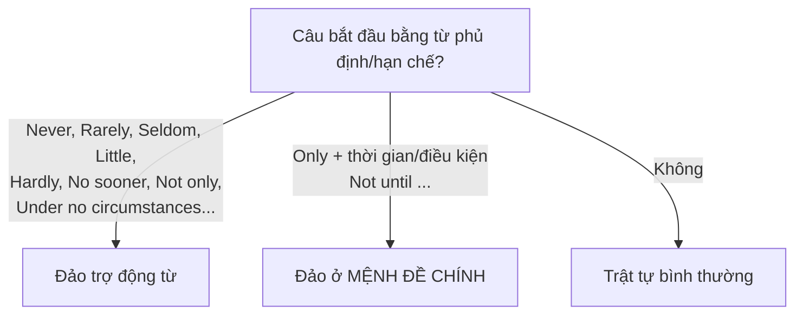

# B2-G009 · Inversion — Đảo ngữ nhấn mạnh

## Mục lục

- [A. Lesson Information](#a-lesson-information)
- [B. Warm-up](#b-warm-up)
- [C. WHAT](#c-what)
- [D. WHY](#d-why)
- [E. FORM](#e-form)
- [F. HOW](#f-how)
- [G. VISUAL](#g-visual)
- [H. COMPARISON](#h-comparison)
- [I. COMMON MISTAKES](#i-common-mistakes)
- [J. MEMORY TRICKS](#j-memory-tricks)
- [K. REAL-LIFE APPLICATION](#k-real-life-application)
- [L. PRACTICE EXERCISES](#l-practice-exercises)
- [M. KNOWLEDGE CHECK](#m-knowledge-check)
- [N. ANSWER KEY](#n-answer-key)

---

## A. Lesson Information

| Mục | Nội dung |
|---|---|
| **Lesson ID** | B2-G009 |
| **Topic** | Negative adverbial inversion (Never, Rarely, Seldom, Hardly ... when, No sooner ... than, Not only ... but also, Under no circumstances, At no time, Little); Only + time expression; Not until; So/Such ... that inversion |
| **Tên tiếng Việt** | Đảo ngữ sau trạng từ phủ định/hạn chế, Only, Not until, So/Such |
| **CEFR Level** | B2 |
| **Prerequisites** | [B1-G019 — Complex Sentences](../../04-B1-INTERMEDIATE/grammar/B1-G019-complex-sentences.md), [B2-G002 — Advanced Conditionals](B2-G002-advanced-conditionals.md) |
| **Estimated Time** | 90 phút |

**Learning Objectives:**

1. Hiểu **đảo ngữ** = trợ động từ đứng **trước** chủ ngữ (như câu hỏi) trong câu khẳng định, để **nhấn mạnh**.
2. Đảo ngữ sau ***Never, Rarely, Seldom, Little, At no time, Under no circumstances, On no account***.
3. Dùng ***Hardly/Scarcely ... when*** và ***No sooner ... than*** (vừa mới... thì...).
4. Dùng ***Not only ... but also***, ***Only after/when/if/then***, ***Not until***.
5. Dùng ***So + adj ... that*** và ***Such ... that*** đảo ngữ (mức nhận biết và viết lại câu).

---

## B. Warm-up

> *I have **never** seen such a beautiful sunset.*
> ***Never have I seen** such a beautiful sunset.*

🤔 **Hãy suy nghĩ:** Câu thứ hai trông giống câu hỏi (*have I seen*) nhưng không có dấu hỏi. Nó mang cảm xúc gì khác câu đầu? Bạn sẽ gặp kiểu câu này ở đâu — trong tin nhắn bạn bè hay trong một bài phát biểu?

---

## C. WHAT

**Đảo ngữ** (inversion) là đưa **trạng từ phủ định/hạn chế** lên **đầu câu**, rồi **đảo trợ động từ** lên trước chủ ngữ — giống trật tự câu hỏi.

```text
Trạng từ phủ định/hạn chế + TRỢ ĐỘNG TỪ + S + V ...
Never                       have           I   seen ...
```

| Bình thường | Đảo ngữ |
|---|---|
| *I **rarely** go out.* | ***Rarely do I** go out.* |
| *She **had hardly** arrived **when** it rained.* | ***Hardly had she** arrived **when** it rained.* |
| *He **not only** sings **but also** dances.* | ***Not only does he** sing, **but** he **also** dances.* |

---

## D. WHY

Đảo ngữ thuộc **văn phong trang trọng, văn chương, diễn thuyết**. Nó tạo **kịch tính, nhấn mạnh** và là dạng **biến đổi câu** thường gặp trong đề thi B2.



> ⚠️ Không lạm dụng: một bài luận B2 dùng 1–2 câu đảo ngữ là đủ để thể hiện độ đa dạng. Văn nói hằng ngày hầu như không dùng (trừ để đùa hoặc nhấn mạnh).

---

## E. FORM

### E1. Cách đảo

| Động từ trong câu gốc | Đảo ngữ |
|---|---|
| Có trợ động từ (*have, be, will, can...*) | Đưa trợ động từ lên: *I **have** never seen → Never **have** I seen* |
| Động từ thường hiện tại/quá khứ đơn | Thêm *do/does/did*: *I rarely **go** → Rarely **do** I **go*** |
| *be* là động từ chính | Đảo *be*: *He was **so** tired → So tired **was** he...* |

### E2. Nhóm trạng từ phủ định / hạn chế

| Từ/cụm | Nghĩa | Ví dụ |
|---|---|---|
| **Never (before)** | chưa bao giờ | ***Never before had** the city **seen** such crowds.* |
| **Rarely / Seldom** | hiếm khi | ***Rarely do** we **eat** out these days.* |
| **Little** | hầu như không (biết/nhận ra) | ***Little did** she **know** that her life was about to change.* |
| **At no time** | không lúc nào | ***At no time did** he **mention** the money.* |
| **Under no circumstances / On no account** | dù thế nào cũng không | ***Under no circumstances should** you **open** this door.* |
| **In no way** | không hề | ***In no way is** this your fault.* |
| **Nowhere** | không nơi nào | ***Nowhere else can** you **find** such fresh seafood.* |

### E3. "Vừa mới ... thì ..."

| Cấu trúc | Ví dụ |
|---|---|
| **Hardly / Scarcely + had + S + V3 + when + QKĐ** | ***Hardly had** I **sat** down **when** the phone rang.* |
| **No sooner + had + S + V3 + than + QKĐ** | ***No sooner had** we **arrived than** it started to rain.* |

> ⚠️ *Hardly/Scarcely* đi với **when** (hoặc *before*); *No sooner* đi với **than**.

### E4. Not only ... but also

| Bình thường | Đảo ngữ |
|---|---|
| *She is not only clever but also kind.* | ***Not only is** she clever, **but** she is **also** kind.* |
| *He speaks not only English but also French.* | ***Not only does** he **speak** English, **but** he **also** speaks French.* |

### E5. Only + ... và Not until — đảo ở mệnh đề CHÍNH

| Cấu trúc | Ví dụ |
|---|---|
| **Only after + N/V-ing/mệnh đề** | ***Only after** the meeting **did I realise** my mistake.* |
| **Only when + mệnh đề** | ***Only when** you lose your health **do you understand** its value.* |
| **Only if + mệnh đề** | ***Only if** you work hard **will you** succeed.* |
| **Only then / Only in this way** | ***Only then did** he **tell** me the truth.* |
| **Not until + thời gian/mệnh đề** | ***Not until** I got home **did I notice** that my wallet was missing.* |

> Mệnh đề sau *Only when / Not until* giữ **trật tự bình thường**; chỉ mệnh đề chính đảo.

### E6. So / Such ... that (đảo)

| Bình thường | Đảo ngữ |
|---|---|
| *The storm was **so** strong **that** trees fell.* | ***So strong was** the storm **that** trees fell.* |
| *It was **such** a shock **that** she fainted.* | ***Such was** the shock **that** she fainted.* |

---

## F. HOW

| # | English | Tiếng Việt | Phân tích |
|---|---|---|---|
| 1 | ***Never have I** felt so proud of my students.* | Chưa bao giờ tôi tự hào về học trò như vậy. | Never + have |
| 2 | ***Seldom does** it **snow** in Hanoi.* | Hiếm khi tuyết rơi ở Hà Nội. | Seldom + does |
| 3 | ***Little did we know** what was waiting for us.* | Chúng tôi hầu như không biết điều gì đang chờ đợi. | Little + did — văn kể chuyện |
| 4 | ***Under no circumstances should** passengers **leave** their bags unattended.* | Dù trong trường hợp nào, hành khách không được để hành lý không người trông. | Thông báo trang trọng |
| 5 | ***Hardly had** the match **started when** it began to rain.* | Trận đấu vừa bắt đầu thì trời mưa. | Hardly ... when |
| 6 | ***No sooner had** she **left than** her boss called.* | Cô ấy vừa rời đi thì sếp gọi. | No sooner ... than |
| 7 | ***Not only did** they **lose** the match, **but** they **also** lost their best player to injury.* | Họ không chỉ thua trận mà còn mất cầu thủ giỏi nhất vì chấn thương. | Not only |
| 8 | ***Only after** reading the contract carefully **did I** sign it.* | Chỉ sau khi đọc kỹ hợp đồng tôi mới ký. | Only after |
| 9 | ***Not until** he was 40 **did he learn** to drive.* | Mãi đến 40 tuổi anh ấy mới học lái xe. | Not until |
| 10 | ***Only when** the power went out **did we realise** how dependent we were on electricity.* | Chỉ khi mất điện chúng tôi mới nhận ra mình phụ thuộc vào điện thế nào. | Only when |
| 11 | ***So beautiful was** the view **that** we stayed for hours.* | Cảnh đẹp đến mức chúng tôi ở lại hàng giờ. | So + adj + be |
| 12 | ***At no time was** the public **informed** of the risks.* | Không lúc nào công chúng được thông báo về rủi ro. | At no time + bị động |

---

## G. VISUAL

### "Biến thành câu hỏi, bỏ dấu hỏi"

```text
Câu gốc:     I     have   never   seen   it.
Câu hỏi:     Have  I      ever    seen   it?
Đảo ngữ:     Never  have   I       seen   it.
             ↑ từ phủ định  ↑ trợ động từ  ↑ chủ ngữ
```

### Vị trí đảo với Only / Not until

```text
Only when   [I got home]          DID I REALISE   the truth.
            mệnh đề phụ: bình thường   mệnh đề chính: ĐẢO
```

---

## H. COMPARISON

### Hardly ... when vs No sooner ... than

| Hardly/Scarcely | No sooner |
|---|---|
| + **when** / *before* | + **than** |
| ***Hardly had** I left **when** ...* | ***No sooner had** I left **than** ...* |

### Đảo ngữ điều kiện (B2-G002) vs đảo ngữ nhấn mạnh (bài này)

| Điều kiện | Nhấn mạnh |
|---|---|
| Thay *if*: ***Had I known**, ...* | Sau từ phủ định: ***Never had I known** ...* |
| Ý nghĩa: giả định | Ý nghĩa: nhấn mạnh, kịch tính |

### *Not only* đầu câu vs giữa câu

| Giữa câu (không đảo) | Đầu câu (đảo) |
|---|---|
| *She **not only** sings **but also** dances.* | ***Not only does she** sing, **but** she **also** dances.* |

---

## I. COMMON MISTAKES

| # | ❌ Sai | ✅ Đúng | Nguyên nhân | Cách tránh |
|---|---|---|---|---|
| 1 | **Never I have seen** such a thing. | **Never have I seen** ... | Không đảo | Trợ động từ trước chủ ngữ |
| 2 | **Rarely he goes** out. | **Rarely does he go** out. | Quên *do/does* | Động từ thường → thêm *do/does/did* |
| 3 | **Rarely does he goes** out. | Rarely does he **go** out. | Chia động từ 2 lần | Sau *does* → V nguyên mẫu |
| 4 | **Hardly had** I arrived **than** ... | Hardly had I arrived **when** ... | Sai cặp | Hardly–when, No sooner–than |
| 5 | **Not until** I got home **I realised** ... | **Not until** I got home **did I realise** ... | Không đảo mệnh đề chính | Đảo mệnh đề chính |
| 6 | **Only when did I** get home I realised ... | **Only when I got home did I** realise ... | Đảo nhầm mệnh đề | Mệnh đề sau *Only when* bình thường |
| 7 | **Never didn't I** see ... | **Never did I** see ... | Phủ định kép | *Never* đã phủ định |

---

## J. MEMORY TRICKS

1. **"Từ phủ định kéo trợ động từ lên"** 🧲: Thấy *Never/Rarely/Little/Hardly...* đầu câu → làm như câu hỏi.
2. **"Hardly–When, Sooner–Than"**: *Sooner* là so sánh hơn (*soon → sooner*) nên đi với *than*.
3. **"Only/Not until: đảo ở nửa SAU"**: phần đầu kể bối cảnh bình thường, phần sau (mệnh đề chính) đảo.

---

## K. REAL-LIFE APPLICATION

### Bài phát biểu tốt nghiệp (trích)

> *Four years ago, when we first walked through these gates, **little did we know** how much we would change. **Never had** most of us **lived** away from home. **Not only did** we **have** to learn about economics and law, **but** we **also** had to learn how to cook, manage money and look after each other.*
>
> *There were difficult moments. **Hardly had** we **started** our second year **when** the pandemic forced us to study online. **Only then did** we **realise** how much we valued being together.*
>
> *Today, **under no circumstances should** we **forget** the people who helped us get here — our families, our teachers and our friends. **Rarely do** we **thank** them enough. So let's do it now.*

**Dịch tóm tắt:** Bốn năm trước, chúng ta hầu như không biết mình sẽ thay đổi nhiều thế nào. Chưa bao giờ phần lớn chúng ta sống xa nhà. Chúng ta không chỉ học kinh tế, luật mà còn học nấu ăn, quản lý tiền. Vừa vào năm hai thì đại dịch buộc học online; chỉ khi đó mới nhận ra mình quý việc ở bên nhau. Hôm nay, dù thế nào cũng không được quên những người đã giúp mình. Hiếm khi chúng ta cảm ơn họ đủ.

---

## L. PRACTICE EXERCISES

> ✍️ Đáp án: [B2-G009-ANSWERS](../../12-ANSWERS-AND-EXPLANATIONS/B2/B2-G009-ANSWERS.md)

### Level 1 — Recognition

**L1.1.** Never ___ such a delicious meal.  A. I have eaten  B. have I eaten  C. I ate
**L1.2.** Rarely ___ to bed before midnight.  A. she goes  B. does she go  C. does she goes
**L1.3.** Hardly had we sat down ___ the lights went out.  A. than  B. when  C. that
**L1.4.** No sooner had he arrived ___ he was asked to leave.  A. than  B. when  C. then
**L1.5.** Not until the next morning ___ the news.  A. we heard  B. did we hear  C. we did hear
**L1.6.** Only when you have children ___ how hard parenting is.  A. you understand  B. do you understand  C. understand you

### Level 2 — Controlled Practice

Viết lại câu bắt đầu bằng từ cho sẵn.

**L2.1.** I have never seen such a mess. → Never ______.
**L2.2.** We rarely see our cousins these days. → Rarely ______.
**L2.3.** She didn't know that he was lying. → Little ______.
**L2.4.** You must not open this box under any circumstances. → Under no circumstances ______.
**L2.5.** As soon as I got into the shower, the doorbell rang. → Hardly ______.
**L2.6.** The film started immediately after we sat down. → No sooner ______.
**L2.7.** He is talented and he is also very hard-working. → Not only ______.
**L2.8.** I didn't understand the problem until the teacher explained it. → Not until ______.
**L2.9.** You can only enter the building if you have a pass. → Only if ______.
**L2.10.** The wind was so strong that we couldn't open the door. → So strong ______.

### Level 3 — Error Correction

**L3.1.** Never I have been so embarrassed.
**L3.2.** Seldom do they visits their grandparents.
**L3.3.** Hardly had I finished speaking than everyone started laughing.
**L3.4.** Not until she called me I knew she was in town.
**L3.5.** Only after did I read the instructions I understood the problem.
**L3.6.** Not only she speaks French, but she also speaks Spanish.

### Level 4 — Production

**L4.1.** Dịch (dùng *Never*): *"Chưa bao giờ tôi thấy nhiều người như vậy ở một buổi hòa nhạc."*
**L4.2.** Dịch (dùng *No sooner*): *"Chúng tôi vừa ra khỏi nhà thì trời đổ mưa."*
**L4.3.** Dịch (dùng *Not until*): *"Mãi đến khi mất việc, anh ấy mới nhận ra tầm quan trọng của việc tiết kiệm."*
**L4.4.** Dịch (dùng *Under no circumstances*): *"Dù bất kỳ lý do gì, nhân viên cũng không được chia sẻ mật khẩu."*

**L4.5.** **Explain:** Trong câu *"Only when I got home did I realise..."*, vì sao mệnh đề *I got home* không đảo mà *did I realise* lại đảo?

### Level 5 — Real Communication

**L5.1.** Viết đoạn văn 130–160 từ (phong cách bài phát biểu hoặc đoạn kể chuyện kịch tính) về **một trải nghiệm đáng nhớ**. Dùng ≥ 5 cấu trúc đảo ngữ khác nhau (gồm ít nhất *Never/Rarely*, *Hardly/No sooner*, *Not only*, *Only/Not until*).
**L5.2.** **Speaking — Dramatic retelling:** Kể lại một sự kiện bất ngờ trong 1,5 phút theo phong cách "người dẫn chuyện phim tài liệu", dùng ≥ 3 câu đảo ngữ (*Little did they know..., No sooner had..., Only then did...*).

---

## M. KNOWLEDGE CHECK

### 5 câu hỏi tự kiểm tra

1. Cấu trúc chung của đảo ngữ nhấn mạnh?
2. Cần thêm gì khi động từ là động từ thường?
3. *Hardly* và *No sooner* đi với từ nào?
4. Với *Only when / Not until*, mệnh đề nào đảo?
5. Đảo ngữ thuộc văn phong nào?

### Checklist

- [ ] Tôi đảo đúng trợ động từ (*have/do/did/will...*).
- [ ] Tôi không nhầm *Hardly–when* với *No sooner–than*.
- [ ] Tôi đảo ở mệnh đề chính sau *Only.../Not until...*.

### 3 lỗi quan trọng cần nhớ

1. ~~Never I have~~ → **Never have I**.
2. ~~Rarely he goes~~ → **Rarely does he go**.
3. ~~Not until..., I realised~~ → **Not until..., did I realise**.

### Lịch ôn tập

| Ngày | Việc cần làm |
|---|---|
| Ngày 1 | Làm lại L2 |
| Ngày 3 | Viết 5 câu đảo ngữ về bản thân |
| Ngày 7 | Luyện biến đổi câu trong [B2-G029](B2-G029-sentence-transformation.md) |

### Liên kết

- ➡️ Bài tiếp theo: [B2-G010 — Cleft Sentences & Emphasis](B2-G010-cleft-sentences-emphasis.md)

---

## N. ANSWER KEY

👉 [B2-G009-ANSWERS.md](../../12-ANSWERS-AND-EXPLANATIONS/B2/B2-G009-ANSWERS.md)
