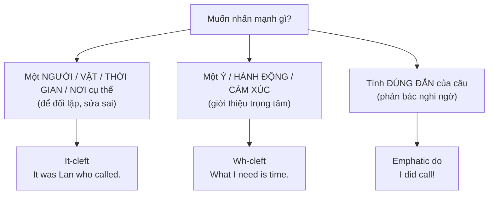

# B2-G010 · Emphasis & Cleft Sentences — Câu chẻ và cách nhấn mạnh

## Mục lục

- [A. Lesson Information](#a-lesson-information)
- [B. Warm-up](#b-warm-up)
- [C. WHAT](#c-what)
- [D. WHY](#d-why)
- [E. FORM](#e-form)
- [F. HOW](#f-how)
- [G. VISUAL](#g-visual)
- [H. COMPARISON](#h-comparison)
- [I. COMMON MISTAKES](#i-common-mistakes)
- [J. MEMORY TRICKS](#j-memory-tricks)
- [K. REAL-LIFE APPLICATION](#k-real-life-application)
- [L. PRACTICE EXERCISES](#l-practice-exercises)
- [M. KNOWLEDGE CHECK](#m-knowledge-check)
- [N. ANSWER KEY](#n-answer-key)

---

## A. Lesson Information

| Mục | Nội dung |
|---|---|
| **Lesson ID** | B2-G010 |
| **Topic** | It-cleft (It is/was ... that/who); Wh-cleft (What I need is...); All/The thing/The reason/The place ...; emphatic do/does/did; emphasis with "the very", "itself", "at all" |
| **Tên tiếng Việt** | Câu chẻ *It is... that*, *What... is*, nhấn mạnh với *do/does/did* và các từ nhấn mạnh |
| **CEFR Level** | B2 |
| **Prerequisites** | [B1-G013 — Relative Clauses](../../04-B1-INTERMEDIATE/grammar/B1-G013-defining-non-defining-relatives.md), [B1-G019 — Complex Sentences](../../04-B1-INTERMEDIATE/grammar/B1-G019-complex-sentences.md) |
| **Estimated Time** | 75 phút |

**Learning Objectives:**

1. Dùng **It-cleft**: *It was **Lan** who broke the vase* — nhấn mạnh một thành phần.
2. Dùng **Wh-cleft**: ***What** I need **is** a holiday.*
3. Dùng các biến thể: ***All** I want is..., **The thing** that annoys me is..., **The reason** why... is that...*
4. Dùng ***do/does/did*** nhấn mạnh trong câu khẳng định.
5. Biết khi nào dùng câu chẻ để **sửa thông tin sai** hoặc **tạo trọng tâm** trong nói và viết.

---

## B. Warm-up

Câu gốc: *Tom broke the window yesterday.*

> ***It was Tom** who broke the window yesterday.* (không phải ai khác)
> ***It was the window** that Tom broke yesterday.* (không phải cái gương)
> ***It was yesterday** that Tom broke the window.* (không phải hôm nay)
> ***What Tom did** was break the window.*

🤔 **Hãy suy nghĩ:** Bốn câu có cùng thông tin nhưng "điểm sáng" khác nhau. Trong tiếng Việt, ta nhấn mạnh bằng ngữ điệu hoặc cụm *"chính... là người..."*. Tiếng Anh viết thì nhấn mạnh thế nào khi không có ngữ điệu?

---

## C. WHAT

**Câu chẻ** (cleft sentence) "chẻ" một câu đơn thành **hai phần** để **đưa thông tin quan trọng vào vị trí nổi bật**.

| Loại | Cấu trúc | Ví dụ |
|---|---|---|
| **It-cleft** | *It + be + [phần nhấn mạnh] + that/who + phần còn lại* | ***It was** my mother **who** taught me to cook.* |
| **Wh-cleft** | *What + S + V + be + [phần nhấn mạnh]* | ***What** I love about Hanoi **is** the food.* |
| **Biến thể** | *All / The thing / The reason / The place ... + be* | ***All** I want **is** some sleep.* |
| **Emphatic do** | *do/does/did + V* | *I **did** lock the door — I'm sure!* |

---

## D. WHY



Câu chẻ giúp bài nói/viết B2 **có trọng tâm rõ**, đặc biệt khi **sửa hiểu lầm**, **so sánh/đối lập**, hoặc **mở đầu một ý quan trọng** trong bài luận và bài thuyết trình.

---

## E. FORM

### E1. It-cleft

```text
It + is/was + [thành phần nhấn mạnh] + that / who + phần còn lại
```

| Nhấn mạnh | Ví dụ |
|---|---|
| Chủ ngữ (người) | ***It was** Nam **who/that** won the prize.* |
| Tân ngữ | ***It's** coffee **that** I need, not tea.* |
| Thời gian | ***It was** in 2010 **that** we first met.* |
| Nơi chốn | ***It was** in Da Lat **that** they got married.* |
| Lý do | ***It was** because of the rain **that** the match was cancelled.* |

> - *who* chỉ dùng khi nhấn mạnh **người**; *that* dùng được cho mọi trường hợp.
> - Thì của *be*: thường *is* (hiện tại) hoặc *was* (quá khứ), theo ngữ cảnh.
> - ⚠️ Nhấn mạnh thời gian/nơi chốn vẫn dùng ***that***, không dùng *when/where*: ~~It was in 2010 when...~~ (văn nói có gặp, nhưng *that* là chuẩn).

### E2. Wh-cleft

```text
What + S + V + is/was + [thành phần nhấn mạnh]
```

| Nhấn mạnh | Ví dụ |
|---|---|
| Danh từ | ***What** I need **is** a long holiday.* |
| Hành động (*do*) | ***What** she did **was** (to) call the police.* |
| Mệnh đề | ***What** surprised me **was that** nobody complained.* |
| Cảm xúc/ý kiến | ***What** I like about this job **is** the flexibility.* |

### E3. Biến thể

| Cấu trúc | Ví dụ |
|---|---|
| ***All*** + S + V + *is/was* (= điều duy nhất) | ***All** I did **was** ask a question!* |
| ***The thing*** (that) ... *is* | ***The thing** that worries me **is** the cost.* |
| ***The reason*** (why) ... *is that* | ***The reason** I'm late **is that** my bike broke down.* |
| ***The place / The time / The person*** ... | ***The person** I admire most **is** my grandmother.* |
| Đảo ngược Wh-cleft | *A long holiday **is what** I need.* |

### E4. Emphatic *do/does/did*

| Ví dụ | Chức năng |
|---|---|
| *"You didn't lock the door." — "I **did** lock it!"* | Phản bác |
| *I **do** like your new haircut.* | Nhấn mạnh cảm xúc thật |
| ***Do** sit down.* | Mời lịch sự, nhấn mạnh |
| *He doesn't play often, but when he **does** play, he plays well.* | Đối lập |

> Động từ sau *do/does/did* luôn ở **nguyên mẫu**: *She **does** speak* (không ~~does speaks~~).

### E5. Từ nhấn mạnh khác

| Từ | Ví dụ |
|---|---|
| *the very* | *That's **the very** book I was looking for!* |
| *-self* (đại từ nhấn mạnh) | *The president **himself** attended.* |
| *at all / whatsoever* | *I have no idea **at all**. / There is no evidence **whatsoever**.* |
| *on earth / ever* (trong câu hỏi) | *What **on earth** are you doing?* |

---

## F. HOW

| # | English | Tiếng Việt | Phân tích |
|---|---|---|---|
| 1 | ***It was** my grandfather **who** taught me to play chess.* | Chính ông tôi là người dạy tôi chơi cờ. | It-cleft — người |
| 2 | ***It's** the noise **that** I can't stand, not the heat.* | Chính tiếng ồn là thứ tôi không chịu nổi, không phải cái nóng. | Đối lập |
| 3 | ***It was** only when I moved abroad **that** I appreciated Vietnamese food.* | Mãi khi ra nước ngoài tôi mới trân trọng món Việt. | It-cleft + *only when* |
| 4 | ***What** I really need right now **is** a cup of coffee.* | Điều tôi thực sự cần bây giờ là một tách cà phê. | Wh-cleft |
| 5 | ***What** annoys me **is that** he never says thank you.* | Điều làm tôi khó chịu là anh ta không bao giờ cảm ơn. | Wh-cleft + mệnh đề |
| 6 | ***What** we should do **is** talk to the manager.* | Việc chúng ta nên làm là nói chuyện với quản lý. | Wh-cleft — hành động |
| 7 | ***All** I want for my birthday **is** a quiet dinner.* | Tất cả những gì tôi muốn là một bữa tối yên tĩnh. | All-cleft |
| 8 | ***The reason** I chose this university **is that** it has a strong engineering faculty.* | Lý do tôi chọn trường này là vì... | The reason ... is that |
| 9 | *"You don't care about me!" — "I **do** care about you."* | Anh có quan tâm đến em mà! | Emphatic *do* |
| 10 | *I **did** send the email — check your spam folder.* | Tôi có gửi email mà. | Emphatic *did* |
| 11 | ***It was** in this very room **that** the treaty was signed.* | Chính trong căn phòng này hiệp ước đã được ký. | It-cleft + *very* |
| 12 | ***The person** I admire most **is** my mother, **who** raised three children alone.* | Người tôi ngưỡng mộ nhất là mẹ tôi... | The person ... is |

---

## G. VISUAL

### Chuyển câu thường → câu chẻ

```text
Câu gốc:   Lan  bought  a new laptop  in Singapore  last week.
               ↓
It-cleft:  It was  [Lan]           who   bought a new laptop in Singapore last week.
           It was  [a new laptop]  that  Lan bought in Singapore last week.
           It was  [in Singapore]  that  Lan bought a new laptop last week.
           It was  [last week]     that  Lan bought a new laptop in Singapore.

Wh-cleft:  What Lan bought in Singapore last week was [a new laptop].
```

---

## H. COMPARISON

### It-cleft vs Wh-cleft

| It-cleft | Wh-cleft |
|---|---|
| Nhấn mạnh **một thành phần cụ thể**, thường để **đối lập/sửa sai** | Đưa **trọng tâm mới** vào cuối câu, thường để **giới thiệu ý** |
| *It was **Mai** who called, not Lan.* | *What I want to discuss today is **climate change**.* |

### Câu chẻ It vs mệnh đề quan hệ

| Câu chẻ | Mệnh đề quan hệ |
|---|---|
| *It was the red car **that** hit me.* (bỏ *It was ... that* → câu vẫn đủ nghĩa: *The red car hit me*) | *I bought the car **that** was on sale.* (*that* bổ nghĩa cho *the car*) |

---

## I. COMMON MISTAKES

| # | ❌ Sai | ✅ Đúng | Nguyên nhân | Cách tránh |
|---|---|---|---|---|
| 1 | **It was** Lan **which** called me. | It was Lan **who/that** called me. | *which* cho người | Người → *who/that* |
| 2 | **What** I need **it is** a break. | What I need **is** a break. | Thừa *it* | Mệnh đề *What* đã là chủ ngữ |
| 3 | **What** I want **are** some peace. | What I want **is** some peace. | Hòa hợp sai | Mệnh đề *What* + *is* (thường) |
| 4 | I **did locked** the door. | I **did lock** the door. | Chia 2 lần | *did* + V nguyên mẫu |
| 5 | **It was** in 2010 **when** we met. | It was in 2010 **that** we met. | Dùng *when* | It-cleft → *that* |
| 6 | **The reason** I'm late **is because** of traffic. | ... **is that** there was a lot of traffic. / ...**is** the traffic. | Lặp ý lý do | *The reason ... is that...* |
| 7 | **All** what I want is sleep. | **All** I want is sleep. / **What** I want is sleep. | Trộn *all* và *what* | Chọn một |

---

## J. MEMORY TRICKS

1. **"It ... that = Chính ... là"** 🎯: *It was Lan that...* = *Chính Lan là người...*
2. **"What = Điều mà"**: *What I need is...* = *Điều mà tôi cần là...*
3. **"Did + nguyên mẫu = có mà!"**: *I did call!* = *Tôi CÓ gọi mà!*

---

## K. REAL-LIFE APPLICATION

### Mở bài thuyết trình

> *Good morning, everyone. **What I'd like to talk about today is** how social media affects our sleep. Many people think **it's** screen light **that** keeps us awake. That's partly true. But **what** recent studies suggest **is that** the content itself — the endless scrolling and the emotional reactions — matters even more.*
>
> ***The reason** I chose this topic **is that** I myself used to sleep only five hours a night. **It was** only when I deleted two apps **that** my sleep improved. I **do** believe small changes can make a big difference. **All** you need **is** a little self-discipline.*

> ℹ️ Phần "studies suggest" là tình huống minh họa ngôn ngữ thuyết trình; khi dùng trong bài thật, cần dẫn nguồn cụ thể.

**Dịch tóm tắt:** Chủ đề là mạng xã hội ảnh hưởng giấc ngủ. Nhiều người nghĩ ánh sáng màn hình gây mất ngủ — đúng một phần, nhưng nội dung (lướt vô tận, phản ứng cảm xúc) còn quan trọng hơn. Lý do chọn chủ đề: tác giả từng chỉ ngủ 5 tiếng/đêm; chỉ khi xóa hai ứng dụng thì giấc ngủ mới cải thiện. Thay đổi nhỏ có thể tạo khác biệt lớn.

---

## L. PRACTICE EXERCISES

> ✍️ Đáp án: [B2-G010-ANSWERS](../../12-ANSWERS-AND-EXPLANATIONS/B2/B2-G010-ANSWERS.md)

### Level 1 — Recognition

**L1.1.** It was my sister ___ found the lost dog.  A. which  B. who  C. what
**L1.2.** ___ I need is a good night's sleep.  A. That  B. What  C. Which
**L1.3.** "You didn't call me!" — "I ___ call you — twice!"  A. did  B. was  C. had
**L1.4.** It was in Hue ___ my parents first met.  A. where  B. that  C. which
**L1.5.** All I did ___ ask a simple question.  A. is  B. was  C. were
**L1.6.** Câu nào **đúng**?  A. What I want it is a new job.  B. What I want is a new job.  C. What I want are a new job.

### Level 2 — Controlled Practice

Viết lại câu với It-cleft, nhấn mạnh phần in đậm.

**L2.1.** **My father** taught me to swim.
**L2.2.** I lost **my wallet** at the station.
**L2.3.** We moved to Da Nang **in 2015**.
**L2.4.** The flight was cancelled **because of the typhoon**.

Viết lại với Wh-cleft (bắt đầu bằng *What*).

**L2.5.** I love the atmosphere of this café.
**L2.6.** His rudeness surprised me.
**L2.7.** We need more time.

Viết lại bằng từ cho sẵn.

**L2.8.** I only want to be happy. (All)
**L2.9.** I'm late because I missed the bus. (The reason)
**L2.10.** "You don't like my cooking." — "That's not true. ______" (emphatic *do*)

### Level 3 — Error Correction

**L3.1.** It was Hoa which won the competition.
**L3.2.** What I really want it is to travel the world.
**L3.3.** I did finished my homework!
**L3.4.** It was in 1999 when the company was founded.
**L3.5.** The reason she left is because she was unhappy.
**L3.6.** All what she said was a lie.

### Level 4 — Production

**L4.1.** Dịch (It-cleft): *"Chính cô giáo tiếng Anh đã truyền cảm hứng cho tôi trở thành phiên dịch viên."*
**L4.2.** Dịch (Wh-cleft): *"Điều tôi thích nhất ở công việc này là được gặp nhiều người."*
**L4.3.** Dịch (The reason): *"Lý do tôi học tiếng Anh là vì tôi muốn làm việc cho một công ty quốc tế."*
**L4.4.** Dịch (emphatic *do*): *"Tôi thật sự xin lỗi về chuyện hôm qua."*

**L4.5.** **Explain:** Khi nào nên dùng *It-cleft* và khi nào nên dùng *Wh-cleft*? Cho một ví dụ mỗi loại.

### Level 5 — Real Communication

**L5.1.** Viết **phần mở đầu một bài thuyết trình** 120–150 từ về chủ đề bạn quan tâm. Dùng ≥ 2 It-cleft, ≥ 2 Wh-cleft, ≥ 1 *The reason ... is that*, ≥ 1 *All ... is*, ≥ 1 emphatic *do/does/did*.
**L5.2.** **Speaking — Correcting misunderstandings:** Một người bạn nhớ sai về một sự kiện (*"You went to Da Lat with Nam last summer, right?"*). Sửa lại 4–5 chi tiết bằng It-cleft: *"No, it was Phu Quoc that I went to, and it was with Linh, not Nam..."*

---

## M. KNOWLEDGE CHECK

### 5 câu hỏi tự kiểm tra

1. Cấu trúc It-cleft?
2. Cấu trúc Wh-cleft?
3. Khi nhấn mạnh thời gian/nơi chốn trong It-cleft, dùng *that* hay *when/where*?
4. Emphatic *do* dùng để làm gì?
5. *The reason ... is that* — vì sao không dùng *is because*?

### Checklist

- [ ] Tôi viết được It-cleft nhấn mạnh 4 thành phần khác nhau.
- [ ] Tôi dùng Wh-cleft để giới thiệu ý chính.
- [ ] Tôi dùng emphatic *do* với động từ nguyên mẫu.

### 3 lỗi quan trọng cần nhớ

1. ~~It was Lan which~~ → **who/that**.
2. ~~What I need it is~~ → What I need **is**.
3. ~~I did locked~~ → I did **lock**.

### Lịch ôn tập

| Ngày | Việc cần làm |
|---|---|
| Ngày 1 | Làm lại L2 |
| Ngày 3 | Viết lại 3 câu mở bài luận cũ bằng Wh-cleft |
| Ngày 7 | Áp dụng trong [S07 — VSTEP-style Speaking](../../09-FOUR-SKILLS/Speaking/S07-vstep-speaking.md) |

### Liên kết

- ➡️ Bài tiếp theo: [B2-G011 — Advanced Modal Verbs](B2-G011-advanced-modals.md)

---

## N. ANSWER KEY

👉 [B2-G010-ANSWERS.md](../../12-ANSWERS-AND-EXPLANATIONS/B2/B2-G010-ANSWERS.md)
