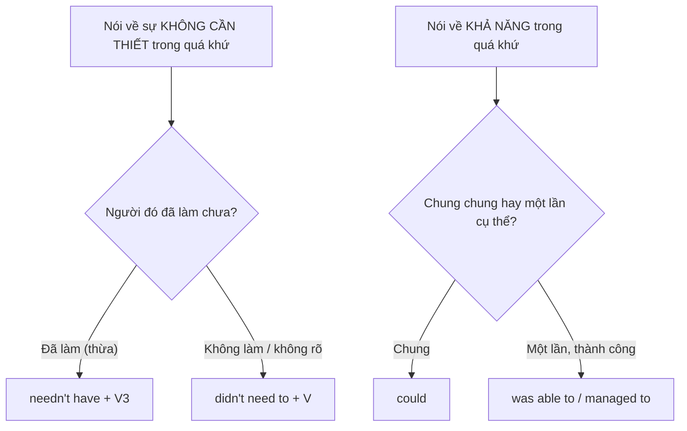

# B2-G011 · Advanced Modal Verbs — Động từ khuyết thiếu nâng cao

## Mục lục

- [A. Lesson Information](#a-lesson-information)
- [B. Warm-up](#b-warm-up)
- [C. WHAT](#c-what)
- [D. WHY](#d-why)
- [E. FORM](#e-form)
- [F. HOW](#f-how)
- [G. VISUAL](#g-visual)
- [H. COMPARISON](#h-comparison)
- [I. COMMON MISTAKES](#i-common-mistakes)
- [J. MEMORY TRICKS](#j-memory-tricks)
- [K. REAL-LIFE APPLICATION](#k-real-life-application)
- [L. PRACTICE EXERCISES](#l-practice-exercises)
- [M. KNOWLEDGE CHECK](#m-knowledge-check)
- [N. ANSWER KEY](#n-answer-key)

---

## A. Lesson Information

| Mục | Nội dung |
|---|---|
| **Lesson ID** | B2-G011 |
| **Topic** | needn't have done vs didn't need to; was able to vs could; be bound to / be likely to / be supposed to / be meant to; may/might as well; would (past habit) vs used to; should (probability); modals with continuous and passive forms |
| **Tên tiếng Việt** | Modal nâng cao: needn't have, was able to, be bound to, be supposed to, might as well, would (thói quen quá khứ) |
| **CEFR Level** | B2 |
| **Prerequisites** | [B1-G014 — Modals of Deduction](../../04-B1-INTERMEDIATE/grammar/B1-G014-modals-deduction-present.md), [B1-G015 — Modal Perfects](../../04-B1-INTERMEDIATE/grammar/B1-G015-modal-perfects.md) |
| **Estimated Time** | 90 phút |

**Learning Objectives:**

1. Phân biệt ***needn't have done*** (đã làm, nhưng không cần) và ***didn't need to do*** (không cần, thường là không làm).
2. Phân biệt ***could*** (khả năng chung) và ***was able to / managed to*** (làm được trong một tình huống cụ thể).
3. Dùng các "bán modal": ***be bound to, be likely to, be supposed to, be meant to, be due to***.
4. Dùng ***may/might as well*** (thôi thì cứ...) và ***should*** chỉ khả năng.
5. Dùng ***would*** cho thói quen quá khứ và phân biệt với *used to*.

---

## B. Warm-up

> *I **needn't have bought** so much food — only three guests came.*
> *I **didn't need to buy** any food — my mum brought everything.*

🤔 **Hãy suy nghĩ:** Trong câu nào người nói **đã mua** đồ ăn? Hai câu đều nói "không cần mua", nhưng kết quả thực tế khác nhau. Dấu hiệu ngữ pháp nào cho biết điều đó?

---

## C. WHAT

Ở B1 bạn đã học modal suy luận (*must, might, can't*) và modal hoàn thành (*should have, could have*). B2 bổ sung những **sắc thái tinh tế** mà người học trung cấp hay nhầm:

| Nhóm | Cấu trúc | Ý nghĩa |
|---|---|---|
| Sự cần thiết trong quá khứ | *needn't have V3* / *didn't need to V* | Làm thừa / không cần làm |
| Khả năng trong quá khứ | *could* / *was able to* / *managed to* | Khả năng chung / thành công cụ thể |
| Bán modal | *be bound to, be likely to, be supposed to, be meant to, be due to* | Chắc chắn / có khả năng / lẽ ra phải / dự kiến |
| Lựa chọn | *might/may as well* | Thôi thì cứ... (không có lựa chọn tốt hơn) |
| Thói quen quá khứ | *would* | Thói quen lặp lại (hành động) |
| Khả năng | *should* | Có lẽ sẽ (theo dự tính) |

---

## D. WHY



Những phân biệt này **thay đổi nghĩa thực tế** của câu — người đọc/nghe B2 trở lên sẽ hiểu khác nhau. Ở bài thi, đây là dạng câu hỏi trắc nghiệm và biến đổi câu kinh điển.

---

## E. FORM

### E1. *needn't have done* vs *didn't need to do*

| Cấu trúc | Nghĩa | Ví dụ |
|---|---|---|
| **needn't have + V3** | **Đã làm**, nhưng hóa ra không cần | *You **needn't have brought** an umbrella — it's sunny.* (bạn đã mang) |
| **didn't need to + V** | **Không cần** làm (thường không làm; hoặc không nói rõ) | *I **didn't need to wake** up early, so I slept in.* |
| **didn't have to + V** | = *didn't need to* | *We **didn't have to** pay — it was free.* |

### E2. *could* vs *was able to / managed to*

| Tình huống | Khẳng định | Phủ định |
|---|---|---|
| **Khả năng chung** trong quá khứ | ***could*** — *I **could** swim when I was five.* | *couldn't* |
| **Một lần cụ thể, thành công** | ***was able to / managed to*** — *The fire was big, but everyone **was able to** escape.* (~~could escape~~ ❌) | *couldn't* / *wasn't able to* đều đúng — *I **couldn't** open the door.* |
| Với động từ tri giác/nhận thức | *could* dùng được cho lần cụ thể: *I **could see** the mountains from my window.* | |

### E3. Bán modal (semi-modals)

| Cấu trúc | Nghĩa | Ví dụ |
|---|---|---|
| **be bound to + V** | chắc chắn sẽ | *Don't worry — she**'s bound to** call you.* |
| **be likely to / unlikely to + V** | có khả năng / ít khả năng | *Prices **are likely to** rise.* |
| **be supposed to + V** | lẽ ra phải (theo quy định/kỳ vọng) | *You **were supposed to** be here at 8!* |
| **be meant to + V** | được cho là / lẽ ra phải | *This film **is meant to** be excellent.* |
| **be due to + V** | dự kiến (theo lịch) | *The train **is due to** arrive at 6.15.* |
| **be about to + V** | sắp sửa | *I **was about to** leave when you called.* |

### E4. *may/might as well*

*We've missed the last bus. We **might as well** walk.* = Thôi thì cứ đi bộ (vì không có lựa chọn nào tốt hơn).

### E5. *would* — thói quen quá khứ

| *would* | *used to* |
|---|---|
| Chỉ dùng cho **hành động** lặp lại | Dùng cho **hành động và trạng thái** |
| *Every summer, we **would** go to the beach.* | *I **used to** live in Hue.* (trạng thái — ~~would live~~ ❌) |
| Thường cần ngữ cảnh thời gian đã được nêu | Có thể mở đầu câu chuyện |

### E6. *should* — khả năng dự tính

*The package **should** arrive tomorrow.* = có lẽ sẽ đến (theo tính toán/kỳ vọng).
*He **should have** arrived by now.* = lẽ ra giờ này anh ấy đã đến (đáng lẽ thế).

### E7. Modal + dạng tiếp diễn / bị động

| Dạng | Ví dụ |
|---|---|
| modal + be + V-ing | *She **must be working** — her light is on.* |
| modal + have been + V-ing | *You **must have been waiting** for ages.* |
| modal + be + V3 | *The work **should be finished** by Friday.* |

---

## F. HOW

| # | English | Tiếng Việt | Phân tích |
|---|---|---|---|
| 1 | *We **needn't have cooked** so much — half the guests didn't come.* | Lẽ ra không cần nấu nhiều vậy. | Đã làm thừa |
| 2 | *I **didn't need to** show my passport at the border.* | Tôi không cần xuất trình hộ chiếu. | Không cần (không làm) |
| 3 | *My grandfather **could** speak French fluently.* | Ông tôi nói tiếng Pháp lưu loát. | Khả năng chung |
| 4 | *The road was flooded, but we **managed to** get home.* | Đường ngập nhưng chúng tôi vẫn về được nhà. | Thành công cụ thể |
| 5 | *If you leave your bike unlocked, it**'s bound to** be stolen.* | Nếu không khóa xe, chắc chắn sẽ bị trộm. | bound to |
| 6 | *Unemployment **is likely to** fall next year.* | Thất nghiệp có khả năng giảm. | likely to — văn báo cáo |
| 7 | *You **'re supposed to** take your shoes off before entering.* | Lẽ ra bạn phải cởi giày trước khi vào. | supposed to — quy tắc |
| 8 | *I **was supposed to** call her, but I forgot.* | Lẽ ra tôi phải gọi cô ấy... | Quá khứ — việc không làm |
| 9 | *This restaurant **is meant to** be the best in town.* | Nhà hàng này được cho là ngon nhất. | meant to = nghe nói |
| 10 | *There's nothing on TV. We **might as well** go to bed.* | Không có gì xem. Thôi đi ngủ cho rồi. | might as well |
| 11 | *When I was a child, my grandmother **would** tell me stories every night.* | Hồi nhỏ, bà thường kể chuyện cho tôi mỗi tối. | would — thói quen |
| 12 | *The meeting **should** finish by five.* | Cuộc họp có lẽ sẽ xong trước 5 giờ. | should — dự tính |

---

## G. VISUAL

### Thang khả năng tương lai

```text
100% ── be bound to / will definitely
 80% ── be likely to / should
 50% ── may / might / could
 20% ── be unlikely to
  0% ── won't / can't
```

### needn't have vs didn't need to

```text
needn't have bought:   🛒 ĐÃ MUA  →  😅 thừa
didn't need to buy:    🚫 (thường) KHÔNG MUA  →  😌 không cần
```

---

## H. COMPARISON

### *be supposed to* vs *should*

| *be supposed to* | *should* |
|---|---|
| Theo **quy định/kế hoạch/kỳ vọng của người khác** | **Lời khuyên/ý kiến** của người nói |
| *You're supposed to wear a helmet.* (luật) | *You should wear a helmet.* (tôi khuyên) |

### *would* vs *used to*

| | *would* | *used to* |
|---|---|---|
| Hành động lặp lại | ✅ *We would play football.* | ✅ *We used to play football.* |
| Trạng thái | ❌ ~~I would have long hair.~~ | ✅ *I used to have long hair.* |
| Phủ định/câu hỏi | Ít dùng | *I didn't use to / Did you use to...?* |

---

## I. COMMON MISTAKES

| # | ❌ Sai | ✅ Đúng | Nguyên nhân | Cách tránh |
|---|---|---|---|---|
| 1 | You **needn't have** come. (khi người đó chưa đến) | You **don't need to** come. | Dùng *needn't have* cho việc chưa làm | *needn't have* = đã làm |
| 2 | Despite the storm, the pilot **could land** safely. | ... the pilot **managed to / was able to** land safely. | *could* cho thành công cụ thể | Một lần cụ thể → *was able to* |
| 3 | I **would have** long hair when I was young. | I **used to have** long hair... | *would* + trạng thái | Trạng thái → *used to* |
| 4 | He **is bound to forgetting**. | He **is bound to forget**. | | *bound to* + V |
| 5 | We **suppose to** finish by 5. | We **are supposed to** finish by 5. | Thiếu *be* và *-ed* | *be supposed to* |
| 6 | We **might as well to** take a taxi. | We **might as well take** a taxi. | Thêm *to* | modal + V |
| 7 | She **must be work** late. | She **must be working** late. | | modal + be + V-ing |

---

## J. MEMORY TRICKS

1. **"Needn't HAVE = đã HAVE làm rồi"** 🛍️: có *have* → việc đã xảy ra (thừa).
2. **"Could = có thể (năng lực); Managed = làm được (kết quả)"**.
3. **"Would kể chuyện xưa — chỉ hành động"**: *would* như người bà kể "ngày xưa bà hay...".

---

## K. REAL-LIFE APPLICATION

### Kể về tuổi thơ và một chuyến đi

> *When I was a child, my family **would** spend every Tet in my grandparents' village. My grandfather **could** fix almost anything, and he **would** let me help him in his workshop.*
>
> *Last year I went back for the first time in ten years. I was nervous because the roads **were supposed to** be in terrible condition after the floods. I packed food and water, but I **needn't have bothered** — there was a new café on every corner! The bus **was due to** arrive at noon, but it was two hours late. Still, I **managed to** get there before dark.*
>
> *My aunt said the village **is likely to** change even more in the next few years. "It**'s bound to** become a tourist spot," she sighed. "We **might as well** open a homestay!"*

**Dịch tóm tắt:** Hồi nhỏ, cả nhà thường ăn Tết ở làng ông bà; ông sửa được mọi thứ và thường cho tác giả phụ. Năm ngoái tác giả quay lại; tưởng đường sẽ rất xấu sau lũ nên mang đồ ăn — hóa ra không cần vì có quán cà phê khắp nơi. Xe buýt dự kiến đến trưa nhưng trễ 2 tiếng; vẫn kịp đến trước khi tối. Cô nói làng có khả năng còn thay đổi, chắc chắn sẽ thành điểm du lịch — "thôi thì mở homestay luôn!".

---

## L. PRACTICE EXERCISES

> ✍️ Đáp án: [B2-G011-ANSWERS](../../12-ANSWERS-AND-EXPLANATIONS/B2/B2-G011-ANSWERS.md)

### Level 1 — Recognition

**L1.1.** I bought a gift for Lan, but she already had one. I ___ it.  A. needn't have bought  B. didn't need to buy  C. mustn't have bought
**L1.2.** The exam was cancelled, so I ___ study. I went to the cinema instead.  A. needn't have studied  B. didn't need to  C. couldn't
**L1.3.** After hours of searching, they ___ find the missing child.  A. could  B. were able to  C. can
**L1.4.** You ___ be here at 8. Why are you late?  A. were supposed to  B. are bound to  C. might as well
**L1.5.** When we were kids, we ___ climb trees every afternoon.  A. would  B. were used to  C. would have
**L1.6.** He's so talented — he's ___ win the competition.  A. bound to  B. supposed to  C. due to

### Level 2 — Controlled Practice

Viết lại câu bằng từ trong ngoặc.

**L2.1.** I took a taxi, but it wasn't necessary because the station was very close. (needn't have)
**L2.2.** It wasn't necessary for us to buy tickets, so we didn't. (didn't need to)
**L2.3.** The flight is scheduled to land at 10.45. (due to)
**L2.4.** It's very probable that it will rain tomorrow. (likely)
**L2.5.** The rules say you must switch off your phone in here. (supposed to)
**L2.6.** People say this museum is fascinating. (meant to)
**L2.7.** There's no point waiting any longer, so let's go home. (might as well)
**L2.8.** Despite the traffic, we succeeded in arriving on time. (managed to)
**L2.9.** It's certain that he will be late — he always is. (bound to)
**L2.10.** Every Sunday, my father used to cook a big lunch for the family. (would)

### Level 3 — Error Correction

**L3.1.** You needn't have come tomorrow — the meeting is cancelled.
**L3.2.** The boat sank, but all the passengers could swim to the shore.
**L3.3.** When I was young, I would have a dog called Lucky.
**L3.4.** We suppose to hand in the essay on Monday.
**L3.5.** She's bound to passing the exam.
**L3.6.** We've missed the train. We might as well to wait for the next one.

### Level 4 — Production

**L4.1.** Dịch: *"Lẽ ra bạn không cần mua hoa — tôi đã có rất nhiều rồi."*
**L4.2.** Dịch: *"Dù bị thương, anh ấy vẫn xoay xở hoàn thành cuộc đua."*
**L4.3.** Dịch: *"Lẽ ra tôi phải gửi báo cáo hôm qua, nhưng tôi quên mất."*
**L4.4.** Dịch: *"Hồi nhỏ, mẹ tôi thường hát cho tôi nghe trước khi ngủ."* (*would*)

**L4.5.** **Explain:** Giải thích khác biệt giữa *"I needn't have waited"* và *"I didn't need to wait"*.

### Level 5 — Real Communication

**L5.1.** Viết đoạn văn 130–160 từ về **một chuyến đi hoặc sự kiện không diễn ra như kế hoạch**. Dùng ≥ 1 *needn't have*, ≥ 1 *didn't need to*, ≥ 1 *managed to/was able to*, ≥ 1 *was supposed to*, ≥ 1 *might as well*, ≥ 1 *would* (thói quen quá khứ) hoặc *be bound to/likely to*.
**L5.2.** **Speaking — Childhood memories:** Nói 1,5 phút về tuổi thơ bằng *would* (hành động lặp lại) và *used to* (trạng thái). Kết thúc bằng một dự đoán với *be likely to / be bound to* về thế hệ trẻ em hiện nay.

---

## M. KNOWLEDGE CHECK

### 5 câu hỏi tự kiểm tra

1. *needn't have done* khác *didn't need to do* thế nào?
2. Khi nào không dùng *could* cho quá khứ khẳng định?
3. Nghĩa của *be bound to, be supposed to, be due to*?
4. *would* và *used to* khác nhau ở điểm nào?
5. *might as well* dùng khi nào?

### Checklist

- [ ] Tôi phân biệt được việc "đã làm thừa" và "không cần làm".
- [ ] Tôi dùng *was able to / managed to* cho thành công cụ thể.
- [ ] Tôi không dùng *would* cho trạng thái quá khứ.

### 3 lỗi quan trọng cần nhớ

1. *needn't have* = **đã làm** (thừa).
2. ~~could escape~~ (một lần cụ thể) → **managed to / was able to** escape.
3. ~~would have long hair~~ → **used to** have.

### Lịch ôn tập

| Ngày | Việc cần làm |
|---|---|
| Ngày 1 | Làm lại L2 |
| Ngày 3 | Viết 5 câu về tuần qua với *needn't have / didn't need to* |
| Ngày 7 | Ôn với [MODAL-VERBS-COMPARISON](../../06-GRAMMAR-REFERENCE/MODAL-VERBS-COMPARISON.md) |

### Liên kết

- ➡️ Bài tiếp theo: [B2-G012 — Future Perfect Continuous & Future in the Past](B2-G012-future-perfect-continuous.md)
- 🔜 [B2-G025 — Hedging & Academic Language](B2-G025-hedging-academic-language.md)

---

## N. ANSWER KEY

👉 [B2-G011-ANSWERS.md](../../12-ANSWERS-AND-EXPLANATIONS/B2/B2-G011-ANSWERS.md)
