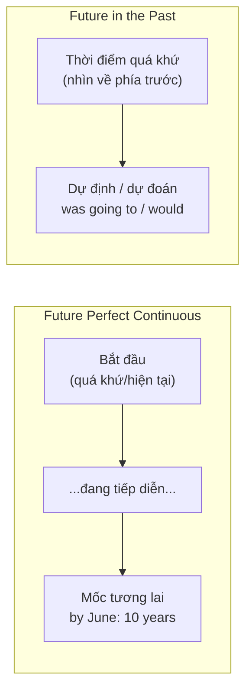

# B2-G012 · Future Perfect Continuous & Future in the Past — Tương lai hoàn thành tiếp diễn và tương lai trong quá khứ

## Mục lục

- [A. Lesson Information](#a-lesson-information)
- [B. Warm-up](#b-warm-up)
- [C. WHAT](#c-what)
- [D. WHY](#d-why)
- [E. FORM](#e-form)
- [F. HOW](#f-how)
- [G. VISUAL](#g-visual)
- [H. COMPARISON](#h-comparison)
- [I. COMMON MISTAKES](#i-common-mistakes)
- [J. MEMORY TRICKS](#j-memory-tricks)
- [K. REAL-LIFE APPLICATION](#k-real-life-application)
- [L. PRACTICE EXERCISES](#l-practice-exercises)
- [M. KNOWLEDGE CHECK](#m-knowledge-check)
- [N. ANSWER KEY](#n-answer-key)

---

## A. Lesson Information

| Mục | Nội dung |
|---|---|
| **Lesson ID** | B2-G012 |
| **Topic** | Future perfect continuous (will have been doing); Future in the past (was going to, would, was about to, was to, was due to) |
| **Tên tiếng Việt** | Tương lai hoàn thành tiếp diễn; tương lai trong quá khứ |
| **CEFR Level** | B2 |
| **Prerequisites** | [B1-G006 — Future Perfect](../../04-B1-INTERMEDIATE/grammar/B1-G006-future-perfect.md), [B1-G001 — Present Perfect Continuous](../../04-B1-INTERMEDIATE/grammar/B1-G001-present-perfect-continuous.md) |
| **Estimated Time** | 75 phút |

**Learning Objectives:**

1. Dùng **will have been + V-ing** để nói về **khoảng thời gian** một hành động sẽ kéo dài **tính đến** một mốc tương lai.
2. Phân biệt *will have done* (kết quả) và *will have been doing* (quá trình, thời lượng).
3. Dùng **tương lai trong quá khứ**: *was/were going to, would, was about to, was to, was due to*.
4. Diễn đạt **kế hoạch không thành**: *I was going to call you, but...*
5. Dùng các cấu trúc này trong **kể chuyện** và **lời giải thích**.

---

## B. Warm-up

> *By next June, I **will have been working** at this company **for ten years**.*
> *I **was going to** call you yesterday, but my phone died.*

🤔 **Hãy suy nghĩ:** Câu 1 nói về tương lai nhưng nhìn lại một quá trình dài. Câu 2 nói về quá khứ nhưng lại có *going to* — vốn là cấu trúc tương lai. Điều gì đã xảy ra với cuộc gọi trong câu 2?

---

## C. WHAT

### Tương lai hoàn thành tiếp diễn

Diễn tả một hành động **bắt đầu trước** và **vẫn tiếp diễn đến** một thời điểm trong tương lai — nhấn mạnh **thời lượng**.

*By December, she **will have been living** in Canada **for five years**.*

### Tương lai trong quá khứ

Diễn tả điều mà **ở một thời điểm trong quá khứ** được xem là **sẽ xảy ra** — dù sau đó nó có xảy ra hay không.

| Cấu trúc | Ví dụ |
|---|---|
| *was/were going to* | *I **was going to** visit her, but I didn't have time.* |
| *would* | *I knew he **would** be late.* |
| *was about to* | *I **was about to** leave when the phone rang.* |
| *was to* (trang trọng) | *She **was to** become the first female president.* |

---

## D. WHY



Cả hai cấu trúc thường gặp trong **kể chuyện, giải thích, viết tiểu sử, CV/thư xin việc** (*By the time I graduate, I will have been studying English for 12 years*) và đặc biệt khi **giải thích vì sao kế hoạch thay đổi**.

---

## E. FORM

### E1. Future perfect continuous

| Dạng | Cấu trúc | Ví dụ |
|---|---|---|
| Khẳng định | **S + will have been + V-ing** | *I **will have been studying** for 3 hours.* |
| Phủ định | **S + won't have been + V-ing** | *She **won't have been waiting** long.* |
| Câu hỏi | **How long will + S + have been + V-ing?** | ***How long will** you **have been living** here by 2030?* |

Thường đi với: ***by + mốc tương lai*** + ***for + khoảng thời gian***; ***by the time + hiện tại đơn***.

### E2. Future in the past

| Cấu trúc | Chức năng | Ví dụ |
|---|---|---|
| **was/were going to + V** | Dự định trong quá khứ (thường **không thành**) | *We **were going to** travel to Japan, but the trip was cancelled.* |
| **would + V** | Dự đoán/tương lai nhìn từ quá khứ (thường trong tường thuật) | *She promised she **would** call.* / *I thought it **would** rain.* |
| **was/were about to + V** | Sắp sửa (ngay trước một sự việc) | *I **was about to** go to bed when the doorbell rang.* |
| **was/were to + V** | Định mệnh/kế hoạch chính thức (văn kể, trang trọng) | *He **was to** become a famous writer.* (về sau thật sự trở thành) |
| **was/were to have + V3** | Kế hoạch chính thức **không thành** | *The ceremony **was to have taken** place in May, but it was postponed.* |
| **was/were due to + V** | Theo lịch trong quá khứ | *The train **was due to** leave at 6.* |

---

## F. HOW

| # | English | Tiếng Việt | Phân tích |
|---|---|---|---|
| 1 | *By the end of this year, I **will have been teaching** for 20 years.* | Đến cuối năm nay, tôi đã dạy được 20 năm. | FPC + *by* + *for* |
| 2 | *When she retires, she **will have been working** here for over three decades.* | Khi nghỉ hưu, bà ấy đã làm ở đây hơn 30 năm. | FPC + *when* |
| 3 | *By the time you arrive, we **will have been driving** for six hours, so we'll be exhausted.* | Lúc bạn đến, chúng tôi đã lái xe 6 tiếng nên sẽ kiệt sức. | Thời lượng → hậu quả |
| 4 | *I **was going to** buy that dress, but it was too expensive.* | Tôi đã định mua cái váy đó, nhưng quá đắt. | Dự định không thành |
| 5 | *They told us the bus **would** arrive at noon.* | Họ nói với chúng tôi xe sẽ đến lúc trưa. | Tường thuật |
| 6 | *I had a feeling that something bad **would** happen.* | Tôi đã có linh cảm điều gì đó tệ sẽ xảy ra. | would — dự đoán |
| 7 | *We **were about to** start dinner when the power went out.* | Chúng tôi sắp ăn tối thì mất điện. | about to |
| 8 | *The young lawyer **was to** become one of the country's most famous judges.* | Luật sư trẻ ấy về sau trở thành... | was to — số phận |
| 9 | *The bridge **was to have opened** in 2020, but construction was delayed.* | Cây cầu lẽ ra khánh thành năm 2020... | was to have V3 — không thành |
| 10 | *The plane **was due to** land at 10, but it was diverted.* | Máy bay dự kiến hạ cánh lúc 10 giờ... | was due to |
| 11 | ***How long will** you **have been learning** English by the time you take the exam?* | Đến lúc thi, bạn sẽ học tiếng Anh được bao lâu? | Câu hỏi FPC |
| 12 | *I **wasn't going to** tell anyone, but she guessed.* | Tôi đã không định nói với ai, nhưng cô ấy đoán ra. | Phủ định |

---

## G. VISUAL

### Future perfect continuous

```text
2016                      NOW (2026)                June 2027
  │━━━━━━━━━━━━━━━━━━━━━━━━━━━━│━━━━━━━━━━━━━━━━━━━━━━━━━━│
  start working                                     "by June 2027,
                                                     I will have been
                                                     working here
                                                     for 11 years"
```

### Future in the past

```text
         PAST                              NOW
  ───────●────────────── ? ─────────────────●────►
     "I was going to call"   (cuộc gọi dự định — có thể KHÔNG xảy ra)
```

---

## H. COMPARISON

### *will have done* vs *will have been doing*

| *will have done* (B1-G006) | *will have been doing* (bài này) |
|---|---|
| **Kết quả/số lượng hoàn thành** | **Quá trình/thời lượng** |
| *By Friday, I **will have written** 5 chapters.* | *By Friday, I **will have been writing** for a month.* |
| Trả lời *How much/How many?* | Trả lời *How long?* |

### *was going to* vs *would*

| *was going to* | *would* |
|---|---|
| Dự định cá nhân (thường không thành) | Dự đoán/tường thuật lời nói |
| *I **was going to** call, but I forgot.* | *He said he **would** call.* |

---

## I. COMMON MISTAKES

| # | ❌ Sai | ✅ Đúng | Nguyên nhân | Cách tránh |
|---|---|---|---|---|
| 1 | By 2030, I **will be working** here for 10 years. | ... I **will have been working** here for 10 years. | Thiếu *have been* | *by + for* → FPC |
| 2 | By the time you **will arrive**, ... | By the time you **arrive**, ... | *will* sau *by the time* | Hiện tại đơn |
| 3 | By next week, I **will have been finishing** the book. | ... I **will have finished** the book. | Dùng FPC cho kết quả | Hoàn tất → *will have done* |
| 4 | I **was going to calling** you. | I was going to **call** you. | | *going to* + V |
| 5 | I was about **leaving** when he arrived. | I was about **to leave**... | | *about to* + V |
| 6 | By then, I **will have been knowing** her for 20 years. | ... I **will have known** her for 20 years. | Động từ trạng thái | *know, own, be* → không tiếp diễn |

---

## J. MEMORY TRICKS

1. **"By + For = Have Been -ing"** ⏳: Thấy *by (mốc)* + *for (khoảng)* → *will have been V-ing*.
2. **"Was going to = kế hoạch bị hủy"**: thường đi kèm *but...*.
3. **"About to = sắp sửa trong gang tấc"**: + *when* + sự việc xen ngang.

---

## K. REAL-LIFE APPLICATION

### Email xin nghỉ phép dài hạn

> *Dear Ms Lam,*
>
> *I am writing to request three months of unpaid leave from January. As you know, by the end of this year I **will have been working** in the marketing department for eight years, and I feel I need time to complete my master's degree.*
>
> *I **was going to** raise this at our meeting last week, but we ran out of time. I had also planned to start the course in September, which **was to have been** my first semester, but my application was delayed.*
>
> *Before submitting this request, I **was about to** ask my colleague Minh whether he could cover my accounts, and he kindly agreed.*
>
> *I look forward to your reply.*
>
> *Best regards,*
> *Nguyen Thi Hoa*

**Dịch tóm tắt:** Xin nghỉ không lương 3 tháng từ tháng Giêng; đến cuối năm sẽ làm ở phòng marketing được 8 năm, cần thời gian hoàn thành thạc sĩ. Định nêu ở cuộc họp tuần trước nhưng hết giờ; kế hoạch học kỳ đầu từ tháng 9 bị trễ. Đã định hỏi đồng nghiệp Minh hỗ trợ — anh ấy đồng ý.

---

## L. PRACTICE EXERCISES

> ✍️ Đáp án: [B2-G012-ANSWERS](../../12-ANSWERS-AND-EXPLANATIONS/B2/B2-G012-ANSWERS.md)

### Level 1 — Recognition

**L1.1.** By next month, I ___ here for a year.  A. will live  B. will have been living  C. am living
**L1.2.** By Friday, she ___ all the reports. (số lượng hoàn thành)  A. will have finished  B. will have been finishing  C. finishes
**L1.3.** I ___ call you last night, but I fell asleep.  A. was going to  B. will  C. am going to
**L1.4.** We were ___ leave when it started to rain.  A. about  B. about to  C. going
**L1.5.** He promised that he ___ help me.  A. will  B. would  C. is going to
**L1.6.** The ceremony was ___ in March, but it was cancelled.  A. to take place  B. to have taken place  C. taking place

### Level 2 — Controlled Practice

Chia động từ trong ngoặc ở thì tương lai hoàn thành tiếp diễn.

**L2.1.** By 2030, my parents (live) ___ in this house for 40 years.
**L2.2.** At 6 p.m., the children (play) ___ video games for four hours.
**L2.3.** When he finally arrives, we (wait) ___ for over an hour.
**L2.4.** How long (you / study) ___ English by the time you take the B2 exam?

Hoàn thành câu với *was/were going to, would, was/were about to, was to have*.

**L2.5.** I ___ buy a new phone, but then I found my old one.
**L2.6.** I knew she ___ love the present.
**L2.7.** We ___ order dinner when our friends arrived with pizza.
**L2.8.** The new stadium ___ opened last year, but there were delays.

Chọn *will have done* hoặc *will have been doing*.

**L2.9.** By the end of this course, I (read) ___ twelve novels.
**L2.10.** By the end of this course, I (read) ___ English novels for six months.

### Level 3 — Error Correction

**L3.1.** By next year, she will be teaching for 15 years.
**L3.2.** By the time we will get there, the film will have started.
**L3.3.** I was going to visiting my grandparents, but I got sick.
**L3.4.** By 2027, I will have been owning this car for ten years.
**L3.5.** We were about leaving when the boss called.
**L3.6.** He said that he will come, but he didn't.

### Level 4 — Production

**L4.1.** Dịch: *"Đến tháng 12 này, tôi sẽ làm việc ở công ty này được 5 năm."*
**L4.2.** Dịch: *"Tôi đã định nói với bạn sự thật, nhưng tôi sợ."*
**L4.3.** Dịch: *"Chúng tôi vừa định ra ngoài thì trời đổ mưa."*
**L4.4.** Dịch: *"Buổi hòa nhạc lẽ ra đã diễn ra vào thứ Bảy, nhưng bị hoãn vì bão."* (*was to have*)

**L4.5.** **Explain:** Giải thích khác nhau giữa *"By June I will have written my thesis"* và *"By June I will have been writing my thesis for a year"*.

### Level 5 — Real Communication

**L5.1.** Viết đoạn văn 120–150 từ: *"Plans that didn't work out"*. Kể về 2–3 kế hoạch bị thay đổi trong năm qua và một dự định cho tương lai. Dùng ≥ 2 *was going to*, ≥ 1 *was about to*, ≥ 1 *would* (dự đoán trong quá khứ), ≥ 2 câu FPC.
**L5.2.** **Speaking — Milestones:** Nói 1 phút về các "cột mốc" sắp tới của bạn: *By the end of this year, I will have been learning English for..., By the time I'm 30, I will have been working...*

---

## M. KNOWLEDGE CHECK

### 5 câu hỏi tự kiểm tra

1. Công thức tương lai hoàn thành tiếp diễn?
2. Khi nào dùng *will have done*, khi nào *will have been doing*?
3. *was going to* thường diễn tả điều gì?
4. *was to* và *was to have V3* khác nhau thế nào?
5. Vì sao không dùng FPC với *know, own*?

### Checklist

- [ ] Tôi dùng FPC với *by ... for ...*.
- [ ] Tôi dùng *was going to* để giải thích kế hoạch không thành.
- [ ] Tôi không dùng *will* sau *by the time*.

### 3 lỗi quan trọng cần nhớ

1. ~~will be working ... for 10 years (by 2030)~~ → **will have been working**.
2. ~~by the time you will arrive~~ → by the time you **arrive**.
3. ~~was about leaving~~ → was about **to leave**.

### Lịch ôn tập

| Ngày | Việc cần làm |
|---|---|
| Ngày 1 | Làm lại L2 |
| Ngày 3 | Viết 5 câu *I was going to... but...* về tuần qua |
| Ngày 7 | Ôn với [ALL-TENSES-COMPARISON](../../06-GRAMMAR-REFERENCE/ALL-TENSES-COMPARISON.md) |

### Liên kết

- ➡️ Bài tiếp theo: [B2-G013 — Perfect Infinitives & Gerunds](B2-G013-perfect-infinitives-gerunds.md)

---

## N. ANSWER KEY

👉 [B2-G012-ANSWERS.md](../../12-ANSWERS-AND-EXPLANATIONS/B2/B2-G012-ANSWERS.md)
