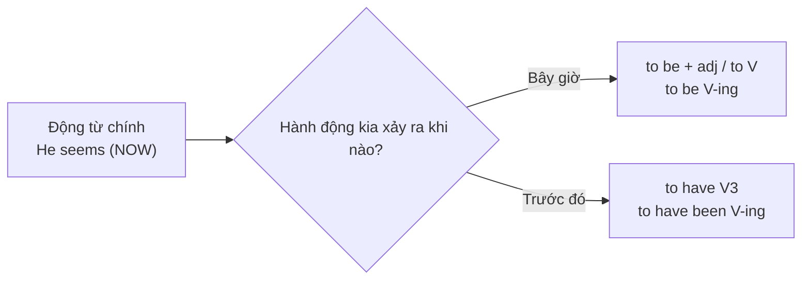

# B2-G013 · Perfect Infinitives & Perfect Gerunds — Nguyên mẫu hoàn thành và danh động từ hoàn thành

## Mục lục

- [A. Lesson Information](#a-lesson-information)
- [B. Warm-up](#b-warm-up)
- [C. WHAT](#c-what)
- [D. WHY](#d-why)
- [E. FORM](#e-form)
- [F. HOW](#f-how)
- [G. VISUAL](#g-visual)
- [H. COMPARISON](#h-comparison)
- [I. COMMON MISTAKES](#i-common-mistakes)
- [J. MEMORY TRICKS](#j-memory-tricks)
- [K. REAL-LIFE APPLICATION](#k-real-life-application)
- [L. PRACTICE EXERCISES](#l-practice-exercises)
- [M. KNOWLEDGE CHECK](#m-knowledge-check)
- [N. ANSWER KEY](#n-answer-key)

---

## A. Lesson Information

| Mục | Nội dung |
|---|---|
| **Lesson ID** | B2-G013 |
| **Topic** | Perfect infinitive (to have done), continuous infinitive (to be doing), perfect continuous infinitive (to have been doing); perfect gerund (having done); passive forms (to have been done, having been done) |
| **Tên tiếng Việt** | Nguyên mẫu hoàn thành, nguyên mẫu tiếp diễn, danh động từ hoàn thành và dạng bị động |
| **CEFR Level** | B2 |
| **Prerequisites** | [B1-G016 — Gerund vs Infinitive](../../04-B1-INTERMEDIATE/grammar/B1-G016-gerund-vs-infinitive.md), [B1-G015 — Modal Perfects](../../04-B1-INTERMEDIATE/grammar/B1-G015-modal-perfects.md) |
| **Estimated Time** | 75 phút |

> ℹ️ Học bài này **trước** [B2-G005 — Passive Reporting](B2-G005-passive-reporting.md), vì G005 dùng *to have + V3*.

**Learning Objectives:**

1. Dùng **to have + V3** để chỉ hành động xảy ra **trước** động từ chính: *He seems **to have left**.*
2. Dùng **to be + V-ing** cho hành động **đang diễn ra**: *She seems **to be sleeping**.*
3. Dùng **having + V3** (danh động từ hoàn thành) sau *admit, deny, regret, remember, be accused of...*
4. Dùng dạng bị động: **to have been V3**, **having been V3**.
5. Dùng *would like / would love / would hate + to have V3* để nói về **mong muốn/tiếc nuối không thành**.

---

## B. Warm-up

> *He seems **to be** happy.* (bây giờ)
> *He seems **to have been** happy before the accident.* (trước đây)
> *She **denied taking** the money.*
> *She **denied having taken** the money.*

🤔 **Hãy suy nghĩ:** Khi nào cần thêm *have* vào sau *to*, và *having* thay cho *V-ing*? Hai câu về *deny* có khác nghĩa nhiều không?

---

## C. WHAT

| Dạng | Cấu trúc | Thời gian so với động từ chính | Ví dụ |
|---|---|---|---|
| Nguyên mẫu đơn | **to V** | cùng lúc / sau | *He seems **to know** the answer.* |
| Nguyên mẫu tiếp diễn | **to be V-ing** | đang diễn ra cùng lúc | *He seems **to be working**.* |
| Nguyên mẫu hoàn thành | **to have V3** | **trước** | *He seems **to have forgotten**.* |
| Nguyên mẫu hoàn thành tiếp diễn | **to have been V-ing** | kéo dài đến trước/lúc đó | *He seems **to have been crying**.* |
| Danh động từ hoàn thành | **having V3** | **trước** | *He regrets **having said** that.* |
| Bị động | **to have been V3 / having been V3** | trước, bị động | *She appears **to have been injured**.* |

---

## D. WHY

Động từ chính (*seem, appear, claim, pretend, regret, deny...*) và động từ nguyên mẫu/danh động từ phía sau có thể ở **hai thời điểm khác nhau**. Dạng hoàn thành **đánh dấu thời gian trước**.



Đây là nền tảng cho **bị động tường thuật** (*He is said to have left*) và văn phong **học thuật/báo chí**.

---

## E. FORM

### E1. Nguyên mẫu hoàn thành sau *seem, appear, claim, pretend, happen*

| Ví dụ | Nghĩa |
|---|---|
| *She **seems to have lost** weight.* | Có vẻ cô ấy đã giảm cân. |
| *He **claims to have met** the president.* | Anh ta tự nhận đã gặp tổng thống. |
| *They **pretended to have read** the book.* | Họ giả vờ đã đọc sách. |
| *The thief **appears to have entered** through the window.* | Có vẻ tên trộm đã vào qua cửa sổ. |

### E2. Nguyên mẫu tiếp diễn

| Ví dụ |
|---|
| *You **seem to be enjoying** yourself.* |
| *He **pretended to be sleeping** when I came in.* |
| *She **appears to have been working** too hard.* (hoàn thành tiếp diễn) |

### E3. *would like / would love / would hate / would prefer* + to have V3

Diễn tả mong muốn về quá khứ **không thành hiện thực**:

| Ví dụ | Nghĩa |
|---|---|
| *I **would like to have seen** her face!* | Tôi ước gì đã được thấy mặt cô ấy (nhưng không thấy). |
| *I **would love to have come**, but I was ill.* | Tôi rất muốn đã đến, nhưng tôi bị ốm. |

### E4. Danh động từ hoàn thành *having V3*

| Sau | Ví dụ |
|---|---|
| *admit, deny, regret, remember, mention* | *He **admitted having stolen** the bike.* |
| giới từ | *She was accused **of having cheated**.* / *Thank you **for having invited** me.* |

> 💡 Với *admit, deny, regret, remember*, dạng **V-ing đơn** thường **đủ** vì nghĩa động từ đã chỉ quá khứ: *He denied **taking** = denied **having taken***. Dạng *having V3* nhấn mạnh thứ tự thời gian, trang trọng hơn.

### E5. Bị động

| Dạng | Ví dụ |
|---|---|
| to be V3 | *He expects **to be promoted**.* |
| to have been V3 | *The documents seem **to have been stolen**.* |
| being V3 | *I hate **being interrupted**.* |
| having been V3 | *She complained of **having been treated** unfairly.* |

---

## F. HOW

| # | English | Tiếng Việt | Phân tích |
|---|---|---|---|
| 1 | *The company **seems to have made** a huge profit last year.* | Công ty có vẻ đã lãi lớn năm ngoái. | to have V3 |
| 2 | *You **seem to be working** very hard these days.* | Dạo này bạn có vẻ đang làm việc rất chăm. | to be V-ing |
| 3 | *Her eyes were red. She **appeared to have been crying**.* | Mắt cô ấy đỏ. Có vẻ cô ấy đã khóc. | to have been V-ing |
| 4 | *He **claims to have invented** the machine himself.* | Anh ta tự nhận đã tự mình phát minh ra cái máy. | claim + to have V3 |
| 5 | *I'm sorry **to have kept** you waiting.* | Xin lỗi đã để bạn đợi. | adj + to have V3 |
| 6 | *I **would love to have been** at the wedding.* | Tôi rất muốn đã có mặt ở đám cưới. | mong muốn không thành |
| 7 | *She **regrets having left** her job.* | Cô ấy hối hận đã bỏ việc. | having V3 |
| 8 | *He was accused **of having lied** to the police.* | Anh ta bị buộc tội đã nói dối cảnh sát. | giới từ + having V3 |
| 9 | ***Having been told** the news, she burst into tears.* | Sau khi được báo tin, cô ấy òa khóc. | having been V3 (xem B2-G008) |
| 10 | *The painting **is believed to have been painted** in 1600.* | Bức tranh được cho là được vẽ năm 1600. | Bị động tường thuật (B2-G005) |
| 11 | *I don't remember **having been asked** this question before.* | Tôi không nhớ đã từng được hỏi câu này. | having been V3 |
| 12 | *The suspect **pretended not to have seen** anything.* | Nghi phạm giả vờ không thấy gì. | Phủ định: *not to have V3* |

---

## G. VISUAL

### Bảng tổng hợp

```text
                Chủ động                     Bị động
Đơn             to do / doing               to be done / being done
Tiếp diễn       to be doing                 —
Hoàn thành      to have done / having done  to have been done / having been done
HT tiếp diễn    to have been doing          —
```

### Thời gian

```text
           TRƯỚC                  ĐỘNG TỪ CHÍNH           SAU
  ─────────●─────────────────────────●───────────────────●──►
     to have done                 to be doing          to do
     having done                  (đang diễn ra)       (ý định)
```

---

## H. COMPARISON

### *seem to V* vs *seem to have V3*

| *seem to be* | *seem to have been* |
|---|---|
| *He seems **to be** rich.* (bây giờ có vẻ giàu) | *He seems **to have been** rich.* (trước kia có vẻ đã giàu) |

### *It seems that...* vs *S + seems to...*

| It + seems that + mệnh đề | S + seems + to-infinitive |
|---|---|
| *It seems that he **has left**.* | *He seems **to have left**.* |
| *It seems that she **is sleeping**.* | *She seems **to be sleeping**.* |

### *remember doing* vs *remember having done*

Hầu như **cùng nghĩa**; *having done* trang trọng hơn và nhấn mạnh hoàn tất.

---

## I. COMMON MISTAKES

| # | ❌ Sai | ✅ Đúng | Nguyên nhân | Cách tránh |
|---|---|---|---|---|
| 1 | He seems **to leave** an hour ago. | He seems **to have left** an hour ago. | Quên dạng hoàn thành | Việc trước → *to have V3* |
| 2 | She seems **to have be** tired. | She seems **to have been** tired. | Sai V3 của *be* | *been* |
| 3 | He denied **to have taken** it. | He denied **having taken** / **taking** it. | *deny* + V-ing | *deny* không + to |
| 4 | I'm sorry **for keep** you waiting. | I'm sorry **to have kept** you waiting. / **for keeping**... | | |
| 5 | The vase seems **to have broken** by the cat. | The vase seems **to have been broken** by the cat. | Thiếu bị động | Có *by* → bị động |
| 6 | He pretended **to not have** heard. | He pretended **not to have** heard. | Vị trí *not* | *not* trước *to* |

---

## J. MEMORY TRICKS

1. **"HAVE = lùi về quá khứ"** ⏪: Thêm *have* vào sau *to* hoặc đổi *V-ing* thành *having V3* → hành động lùi về **trước**.
2. **"BE V-ing = ngay lúc này"**: *seems to be crying* = đang khóc.
3. **"Có BY — thêm BEEN"**: có tác nhân *by* → bị động *to have **been** V3*.

---

## K. REAL-LIFE APPLICATION

### Báo cáo sự cố

> *When the manager arrived at the office on Monday morning, the door **appeared to have been forced** open. Several laptops **seemed to have been taken**, but, surprisingly, the cash in the safe **appeared not to have been touched**.*
>
> *The security guard **claimed to have been patrolling** the building all night, but he admitted **having fallen** asleep for about an hour. The thieves **are believed to have entered** during that time. The guard said he deeply regretted **having let** the company down.*
>
> *The manager said, "I'm sorry **to have caused** so much worry. We **would like to have installed** better cameras last year, but the budget wasn't approved."*

**Dịch tóm tắt:** Sáng thứ Hai, cửa văn phòng có vẻ bị phá; vài laptop có vẻ bị lấy, nhưng tiền trong két dường như không bị động đến. Bảo vệ tự nhận đã tuần tra suốt đêm nhưng thừa nhận đã ngủ quên khoảng một giờ — được cho là lúc trộm vào. Quản lý xin lỗi vì gây lo lắng; lẽ ra muốn lắp camera tốt hơn năm ngoái nhưng ngân sách không được duyệt.

---

## L. PRACTICE EXERCISES

> ✍️ Đáp án: [B2-G013-ANSWERS](../../12-ANSWERS-AND-EXPLANATIONS/B2/B2-G013-ANSWERS.md)

### Level 1 — Recognition

**L1.1.** He seems ___ his keys. He can't find them anywhere.  A. to lose  B. to have lost  C. losing
**L1.2.** Look! The baby seems ___.  A. to be sleeping  B. to have slept  C. sleeping
**L1.3.** She denied ___ the email.  A. to have sent  B. having sent  C. have sent
**L1.4.** I'm sorry ___ you so long.  A. to have kept  B. having kept  C. to keep waiting
**L1.5.** The documents appear ___ by someone in the office.  A. to have copied  B. to have been copied  C. having copied
**L1.6.** I would love ___ the concert, but I had to work.  A. to attend  B. to have attended  C. attending

### Level 2 — Controlled Practice

Viết lại câu bắt đầu bằng từ cho sẵn.

**L2.1.** It seems that he has forgotten my name. → He seems ______.
**L2.2.** It appears that they are having an argument. → They appear ______.
**L2.3.** It seems that she was a famous singer in the 1990s. → She seems ______.
**L2.4.** It seems that the house has been empty for years. → The house seems ______.
**L2.5.** It appears that the window was broken from inside. → The window appears ______.
**L2.6.** He says that he has climbed Everest. (claim) → He claims ______.
**L2.7.** She regrets that she didn't study harder. (regret + having) → She regrets ______.
**L2.8.** They accused him. They said he had cheated. → They accused him ______.
**L2.9.** I wanted to see the fireworks, but I missed them. (would like) → I would like ______.
**L2.10.** It seems that he has been working all night. → He seems ______.

### Level 3 — Error Correction

**L3.1.** She seems to leave the party early last night.
**L3.2.** He appears to have be ill for a long time.
**L3.3.** The suspect denied to have been at the scene.
**L3.4.** The car seems to have damaged in the accident.
**L3.5.** I'm sorry for to have disturbed you.
**L3.6.** He pretended to not have seen me.

### Level 4 — Production

**L4.1.** Dịch: *"Có vẻ anh ấy đã thay đổi rất nhiều kể từ khi đi du học."* (*seems to have*)
**L4.2.** Dịch: *"Cô ấy thừa nhận đã làm mất tài liệu."* (*admit having*)
**L4.3.** Dịch: *"Tôi rất muốn đã được gặp ông nội, nhưng ông mất trước khi tôi sinh ra."* (*would love to have*)
**L4.4.** Dịch: *"Ngôi đền được cho là đã được xây dựng lại nhiều lần."* (*is believed to have been*)

**L4.5.** **Explain:** Phân biệt *"She seems to be happy"* và *"She seems to have been happy"*.

### Level 5 — Real Communication

**L5.1.** Viết **báo cáo sự việc / mô tả hiện trường** 120–150 từ (giả định: phòng ký túc xá bừa bộn, căn bếp bị cháy, một chiếc xe bị hỏng...). Dùng ≥ 3 *seem/appear + to have V3*, ≥ 1 *to be V-ing*, ≥ 1 *to have been V3*, ≥ 2 *having V3*.
**L5.2.** **Speaking — Detective:** Nhìn một bức ảnh bất kỳ (phòng, đường phố, người). Suy đoán 1 phút: *This person seems to have just..., They appear to be..., The room looks as if it...*

---

## M. KNOWLEDGE CHECK

### 5 câu hỏi tự kiểm tra

1. Bốn dạng nguyên mẫu và ý nghĩa thời gian của chúng?
2. Khi nào dùng *having V3*?
3. Dạng bị động của *to have V3*?
4. *would love to have V3* nghĩa là gì?
5. Viết lại: *It seems that she has been crying.*

### Checklist

- [ ] Tôi dùng *to have V3* cho hành động trước động từ chính.
- [ ] Tôi dùng *to be V-ing* cho hành động đang diễn ra.
- [ ] Tôi dùng đúng dạng bị động *to have been V3*.

### 3 lỗi quan trọng cần nhớ

1. ~~seems to leave yesterday~~ → seems **to have left**.
2. ~~to have be~~ → to have **been**.
3. Có *by* → **to have been** V3.

### Lịch ôn tập

| Ngày | Việc cần làm |
|---|---|
| Ngày 1 | Làm lại L2 |
| Ngày 3 | Học tiếp [B2-G005 — Passive Reporting](B2-G005-passive-reporting.md) |
| Ngày 7 | Viết 5 câu *I would love to have...* về những điều bạn tiếc |

### Liên kết

- ➡️ Bài tiếp theo: [B2-G014 — Advanced Gerund & Infinitive](B2-G014-advanced-gerund-infinitive.md)
- 🔁 Áp dụng: [B2-G005 — Passive Reporting](B2-G005-passive-reporting.md)

---

## N. ANSWER KEY

👉 [B2-G013-ANSWERS.md](../../12-ANSWERS-AND-EXPLANATIONS/B2/B2-G013-ANSWERS.md)
