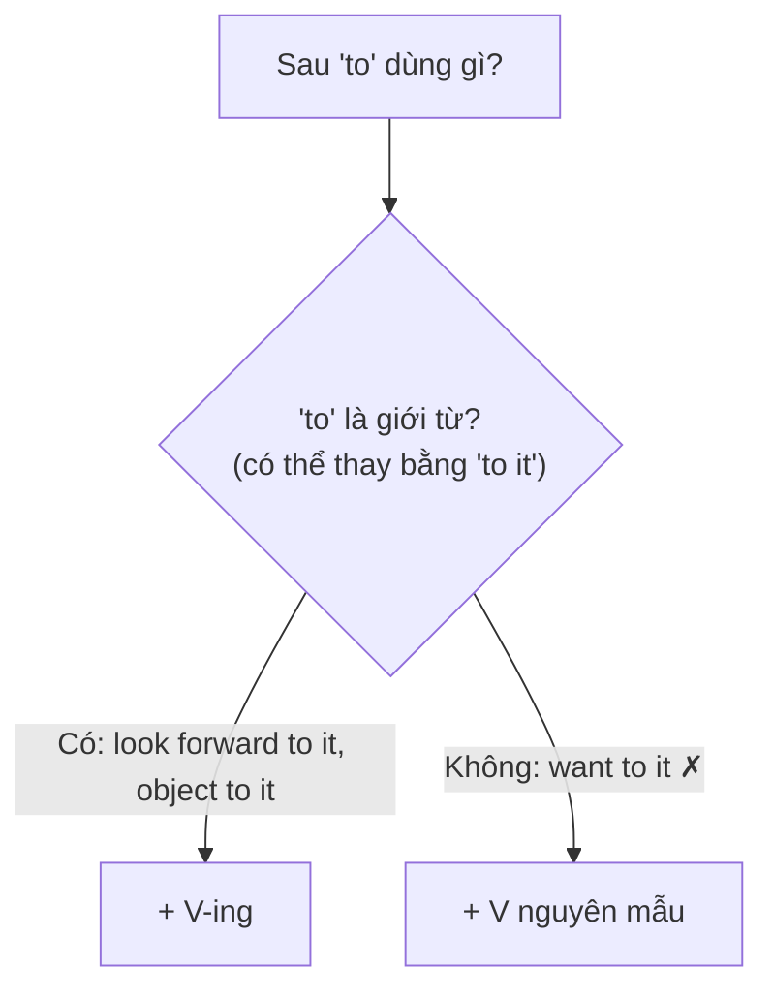

# B2-G014 · Advanced Gerund & Infinitive Patterns — Mẫu danh động từ / nguyên mẫu nâng cao

## Mục lục

- [A. Lesson Information](#a-lesson-information)
- [B. Warm-up](#b-warm-up)
- [C. WHAT](#c-what)
- [D. WHY](#d-why)
- [E. FORM](#e-form)
- [F. HOW](#f-how)
- [G. VISUAL](#g-visual)
- [H. COMPARISON](#h-comparison)
- [I. COMMON MISTAKES](#i-common-mistakes)
- [J. MEMORY TRICKS](#j-memory-tricks)
- [K. REAL-LIFE APPLICATION](#k-real-life-application)
- [L. PRACTICE EXERCISES](#l-practice-exercises)
- [M. KNOWLEDGE CHECK](#m-knowledge-check)
- [N. ANSWER KEY](#n-answer-key)

---

## A. Lesson Information

| Mục | Nội dung |
|---|---|
| **Lesson ID** | B2-G014 |
| **Topic** | Possessive + gerund (my/his + V-ing); expressions + gerund (it's no use, there's no point, can't help, be worth, have difficulty/trouble); to as preposition (object to, be used to, look forward to, when it comes to); verbs of perception + O + V/V-ing; adjective + to V; too/enough + to V; for + O + to V |
| **Tên tiếng Việt** | Danh động từ với tính từ sở hữu; cụm cố định + V-ing; *to* là giới từ; động từ tri giác; *for + O + to V* |
| **CEFR Level** | B2 |
| **Prerequisites** | [B2-G013 — Perfect Infinitives & Gerunds](B2-G013-perfect-infinitives-gerunds.md), [B1-G021 — Verb Patterns](../../04-B1-INTERMEDIATE/grammar/B1-G021-verb-patterns.md) |
| **Estimated Time** | 90 phút |

**Learning Objectives:**

1. Dùng **tính từ sở hữu / tân ngữ + V-ing**: *Do you mind **my/me opening** the window?*
2. Dùng các **cụm cố định + V-ing**: *It's no use..., There's no point (in)..., can't help..., be worth..., have difficulty (in)...*
3. Nhận diện ***to* là giới từ** (+ V-ing): *object to, be used to, look forward to, when it comes to, in addition to, be committed to*.
4. Phân biệt **see/hear/watch + O + V** (toàn bộ hành động) và **+ O + V-ing** (một phần, đang diễn ra).
5. Dùng **for + O + to V** và **It + be + adj + (for O) + to V**.

---

## B. Warm-up

> *I'm looking forward to **seeing** you.*
> *I object to **being** treated like a child.*
> *I saw him **cross** the road.* / *I saw him **crossing** the road.*

🤔 **Hãy suy nghĩ:** Vì sao sau *to* trong *look forward to* lại là *seeing*, không phải *see*? Và hai câu với *saw him* khác nhau thế nào — bạn chứng kiến toàn bộ việc anh ấy qua đường, hay chỉ một khoảnh khắc?

---

## C. WHAT

Bài B1 đã dạy các nhóm cơ bản (*enjoy doing, want to do, stop/remember/try*). B2 bổ sung những mẫu **ít quy tắc hơn**, hay gặp trong bài đọc và biến đổi câu:

| Nhóm | Ví dụ |
|---|---|
| Sở hữu + V-ing | *I appreciate **your helping** me.* |
| Cụm cố định + V-ing | ***It's no use crying** over spilt milk.* |
| *to* là giới từ | *I'm not used **to getting** up early.* |
| Tri giác + O + V / V-ing | *I heard her **sing** / **singing**.* |
| for + O + to V | *It's important **for you to rest**.* |

---

## D. WHY



Phép thử *"to it"*: nếu thay được phần sau *to* bằng *it* hoặc một danh từ → *to* là **giới từ** → dùng **V-ing**. Ví dụ: *I look forward **to it*** ✅ → *look forward to **seeing***.

---

## E. FORM

### E1. Tính từ sở hữu / tân ngữ + V-ing

| Văn phong | Ví dụ |
|---|---|
| Trang trọng: **tính từ sở hữu** | *Do you mind **my** opening the window?* / *I appreciate **your** coming.* |
| Thân mật: **tân ngữ** | *Do you mind **me** opening the window?* |
| Danh từ sở hữu | *I'm worried about **Tom's** driving.* |

### E2. Cụm cố định + V-ing

| Cụm | Nghĩa | Ví dụ |
|---|---|---|
| **It's no use / It's no good** | vô ích | *It's no use **complaining**.* |
| **There's no point (in)** | chẳng ích gì | *There's no point (in) **waiting**.* |
| **can't help** | không thể không | *I **can't help laughing**.* |
| **can't stand / can't bear** | không chịu nổi | *I can't stand **queuing**.* |
| **be worth** | đáng | *This film **is worth watching**.* |
| **have difficulty / trouble / a problem (in)** | gặp khó khăn khi | *I **have trouble remembering** names.* |
| **spend/waste time/money** | dành/lãng phí... để | *She **spends** hours **practising**.* |
| **be busy** | bận làm | *He's **busy preparing** dinner.* |
| **feel like** | muốn (thân mật) | *I **feel like going** out.* |

### E3. *to* là giới từ → V-ing

| Cụm | Ví dụ |
|---|---|
| look forward **to** | *I look forward to **hearing** from you.* |
| be/get used **to** | *I'm used to **working** at night.* |
| object **to** | *She objects to **paying** extra.* |
| be committed / dedicated **to** | *We're committed to **reducing** waste.* |
| when it comes **to** | *When it comes to **cooking**, he's an expert.* |
| in addition **to** | *In addition to **teaching**, she writes novels.* |
| prefer + V-ing + **to** + V-ing | *I prefer **walking** to **driving**.* |
| contribute **to**, be opposed **to**, adjust **to** | *They contributed to **making** the event a success.* |

### E4. Động từ tri giác + O + V / V-ing

| Cấu trúc | Ý nghĩa | Ví dụ |
|---|---|---|
| **see/hear/watch/notice/feel + O + V** | Chứng kiến **toàn bộ** hành động (từ đầu đến cuối) | *I watched him **score** the goal.* |
| **see/hear/watch/notice/feel + O + V-ing** | Chứng kiến **một phần**, hành động **đang diễn ra** | *I saw him **walking** along the beach.* |

### E5. Tính từ + to V, for + O + to V

| Cấu trúc | Ví dụ |
|---|---|
| **It + be + adj + to V** | *It's **difficult to learn** a new language.* |
| **It + be + adj + for + O + to V** | *It's **important for children to sleep** well.* |
| **S + be + adj + to V** | *This question is **easy to answer**.* (không ~~to answer it~~) |
| **too/enough + for O + to V** | *The text is **too long for me to read** in one day.* |
| **N + for + O + to V** | *There's **no need for you to come**.* |

---

## F. HOW

| # | English | Tiếng Việt | Phân tích |
|---|---|---|---|
| 1 | *Would you mind **my asking** you a personal question?* | Bạn có phiền nếu tôi hỏi một câu riêng tư? | Sở hữu + V-ing — trang trọng |
| 2 | *It's **no use arguing** with him — he never listens.* | Cãi với anh ta vô ích. | It's no use |
| 3 | *There's **no point (in) buying** a car if you live in the city centre.* | Mua xe chẳng ích gì nếu sống ở trung tâm. | There's no point |
| 4 | *I **couldn't help smiling** when I saw the photo.* | Tôi không nhịn được cười. | can't help |
| 5 | *Ha Long Bay **is** definitely **worth visiting**.* | Vịnh Hạ Long rất đáng ghé thăm. | be worth |
| 6 | *Many students **have difficulty understanding** native speakers.* | Nhiều học sinh gặp khó khăn khi hiểu người bản ngữ. | have difficulty |
| 7 | *I'm **looking forward to working** with you.* | Tôi mong được làm việc với bạn. | to — giới từ |
| 8 | *When it comes to **saving** money, my sister is the best.* | Nói đến tiết kiệm tiền, em gái tôi giỏi nhất. | when it comes to |
| 9 | *I heard someone **knock** at the door.* | Tôi nghe có người gõ cửa. | Toàn bộ hành động |
| 10 | *I could hear the neighbours **arguing** all night.* | Tôi nghe thấy hàng xóm cãi nhau suốt đêm. | Đang diễn ra |
| 11 | *It's essential **for everyone to wear** a helmet.* | Mọi người bắt buộc phải đội mũ bảo hiểm. | for + O + to V |
| 12 | *This book is **too difficult for beginners to understand**.* | Cuốn sách quá khó để người mới hiểu. | too + for O + to V |

---

## G. VISUAL

### Phép thử "to it"

```text
look forward to ___   →  look forward to IT ✅  →  + V-ING  (seeing)
want to ___           →  want to IT ❌          →  + V      (see)
object to ___         →  object to IT ✅        →  + V-ING  (paying)
decide to ___         →  decide to IT ❌        →  + V      (pay)
```

### Tri giác: toàn bộ vs một phần

```text
I watched him SCORE the goal.     ●━━━━━━━━━━●   (từ đầu đến cuối)
I saw him WALKING in the park.        ━━●━━     (một khoảnh khắc)
```

---

## H. COMPARISON

### *used to V* vs *be/get used to V-ing*

| *used to + V* | *be/get used to + V-ing* |
|---|---|
| Thói quen trong quá khứ | Quen với (hiện tại/quá khứ) |
| *I **used to work** at night.* | *I'**m used to working** at night.* |

### *It's worth + V-ing* vs *It's worthwhile + to V / V-ing*

| *be worth + V-ing / N* | *be worthwhile + to V / V-ing* |
|---|---|
| *The museum **is worth visiting**.* | *It's **worthwhile to visit** / **visiting** the museum.* |

### *There's no point in* vs *It's pointless to*

Cùng nghĩa: *There's no point **in waiting*** = *It's pointless **to wait***.

---

## I. COMMON MISTAKES

| # | ❌ Sai | ✅ Đúng | Nguyên nhân | Cách tránh |
|---|---|---|---|---|
| 1 | I look forward to **hear** from you. | ... to **hearing** from you. | *to* giới từ | Phép thử "to it" |
| 2 | I'm used to **get** up early. | I'm used to **getting** up early. | Nhầm với *used to V* | *be used to* + V-ing |
| 3 | This film is worth **to see**. | This film is worth **seeing**. | | *be worth* + V-ing |
| 4 | It's no use **to cry**. | It's no use **crying**. | | |
| 5 | I can't help **to laugh**. | I can't help **laughing**. | | |
| 6 | This question is easy to answer **it**. | This question is easy to answer. | Thừa tân ngữ | Chủ ngữ = tân ngữ của *answer* |
| 7 | It's important **that you to rest**. | It's important **for you to rest**. / ...**that you rest**. | Trộn cấu trúc | *for + O + to V* hoặc *that* + mệnh đề |
| 8 | I have difficulty **to understand** him. | I have difficulty **understanding** him. | | *have difficulty (in)* + V-ing |

---

## J. MEMORY TRICKS

1. **"Thử TO IT"** 🧪: thay được bằng *to it* → V-ing.
2. **"Năm cụm vô ích – không nhịn – đáng – khó khăn – bận"**: *no use, can't help, worth, difficulty, busy* + V-ing.
3. **"Thấy trọn vẹn → V; thấy dở dang → V-ing"**.

---

## K. REAL-LIFE APPLICATION

### Email phản hồi phỏng vấn

> *Dear Mr Tran,*
>
> *Thank you for inviting me to the interview yesterday. I really appreciate **your taking** the time to show me around the office.*
>
> *I must admit I had some **difficulty answering** the technical questions at first, but I think it was **worth preparing** so carefully. When it comes to **working** in a team, I am confident that I can contribute a great deal. I am also fully committed to **improving** my data analysis skills.*
>
> *I noticed several team members **discussing** a new project, and I couldn't help **feeling** excited about the opportunity. It would be a privilege **for me to join** such a dynamic team.*
>
> *I look forward to **hearing** from you.*
>
> *Yours sincerely,*
> *Le Minh Chau*

**Dịch tóm tắt:** Cảm ơn đã mời phỏng vấn và dành thời gian dẫn đi thăm văn phòng. Ban đầu gặp khó khăn với câu hỏi kỹ thuật nhưng chuẩn bị kỹ là xứng đáng. Về làm việc nhóm, tự tin có thể đóng góp; cam kết cải thiện kỹ năng phân tích dữ liệu. Thấy nhóm thảo luận dự án mới và không khỏi hào hứng. Mong nhận phản hồi.

---

## L. PRACTICE EXERCISES

> ✍️ Đáp án: [B2-G014-ANSWERS](../../12-ANSWERS-AND-EXPLANATIONS/B2/B2-G014-ANSWERS.md)

### Level 1 — Recognition

**L1.1.** I'm not used to ___ in such a big city.  A. live  B. living  C. have lived
**L1.2.** It's no use ___ about it now.  A. to worry  B. worrying  C. worry
**L1.3.** This restaurant is worth ___.  A. to try  B. trying  C. try
**L1.4.** I watched the chef ___ the whole meal in ten minutes.  A. prepare  B. to prepare  C. prepared
**L1.5.** Would you mind ___ the door?  A. my opening  B. me to open  C. I open
**L1.6.** It's important ___ enough sleep.  A. for teenagers getting  B. for teenagers to get  C. that teenagers to get

### Level 2 — Controlled Practice

Chia động từ trong ngoặc (V, to V, hoặc V-ing).

**L2.1.** I'm looking forward to (meet) ___ your family.
**L2.2.** She has trouble (sleep) ___ when she's stressed.
**L2.3.** There's no point (call) ___ him — he's switched off his phone.
**L2.4.** I couldn't help (overhear) ___ your conversation.
**L2.5.** When it comes to (choose) ___ a university, you should consider many factors.
**L2.6.** I heard the baby (cry) ___ in the next room for hours.
**L2.7.** We saw the plane (take) ___ off and disappear into the clouds.
**L2.8.** It's too dangerous for children (swim) ___ here.

Viết lại câu bằng từ cho sẵn.

**L2.9.** It isn't worth waiting for the bus. (no point)
**L2.10.** I find it hard to remember people's names. (difficulty)

### Level 3 — Error Correction

**L3.1.** I look forward to meet you next week.
**L3.2.** He isn't used to drive on the left.
**L3.3.** This museum is worth to visit.
**L3.4.** The instructions are easy to follow them.
**L3.5.** It's essential that everyone to arrive on time.
**L3.6.** She has difficulty to concentrate in noisy places.

### Level 4 — Production

**L4.1.** Dịch: *"Phản đối cũng vô ích — quyết định đã được đưa ra rồi."*
**L4.2.** Dịch: *"Tôi phản đối việc phải làm thêm giờ mà không được trả lương."* (*object to*)
**L4.3.** Dịch: *"Cuốn sách này rất đáng đọc."*
**L4.4.** Dịch: *"Thật khó để người nước ngoài phát âm đúng các thanh điệu tiếng Việt."* (*It's difficult for... to...*)

**L4.5.** **Explain:** Phân biệt *"I saw her cross the street"* và *"I saw her crossing the street"*.

### Level 5 — Real Communication

**L5.1.** Viết email (thân mật hoặc trang trọng) 120–150 từ cho một người bạn sắp chuyển đến thành phố của bạn, cho lời khuyên. Dùng ≥ 2 cụm cố định + V-ing (*it's worth, there's no point, have difficulty...*), ≥ 2 cụm *to* giới từ + V-ing, ≥ 1 *for + O + to V*, ≥ 1 sở hữu + V-ing.
**L5.2.** **Speaking — Adjusting to a new life:** Nói 1,5 phút về một lần bạn phải làm quen với hoàn cảnh mới (trường mới, công việc mới, thành phố mới): *At first I wasn't used to..., I had difficulty..., I couldn't help..., It was worth...*

---

## M. KNOWLEDGE CHECK

### 5 câu hỏi tự kiểm tra

1. Phép thử để biết *to* là giới từ?
2. Kể 5 cụm cố định + V-ing.
3. Khác biệt giữa *see sb do* và *see sb doing*?
4. Cấu trúc *It's + adj + for + O + to V* dùng khi nào?
5. Vì sao *easy to answer it* sai?

### Checklist

- [ ] Tôi dùng V-ing sau *to* là giới từ.
- [ ] Tôi phân biệt *used to V* và *be used to V-ing*.
- [ ] Tôi phân biệt tri giác toàn bộ/một phần.

### 3 lỗi quan trọng cần nhớ

1. ~~look forward to see~~ → **seeing**.
2. ~~be used to get up~~ → **getting** up.
3. ~~worth to visit~~ → worth **visiting**.

### Lịch ôn tập

| Ngày | Việc cần làm |
|---|---|
| Ngày 1 | Làm lại L2 |
| Ngày 3 | Làm flashcard 15 cụm *to* giới từ |
| Ngày 7 | Ôn cùng [B1-G016](../../04-B1-INTERMEDIATE/grammar/B1-G016-gerund-vs-infinitive.md) và [B1-G021](../../04-B1-INTERMEDIATE/grammar/B1-G021-verb-patterns.md) |

### Liên kết

- ➡️ Bài tiếp theo: [B2-G015 — Subjunctive](B2-G015-subjunctive.md)

---

## N. ANSWER KEY

👉 [B2-G014-ANSWERS.md](../../12-ANSWERS-AND-EXPLANATIONS/B2/B2-G014-ANSWERS.md)
