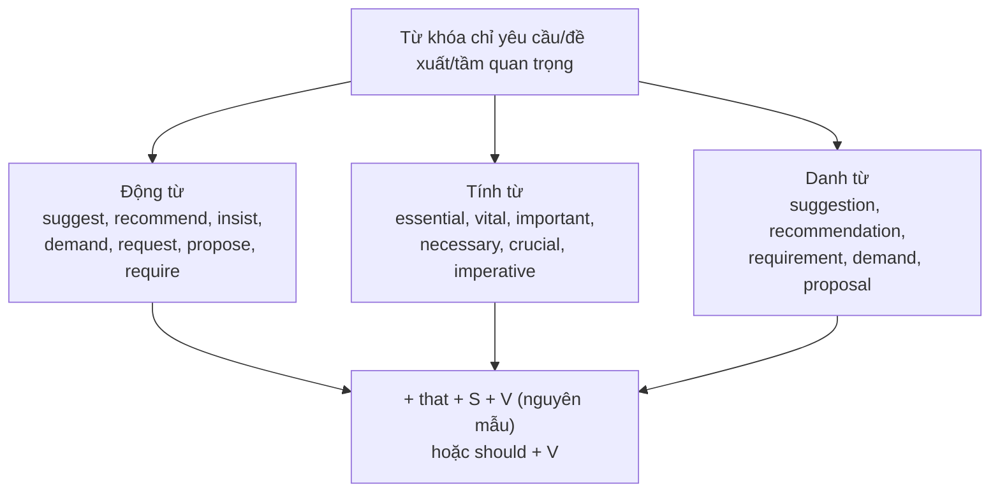

# B2-G015 · Subjunctive & Formal Recommendations — Thức giả định

## Mục lục

- [A. Lesson Information](#a-lesson-information)
- [B. Warm-up](#b-warm-up)
- [C. WHAT](#c-what)
- [D. WHY](#d-why)
- [E. FORM](#e-form)
- [F. HOW](#f-how)
- [G. VISUAL](#g-visual)
- [H. COMPARISON](#h-comparison)
- [I. COMMON MISTAKES](#i-common-mistakes)
- [J. MEMORY TRICKS](#j-memory-tricks)
- [K. REAL-LIFE APPLICATION](#k-real-life-application)
- [L. PRACTICE EXERCISES](#l-practice-exercises)
- [M. KNOWLEDGE CHECK](#m-knowledge-check)
- [N. ANSWER KEY](#n-answer-key)

---

## A. Lesson Information

| Mục | Nội dung |
|---|---|
| **Lesson ID** | B2-G015 |
| **Topic** | Mandative subjunctive after verbs (suggest, recommend, insist, demand, request, propose, require) and adjectives/nouns (essential, vital, important, necessary; the recommendation that...); should-alternative; fixed subjunctive expressions (be that as it may, God save..., so be it, if need be) |
| **Tên tiếng Việt** | Thức giả định sau động từ, tính từ, danh từ chỉ yêu cầu/đề xuất; các thành ngữ cố định |
| **CEFR Level** | B2 |
| **Prerequisites** | [B1-G021 — Verb Patterns](../../04-B1-INTERMEDIATE/grammar/B1-G021-verb-patterns.md), [B2-G006 — Advanced Reported Speech](B2-G006-advanced-reported-speech.md) |
| **Estimated Time** | 75 phút |

**Learning Objectives:**

1. Dùng **thức giả định** (động từ **nguyên mẫu không chia**) sau *suggest, recommend, insist, demand, request, propose, require, ask that...*
2. Dùng giả định sau **tính từ**: *It is essential / vital / important / necessary / crucial that...*
3. Dùng giả định sau **danh từ**: *the suggestion / recommendation / requirement / demand that...*
4. Dùng phương án ***should + V*** (phổ biến trong Anh–Anh).
5. Nhận biết **phủ định** (*that he **not** be...*) và **bị động** (*that it **be** done*).

---

## B. Warm-up

> *The doctor recommended that he **stop** smoking.*
> *It is essential that every student **be** on time.*

🤔 **Hãy suy nghĩ:** *He stop* và *every student be* — có phải lỗi chia động từ không? Vì sao không phải *he stops* hay *student is*?

---

## C. WHAT

**Thức giả định** (subjunctive) dùng **dạng nguyên mẫu không *to*** của động từ, **giống nhau cho mọi ngôi** — không thêm *-s*, không chia thì.

| Câu bình thường (chỉ sự thật) | Câu giả định (yêu cầu/đề xuất) |
|---|---|
| *He **stops** work at 5.* | *I suggest that he **stop** work at 5.* |
| *She **is** on time.* | *It's vital that she **be** on time.* |
| *They **don't** go.* | *We insisted that they **not go**.* |

Thức giả định dùng sau những từ mang nghĩa **đề nghị, yêu cầu, đòi hỏi, sự cần thiết**.

---

## D. WHY



Thức giả định phổ biến trong **văn bản trang trọng** — thư công việc, quy định, báo cáo, văn bản pháp lý — và rất phổ biến trong **tiếng Anh Mỹ**. Tiếng Anh Anh thường dùng ***should + V*** hoặc động từ chia bình thường trong văn thân mật. Bài thi B2 thường kiểm tra *suggest/recommend that...*.

---

## E. FORM

### E1. Sau động từ

```text
S + suggest / recommend / insist / demand / request / propose / require / ask / urge
  + that + S + V (nguyên mẫu)
```

| Ví dụ |
|---|
| *The teacher **suggested that** we **read** more English books.* |
| *They **demanded that** the manager **apologise**.* |
| *I **insist that** he **come** with us.* |

### E2. Sau tính từ

```text
It is + essential / vital / important / necessary / crucial / imperative / advisable
      + that + S + V (nguyên mẫu)
```

| Ví dụ |
|---|
| *It is **essential that** every passenger **wear** a seatbelt.* |
| *It's **important that** she **not be** told yet.* |

### E3. Sau danh từ

| Ví dụ |
|---|
| *The **recommendation that** the factory **be** closed was rejected.* |
| *We support the **proposal that** the meeting **take** place online.* |

### E4. Phủ định và bị động

| Dạng | Cấu trúc | Ví dụ |
|---|---|---|
| Phủ định | **not + V** (không có *do/does*) | *He suggested that we **not wait**.* |
| Bị động | **be + V3** | *They recommended that the road **be closed**.* |
| Với *be* | **be** (cho mọi ngôi) | *It's vital that you **be** honest.* |

### E5. Phương án *should* (Anh–Anh)

*The doctor recommended that he **should stop** smoking.* = *... that he **stop** smoking.*

> Trong văn nói thân mật Anh–Anh, người ta cũng dùng động từ chia bình thường: *I suggest that he **stops**...* Ở bài thi và văn trang trọng, **nguyên mẫu** hoặc ***should + V*** là lựa chọn an toàn.

### E6. Thành ngữ giả định cố định

| Cụm | Nghĩa |
|---|---|
| *Be that as it may* | Dù sao đi nữa |
| *So be it.* | Thì cứ vậy đi. |
| *If need be* | Nếu cần |
| *Long live...!* | ... muôn năm! |
| *God bless you / God save the King* | Chúa phù hộ... |
| *Come what may* | Dù có chuyện gì xảy ra |

---

## F. HOW

| # | English | Tiếng Việt | Phân tích |
|---|---|---|---|
| 1 | *The doctor **recommended that** she **rest** for a week.* | Bác sĩ khuyên cô ấy nghỉ một tuần. | recommend + giả định |
| 2 | *The committee **proposed that** the budget **be** increased.* | Ủy ban đề xuất tăng ngân sách. | Bị động giả định |
| 3 | *My parents **insisted that** I **study** medicine.* | Bố mẹ khăng khăng bắt tôi học y. | insist |
| 4 | *The customer **demanded that** the shop **refund** his money.* | Khách hàng đòi cửa hàng hoàn tiền. | demand |
| 5 | *It is **vital that** the patient **take** this medicine every day.* | Bệnh nhân bắt buộc phải uống thuốc này mỗi ngày. | Tính từ |
| 6 | *It's **important that** nobody **be** left behind.* | Điều quan trọng là không ai bị bỏ lại. | *be* giả định |
| 7 | *I **suggest that** we **not discuss** this in public.* | Tôi đề nghị chúng ta không bàn chuyện này nơi công cộng. | Phủ định |
| 8 | *The law **requires that** all drivers **carry** a licence.* | Luật yêu cầu tài xế mang theo bằng lái. | require |
| 9 | *Her **suggestion that** we **meet** online was accepted.* | Đề xuất họp trực tuyến của cô ấy được chấp nhận. | Danh từ |
| 10 | *The teacher **asked that** phones **be** switched off.* | Giáo viên yêu cầu tắt điện thoại. | ask that + bị động |
| 11 | *We'll work through the night **if need be**.* | Chúng tôi sẽ làm suốt đêm nếu cần. | Thành ngữ |
| 12 | *It's **essential that** he **should be** informed immediately.* | Cần thông báo cho anh ấy ngay lập tức. | Phương án *should* |

---

## G. VISUAL

### Giả định: "Động từ đứng yên"

```text
Câu thường:     He  works   /  She  is   /  They  don't go
                    ↓              ↓              ↓
Giả định:       He  work    /  She  be   /  They  not go
                (không -s)     (luôn be)     (không do)
```

---

## H. COMPARISON

### Ba cách nói với *suggest*

| Cấu trúc | Ví dụ | Văn phong |
|---|---|---|
| suggest + V-ing | *He suggested **taking** a break.* | Mọi văn phong |
| suggest that + S + V | *He suggested that we **take** a break.* | Trang trọng / Anh–Mỹ |
| suggest that + S + should + V | *He suggested that we **should take** a break.* | Anh–Anh |
| ❌ suggest + O + to V | ~~He suggested us to take a break.~~ | Sai |

### *insist* — hai nghĩa

| *insist that* + giả định (yêu cầu) | *insist that* + câu thường (khẳng định sự thật) |
|---|---|
| *She insisted that he **leave**.* (cô ấy đòi anh ta đi) | *She insisted that he **had left**.* (cô ấy khăng khăng rằng anh ta đã đi rồi) |

---

## I. COMMON MISTAKES

| # | ❌ Sai | ✅ Đúng | Nguyên nhân | Cách tránh |
|---|---|---|---|---|
| 1 | I suggest that he **goes** to the doctor. (bài thi) | I suggest that he **go** / **should go** ... | Chia theo ngôi | Giả định → nguyên mẫu |
| 2 | It's essential that she **is** here. | ... that she **be** here. | | *be* cho mọi ngôi |
| 3 | They recommended that we **don't** wait. | ... that we **not** wait. | Dùng *do* | *not + V* |
| 4 | He suggested **me to** apply. | He suggested **that I apply** / suggested **applying**. | | Không *suggest sb to* |
| 5 | The judge demanded that the man **to pay**. | ... that the man **pay**. | Thêm *to* | Không *to* |
| 6 | They proposed that the park **is built**. | ... that the park **be built**. | | Bị động: *be + V3* |

---

## J. MEMORY TRICKS

1. **"Lệnh — không chia"** 📜: Yêu cầu/đề xuất → động từ "đứng nghiêm", không *-s*, không *is*.
2. **"Not đứng một mình"**: phủ định giả định = *not + V*, không cần *don't*.
3. **"Không chắc → thêm should"**: Nếu quên giả định, dùng *should + V* — luôn đúng trong Anh–Anh.

---

## K. REAL-LIFE APPLICATION

### Biên bản kiến nghị của hội phụ huynh

> *Following the meeting on 10 October, the Parents' Association **recommends that** the school **take** the following steps:*
>
> *1. It is **essential that** every classroom **be** equipped with an air purifier before the dry season.*
> *2. We **request that** the canteen menu **include** at least one vegetarian option every day.*
> *3. Parents **propose that** homework for primary students **not exceed** 30 minutes per day.*
> *4. We **insist that** all school trips **be** approved by the Association in advance.*
>
> *We understand that some of these changes may be costly. **Be that as it may**, we believe they are necessary for our children's health and well-being.*

**Dịch tóm tắt:** Hội phụ huynh kiến nghị: mỗi lớp phải có máy lọc không khí; thực đơn có ít nhất một món chay mỗi ngày; bài tập cho tiểu học không quá 30 phút/ngày; mọi chuyến đi phải được Hội duyệt trước. Dù tốn kém, những thay đổi này cần thiết.

---

## L. PRACTICE EXERCISES

> ✍️ Đáp án: [B2-G015-ANSWERS](../../12-ANSWERS-AND-EXPLANATIONS/B2/B2-G015-ANSWERS.md)

### Level 1 — Recognition

**L1.1.** The doctor recommended that he ___ more water.  A. drinks  B. drink  C. to drink
**L1.2.** It is essential that everyone ___ on time.  A. is  B. be  C. are
**L1.3.** They suggested that we ___ the meeting.  A. not cancel  B. don't cancel  C. not to cancel
**L1.4.** The manager insisted that the report ___ by Friday.  A. is finished  B. be finished  C. finishes
**L1.5.** She suggested ___ to the beach.  A. us to go  B. going  C. to go
**L1.6.** Câu nào là **giả định**?  A. He insisted that he had seen the man.  B. He insisted that she see a doctor.

### Level 2 — Controlled Practice

Viết lại câu dùng thức giả định (that + S + V).

**L2.1.** "You should take a holiday," my boss said to me. (suggest)
**L2.2.** "All visitors must sign in at reception." (require — The rules...)
**L2.3.** "Refund my money immediately!" the customer said. (demand)
**L2.4.** "It would be a good idea to close the road during the festival." (recommend — The police...)
**L2.5.** "You must come to the party," Lan said to Mai. (insist)

Hoàn thành câu với dạng đúng của động từ.

**L2.6.** It's vital that the patient (not / eat) ___ anything before the operation.
**L2.7.** The teacher requested that all phones (switch off) ___. (bị động)
**L2.8.** It is important that he (be) ___ informed of the changes.
**L2.9.** Their proposal that the company (hire) ___ more staff was accepted.
**L2.10.** I suggest that she (apply) ___ for the scholarship.

### Level 3 — Error Correction

**L3.1.** The coach suggested that he trains every day.
**L3.2.** It's necessary that every student is present.
**L3.3.** She recommended that we don't eat street food.
**L3.4.** The judge demanded that the witness to tell the truth.
**L3.5.** He suggested me to call the police.
**L3.6.** The committee proposed that the building is demolished.

### Level 4 — Production

**L4.1.** Dịch: *"Bác sĩ đề nghị bà ấy nghỉ ngơi ít nhất hai tuần."*
**L4.2.** Dịch: *"Điều cốt yếu là mọi nhân viên phải tuân thủ quy định an toàn."*
**L4.3.** Dịch: *"Chúng tôi yêu cầu cuộc họp được hoãn lại."* (bị động)
**L4.4.** Dịch: *"Cô ấy đề nghị chúng tôi không nói với ai về chuyện này."*

**L4.5.** **Explain:** Giải thích vì sao trong câu *"It's essential that he be here"* không dùng *is*, và nêu một cách viết khác cũng đúng.

### Level 5 — Real Communication

**L5.1.** Viết **thư kiến nghị** 120–150 từ gửi ban quản lý khu chung cư/trường học/công ty (giả định) đề xuất 3–4 thay đổi. Dùng ≥ 3 động từ khác nhau + giả định, ≥ 2 tính từ + giả định, ≥ 1 danh từ + giả định, ≥ 1 phủ định giả định, ≥ 1 bị động giả định.
**L5.2.** **Speaking — Giving formal recommendations:** Bạn là cố vấn cho một bạn trẻ sắp đi du học. Nói 1,5 phút: *I'd recommend that you..., It's essential that you..., I'd suggest that you not...*

---

## M. KNOWLEDGE CHECK

### 5 câu hỏi tự kiểm tra

1. Thức giả định dùng dạng động từ nào?
2. Kể 5 động từ, 4 tính từ đi với giả định.
3. Phủ định và bị động của giả định?
4. Phương án thay thế trong Anh–Anh?
5. *insist that he leave* và *insist that he left* khác nhau thế nào?

### Checklist

- [ ] Tôi dùng nguyên mẫu (không *-s*) sau *suggest/recommend that*.
- [ ] Tôi dùng *be* cho mọi ngôi trong giả định.
- [ ] Tôi dùng *not + V* cho phủ định.

### 3 lỗi quan trọng cần nhớ

1. ~~suggest that he goes~~ (văn trang trọng) → that he **go**.
2. ~~essential that she is~~ → that she **be**.
3. ~~that we don't wait~~ → that we **not wait**.

### Lịch ôn tập

| Ngày | Việc cần làm |
|---|---|
| Ngày 1 | Làm lại L2 |
| Ngày 3 | Viết 5 lời khuyên trang trọng cho người mới học tiếng Anh |
| Ngày 7 | Ôn cùng [B2-G028 — Formal vs Informal](B2-G028-formal-informal.md) |

### Liên kết

- ➡️ Bài tiếp theo: [B2-G016 — Unreal Past: Would Rather, It's Time, As If](B2-G016-unreal-past-would-rather.md)

---

## N. ANSWER KEY

👉 [B2-G015-ANSWERS.md](../../12-ANSWERS-AND-EXPLANATIONS/B2/B2-G015-ANSWERS.md)
